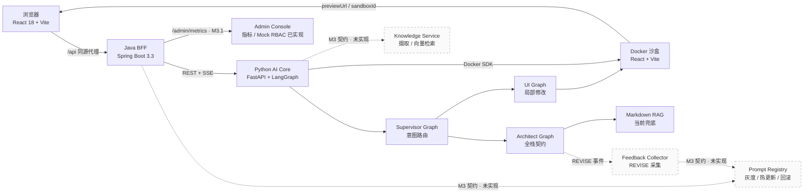

# vibe-platform 项目完成情况摘要

> 快照日期：2026-11-05  
> 当前提交：以 `git log -1 --oneline` 为准
> 结论：已完成 **可运行的单前端应用（React/Vite）Vibe Coding 闭环**，
> 并落地 Supervisor 多智能体路由、Architect 全栈契约与 both 强门控；
> 真正的全栈代码生成 / 多服务沙盒仍处于设计或预留阶段。

---

## 1. 一句话总结

用户可以在画布上圈选 React 页面元素、用自然语言提出修改，平台通过
**Supervisor 统一调度**把请求路由到 **局部 UI Graph** 或 **全局 Architect Graph**；
UI 修改在 Docker 沙盒中自动编码、构建、验证并生成 Git checkpoint，
架构请求则按应用形态完成多轮澄清并生成《全栈实施契约》。
当同时需要 UI 修改与全栈架构设计时，系统强制 **先确认契约、再执行 UI**，
避免两个子图乱序写沙盒。

---

## 2. 里程碑完成度

| 里程碑 | 状态 | 说明 |
|---|---|---|
| M1 前端闭环 | ✅ 已完成 | 圈选 → 标注 → Agent → Docker 沙盒 → 构建验证 → 预览 / Diff |
| M2 SSE + HITL | ✅ 已完成 | Run 事件流、`seq` / `afterSeq` 重放、澄清暂停、取消 Run |
| M3-A 审批与取消 | ✅ 已完成 | Diff 审批闸门、审批通过 / 拒绝、协作式取消 |
| M3-B CodeEditor 抽象 | ✅ 已完成（部分实现） | `CodeEditor` / `AnchorCodeEditor` / `FileCreator` / `TreeSitterEditor` 占位与 Registry |
| M2.5 Architect | ✅ 已完成 | 应用形态判别、动态澄清、Markdown + BM25 RAG、分级契约 |
| M2.5 Supervisor 路由 | ✅ 已完成 | 意图分类、AgentRegistry、UI / Architect / both / custom / rejected |
| M2.5 声明式 Manifest | ✅ 已完成 | 内置 Agent 由 `manifest.json` 启动扫描注册，替代硬编码 |
| M2.5 Skill 预留 | ✅ 已完成 | `SkillRegistry` 只声明不执行；Agent / Tool / Skill 边界入库 |
| M2.5 决策可视化 | ✅ 已完成 | 分析意图 → 判定结果 → both 双阶段时间轴 |
| M2.5 专属 Agent 演示 | ✅ 已完成 | Excel 报表 Manifest 自动注册、关键词路由、前端目录 |
| M2.5 前端 Supervisor 接入 | ✅ 已完成 | “发送 / 提交 / 下一步”统一走 route + dispatch，按 handoff 切换 UI |
| M2.5 both 强门控 | ✅ 已完成 | 项目锁、契约校验、幂等 release、乱序 409、自动中止 |
| M3 多格式导入 | ✅ 已完成 | React zip / HTML zip / 图片 → 沙盒 → 新 Tab + 预览 |
| M3 空白区域 ADD | ✅ 已完成 | 圈选几何判定新增意图，父容器归一化坐标，Agent 插入 JSX |
| M3 Tools / Skills / MCP | ✅ 已完成 | shell_tool 注册、tailwind_magic Skill、MCP 配置预留 |
| 稳定性：浮层卸载竞态 | ✅ 已完成 | AbortController + epoch 防呆 + 区域错误边界 + 关闭确认 |
| M3 数据中台契约 | 📐 设计完成 | 独立 Knowledge Service、摄取流水线、租户隔离检索、`KnowledgeRAGProvider` |
| M3 管理中台契约 | 📐 设计完成 | `/admin`、Agent 指标、Prompt Registry 版本/灰度/回滚、审计 |
| M3 反馈自优化契约 | 📐 设计完成 | `REVISE` 采集、聚类、候选 Prompt、离线评估、人工审批；**不做微调** |
| M3.1 管理中台骨架 | ✅ 已完成 | `/admin` 入口与路由守卫、`@IsAdmin` Mock RBAC、`GET /admin/metrics` 内存聚合、四卡 + Agent 占比 + 最近 10 次 Run |
| Eval Suite v0.1 | ✅ 已完成 | 10 条核心 YAML 用例、Supervisor 路由断言、Mock 代码断言、JSON / Markdown / JUnit 报告、Docker 包装 CLI |
| Eval Suite v0.2 | ✅ 已完成 | `scripts/run_eval.py` 真实 Docker 沙盒引擎：路由 + UI 子图执行 + 沙盒导出源码断言 + `docs/eval_report.md`；10/10 PASS |
| Admin Eval 契约 | 📐 契约预留 | `POST /api/v1/admin/eval/run`、评测详情 / 历史得分曲线；Eval 与 Knowledge“考题 / 教材”解耦 |
| M3.2-M3.4 中台实现 | ⏳ 未开始 | 知识中台 → Prompt Registry → 反馈自优化 |
| 全栈代码生成 | ⏳ 未开始 | 契约尚未驱动 Spring Boot / MySQL / 脚本生成 |
| 多服务沙盒 | ⏳ 未开始 | 当前只有单 React/Vite 沙盒 |
| 真实认证 / 多租户 | ⏳ 未开始 | 前端 Mock 登录，BFF 无 Spring Security |
| Redis 事件总线 / 持久化 | ⏳ 未开始 | 进程内事件缓冲 + `MemorySaver` |

---

## 3. 当前系统拓扑



| 层 | 技术栈 | 当前职责 |
|---|---|---|
| 前端 | React 18.3.1 + JavaScript/JSX + Vite 5.4.21 + 原生 CSS | 登录、多 Tab 工作台、画布圈选、迷你 Chatbox、预览、Diff、Architect 面板、Supervisor Toast |
| BFF | Java 21 + Spring Boot 3.3.5 | 公开 API、JSON / SSE 透传、长超时、错误映射 |
| AI Core | Python 3.12 + FastAPI 0.115.6 + LangGraph 0.2.62 | Supervisor、UI Graph、Architect Graph、RAG、Run 状态与事件 |
| 沙盒 | Docker + React/Vite 模板 | 代码写入、`npm run build` 验证、Git checkpoint、预览端口 |
| 数据 / 中间件 | MySQL / Redis / MinIO | 复用 `~/Workspace/infra`；BFF 尚未真正持久化业务数据 |

---

## 4. 已落地能力

### 4.1 前端工作台

- 登录页、Mock 鉴权、Token 本地存储、受保护路由。
- 多项目 Tab：切换、拖拽排序、最多 5 个、关闭即销毁沙盒。
- 对比模式 / 展示模式；画布与预览始终挂载，切换不重建 iframe。
- 固定 1280×720 设计视口，`cover` 等比填充，画布与 iframe 使用同一
  scale / offset。
- 画布圈选、世界坐标绑定、平移缩放不漂移、标注层 z-index 管理。
- 每个标注独立 `threadId` / `chatHistory`，支持单圈多轮增量修改。
- 修改 / 新增（`MODIFY` / `ADD`）两种标注动作。
- 最多 3 个标注，批量提交；输入不完整时禁止提交。
- 预览、代码 Diff、执行时间轴、Git commit 回滚。
- 设置弹窗：人工审批开关，默认关闭。
- 项目导出、代码编辑器入口。

### 4.2 UI Graph（局部修改）

- LangGraph 流程：
  `planner → coder → applier → verifier → evaluator`，失败最多自动修复 3 次。
- 支持 Mock / DeepSeek；Mock 可确定性解析颜色、文案、缩放、添加按钮等指令。
- 多标注合并为一次规划与写入。
- 构建验证通过后写入 Git checkpoint：
  `run: {runId} - turn: {turnCount}`。
- 支持按 thread 回滚到历史 turn，恢复源码与聊天上下文。
- 支持审批模式：
  - 关闭：验证通过直接成功；
  - 开启：进入 `AWAITING_APPROVAL`，用户批准后才提交。
- SSE 事件：`run.started` / `node.*` / `tool.*` / `clarification.required` /
  `approval.required` / `run.succeeded` / `run.failed` / `run.cancelled`。
- 协作式取消：运行中可请求取消，终端状态与事件保持一致。

### 4.3 Architect Graph（全局架构）

- 入口：工具栏“下一步：构建全栈方案”。
- 先判别应用形态：
  - `lightweight_web`
  - `script_automation`
  - `full_stack_system`
- 按形态动态追问：
  - 轻量工具不追问后端 / 数据库；
  - 脚本不追问 UI；
  - 全栈才要求技术栈、数据库、业务动作、数据实体。
- RAG：`knowledge/fullstack` Markdown + BM25，契约带知识库引用。
- 置信度阈值默认 85%，不足则继续澄清，最多 5 轮。
- 生成分级《全栈实施契约》：
  - 概览、技术栈、关键假设、知识库依据；
  - API 路由、数据库 DDL、前端设计、实施路径、Markdown 原文。
- 用户可 `CONFIRM / REVISE / CANCEL`。
- SSE 独立命名空间：`architect.*`，与 UI Run 完全解耦。

### 4.4 Supervisor 多智能体路由

- `Supervisor Graph` 只做意图分类、Agent 解析与 Handoff，不写代码。
- 路由优先级：
  1. 显式 `targetAgent`
  2. 显式 `scopeHint`
  3. UI + 架构关键词 → both
  4. 架构关键词 → Architect
  5. 标注 / UI 关键词 → UI
  6. 无信号 → rejected
- `AgentRegistry` 启动扫描 `ai_core/*/manifest.json`，注册内置、预留与企业 CustomAgent：
  - `ui_graph`：可用（`agent/manifest.json`）
  - `architect_graph`：可用（`architect/manifest.json`）
  - `backend_coder`：预留（`backend_coder/manifest.json`，无 Graph）
  - `script_agent`：预留（`script_agent/manifest.json`，无 Graph）
  - CustomAgent：受限 JSON Manifest，当前仅路由计划
- `SkillRegistry` 汇总 Manifest 中的 Skill 声明（M3 才动态拼装 Prompt / RAG / Tool）。
- Memory 当前仅 LangGraph 线程级短期记忆；长期记忆与 MCP Client Adapter 留待 M3。
- `decision.handoff` 直接驱动前端：
  - `handoff_ui`
  - `handoff_architect`
  - `handoff_both`
  - `handoff_custom`
  - `rejected`
- `route` 只返回计划；`dispatch` 才启动真实子图并返回独立 SSE 路径。
- 前端不再硬编码 `/runs/stream` 或 `/architect/runs/stream`。
- 决策可视化：发送后显示“正在分析意图”，route 返回后显示判定与理由；
  both 模式显示「架构澄清 → 前端修改」双阶段时间轴。
- 「我的专属 Agent」目录展示 Manifest Agent；演示 Agent
  `excel_report_agent`（Excel 报表专家）命中“销售数据”等关键词后返回
  `handoff_custom`，只路由不执行。

### 4.5 both 强门控

- `handoff_both` 时：
  1. 预留项目锁；
  2. 只启动 Architect；
  3. 创建 gate（`AWAITING_CONTRACT`）；
  4. 保存原始请求，UI 暂不启动。
- 前端展示“正在进行全局架构设计，请先确认契约”，
  提交按钮与画布操作冻结。
- 契约 `CONFIRMED` 后：
  - 前端自动调用 `POST /supervisor/gates/{gateId}/release`；
  - 服务端校验契约；
  - 使用 gate 保存的原始请求启动 UI Graph；
  - 返回 UI Run 与 SSE 路径；
  - 前端 attach，不重复创建 Run / 沙盒。
- 并发与乱序保护：
  - 契约未确认 → 409 `SUPERVISOR_CONTRACT_NOT_CONFIRMED`
  - 同项目已有 active gate → 409 `SUPERVISOR_PROJECT_GATE_ACTIVE`
  - 并发 release → 409 `SUPERVISOR_GATE_RELEASING`
  - Architect 取消 / 失败 / 丢失 → gate `FAILED` 并释放项目锁
  - 重复 release → 200，返回同一个 UI Run
- **当前边界**：gate 为单进程内存实现；多副本部署需替换为
  Redis / MySQL 分布式锁，API 契约不变。

### 4.6 沙盒 / Editor

- Docker 沙盒模板：Node 20 + React 18 + Vite 5。
- `cap_drop=ALL`、`no-new-privileges`、CPU / 内存限制、预览端口仅绑定回环。
- 沙盒创建即 `git init` 并生成 baseline commit。
- 每次成功 Run 自动 commit，支持按 thread 回滚。
- Editor 抽象：
  - `FileCreator`：新增文件，拒绝绝对路径 / `..` / 盘符。
  - `AnchorCodeEditor`：锚点替换。
  - `TreeSitterEditor`：占位，尚未接入依赖。
  - `EditorRegistry`：按编辑类型选择实现。
- Mock 与 Coder 的 files 模式已接入；旧 patch 模式保留兼容。

### 4.7 项目导入与扩展点

- 导入 React zip：解压、`npm install`、构建校验，失败返回结构化错误。
- 导入 HTML zip：直接启动内置静态服务器，支持 SPA fallback。
- 导入图片：多模态模型生成 React 代码；无视觉 Key 时输出确定性占位页。
- 圈选空白区域自动判定 `ADD`：最近 `data-source` 父容器 + 父容器归一化坐标。
- `shell_tool` 已接入 LangGraph `ToolNode`，默认关闭且仅允许只读白名单命令。
- `config/skills/` 外部 Skill 挂载到 `ui_graph`（`tailwind_magic`）。
- `MCP_SERVERS` 配置与官方 `mcp` SDK 挂载示例已预留。

### 4.8 项目与导出

- 多项目本地持久化、项目切换、新建项目。
- 项目导出为可运行 React/Vite 工程。
- 预览 iframe、构建产物与 Git 提交状态可查看。

### 4.9 自动化评测（Eval Suite）

- `config/eval_suite/core_cases.yaml`：10 条核心用例，覆盖 UI 改色 / 文案 /
  缩放 / 新增、双标注批量、Architect、both、CustomAgent、缺标注守卫与未知意图。
- `services/orchestrator/eval_suite/`：Loader 严格校验 → 真实 `SupervisorService`
  路由 → `MockAgentLLM` 确定性代码生成 → 断言 → 报告；不启动业务服务与沙盒。
- `./scripts/eval_suite.sh run`：复用 `python-ai` 镜像一次性容器执行，输出
  `reports/eval/` 下的 JSON / Markdown / JUnit；失败时逐条打印期望值与实际值。
- `scripts/run_eval.py`：宿主机直连 BFF / AI Core，逐条走 Supervisor 路由；
  有代码断言的用例启动真实 Docker 沙盒，完成构建与预览后从沙盒导出包读取
  `src/App.jsx`，用正则断言并写入 `docs/eval_report.md`。
- 每条用例使用独立 `projectId + threadId`，避免历史会话快照污染；`finally`
  删除沙盒，报告包含成功数、失败数、通过率、耗时与清理统计。
- Eval 与 Knowledge 解耦：评测集是“考题”，知识库是“教材”；考题不写教材、
  不被 RAG 检索，涉及知识库的评测需固定 `knowledgeSnapshotId`。
- 管理中台预留 `POST /api/v1/admin/eval/run` 与历史得分曲线契约，后续一键触发。
- 单测覆盖加载器错误、断言失败、报告写出；与真实沙盒 / DeepSeek E2E 互补。

---

## 5. 对外 API 概览

### 5.1 Java BFF 公开 API

| 前缀 | 能力 |
|---|---|
| `GET /api/v1/health` | 健康检查 |
| `POST /api/v1/runs` | 非流式执行（兼容） |
| `POST /api/v1/runs/stream` | 直接启动 UI Run（保留兼容） |
| `GET /api/v1/runs/{runId}` | Run 快照 |
| `GET /api/v1/runs/{runId}/events/stream` | UI Run SSE |
| `POST /api/v1/runs/{runId}/cancel` | 取消 Run |
| `GET /api/v1/runs/{runId}/clarifications` | 查询澄清 |
| `POST /api/v1/runs/{runId}/clarifications/{id}/answers` | 提交澄清 |
| `GET /api/v1/runs/{runId}/approvals` | 查询审批 |
| `POST /api/v1/runs/{runId}/approvals/{id}/decision` | 审批决策 |
| `POST /api/v1/runs/{runId}/rollback` | Git 回滚 |
| `GET /api/v1/runs/{runId}/export` | 导出 Run 工程 |
| `POST /api/v1/architect/runs/stream` | 启动 Architect |
| `GET /api/v1/architect/runs/{runId}/events/stream` | Architect SSE |
| `POST /api/v1/architect/runs/{runId}/clarifications/{id}/answers` | Architect 澄清 |
| `POST /api/v1/architect/runs/{runId}/contracts/{id}/decision` | 契约决策 |
| `POST /api/v1/architect/runs/{runId}/cancel` | 取消 Architect |
| `POST /api/v1/supervisor/route` | Supervisor 路由 |
| `POST /api/v1/supervisor/dispatch` | Supervisor 派发 |
| `GET /api/v1/supervisor/agents` | Agent 列表 |
| `POST /api/v1/supervisor/agents/reload` | 重载 CustomAgent |
| `GET /api/v1/supervisor/gates/{gateId}` | 查询门控 |
| `POST /api/v1/supervisor/gates/{gateId}/release` | 释放门控 |
| `DELETE /api/v1/sandboxes/{sandboxId}` | 销毁沙盒 |
| `GET /api/v1/admin/metrics` | 管理中台指标（`@IsAdmin`，M3.1 已实现） |
| `POST /api/v1/admin/eval/run` | 一键评测（契约预留，尚未注册路由） |

> 前端主链路已统一走 Supervisor；直接 Run / Architect API 仍保留，供
> 内部调试、兼容与未来其它入口使用。

---

## 6. 已验证情况

| 类型 | 结果 |
|---|---|
| Python 单元测试 | **81 passed**（含 Eval Suite 9 项） |
| Eval Suite 离线跑批 | **PASS**（10/10，约 40 ms） |
| Eval Suite 真实沙盒跑批 | **PASS**（10/10，35.72s，创建 / 清理沙盒各 6 个） |
| Supervisor API E2E（直连 AI Core） | **PASS** |
| Supervisor API E2E（经 Java BFF） | **PASS** |
| both 混合 API E2E（直连 / BFF） | **PASS** |
| 浏览器级 both 混合 E2E | **PASS** |
| 前端生产构建 | **PASS**（329.40 kB JS / 78.32 kB CSS） |

浏览器级 `scripts/supervisor_mixed_ui_e2e_test.py` 覆盖：

1. 圈选 CTA 并填写 UI 修改指令；
2. 点击“下一步”只调用 `supervisor/route` + `dispatch`；
3. 门控期间 Architect 面板打开、提交冻结、沙盒为空；
4. 完成全栈澄清并 `CONFIRM` 契约；
5. 自动 release，gate 变为 `RELEASED`；
6. UI Graph 真实执行成功，返回 `sandboxId`；
7. `dispatch=1 / release=1`，无重复 Run / 沙盒；
8. 测试结束销毁沙盒。

API 级 both E2E 还覆盖：

- 早释放 409；
- 同项目并发派发 409；
- 取消 Architect → gate `FAILED`；
- 重复 release 幂等返回同一 UI Run。

---

## 7. 当前未完成 / 已知差距

| 能力 | 当前状态 | 差距 |
|---|---|---|
| 全栈代码生成 | 只有契约 | 尚未生成 Spring Boot / MySQL / 迁移脚本 |
| 多服务沙盒 | 单 React/Vite 沙盒 | web / api / db / edge 未实现 |
| BackendCoder / DBA / ScriptAgent | 仅注册为 reserved | 无运行时、无编排 |
| CustomAgent 运行时 | 只有 Manifest 与路由计划 | 需独立受限沙盒 / 临时 venv |
| Skill 动态拼装 | `SkillRegistry` 只登记声明 | M3 才注入 Prompt / RAG、裁剪 Tool |
| 长期记忆 / 用户画像 | 仅线程级短期记忆 | 规划在 M3，当前刻意不引入 |
| MCP Client Adapter | 架构图虚线框 | M2.5 不引入依赖、不建立连接 |
| Redis 事件总线 | 进程内 `RunEventBuffer` | 重启丢失、无法多副本 |
| LangGraph checkpoint | `MemorySaver` | 重启丢失中断状态 |
| BFF 持久化 | 无数据库访问层 | 用户 / 项目 / Run 仍主要在前端或 Python 内存 |
| 真实认证 | 前端 Mock Token | 无 Spring Security / JWT / RBAC |
| RAG | Markdown + BM25 | 无向量库；`chroma.py` 为占位；`RAGProvider` 尚无 `tenant_id` |
| Knowledge Service | 仅契约 | 文档摄取 / Embedding / Qdrant / 租户隔离检索未实现 |
| Admin / Prompt Registry | 部分实现 | `/admin`、Mock RBAC、内存指标已落地；Prompt 版本 / 灰度 / 热更新 / 回滚未实现 |
| Feedback / 自优化 | 仅契约 | REVISE 采集、聚类、候选 Prompt、评估、审批未实现；无微调链路 |
| Tree-sitter 编辑 | 占位类 | 未安装依赖、未实现结构化替换 |
| OpenAPI / Schema 代码生成 | 手写 DTO | `packages/protocol` 仅 README |
| 配额 / 审计 / 管理后台 | 无 | 未实现 |
| Eval Suite 覆盖边界 | 离线 + 真实沙盒双引擎 | 真实沙盒仍用 Mock LLM；DeepSeek 评测、历史趋势基线、Admin 一键评测未实现 |
| 沙盒隔离强度 | 普通 Docker | 未使用 gVisor / Firecracker / K8s |
| 门控多副本 | 单进程内存 | 需 Redis / MySQL 分布式锁 |

---

## 8. 建议下一步

### P0：把契约变成真实全栈产物

1. 增加 `BackendCoder`：根据《全栈实施契约》生成 Spring Boot 工程、
   Controller / Service / Repository、配置与测试。
2. 增加 `DbaAgent`：根据契约 DDL 生成 Flyway / SQL 迁移，并在临时 MySQL
   中执行 up / down 验证。
3. 扩展沙盒为多服务：`web + api + db`，通过统一 edge 入口预览与联调。
4. 把 Architect `CONFIRMED` 契约作为后续 Agent 的唯一输入，禁止重新猜测业务模型。

### P1：运行时与可靠性

1. `MemorySaver` → Redis checkpointer，保证重启后可恢复澄清 / 审批。
2. 进程内事件缓冲 → Redis Stream，保留 `seq` / `afterSeq` 语义。
3. gate 注册表 → Redis / MySQL 分布式锁，支持多副本。
4. BFF 接入 MySQL，落地用户、项目、Run 元数据与配额。

### P2：平台化

1. `CustomAgent` 独立受限沙盒运行时：非 root、临时 venv、只读 Prompt/RAG、
   无宿主网络与密钥、资源配额、结构化 `AgentResult`。
2. 真实认证、租户隔离、审计与配额。
3. Tree-sitter 结构化编辑、OpenAPI 代码生成。
4. Agent 市场。
5. Eval Suite 扩展 DeepSeek 评测与历史基线；落地管理中台一键评测
   `POST /api/v1/admin/eval/run` 与得分曲线。

### P3：Agent OS 中台（M3，M3.1 已落地）

1. ~~**M3.1 管理中台骨架**~~ ✅：`/admin`、Mock RBAC、Agent 指标聚合已实现；
   审计与真实 JWT 仍待接入。
2. **M3.2 知识中台**：Knowledge Service 摄取流水线、Qdrant、租户隔离检索；
   `RAGProvider` 升级为强制 `tenant_id`，生产切换 `KnowledgeRAGProvider`。
3. **M3.3 Prompt Registry**：不可变版本、校验、灰度、热更新、回滚、Diff。
4. **M3.4 反馈与自优化**：Feedback Collector、聚类、候选 Prompt、离线评估、
   人工审批与灰度回滚；**不做微调**。

---

## 9. 关键文档

| 文档 | 内容 |
|---|---|
| `TECH_STACK.md` | 当前实际技术栈事实清单 |
| `docs/design/02.整体架构设计.md` | 目标架构与演进路线 |
| `docs/design/03.API接口设计.md` | 公共 / 内部 API 契约 |
| `docs/design/04.M2_Agent_ToolCalling_SSE_HITL.md` | SSE、HITL、执行层 |
| `docs/design/05.Supervisor_Multi_Agent.md` | Supervisor、声明式 Manifest、SkillRegistry、Memory / MCP 边界、both 强门控、CustomAgent 沙盒隔离 |
| `docs/design/06.Agent_OS_Data_Management.md` | M3 数据中台 / 管理中台 / 反馈自优化契约（设计） |
| `docs/design/07.Eval_Suite.md` | Eval Suite 评测集契约、离线 / 真实沙盒执行器、断言、报告、CI 与 Admin 联动 |
| `config/eval_suite/README.md` | 核心评测集使用说明与新增用例流程 |
| `docs/memory/00_project_brief.md` | 项目简报与里程碑 |
| `docs/memory/2026-11-05_M2_5_supervisor_frontend_gate.md` | 前端统一调度与 both 强门控实现记录 |
| `docs/memory/2026-11-05_M2_5_agent_manifest_skill.md` | 声明式 Manifest、Skill 预留与边界 |
| `docs/memory/2026-11-05_M2_5_demo_visualization_custom_agent.md` | 决策可视化与专属 Agent 演示 |
| `docs/DEMO_3_MIN.md` | 3 分钟面试演示脚本 |

---

## 10. 本地验证入口

```bash
# 启动平台三服务（中间件已在 ~/Workspace/infra 运行）
docker compose up -d

# Eval Suite 离线跑批（不需要启动任何业务服务）
./scripts/eval_suite.sh run
./scripts/eval_suite.sh list

# Eval Suite 真实沙盒跑批（需 BFF / AI Core / Docker 已启动）
python scripts/run_eval.py
python scripts/run_eval.py --filter case_001 --verbose

# Python 单元测试（在 AI 镜像内运行，挂载当前仓库）
docker run --rm -v "$PWD":/repo -w /repo/services/orchestrator \
  -e PYTHONPATH=/repo/services/orchestrator \
  vibe-platform/python-ai:dev python -m unittest discover -s tests -v

# Supervisor 路由 / 派发 API E2E
python3 scripts/supervisor_e2e_test.py
AI_BASE_URL=http://127.0.0.1:8080 python3 scripts/supervisor_e2e_test.py

# both 混合场景 API E2E
python3 scripts/supervisor_both_e2e_test.py
AI_BASE_URL=http://127.0.0.1:8080 python3 scripts/supervisor_both_e2e_test.py

# 浏览器级 UI + 架构澄清混合 E2E（含决策时间轴）
/tmp/vibe-browser/bin/python scripts/supervisor_mixed_ui_e2e_test.py

# 浏览器级专属 Agent 秒级接入 E2E
/tmp/vibe-browser/bin/python scripts/custom_agent_e2e_test.py

# 前端生产构建
docker exec vibe-platform-web npx vite build \
  --outDir /tmp/vibe-web-dist --emptyOutDir
```

---

## 11. 总体评价

平台已经具备一个 **可演示、可回归、可继续扩展的 Vibe Coding 内核**：

- 前端交互闭环完整；
- 局部 UI 修改链路真实可执行；
- Architect 契约能力完整；
- Supervisor 路由与 both 门控具备生产级并发语义；
- 测试覆盖从单元、API 到浏览器级 E2E。

距离“生成完整全栈应用”的主要缺口不在交互层，而在 **契约驱动的后端 / 数据库
生成、多服务沙盒、持久化与分布式运行时**。这些能力可以在不改动现有前端协议和
Supervisor 路由契约的前提下逐步接入。
