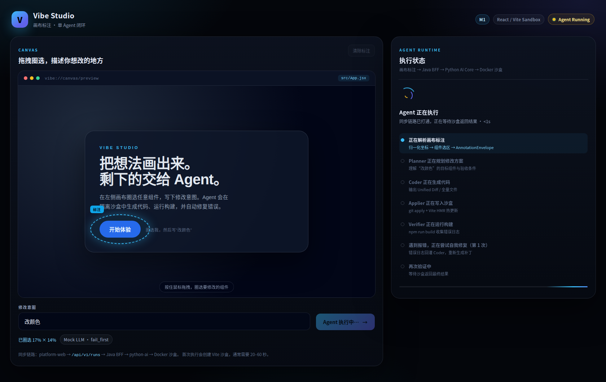
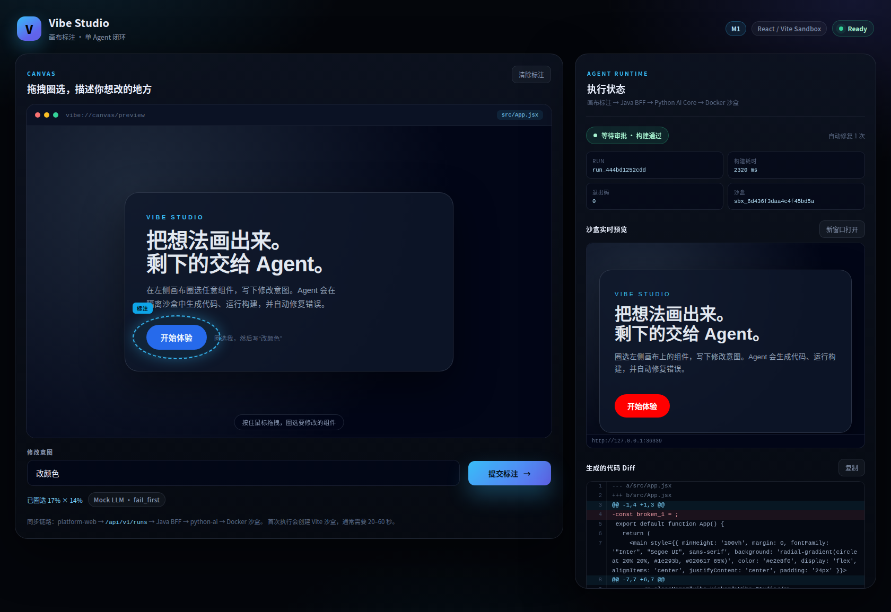

# vibe-platform

以前端可视化为抓手、多轮交互生成完整全栈应用的 Vibe Coding 平台。

当前阶段：**M1 完成**。画布标注 → Java BFF → Python AI Core → LangGraph 单 Agent
→ Docker 沙盒 → 构建验证 / 自动修复 → 预览与 Diff 展示，全链路已打通。

## 目录

```text
apps/platform-web/                    React 18 + Vite 画布（标注 / 执行状态 / 预览 / Diff）
apps/platform-bff/                    Java 21 + Spring Boot 3.3 BFF
services/orchestrator/                Python 3.12 + FastAPI + LangGraph AI Core
services/orchestrator/ai_core/        Sandbox / Agent / API
services/orchestrator/sandbox_template/ React + Vite 沙盒基础镜像
infra/migrations/schema.sql           M1 初始 MySQL schema（无物理外键）
scripts/init-db.sh                    应用 schema 到已有 Docker MySQL
scripts/smoke-test.sh                 验证 Java -> Python 跨语言调用
scripts/sandbox_e2e_test.py           沙盒创建/补丁/构建校验/销毁 E2E
scripts/agent_e2e_test.py             Agent 闭环 E2E（Mock LLM）
scripts/platform_e2e_test.py          全链路 E2E（Vite 代理 → BFF → AI Core → 沙盒）
scripts/ui_e2e_test.py                浏览器 E2E（Playwright：圈选 / Loading / 预览 / Diff）
docs/screenshots/                     M1 联调截图
docker-compose.yml                    只编排平台自身服务
```

## 前置条件

- Docker / Docker Compose
- 宿主机已有 `~/Workspace/infra` 提供的 MySQL 3306、Redis 6379、MinIO 9000/9001
- 本文档不启动、不重复部署上述中间件

## 启动

```bash
cp .env.example .env        # 首次执行；按需修改
./scripts/init-db.sh        # 首次执行；创建 users/projects/runs
docker compose up --build -d
docker compose ps
```

服务端口：

| 服务 | 宿主端口 | 容器内地址 |
|---|---|---|
| platform-web | 5173 | `http://platform-web:5173` |
| java-bff | 8080 | `http://java-bff:8080` |
| python-ai | 8100 | `http://python-ai:8100` |

打开 <http://127.0.0.1:5173> 即可使用画布。浏览器只请求同源 `/api`，由 Vite
代理到 `java-bff`；三个服务都加入 `vibe-platform-net`，Java 通过服务名
`http://python-ai:8100` 调用 Python。

```text
Browser ──/api──▶ platform-web(Vite proxy) ──▶ java-bff ──▶ python-ai ──▶ Docker sandbox
                     :5173                       :8080          :8100         127.0.0.1:<random>
```

## 画布全链路（M1）

1. 在画布上按住鼠标拖拽，圈选「开始体验」按钮。
2. 输入修改意图（默认「改颜色」），点击 **提交标注**。
3. 前端组装 `AnnotationEnvelope`，POST `/api/v1/runs`。
4. Java BFF 同步代理到 `POST /api/v1/internal/runs/execute`（长读超时 300s）。
5. Python 创建 React + Vite 沙盒，执行 LangGraph：

```text
planner -> coder -> applier -> verifier -> evaluator
                        ^                       |
                        +---- retry (<= 3) <-----+
                                                +-- success -> awaiting_approval
                                                +-- exhausted -> failed
```

6. 前端「Agent 执行状态」面板展示阶段动画；成功后展示 `previewUrl` iframe
   与右侧 `generatedPatch` Diff。

Mock LLM 默认 `fail_first`：首次生成故意包含语法错误，Verifier 捕获日志后
自动修复 1 次，最终返回 `AWAITING_APPROVAL`，方便稳定复现完整闭环。





platform-web 在 Compose 中挂载 `./apps/platform-web:/app`（`node_modules`
使用匿名卷），修改前端源码后由 Vite HMR 即时生效，无需重建镜像。

## 验证

### 1. 全链路 E2E（推荐）

```bash
python3 scripts/platform_e2e_test.py
```

覆盖：三个服务健康检查 → Vite `/api` 代理 → 画布同款请求体 → Java BFF →
Python Agent → 沙盒创建 → 首次构建失败 → 自动修复 → 预览页与 `/src/App.jsx`
包含红色样式 → 清理沙盒。

### 2. 浏览器 UI E2E（Playwright）

```bash
pip install playwright
playwright install chromium
python3 scripts/ui_e2e_test.py
```

真实浏览器中圈选按钮 → 提交标注 → 截取 Loading 面板 → 等待
`AWAITING_APPROVAL` → 校验 iframe 内按钮 `rgb(255, 0, 0)` → 截取结果图 →
清理沙盒。截图输出到 `docs/screenshots/`。

### 3. 分层验证

```bash
python3 scripts/sandbox_e2e_test.py   # 沙盒生命周期 / 补丁 / 构建
python3 scripts/agent_e2e_test.py     # Agent 闭环 / 3 次上限 / FULLSTACK 拒绝
./scripts/smoke-test.sh               # Java -> Python 健康检查
```

### 4. 手动调用

```bash
curl -s http://127.0.0.1:5173/api/v1/health | python3 -m json.tool
curl -s http://127.0.0.1:8080/api/v1/health | python3 -m json.tool
curl -s http://127.0.0.1:8100/api/v1/health | python3 -m json.tool
```

`java-bff` 的 `dependencies.pythonAi.status=UP` 即证明跨语言调用成功；Python
不可达时 Java 返回 503 + `DEGRADED`，不会抛出 500。

## Java BFF Run API

| 方法 | 路径 | 说明 |
|---|---|---|
| POST | `/api/v1/runs` | 接收画布标注，同步代理 AI Core 执行 |

BFF 只校验 `projectId` / `annotation` 存在，`annotation` 与 `options` 以
`JsonNode` 透传，契约单一真源在 Python `agent/schemas.py`。AI Core 的 HTTP
状态与 JSON 原样返回：业务失败（重试耗尽）是 `200 + status=FAILED`，参数 /
沙盒错误是 4xx/5xx。

> AI Core 客户端强制 HTTP/1.1。JDK HttpClient 默认尝试 h2c Upgrade，Uvicorn
> 不支持升级，POST 请求体会丢失（表现为 FastAPI 422 missing body）。

## 沙盒（Sandbox）

`python-ai` 通过挂载的 `/var/run/docker.sock` 调用宿主 Docker，为每个项目创建
独立的 React + Vite 容器。容器限制：`cap_drop=ALL`、`no-new-privileges`、
内存 / CPU / PID 限额，预览端口只绑定 `127.0.0.1`。

| 方法 | 路径 | 说明 |
|---|---|---|
| POST | `/api/v1/internal/sandbox/create` | 创建容器，写入初始文件，返回预览 URL |
| POST | `/api/v1/internal/sandbox/apply-patch` | 全量文件 / unified diff，触发 Vite HMR |
| GET | `/api/v1/internal/sandbox/verify?sandbox_id=...&check=build` | 执行 `npm run build` / `npm run test` |
| DELETE | `/api/v1/internal/sandbox/{sandboxId}` | 强制销毁容器 |

沙盒镜像 `vibe-platform/sandbox-react:dev` 首次使用时自动构建（依赖已预热，
单次创建约 1~3 秒）。Dockerfile 已配置 `registry.npmmirror.com`，依赖层与
源码层分离以利用 Docker 缓存。

> 安全提示：挂载 Docker Socket 等价于授予 python-ai 宿主 root 权限，仅限本地
> 开发与受信任环境。生产环境必须替换为独立沙盒节点 + gVisor，业务容器不得
> 直接挂载 Docker Socket。
>
> 若容器内无权限访问 Socket，执行
> `stat -c '%g' /var/run/docker.sock` 获取 GID，并写入 `.env` 的 `DOCKER_GID`。

## Agent 闭环（M1）

`POST /api/v1/internal/runs/execute` 接收画布 `AnnotationEnvelope`，创建沙盒并
同步执行 LangGraph：

- `applier` 直接复用 `SandboxProvider`（与沙盒 `apply-patch` API 同一实现），
  避免内部 HTTP 自调用。
- `verifier` 执行 `npm run build`，失败日志写入状态并由 `coder` 重试；
  `retry_count` 硬上限为 3，预算耗尽返回 `FAILED`。
- 模型选择：`llmProvider=auto` 时，有 `DEEPSEEK_API_KEY` 用 DeepSeek，
  否则用 Mock；也可显式指定 `mock` / `deepseek`。
- Mock 场景：`fail_first`（首次写错，验证自动修复）、`always_fail`
  （验证 3 次上限）、`none`（直接成功）。

最小请求：

```json
{
  "runId": "run_01",
  "projectId": "proj_01",
  "annotation": {
    "version": 1,
    "annotationId": "ann_01",
    "type": "note",
    "target": {
      "mode": "source",
      "source": { "file": "src/App.jsx" }
    },
    "intent": {
      "kind": "UI_ONLY",
      "ui": { "summary": "将按钮改为红色" }
    },
    "payload": { "text": "将按钮改为红色" }
  },
  "files": { "src/App.jsx": "export default function App() { ... }" },
  "options": {
    "llmProvider": "mock",
    "mockScenario": "fail_first",
    "maxRetries": 3,
    "keepSandbox": true
  }
}
```

> M1 的 execute 是同步接口，便于后台联调；M2 将改为 202 + checkpoint + 事件流。

## 数据库

```bash
# 查看表
docker exec -it geo-mysql mysql -uroot -proot -e "USE geo_ai_db; SHOW TABLES;"

# 确认没有物理外键
docker exec -it geo-mysql mysql -uroot -proot -N -e \
  "SELECT COUNT(*) FROM information_schema.REFERENTIAL_CONSTRAINTS WHERE CONSTRAINT_SCHEMA='geo_ai_db';"
```

预期外键数量为 `0`。

## 停止

```bash
docker compose down
```

不删除外部中间件，也不删除 MySQL 中的业务表。
