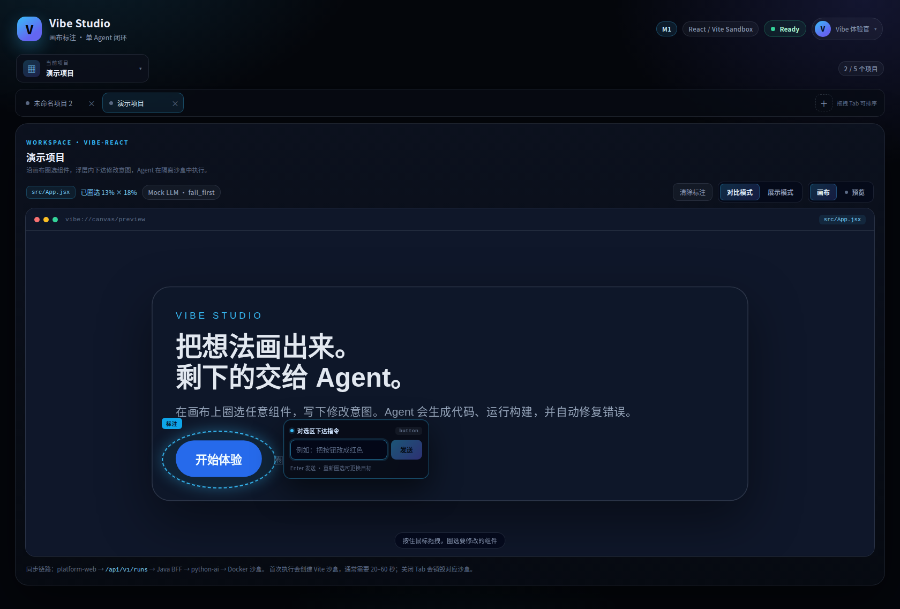
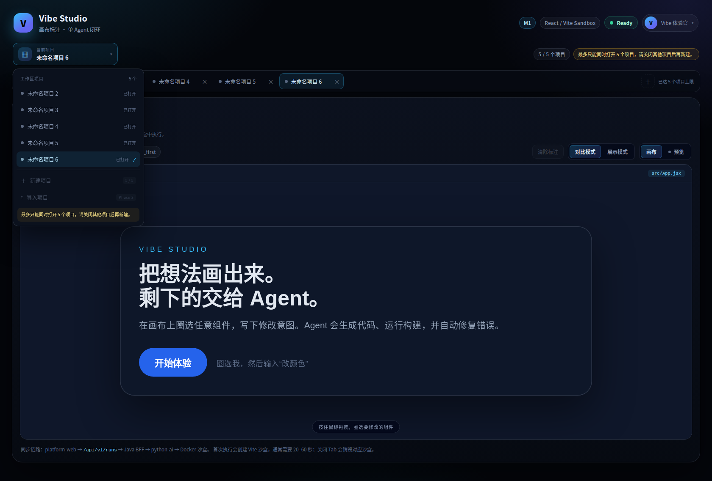

# vibe-platform

以前端可视化为抓手、多轮交互生成完整全栈应用的 Vibe Coding 平台。

当前阶段：**M1 完成 · Phase 4 双视图与等比预览**。画布标注 → Java BFF →
Python AI Core → LangGraph 单 Agent → Docker 沙盒 → 构建验证 / 自动修复 →
项目内预览与 Diff，全链路已打通；工作台支持对比/展示两种布局、无缝缩放
预览、多项目 Tab、5 Tab 上限、关闭即销毁沙盒与拖拽排序。

## 目录

```text
apps/platform-web/                    React 18 + Vite（登录 / 多 Tab 工作台 / 画布浮层 / 预览 / Diff）
apps/platform-bff/                    Java 21 + Spring Boot 3.3 BFF
services/orchestrator/                Python 3.12 + FastAPI + LangGraph AI Core
services/orchestrator/ai_core/        Sandbox / Agent / API
services/orchestrator/sandbox_template/ React + Vite 沙盒基础镜像
infra/migrations/schema.sql           M1 初始 MySQL schema（无物理外键）
scripts/init-db.sh                    应用 schema 到已有 Docker MySQL
scripts/smoke-test.sh                 验证 Java -> Python 跨语言调用
scripts/sandbox_e2e_test.py           沙盒创建/补丁/构建校验/销毁 E2E
scripts/agent_e2e_test.py             Agent 闭环 E2E（Mock LLM）
scripts/platform_e2e_test.py          全链路 E2E（Vite 代理 → BFF → AI Core → 沙盒）
scripts/ui_e2e_test.py                浏览器 E2E（Playwright：双视图 / 缩放预览 / 沙盒销毁 / Tab 上限）
docs/screenshots/                     M1 联调截图
docker-compose.yml                    只编排平台自身服务
```

## 前置条件

- Docker / Docker Compose
- 宿主机已有 `~/Workspace/infra` 提供的 MySQL 3306、Redis 6379、MinIO 9000/9001
- 本文档不启动、不重复部署上述中间件

## 启动

```bash
cp .env.example .env        # 首次执行；按需修改
./scripts/init-db.sh        # 首次执行；创建 users/projects/runs
docker compose up --build -d
docker compose ps
```

服务端口：

| 服务 | 宿主端口 | 容器内地址 |
|---|---|---|
| platform-web | 5173 | `http://platform-web:5173` |
| java-bff | 8080 | `http://java-bff:8080` |
| python-ai | 8100 | `http://python-ai:8100` |

打开 <http://127.0.0.1:5173> 会先进入登录页，点击 **一键体验** 即可进入工作台；
Mock 会话写入 `localStorage`。浏览器只请求同源 `/api`，由 Vite 代理到
`java-bff`；三个服务都加入 `vibe-platform-net`，Java 通过服务名
`http://python-ai:8100` 调用 Python。

```text
Browser ──/api──▶ platform-web(Vite proxy) ──▶ java-bff ──▶ python-ai ──▶ Docker sandbox
                     :5173                       :8080          :8100         127.0.0.1:<random>
```

## 画布全链路（M1）

1. 在画布上按住鼠标拖拽，圈选「开始体验」按钮。
2. 选区旁自动弹出浮动输入框，输入「改颜色」，按 Enter 或点击 **发送**。
3. 前端组装 `AnnotationEnvelope`，POST `/api/v1/runs`。
4. Java BFF 同步代理到 `POST /api/v1/internal/runs/execute`（长读超时 300s）。
5. Python 创建 React + Vite 沙盒，执行 LangGraph：

```text
planner -> coder -> applier -> verifier -> evaluator
                        ^                       |
                        +---- retry (<= 3) <-----+
                                                +-- success -> awaiting_approval
                                                +-- exhausted -> failed
```

6. 当前 Tab 顶部的状态点与顶栏提示显示执行进度；成功后画布右下角出现
   **查看效果**，点击切到「实时预览」，全屏展示 `previewUrl` iframe，并可
   展开 `generatedPatch` Diff 与执行轨迹。

Mock LLM 默认 `fail_first`：首次生成故意包含语法错误，Verifier 捕获日志后
自动修复 1 次，最终返回 `AWAITING_APPROVAL`，方便稳定复现完整闭环。







platform-web 在 Compose 中挂载 `./apps/platform-web:/app`（`node_modules`
使用匿名卷），修改前端源码后由 Vite HMR 即时生效，无需重建镜像。

## 路由与账户（Phase 1）

| 路径 | 说明 |
|---|---|
| `/login` | Mock 登录：账号密码或一键体验，Token 写入 `localStorage` |
| `/workspace` | 受保护工作台；未登录访问会重定向到 `/login` |

右上角头像菜单包含 **账户设置**（展示用户、租户、角色、Token 掩码）与
**退出登录**。当前鉴权仅用于前端门禁，真实认证 / RBAC 后续接入。

## 多 Tab 工作区与资源生命周期（Phase 2 / 3 / 4）

- 顶部左侧 **项目下拉栏**：切换项目、查看已打开状态、新建项目；「导入项目」
  为后续阶段占位，当前禁用。
- 每个项目窗口支持两种布局：
  - **对比模式**：单屏全屏显示，顶部「画布 / 预览」Tab 切换；
  - **展示模式**：画布与预览左右 50% 同显，窄屏自动压缩。
- 两种模式下画布与预览面板 **始终挂载**。对比模式用 `visibility:hidden` +
  `pointer-events:none` + `z-index` 让非当前面板彻底退出命中测试；Tab 级休眠
  仍用 `display:none`。切换不会重建 React 组件或 iframe，圈选标注、浮层草稿
  与 Vite HMR WebSocket 连接全部保留。
- 预览区与画布容器等高同宽：顶部 chrome 固定 42px，下方画面填满剩余空间；
  `.project-viewport`、`.runtime-stage`、`.canvas-stage` 等外层全部
  `overflow:hidden`。
- 画布与预览共用 `useFillViewport`：以 1024px 为逻辑宽度，
  `scale = 容器宽 / 1024`，逻辑高度取 `容器高 / scale`，最后用
  `transform-origin: top left; transform: scale(scale)` 铺满容器。缩放后
  iframe 宽高严格等于预览屏幕，不存在黑边；画布 Mock 页面使用同一套参数，
  因此两边卡片尺寸、位置与垂直中心像素级一致。
- 画布、iframe、chrome 与舞台统一使用 `#0f172a`，边缘完全融合；
  iframe 加 `scrolling="no"`，沙盒模板的 `html/body/#root` 也设
  `overflow:hidden`，内外都不会出现原生滚动条。
- 结果状态、自动修复次数与「详情 / 代码 Diff」以浮层/抽屉覆盖在预览上，
  不挤压 iframe 尺寸。
- 预览 URL 会用 `no-cors` 请求探活；若容器已被销毁、服务重启或端口释放，
  预览区显示 **PREVIEW_OFFLINE / 预览连接失败**，而不是浏览器自带的错误页，
  并提供 **重新执行 Agent**（复用最近一次指令与画布标注）创建新沙盒。
- Agent 成功后的演示改色会同步回画布按钮，保证画布与预览的内容状态一致。
- Agent 完成后若停留在画布模式，右下角显示 **查看效果 →**，一键切到预览。
- **最多同时打开 5 个项目**。达到上限后，下拉栏与 Tab 栏的新建入口禁用，
  并展示「最多只能同时打开 5 个项目，请关闭其他项目后再新建」。
- **关闭 Tab = 彻底销毁项目**：删除项目与运行状态，并通过 BFF
  `DELETE /api/v1/sandboxes/{sandboxId}` 销毁该项目关联的全部 Docker
  容器；若 Run 仍在途，结果返回后立即销毁新沙盒，避免泄漏。
- 新建项目以 **当前存活 Tab 数 + 1** 为编号起点；若该编号已被占用则顺延，
  保证递增且绝不重名（例如存活 4 个且 5、6 已占用时，新项目为 7）。
- 工作区结构与 Tab 顺序持久化到 `localStorage` 的 `vibe.workspace.v1`；
  已完成 Run 的预览结果与 `sandboxIds` 存入 `sessionStorage`
  `vibe.runs.v1`，刷新后仍可查看效果并在关闭时清理沙盒。
- 非激活 Tab 使用 `display:none` + `content-visibility:hidden` 休眠，降低
  渲染与 CPU 开销；sandbox 容器仍在运行，关闭 Tab 才会释放。
- 每个项目独立保存标注、意图草稿与 Run 结果，切换 Tab 不串状态；多个项目
  可并行执行，Tab 状态点显示 idle / running / success / error。

### 前端状态隔离

工作区没有引入额外状态库，`useWorkspace` 是单一工作区 store，`WorkspacePage`
用 `runStates[projectId]` 保存每个项目的运行态；`ProjectWorkspace` 的
`viewMode` / `mode` 是每个 Tab 自己的本地状态。所有项目窗口按 `project.id`
作为 key 常驻挂载，因此每个 Tab 的画布、预览、布局选择互不影响；异步 Run
回写也始终带 `projectId`，关闭 Tab 后由 `closedProjectsRef` 阻止迟到结果污染
状态并立即销毁新沙盒。

### 5 个项目时的 Docker 资源（实测）

同一时刻并发创建 5 个 React + Vite 沙盒，稳定后 `docker stats`：

| 指标 | 单沙盒 | 5 个沙盒合计 |
|---|---|---|
| 常驻内存 | 78–95 MiB | **约 426 MiB（0.42 GiB）** |
| 空闲 CPU | 0.05%–0.19% | **约 0.6%** |
| 进程数（PIDs） | 29–32 | 148 |
| 限额 | 768 MiB / 1 CPU / 256 PIDs | 3.75 GiB / 5 CPU / 1280 PIDs |
| 监听端口 | 1 个随机端口，仅 `127.0.0.1` | 5 个随机端口 |

平台自身（`java-bff` + `python-ai` + `platform-web`）常驻约 377 MiB。
5 个项目全部打开时，平台 + 沙盒常驻内存约 **800 MiB**；构建/热更新瞬间
CPU 会短时冲高，但每个容器受 1 CPU 限额约束。沙盒镜像
`vibe-platform/sandbox-react:dev` 约 492 MB（镜像层共享，不随容器数线性增长）。

## 验证

### 1. 全链路 E2E（推荐）

```bash
python3 scripts/platform_e2e_test.py
```

覆盖：三个服务健康检查 → Vite `/api` 代理 → 画布同款请求体 → Java BFF →
Python Agent → 沙盒创建 → 首次构建失败 → 自动修复 → 预览页与 `/src/App.jsx`
包含红色样式 → 清理沙盒。

### 2. 浏览器 UI E2E（Playwright）

```bash
pip install playwright
playwright install chromium
python3 scripts/ui_e2e_test.py
```

真实浏览器中验证未登录跳转 → 一键登录 → 新建项目 → 拖拽 Tab 排序 →
刷新验证 localStorage 持久化 → 画布圈选并发送意图 → 执行中状态反馈 →
**查看效果**切换全屏预览并校验 iframe 按钮 `rgb(255, 0, 0)` → 对比/展示
模式往返，比对画布与预览面板宽高、检查外层无滚动条、iframe 缩放后严格铺满
预览屏幕（左上角原点）→ 对比画布 Mock 卡片与 iframe 内卡片的宽高/垂直中心 →
用 DOM 节点标记验证组件零重挂载 → 详情抽屉中的 Diff 与沙盒信息 →
**刷新恢复预览结果** → 外部删除沙盒容器，验证 PREVIEW_OFFLINE 提示与
**重新执行 Agent** 创建新沙盒 → 关闭 Tab 并通过 Docker CLI 确认容器已销毁 →
5 Tab 上限 → 关闭项目后按存活数递增命名且不重名 → 账户设置 / 退出 /
账号密码登录。截图输出到 `docs/screenshots/`（`phase4-*.png`）。

### 3. 分层验证

```bash
python3 scripts/sandbox_e2e_test.py   # 沙盒生命周期 / 补丁 / 构建
python3 scripts/agent_e2e_test.py     # Agent 闭环 / 3 次上限 / FULLSTACK 拒绝
./scripts/smoke-test.sh               # Java -> Python 健康检查
```

### 4. 手动调用

```bash
curl -s http://127.0.0.1:5173/api/v1/health | python3 -m json.tool
curl -s http://127.0.0.1:8080/api/v1/health | python3 -m json.tool
curl -s http://127.0.0.1:8100/api/v1/health | python3 -m json.tool
```

`java-bff` 的 `dependencies.pythonAi.status=UP` 即证明跨语言调用成功；Python
不可达时 Java 返回 503 + `DEGRADED`，不会抛出 500。

## Java BFF Run API

| 方法 | 路径 | 说明 |
|---|---|---|
| POST | `/api/v1/runs` | 接收画布标注，同步代理 AI Core 执行 |
| DELETE | `/api/v1/sandboxes/{sandboxId}` | 代理 AI Core 销毁沙盒；404 幂等透传 |

BFF 只校验 `projectId` / `annotation` 存在，`annotation` 与 `options` 以
`JsonNode` 透传，契约单一真源在 Python `agent/schemas.py`。AI Core 的 HTTP
状态与 JSON 原样返回：业务失败（重试耗尽）是 `200 + status=FAILED`，参数 /
沙盒错误是 4xx/5xx。

> AI Core 客户端强制 HTTP/1.1。JDK HttpClient 默认尝试 h2c Upgrade，Uvicorn
> 不支持升级，POST 请求体会丢失（表现为 FastAPI 422 missing body）。

## 沙盒（Sandbox）

`python-ai` 通过挂载的 `/var/run/docker.sock` 调用宿主 Docker，为每个项目创建
独立的 React + Vite 容器。容器限制：`cap_drop=ALL`、`no-new-privileges`、
内存 / CPU / PID 限额，预览端口只绑定 `127.0.0.1`。

| 方法 | 路径 | 说明 |
|---|---|---|
| POST | `/api/v1/internal/sandbox/create` | 创建容器，写入初始文件，返回预览 URL |
| POST | `/api/v1/internal/sandbox/apply-patch` | 全量文件 / unified diff，触发 Vite HMR |
| GET | `/api/v1/internal/sandbox/verify?sandbox_id=...&check=build` | 执行 `npm run build` / `npm run test` |
| DELETE | `/api/v1/internal/sandbox/{sandboxId}` | 强制销毁容器 |

沙盒镜像 `vibe-platform/sandbox-react:dev` 首次使用时自动构建（依赖已预热，
单次创建约 1~3 秒）。Dockerfile 已配置 `registry.npmmirror.com`，依赖层与
源码层分离以利用 Docker 缓存。

> 安全提示：挂载 Docker Socket 等价于授予 python-ai 宿主 root 权限，仅限本地
> 开发与受信任环境。生产环境必须替换为独立沙盒节点 + gVisor，业务容器不得
> 直接挂载 Docker Socket。
>
> 若容器内无权限访问 Socket，执行
> `stat -c '%g' /var/run/docker.sock` 获取 GID，并写入 `.env` 的 `DOCKER_GID`。

## Agent 闭环（M1）

`POST /api/v1/internal/runs/execute` 接收画布 `AnnotationEnvelope`，创建沙盒并
同步执行 LangGraph：

- `applier` 直接复用 `SandboxProvider`（与沙盒 `apply-patch` API 同一实现），
  避免内部 HTTP 自调用。
- `verifier` 执行 `npm run build`，失败日志写入状态并由 `coder` 重试；
  `retry_count` 硬上限为 3，预算耗尽返回 `FAILED`。
- 模型选择：`llmProvider=auto` 时，有 `DEEPSEEK_API_KEY` 用 DeepSeek，
  否则用 Mock；也可显式指定 `mock` / `deepseek`。
- Mock 场景：`fail_first`（首次写错，验证自动修复）、`always_fail`
  （验证 3 次上限）、`none`（直接成功）。

最小请求：

```json
{
  "runId": "run_01",
  "projectId": "proj_01",
  "annotation": {
    "version": 1,
    "annotationId": "ann_01",
    "type": "note",
    "target": {
      "mode": "source",
      "source": { "file": "src/App.jsx" }
    },
    "intent": {
      "kind": "UI_ONLY",
      "ui": { "summary": "将按钮改为红色" }
    },
    "payload": { "text": "将按钮改为红色" }
  },
  "files": { "src/App.jsx": "export default function App() { ... }" },
  "options": {
    "llmProvider": "mock",
    "mockScenario": "fail_first",
    "maxRetries": 3,
    "keepSandbox": true
  }
}
```

> M1 的 execute 是同步接口，便于后台联调；M2 将改为 202 + checkpoint + 事件流。

## 数据库

```bash
# 查看表
docker exec -it geo-mysql mysql -uroot -proot -e "USE geo_ai_db; SHOW TABLES;"

# 确认没有物理外键
docker exec -it geo-mysql mysql -uroot -proot -N -e \
  "SELECT COUNT(*) FROM information_schema.REFERENTIAL_CONSTRAINTS WHERE CONSTRAINT_SCHEMA='geo_ai_db';"
```

预期外键数量为 `0`。

## 停止

```bash
docker compose down
```

不删除外部中间件，也不删除 MySQL 中的业务表。
