# vibe-platform

以前端可视化为抓手、多轮交互生成完整全栈应用的 Vibe Coding 平台。

当前阶段：**M2.5 完成 · Supervisor 多 Agent 路由 + 声明式 Manifest +
both 强门控 + 专属 Agent 秒级接入**。顶部 Supervisor 统一调度层根据自然语言、
画布标注与 Agent Manifest 能力，把请求分发到局部 UI 修改、全局架构澄清、
both 串行门控或企业自定义 Agent。画布最多 3 个标注 → `AnnotationEnvelope[]`（`action` 为
`MODIFY` 修改已有元素 / `ADD` 新增组件）→ Java BFF → Python AI Core → LangGraph
单 Agent 一次性规划 / 编码 / 写入 / 构建验证 → Docker 沙盒 → 项目内预览与
Diff，全链路已打通；工作台支持对比/展示两种布局、无缝缩放预览、多项目
Tab、5 Tab 上限、关闭即销毁沙盒与拖拽排序。每个标注拥有独立 `threadId` /
`chatHistory` 与迷你 Chatbox，可在同一个圈上连续多轮增量修改，后端复用
同一沙盒并携带历史修改记录。每轮成功 Run 都会在沙盒内生成 Git commit，
Chatbox 可逐轮回滚代码与 thread 上下文；删除标注则回到该圈创建前的全局
基线。模型可选 `auto` / `deepseek` / `mock`：配置 `DEEPSEEK_API_KEY` 后
即可对颜色、文案、字号、布局等任意 UI 属性生成修改，不再局限于 Mock 的
固定示例。

> **M3 中台设计（2026-11-05，契约先行）**：新增独立 **Knowledge Service**
> 承载文档摄取、切分、Embedding 与租户隔离检索；`RAGProvider` 升级为强制
> `tenantId` 的 HTTP 契约。管理中台新增 `/admin` 入口、Agent 指标、
> Prompt 版本/灰度/热更新，以及基于 Architect `REVISE` 反馈的 Prompt
> 自优化闭环。**明确不做大模型微调**，且优化结果必须人工审批。
> 当前阶段仅完成架构与接口契约，底层实现按 M3.1–M3.4 推进。
> 详见 [`docs/design/06.Agent_OS_Data_Management.md`](docs/design/06.Agent_OS_Data_Management.md)。

## 目录

```text
apps/platform-web/                    React 18 + Vite（登录 / 多 Tab 工作台 / 画布浮层 / 预览 / Diff）
apps/platform-bff/                    Java 21 + Spring Boot 3.3 BFF
services/orchestrator/                Python 3.12 + FastAPI + LangGraph AI Core
services/orchestrator/ai_core/        Sandbox / Agent / API
services/orchestrator/ai_core/*/manifest.json 声明式 Agent 能力清单
services/orchestrator/config/custom_agents/   企业专属 Agent Manifest（演示：Excel 报表专家）
services/orchestrator/config/skills/          外部 Skill 提示词（tailwind_magic.skill.json）
services/orchestrator/ai_core/tools/          LangGraph 工具箱（shell_tool 示例 + 安全白名单）
services/orchestrator/sandbox_template/ React + Vite 沙盒基础镜像
infra/migrations/schema.sql           M1 初始 MySQL schema（无物理外键）
scripts/init-db.sh                    应用 schema 到已有 Docker MySQL
scripts/smoke-test.sh                 验证 Java -> Python 跨语言调用
scripts/sandbox_e2e_test.py           沙盒创建/补丁/构建校验/销毁 E2E
scripts/agent_e2e_test.py             Agent 闭环 E2E（Mock LLM）
scripts/platform_e2e_test.py          全链路 E2E（Vite 代理 → BFF → AI Core → 沙盒）
scripts/ui_e2e_test.py                浏览器 E2E（Playwright：双视图 / 缩放预览 / 项目导出 / 沙盒销毁 / Tab 上限）
scripts/multi_annotation_e2e_test.py  浏览器 E2E（3 个标注 / 独立输入框 / 上限提示 / 批量提交 / 导出）
scripts/multi_turn_chat_e2e_test.py   浏览器 E2E（平移缩放不漂移 / 单圈两轮对话 / 沙盒复用）
scripts/rollback_e2e_test.py          浏览器 E2E（Git 提交顺序 / 逐轮回滚 / 回滚后续写）
scripts/annotation_delete_rollback_e2e_test.py 浏览器 E2E（删除标注回到创建前基线 / 清除全部）
scripts/add_component_e2e_test.py     浏览器 E2E（圈选卡片内部 → ADD 红色提交按钮 → 构建/预览）
scripts/blank_area_add_e2e_test.py    浏览器 E2E（画圈框住空白区域 → 自动判定 ADD → 父容器内插入按钮 → 构建）
scripts/import_project_e2e_test.py    浏览器 E2E（导入 React zip / HTML zip / 图片，自动建 Tab 与预览）
scripts/popover_close_race_e2e_test.py 浏览器 E2E（发送后立即关闭浮层：中止请求 / 丢弃迟到结果 / 预览不报错）
scripts/supervisor_e2e_test.py        Supervisor 路由 / 注册中心 / 门控 API E2E
scripts/supervisor_both_e2e_test.py   both 模式 API E2E（契约确认 → release → UI Run）
scripts/supervisor_mixed_ui_e2e_test.py 浏览器级 both 混合 E2E（决策可视化 + 时间轴）
scripts/custom_agent_e2e_test.py      浏览器级专属 Agent 秒级接入 E2E
docs/DEMO_3_MIN.md                    3 分钟面试演示脚本
docs/screenshots/                     联调截图
docker-compose.yml                    只编排平台自身服务
```

## 前置条件

- Docker / Docker Compose
- 宿主机已有 `~/Workspace/infra` 提供的 MySQL 3306、Redis 6379、MinIO 9000/9001
- 本文档不启动、不重复部署上述中间件

## 启动

```bash
cp .env.example .env        # 首次执行；按需修改
./scripts/init-db.sh        # 首次执行；创建 users/projects/runs
docker compose up --build -d
docker compose ps
```

服务端口：

| 服务 | 宿主端口 | 容器内地址 |
|---|---|---|
| platform-web | 5173 | `http://platform-web:5173` |
| java-bff | 8080 | `http://java-bff:8080` |
| python-ai | 8100 | `http://python-ai:8100` |

打开 <http://127.0.0.1:5173> 会先进入登录页，点击 **一键体验** 即可进入工作台；
Mock 会话写入 `localStorage`。浏览器只请求同源 `/api`，由 Vite 代理到
`java-bff`；三个服务都加入 `vibe-platform-net`，Java 通过服务名
`http://python-ai:8100` 调用 Python。

```text
Browser ──/api──▶ platform-web(Vite proxy) ──▶ java-bff ──▶ python-ai ──▶ Docker sandbox
                     :5173                       :8080          :8100         127.0.0.1:<random>
```

## 多 Agent 调度架构（M2.5）

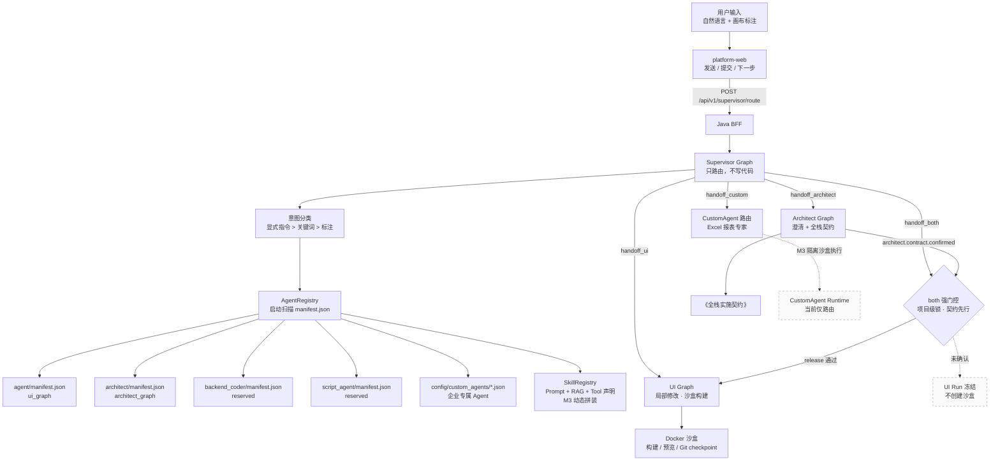

**四个可演示的架构点**：

| 能力 | 用户体验 | 架构落点 |
|---|---|---|
| 多 Agent 路由 | 一句话自动进入 UI / Architect / 专属 Agent，不需要选菜单 | Supervisor Graph + 规则分类器 |
| 声明式注册 | 新增 Agent 只加 `manifest.json`，不改 Python / Java | `AgentRegistry` 启动扫描 + `SkillRegistry` |
| both 强门控 | 先确认契约，再修改界面；阶段时间轴实时可见 | 项目锁 + `AWAITING_CONTRACT → RELEASED` 状态机 |
| 专属 Agent 秒级接入 | 放入 JSON → 刷新 → 关键词命中即路由 | `config/custom_agents` + Manifest 关键词匹配 |

### 秒级接入一个专属 Agent

```bash
# 1. 放入 Manifest（示例已内置 Excel 报表专家）
cat services/orchestrator/config/custom_agents/excel_report_agent.json

# 2. 运行中的 AI Core 立即重扫，无需改代码、无需重启
curl -X POST http://127.0.0.1:8100/api/v1/internal/supervisor/agents/reload

# 3. 验证路由：应返回 handoff_custom / excel_report_agent
curl -X POST http://127.0.0.1:8080/api/v1/supervisor/route \
  -H 'Content-Type: application/json' \
  -d '{"projectId":"demo","message":"帮我导出一份本月的销售数据"}'
```

前端工具栏的 **「✨ 我的专属 Agent」** 会展示当前注册的企业 Agent、能力与关键词。
CustomAgent 在本阶段只完成声明与路由，运行时将在 M3 进入独立受限沙盒。

> 面试现场如何按顺序点击、每步该讲什么：见
> **[3 分钟演示脚本](docs/DEMO_3_MIN.md)**。

## 画布全链路（M1）

1. 在画布上按住鼠标拖拽，圈选目标区域；选区旁自动弹出该标注的独立输入框。
2. 一次最多圈选 **3 个区域**，每个区域填写自己的意图（如「改成蓝色」
   「文字改为提交」「放大一倍」「添加一个红色的提交按钮」）。浮层内提供
   **修改 / 新增** 切换：圈中没有命中具体元素、或指令包含“添加 / 新建 /
   插入”时自动切到 `ADD`，用户也可以手动覆盖。浮层遮挡下一次圈选时，可
   点击视口工具栏的 **隐藏标注输入**；**清除标注** 会清空全部圈与输入框，
   并把沙盒代码回滚到最早执行圈的创建前基线。
3. 达到 3 个后继续圈选会被拦截并提示上限。点击 **提交标注**，前端把全部
   `AnnotationEnvelope` 打包为 `annotations: AnnotationEnvelope[]`，一次
   POST `/api/v1/runs`；旧版单 `annotation` 字段仍向后兼容。
4. Java BFF 同步代理到 `POST /api/v1/internal/runs/execute`（长读超时 300s）。
5. Python 创建 React + Vite 沙盒，Planner 综合全部标注，Coder 一次生成
   包含所有修改的 patch / files，Applier 一次写入，Verifier 一次构建，执行
   LangGraph：

```text
planner -> coder -> applier -> verifier -> evaluator
                        ^                       |
                        +---- retry (<= 3) <-----+
                                                +-- success -> awaiting_approval
                                                +-- exhausted -> failed
```

6. 当前 Tab 顶部的状态点与顶栏提示显示执行进度；成功后画布右下角出现
   **查看效果**，点击切到「实时预览」，全屏展示 `previewUrl` iframe，并可
   展开 `generatedPatch` Diff 与执行轨迹。
7. **世界坐标绑定**：圈选时将屏幕坐标反算为 1280×720 设计视口的归一化
   世界坐标；`.annotation-layer` 与 Mock 页面位于同一个
   `translate(x, y) scale(s)` 容器内。平移 / 滚轮缩放后，圈、迷你 Chatbox
   与页面 DOM 保持像素级绑定，不会留在屏幕原位。
8. **标注层级**：点击某个标注标签或浮层会将其 `z-index` 提升到最高；点击
   画布空白或失焦后恢复默认层级。中键 / 空格 + 左键平移即使从浮层上按下
   也继续生效，不会出现浮层覆盖区域无法拖动的死角。
9. **单圈多轮对话**：每个标注的浮层是独立迷你 Chatbox，拥有 `threadId` 与
   `chatHistory`。发送后立即只执行该圈，后端复用当前沙盒、读取上一轮修改
   后的源码，并把同圈历史与 `previousRuns` 通过 `threadContext` 注入
   Planner / Coder。用户先发「改成红色」再发「不，我要蓝色」时，最终源码
   以蓝色为准；对话气泡展示历史，超出高度在浮层内部滚动。浮层是画布
   子元素，宽度固定为 `320px` 世界单位，**不做反向缩放**：画布缩放到
   50% / 100% / 150% 时，圆角、字号、输入框与浮层整体等比变化，像画在
   画布上的一张图。浮层层级固定高于所有圈线（激活 320 / 默认 300+）。
10. **Git Checkpoint / Undo**：沙盒创建时立即 `git init` 并生成
    `baseline: sandbox init` 根提交。每次 Run 通过 Verifier 后执行
    `git add . && git commit -m "run: {runId} - turn: {turnCount}"`；
    响应返回全局 `commitHash`、`baselineCommit` 与逐 thread 的
    `commits[{threadId, turnCount, commitHash}]`。成功助手消息旁显示
    `turn N · <short sha>` 与 **↩️ 回滚到此步**；后端按 thread checkpoint
    校准目标后执行 `git reset --hard`，恢复该圈聊天历史 / runs / 源码快照，
    并返回带 `?v=` 的 previewUrl 强制刷新 iframe。删除标注时回到该圈创建前
    基线；「清除标注」回到最早执行圈的基线。跨标注覆盖限制与 M2 Event
    Sourcing 重放方案见 `docs/memory/2026-11-04_M1_git_undo_rollback.md`。

Mock LLM 默认 `fail_first`：首次生成故意包含语法错误，Verifier 捕获日志后
自动修复 1 次，最终返回 `AWAITING_APPROVAL`，方便稳定复现完整闭环。Mock
能确定性解析常见颜色 / 文案 / 放大缩小指令并合并应用 3 个标注；识别到
“添加 / 新增 / 新建 / 插入”时，会向命中容器末尾或目标元素之后插入完整
`<button>` JSX，不覆盖原有 DOM。`mockScenario=add_button` 可强制走新增
分支，用于无密钥 E2E。Mock 不是通用模型；布局、间距、结构等任意修改请
选择 `deepseek`（或 `auto`）。单圈 Chatbox 发送固定使用
`mockScenario=none`，确保多轮交互即时返回。

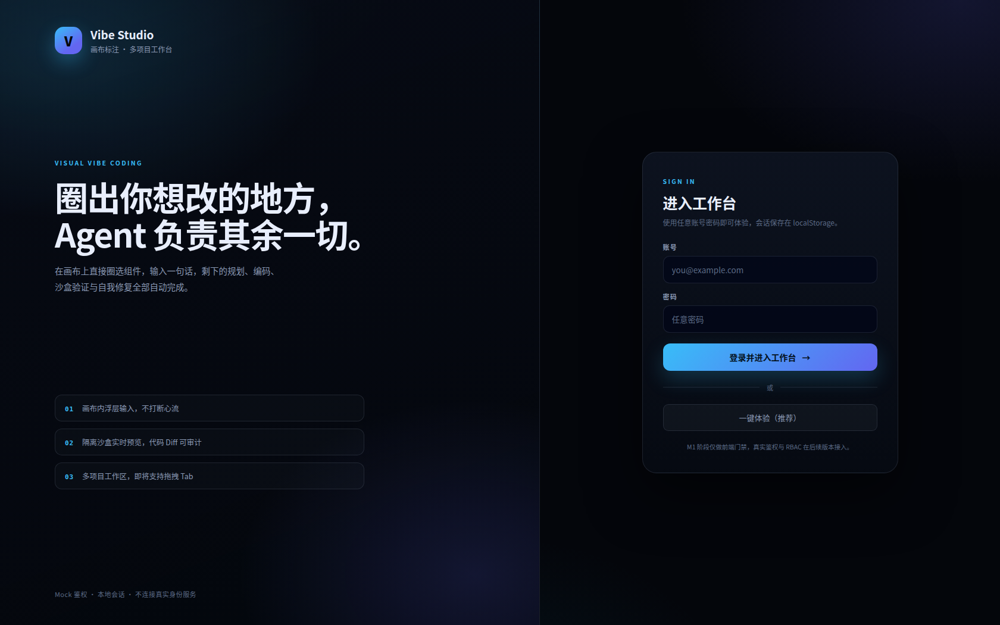


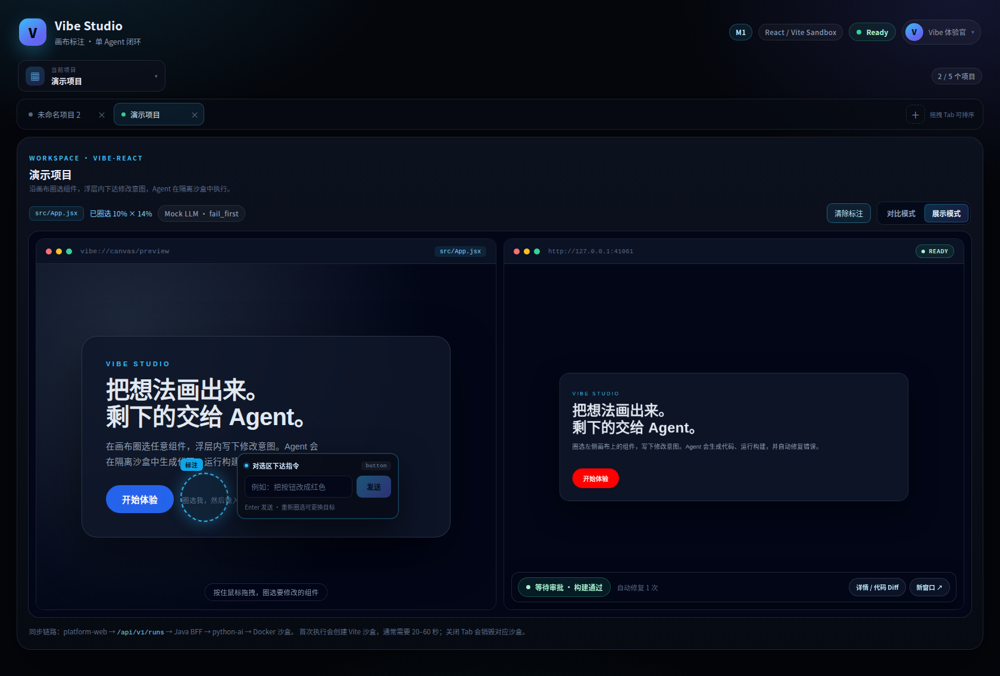

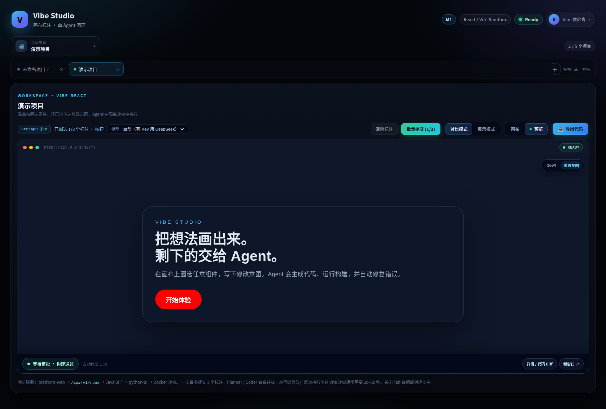

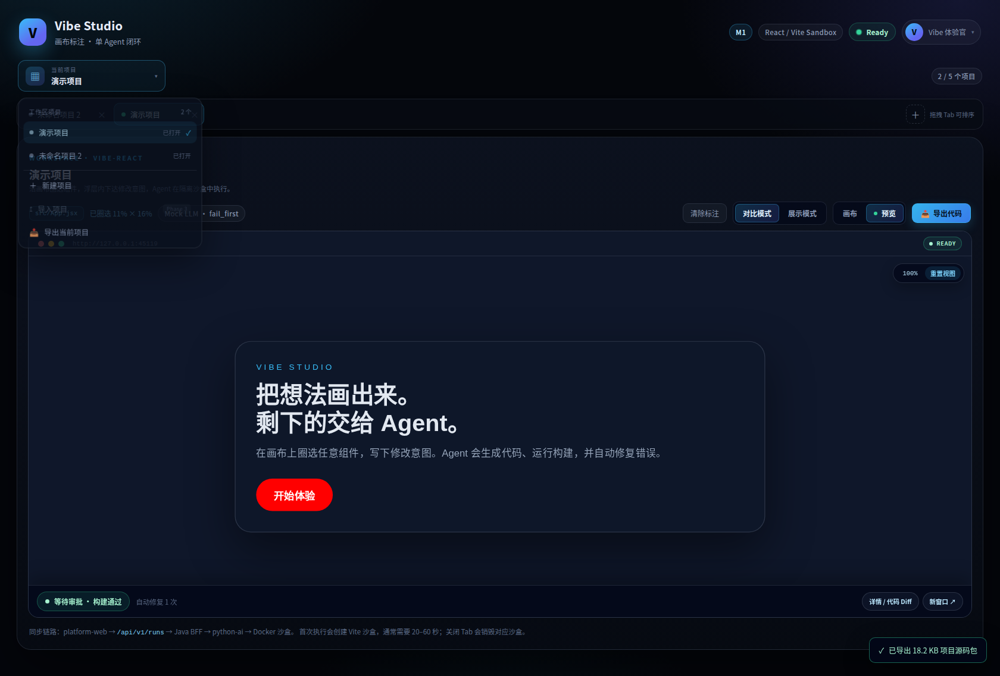

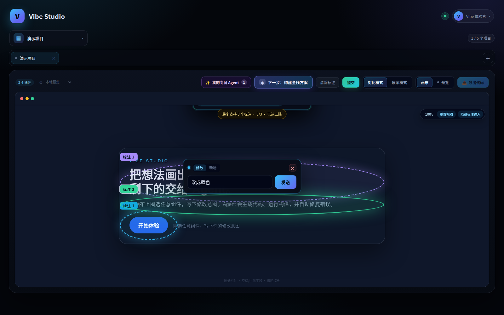

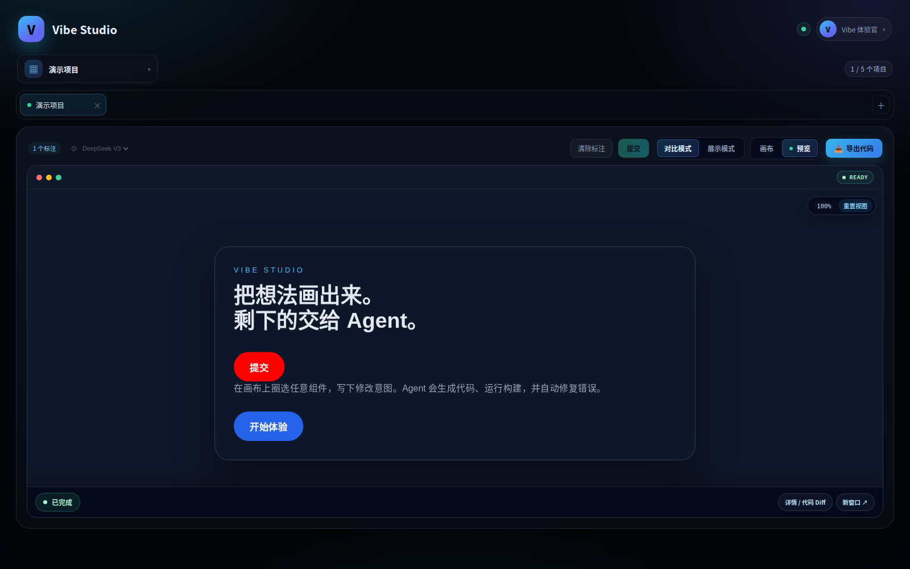

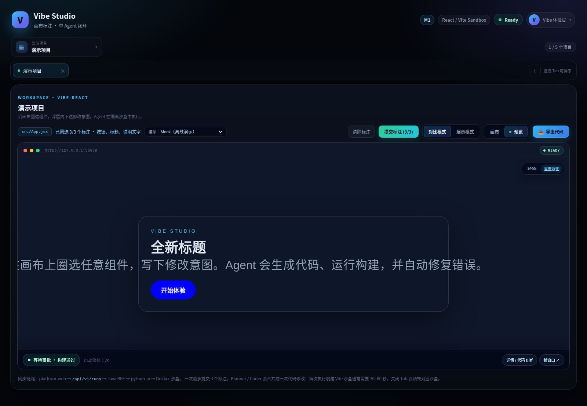

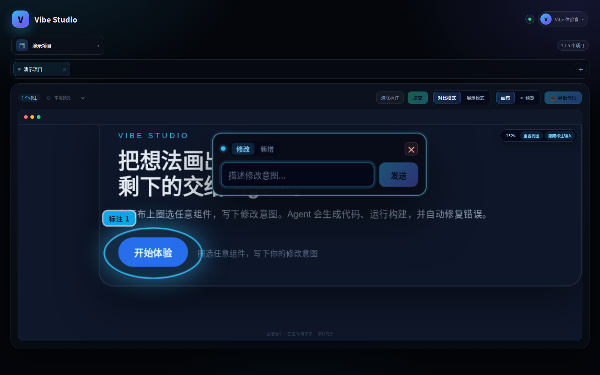

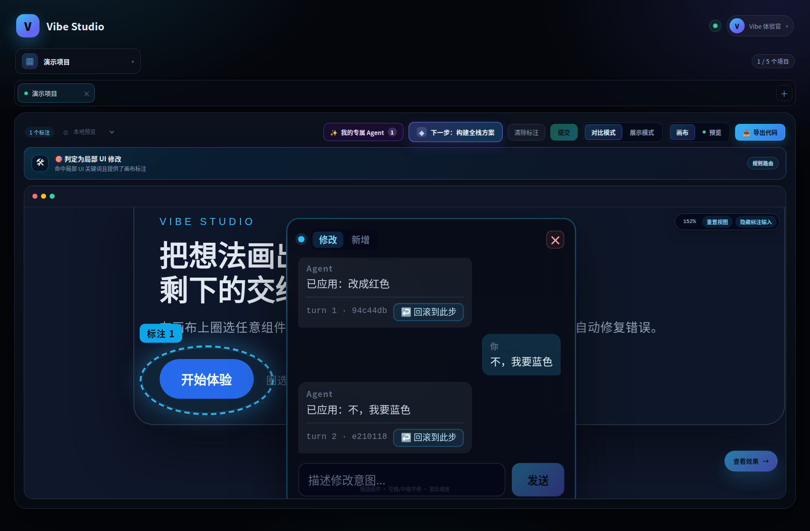

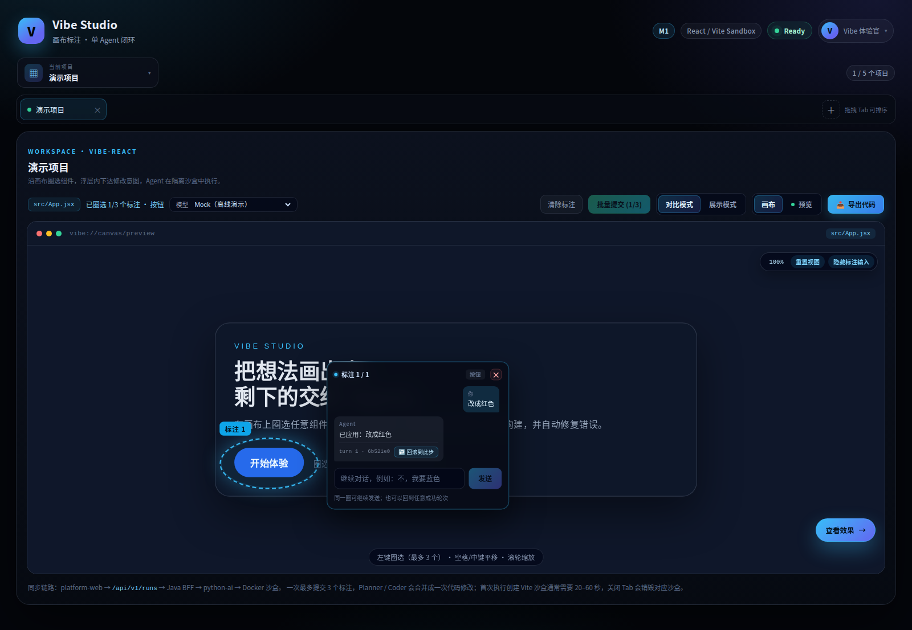

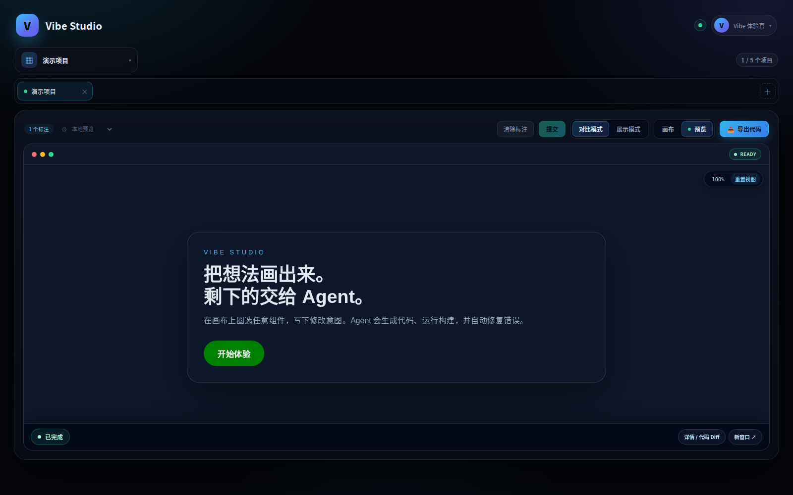


platform-web 在 Compose 中挂载 `./apps/platform-web:/app`（`node_modules`
使用匿名卷），修改前端源码后由 Vite HMR 即时生效，无需重建镜像。

## 路由与账户（Phase 1）

| 路径 | 说明 |
|---|---|
| `/login` | Mock 登录：账号密码或一键体验，Token 写入 `localStorage` |
| `/workspace` | 受保护工作台；未登录访问会重定向到 `/login` |

右上角头像菜单包含 **账户设置**（展示用户、租户、角色、Token 掩码）与
**退出登录**。当前鉴权仅用于前端门禁，真实认证 / RBAC 后续接入。

## 多 Tab 工作区与资源生命周期（Phase 2 / 3 / 4）

- 顶部左侧 **项目下拉栏**：切换项目、查看已打开状态、新建项目；「导入项目」
  为后续阶段占位，当前禁用。
- 每个项目窗口支持两种布局：
  - **对比模式**：单屏全屏显示，顶部「画布 / 预览」Tab 切换；
  - **展示模式**：画布与预览左右 50% 同显，窄屏自动压缩。
- 两种模式下画布与预览面板 **始终挂载**。对比模式用 `visibility:hidden` +
  `pointer-events:none` + `z-index` 让非当前面板彻底退出命中测试；Tab 级休眠
  仍用 `display:none`。切换不会重建 React 组件或 iframe，圈选标注、浮层草稿
  与 Vite HMR WebSocket 连接全部保留。
- 预览区与画布容器等高同宽：顶部 chrome 固定 42px，下方画面填满剩余空间；
  `.canvas-frame` / `.runtime-panel` 都由父级 `.viewport-pane` 绝对定位
  `inset:0`，内部元素无法把框架撑高；`.project-viewport`、`.runtime-stage`、
  `.canvas-stage` 等外层全部 `overflow:hidden`。
- 画布与预览共用 `useFillViewport`：固定 1280×720 设计视口，
  `scale = max(容器宽 / 1280, 容器高 / 720)`（cover），再用
  `translate(offsetX, offsetY) scale(scale)` 居中铺满，多出的方向由外层
  `overflow:hidden` 裁切。这样无论容器比例如何都不会出现黑边；画布 Mock 与
  iframe 使用完全相同的 scale / offset，因此卡片尺寸、位置与垂直中心一致。
- 画布、iframe、chrome 与舞台统一使用 `#0f172a`，边缘完全融合；
  iframe 加 `scrolling="no"`，沙盒模板的 `html/body/#root` 也设
  `overflow:hidden`，内外都不会出现原生滚动条。
- 结果状态、自动修复次数与「详情 / 代码 Diff」是 `position:absolute;
  bottom:0; z-index:10` 的悬浮 HUD（半透明深色 + backdrop blur），覆盖在
  iframe 底部，不参与布局，绝不挤压预览高度。
- **画布与预览都支持视口交互**：
  - 滚轮以鼠标指针为中心缩放，范围 0.25x–3x；
  - 中键拖拽或空格 + 左键拖拽平移，**X / Y 二维自由**，不受对比 / 展示
    布局影响（100% 时某个方向恰好铺满也照样能拖）；
  - 平移边界只保证画面至少保留 96px 可见，绝不强制居中锁定某个轴；
  - 空格按下时光标为 `grab`，拖拽中为 `grabbing`；
  - 右上角实时显示缩放百分比，并提供「重置视图」；
  - 视口状态（zoom / panX / panY）保存在每个项目独立的
    `ViewportProvider`（React Context）中，画布与预览各一份；
  - 对比模式切换「画布 / 预览」只改 CSS `visibility`，组件与视口状态都不
    卸载、不重置；展示模式下还可开启「视口联动」，两侧共享同一组变换。
- 预览的 iframe 会吞掉指针与滚轮事件，因此 ScaledPreview 在 iframe 上方
  覆盖一层透明手势层；手势层同时挡住了 iframe 内的点击，需要真实交互时
  使用 HUD 中的「新窗口 ↗」打开沙盒。
- 预览 URL 会用 `no-cors` 请求探活；若容器已被销毁、服务重启或端口释放，
  预览区显示 **PREVIEW_OFFLINE / 预览连接失败**，而不是浏览器自带的错误页，
  并提供 **重新执行 Agent**（复用最近一次指令与画布标注）创建新沙盒。
- 内置模板带 `templateVersion`；旧 localStorage 项目在加载时自动迁移到最新
  `INITIAL_APP`，避免旧版卡片的 `box-sizing` / `p` 外边距造成画布与预览框
  尺寸、位置不一致。
- Agent 完成后若停留在画布模式，右下角显示 **查看效果 →**，一键切到预览。
- **最多同时打开 5 个项目**。达到上限后，下拉栏与 Tab 栏的新建入口禁用，
  并展示「最多只能同时打开 5 个项目，请关闭其他项目后再新建」。
- **关闭 Tab = 彻底销毁项目**：删除项目与运行状态，并通过 BFF
  `DELETE /api/v1/sandboxes/{sandboxId}` 销毁该项目关联的全部 Docker
  容器；若 Run 仍在途，结果返回后立即销毁新沙盒，避免泄漏。
- 新建项目以 **当前存活 Tab 数 + 1** 为编号起点；若该编号已被占用则顺延，
  保证递增且绝不重名（例如存活 4 个且 5、6 已占用时，新项目为 7）。
- 工作区结构与 Tab 顺序持久化到 `localStorage` 的 `vibe.workspace.v1`；
  已完成 Run 的预览结果与 `sandboxIds` 存入 `sessionStorage`
  `vibe.runs.v1`，刷新后仍可查看效果并在关闭时清理沙盒。
- 非激活 Tab 使用 `display:none` + `content-visibility:hidden` 休眠，降低
  渲染与 CPU 开销；sandbox 容器仍在运行，关闭 Tab 才会释放。
- 每个项目独立保存标注、意图草稿与 Run 结果，切换 Tab 不串状态；多个项目
  可并行执行，Tab 状态点显示 idle / running / success / error。

### 前端状态隔离

工作区没有引入额外状态库，`useWorkspace` 是单一工作区 store，`WorkspacePage`
用 `runStates[projectId]` 保存每个项目的运行态；`ProjectWorkspace` 的
`viewMode` / `mode` 是每个 Tab 自己的本地状态。所有项目窗口按 `project.id`
作为 key 常驻挂载，因此每个 Tab 的画布、预览、布局选择互不影响；异步 Run
回写也始终带 `projectId`，关闭 Tab 后由 `closedProjectsRef` 阻止迟到结果污染
状态并立即销毁新沙盒。

## 项目导出

沙盒是项目的唯一真源：导出直接读取运行中的沙盒文件，不依赖前端缓存。

| 方法 | 路径 | 说明 |
|---|---|---|
| GET | `/api/v1/runs/{runId}/export?sandboxId=...` | 前端主入口；`sandboxId` 可选，用于 BFF 重启后兜底 |
| GET | `/api/v1/sandboxes/{sandboxId}/export` | 直接按沙盒导出 |
| GET | `/api/v1/internal/sandbox/{sandboxId}/export` | Python 内部接口，返回 gzip 字节流 |

- 容器内执行 `tar -czf - --exclude=node_modules --exclude=.git --exclude=dist .`，
  保留 `package.json` / `package-lock.json` / `vite.config.js` / `src/`。
- 导出包根目录包含 **`VIBE_CONTEXT.md`**：Agent 执行时把本次画布
  `AnnotationEnvelope`（用户意图、UI 摘要、验收标准、归一化选区、目标文件 /
  组件 / 选择器、完整 JSON）渲染成 Markdown。在 Cursor / Claude Code 中打开
  解压后的项目时，先读该文件即可知道画布上的修改背景。
- BFF 不落盘、不解析压缩包，直接把 AI Core 的 `InputStream` 复制到 Servlet
  输出流；响应头为 `Content-Type: application/gzip` 与
  `Content-Disposition: attachment; filename="project-export.tar.gz"`。
- 前端有两个入口：工作区工具栏最右侧的 **📥 导出代码**，以及项目下拉菜单中
  的 **导出当前项目**；二者都触发浏览器原生下载，失败时右下角提示原因。
- 解压后在干净环境执行 `npm ci && npm run dev` 即可独立运行；已在
  `node:20-alpine` 容器中实测 `npm ci && npm run build` 通过。

### 5 个项目时的 Docker 资源（实测）

同一时刻并发创建 5 个 React + Vite 沙盒，稳定后 `docker stats`：

| 指标 | 单沙盒 | 5 个沙盒合计 |
|---|---|---|
| 常驻内存 | 78–95 MiB | **约 426 MiB（0.42 GiB）** |
| 空闲 CPU | 0.05%–0.19% | **约 0.6%** |
| 进程数（PIDs） | 29–32 | 148 |
| 限额 | 768 MiB / 1 CPU / 256 PIDs | 3.75 GiB / 5 CPU / 1280 PIDs |
| 监听端口 | 1 个随机端口，仅 `127.0.0.1` | 5 个随机端口 |

平台自身（`java-bff` + `python-ai` + `platform-web`）常驻约 377 MiB。
5 个项目全部打开时，平台 + 沙盒常驻内存约 **800 MiB**；构建/热更新瞬间
CPU 会短时冲高，但每个容器受 1 CPU 限额约束。沙盒镜像
`vibe-platform/sandbox-react:dev` 约 492 MB（镜像层共享，不随容器数线性增长）。

## 项目导入与画布新增意图（M3）

### 导入项目

工作区左上角“新建项目”下方新增 **导入项目**，支持：

| 输入 | 后端处理 | 结果 |
|---|---|---|
| React 项目 `.zip` | 沙盒内解压 → 校验入口 → `npm install` → `npm run build` | 新 Tab + 预览 |
| 静态 HTML `.zip` | 解压 → 内置静态服务器（SPA fallback） | 新 Tab + 预览 |
| 图片 `.png/.jpg` | 视觉模型识别结构并生成 React 代码；无 Key 时生成确定性占位页 | 新 Tab + 预览 |

- 入口：`POST /api/v1/internal/sandbox/import`（multipart，BFF 透传），返回
  `sandboxId` / `previewUrl` / `kind`。
- zip 安全：拒绝 Zip Slip、符号链接、加密包、解压炸弹、超量条目，过滤
  `.env` / 密钥文件；默认限制 32 MiB 压缩包、128 MiB 解压、4000 条目。
- 图片走 OpenAI 兼容多模态端点（`VISION_API_KEY` / `VISION_BASE_URL` /
  `VISION_MODEL`）；未配置 Key 时仍返回可编译的占位 React 页，便于离线联调。

### 空白区域自动判定 ADD

圈选时前端会计算圈与所有 `data-source` 节点的交集面积、覆盖率与选区占比：

- 命中节点且覆盖率足够 → `action: "MODIFY"`，目标为被圈节点。
- 未命中任何节点，或圈面积远大于节点（阈值 `MODIFY_MIN_COVERAGE=0.35`、
  `ADD_AREA_RATIO=4`、`MODIFY_MIN_SELECTION_SHARE=0.12`）→ `action: "ADD"`。
- ADD 时向上寻找最近的带 `data-source` 父容器作为 `target`，并附带
  `relativeTarget`（`coordinateSpace: "parent-normalized"`，x/y/width/height
  相对父容器归一化），Agent 依据坐标在父容器内插入新 JSX。
- `ui_graph` 的 System Prompt 已明确 ADD 语义；Mock LLM 与真实模型共用同一
  契约，新增节点会写入 `data-source` 供后续继续圈选。

### Tools / Skills / MCP 扩展点

- **Tools**：`ai_core/tools/` 提供 `ToolRegistry` 与 `shell_tool`，已注册进
  LangGraph `ToolNode`。默认 `TOOL_SHELL_ENABLED=false`；开启后仍只允许只读
  白名单命令、固定工作目录、超时与输出截断，拒绝 shell 元字符与路径逃逸。
- **Skills**：`config/skills/*.skill.json` 由 `SkillRegistry` 扫描；
  `tailwind_magic` 在 `ui_graph` manifest 中挂载，向 System Prompt 注入
  Tailwind 设计规范。
- **MCP**：`config.py` 提供 `MCP_SERVERS: list[dict]`，`graph.py` 预留官方
  `mcp` SDK 挂载外部 Server（文件系统 / 浏览器）的注释与配置入口。

## 验证

### 0. Eval Suite 离线跑批（最快）

```bash
./scripts/eval_suite.sh validate   # 校验 YAML 契约
./scripts/eval_suite.sh list       # 查看 10 条核心用例
./scripts/eval_suite.sh run        # 10/10 PASS，约 40 ms
```

覆盖 Supervisor 五类 Handoff、UI 改色 / 文案 / 缩放 / 新增、双标注批量、
Architect、both、CustomAgent 与缺标注守卫；使用真实路由 + 确定性 Mock 代码
生成，不启动业务服务与沙盒。报告写入 `reports/eval/`（JSON / Markdown /
JUnit）。详见 `config/eval_suite/README.md` 与 `docs/design/07.Eval_Suite.md`。

### 1. 全链路 E2E（推荐）

```bash
python3 scripts/platform_e2e_test.py
```

覆盖：三个服务健康检查 → Vite `/api` 代理 → 画布同款请求体（3 个标注：
颜色 / 文案 / 尺寸）→ Java BFF → Python Agent → 沙盒创建 → 首次构建失败 →
自动修复 → 预览页与 `/src/App.jsx` 同时包含 3 处修改 → 清理沙盒。

### 2. Supervisor / 专属 Agent E2E

```bash
# API：路由、注册中心、both 门控、CustomAgent 关键词路由
python3 scripts/supervisor_e2e_test.py
AI_BASE_URL=http://127.0.0.1:8080 python3 scripts/supervisor_e2e_test.py
python3 scripts/supervisor_both_e2e_test.py

# 浏览器：决策可视化 + both 双阶段时间轴 + 专属 Agent 目录/路由
/tmp/vibe-browser/bin/python scripts/supervisor_mixed_ui_e2e_test.py
/tmp/vibe-browser/bin/python scripts/custom_agent_e2e_test.py
```

覆盖：`handoff_ui / handoff_architect / handoff_both / handoff_custom /
rejected` 五类路由、`reserved` Agent 拒绝、both 项目锁与幂等 release、
顶部「正在分析意图 → 判定结果」、两阶段时间轴、专属 Agent 目录与
`Excel 报表专家` 关键词路由（只 route，不 dispatch）。

### 3. 浏览器 UI E2E（Playwright）

```bash
pip install playwright
playwright install chromium
python3 scripts/ui_e2e_test.py
```

真实浏览器中验证未登录跳转 → 一键登录 → 新建项目 → 拖拽 Tab 排序 →
刷新验证 localStorage 持久化 → 画布圈选并发送意图 → 执行中状态反馈 →
**查看效果**切换全屏预览并校验 iframe 按钮 `rgb(255, 0, 0)` → 对比/展示
模式往返，比对画布与预览面板宽高、检查外层无滚动条、iframe 以 1280×720
cover 缩放后完全覆盖预览屏幕（居中、无留白）→ 对比画布 Mock 卡片与 iframe
内卡片的宽高/偏移/垂直中心 →
用 DOM 节点标记验证组件零重挂载 → **预览滚轮放大（校验指针锚点不漂移）、
中键平移、画布独立缩放，并在画布/预览往返后校验 transform 零重置** →
展示模式开启视口联动，校验两侧 zoom/transform 完全一致 → 重置视图恢复对齐 →
**工具栏与项目下拉菜单分别触发下载，解压校验完整 Vite 文件结构与 Agent
修改后的源码** → 详情抽屉中的 Diff 与沙盒信息 →
**刷新恢复预览结果** → 外部删除沙盒容器，验证 PREVIEW_OFFLINE 提示与
**重新执行 Agent** 创建新沙盒 → 关闭 Tab 并通过 Docker CLI 确认容器已销毁 →
5 Tab 上限 → 关闭项目后按存活数递增命名且不重名 → 账户设置 / 退出 /
账号密码登录。截图输出到 `docs/screenshots/`（`phase4-*.png`）。

### 4. 批量标注 UI E2E

```bash
/tmp/vibe-browser/bin/python scripts/multi_annotation_e2e_test.py
```

真实浏览器验证：连续圈选 3 个区域、每个区域独立输入、第 4 次圈选被上限
拦截、「清除标注」清空全部圈与输入框、提交请求体为长度 3 的
`annotations` 数组（且不再发送单 `annotation`）、预览与导出包 /
`VIBE_CONTEXT.md` / Diff 同时包含颜色、文案、尺寸 3 处修改。

### 5. 单圈多轮对话 / 世界坐标 E2E

```bash
/tmp/vibe-browser/bin/python scripts/multi_turn_chat_e2e_test.py
```

验证：圈选后中键平移 + 滚轮放大，圈与按钮相对几何位移为 0；激活浮层
`z-index` 从 30 提升到 120，失焦恢复；同一个 Chatbox 连续发送「改成红色」
与「不，我要蓝色」，两次请求 `threadId` 一致，第二轮 `chatHistory` 为
`[user, assistant, user]` 且携带第一轮 `sandboxId`；后端返回
`reusedSandbox=true`，最终 iframe 按钮为 `rgb(0, 0, 255)`；刷新后两轮对话
仍从会话快照恢复。

### 6. 单圈回滚 / Git 提交顺序 E2E

```bash
/tmp/vibe-browser/bin/python scripts/rollback_e2e_test.py
```

验证：沙盒 Git 历史依次为 `baseline: sandbox init` → `run: ... - turn: 1` →
`run: ... - turn: 2`；每条成功助手消息旁存在「回滚到此步」。回滚到 turn 1 后
HEAD 指回第一轮 commit、聊天记录从 4 条截断为 2 条、预览从蓝色恢复为红色；
继续发送「改成绿色」时重新使用 `turn: 2` 并生成全新 commit，旧 turn 2 commit
不再是 HEAD 的祖先。后端响应 `checkpointRestored=true`，previewUrl 带
`?v=` cache-busting。

### 7. 删除标注 / 全局基线回滚 E2E

```bash
/tmp/vibe-browser/bin/python scripts/annotation_delete_rollback_e2e_test.py
```

场景 A（红）、B（绿）修改同一文件：B 在 A 之后创建，删除 B 后 HEAD 回到 A1，
A 的聊天记录保留且预览恢复红色；再点「清除标注」回到沙盒 root baseline，
预览恢复初始颜色。该用例明确覆盖 M1.5 “全局线性历史”限制。

### 8. 新增组件 E2E

```bash
/tmp/vibe-browser/bin/python scripts/add_component_e2e_test.py
```

在画布上圈选大卡片内部，输入「添加一个红色的提交按钮」，校验浮层
`data-action` 自动从 `MODIFY` 切到 `ADD`、手动切换可覆盖；提交后 Mock 在
卡片内插入 `button.vibe-added-button`，`npm run build` 通过，预览 iframe
中新增按钮文本为「提交」、背景为 `rgb(255, 0, 0)`，原有 CTA 仍保留。

### 9. 分层验证

```bash
python3 scripts/sandbox_e2e_test.py   # 沙盒生命周期 / 补丁 / 构建
python3 scripts/agent_e2e_test.py     # 批量标注 / 自动修复 / 3 次上限 / 4 个标注 422
./scripts/smoke-test.sh               # Java -> Python 健康检查
```

### 10. 手动调用

```bash
curl -s http://127.0.0.1:5173/api/v1/health | python3 -m json.tool
curl -s http://127.0.0.1:8080/api/v1/health | python3 -m json.tool
curl -s http://127.0.0.1:8100/api/v1/health | python3 -m json.tool
```

`java-bff` 的 `dependencies.pythonAi.status=UP` 即证明跨语言调用成功；Python
不可达时 Java 返回 503 + `DEGRADED`，不会抛出 500。

## Java BFF Run API

| 方法 | 路径 | 说明 |
|---|---|---|
| POST | `/api/v1/runs` | 接收画布标注，同步代理 AI Core 执行 |
| POST | `/api/v1/runs/rollback` | 单标注 / 删除基线回滚：校验 40 位 commit 后代理 AI Core |
| GET | `/api/v1/runs/{runId}/export` | 下载该 Run 的项目 tar.gz；`sandboxId` 可选 |
| GET | `/api/v1/sandboxes/{sandboxId}/export` | 按沙盒下载项目 tar.gz |
| DELETE | `/api/v1/sandboxes/{sandboxId}` | 代理 AI Core 销毁沙盒；404 幂等透传 |

BFF 只校验 `projectId` 以及 `annotations`（数组）或旧版 `annotation` 至少
存在一个；`annotations` / `annotation` / `options` 均以 `JsonNode` 透传，
契约单一真源在 Python `agent/schemas.py`（数组最多 3 项，超出返回 422）。
AI Core 的 HTTP 状态与 JSON 原样返回：业务失败（重试耗尽）是
`200 + status=FAILED`，参数 / 沙盒错误是 4xx/5xx。

单圈多轮修改额外使用：

- 请求：`sandboxId` 复用上一轮沙盒；每个 annotation 携带
  `threadId` 与 `chatHistory: [{id, role, content, runId?, commitHash?,
  turnCount?, createdAt?}]`。
- 响应：`reusedSandbox` 表示是否复用；`assistantMessage` 与后端 thread
  记录同文案，前端直接追加到该圈聊天记录。
- Git checkpoint：成功响应额外返回 `commitHash`、`turnCount`、
  `baselineCommit`、`commits[{threadId, turnCount, commitHash, runId}]`。
- 回滚请求：
  `POST /api/v1/runs/rollback`
  `{sandboxId, threadId, commitHash, runId?, turnCount?}`。
  响应 `{sandboxId, threadId, commitHash, turnCount, runId,
  checkpointRestored, previewUrl, previewRevision}`；`previewUrl` 带
  `?v=`，用于强制刷新 iframe。

> AI Core 客户端强制 HTTP/1.1。JDK HttpClient 默认尝试 h2c Upgrade，Uvicorn
> 不支持升级，POST 请求体会丢失（表现为 FastAPI 422 missing body）。

## 沙盒（Sandbox）

`python-ai` 通过挂载的 `/var/run/docker.sock` 调用宿主 Docker，为每个项目创建
独立的 React + Vite 容器。容器限制：`cap_drop=ALL`、`no-new-privileges`、
内存 / CPU / PID 限额，预览端口只绑定 `127.0.0.1`。

| 方法 | 路径 | 说明 |
|---|---|---|
| POST | `/api/v1/internal/sandbox/create` | 创建容器，写入初始文件，返回预览 URL |
| POST | `/api/v1/internal/sandbox/apply-patch` | 全量文件 / unified diff，触发 Vite HMR |
| GET | `/api/v1/internal/sandbox/verify?sandbox_id=...&check=build` | 执行 `npm run build` / `npm run test` |
| DELETE | `/api/v1/internal/sandbox/{sandboxId}` | 强制销毁容器 |

沙盒镜像 `vibe-platform/sandbox-react:dev` 首次使用时自动构建（依赖已预热，
单次创建约 1~3 秒）。Dockerfile 已配置 `registry.npmmirror.com`，依赖层与
源码层分离以利用 Docker 缓存。

> 安全提示：挂载 Docker Socket 等价于授予 python-ai 宿主 root 权限，仅限本地
> 开发与受信任环境。生产环境必须替换为独立沙盒节点 + gVisor，业务容器不得
> 直接挂载 Docker Socket。
>
> 若容器内无权限访问 Socket，执行
> `stat -c '%g' /var/run/docker.sock` 获取 GID，并写入 `.env` 的 `DOCKER_GID`。

## Agent 闭环（M1）

`POST /api/v1/internal/runs/execute` 接收 `annotations: AnnotationEnvelope[]`
（1~3 个；旧版单 `annotation` 自动归一为单元素数组），创建沙盒并同步执行
LangGraph：

- 每个 annotation 携带 `action: "MODIFY" | "ADD"`。`MODIFY` 修改已有元素；
  `ADD` 要求模型保留原有 DOM，在选区对应的父级 / 兄弟级节点插入完整 JSX，
  `target` 可为空并由 `worldTarget` 几何位置决定插入点。Planner / Coder
  的 System Prompt 均显式约束这一点。
- 每个 annotation 可携带 `threadId` / `chatHistory` / `sandboxId`。服务端
  `ThreadMemoryStore` 合并前端历史与进程内记录，生成
  `threadContext = {threadId, chatHistory, previousRuns}` 注入 Planner /
  Coder；同一圈的后续请求优先复用 `sandboxId`，并读取修改后的当前源码。
- 每个成功 Run 生成 sandbox Git commit 与 thread checkpoint。checkpoint
  保存 `{runId, turnCount, commitHash, chatHistory, runs, files}`；回滚时
  `git reset --hard` 与 ThreadMemoryStore 恢复必须在同一个请求内完成。
- 一个批量 Run 只生成一个全局 commit；每个 annotation 保留自己的
  `turnCount`。删除标注回到创建前基线，M1.5 会丢弃其后的全局提交，M2
  使用 Event Sourcing 重放未删除标注的意图。
- `planner` 一次性读取全部标注和所有目标文件，输出综合计划；多个标注命中
  同一文件时只规划一次。
- `coder` 一次生成包含全部修改的 patch 或完整 files；多文件 / 多标注时
  提示词强制优先 `mode=files`，并校验所有目标文件都被覆盖。
- `applier` 直接复用 `SandboxProvider`，一次性写入全部文件，避免多次 HMR
  和中间态；随后重读所有目标文件，作为后续 Diff 与重试的基线。
- `verifier` 只执行一次 `npm run build`；失败日志写入状态并由 `coder` 整体
  重试，`retry_count` 硬上限为 3，预算耗尽返回 `FAILED`。
- Mock 场景：`fail_first`（首次写错，验证自动修复）、`always_fail`
  （验证 3 次上限）、`add_button`（强制新增按钮，用于 ADD E2E）、`none`
  （直接成功）。`agent_e2e_test.py` 还验证第 4 个标注会被 Pydantic 以 422
  拒绝。

### 接入真实 DeepSeek

1. 在 `.env` 填入真实 Key（不要提交 Git）：

```dotenv
DEEPSEEK_API_KEY=sk-...
DEEPSEEK_BASE_URL=https://api.deepseek.com
DEEPSEEK_MODEL=deepseek-chat
```

2. 重新创建 `python-ai`，让环境变量生效：

```bash
docker compose up -d --force-recreate python-ai
# 改了提示词 / Python 代码时：
docker compose up --build -d python-ai
```

3. `GET /api/v1/health` 的 `dependencies.llm` 应为 `deepseek`（不泄露 Key）。
   前端模型选择器默认显示 **DeepSeek V3**（`auto`：有 Key 走真实模型，
   无 Key 回退本地 Mock）；离线演示时可选 **本地预览**。

调用链：Planner 与 Coder 的 System Prompt 明确要求处理全部 1~3 个标注、
支持颜色 / 文案 / 字号 / 间距 / 布局 / 组件结构等任意 UI 属性，禁止只处理
第一个标注；输出仅接受结构化 JSON（`diff` 或 `files`），路径必须位于沙盒
目标文件内，`..` / 绝对路径会被拒绝。

最小请求（3 个不同属性）：

```json
{
  "runId": "run_01",
  "projectId": "proj_01",
  "annotations": [
    {
      "version": 1,
      "annotationId": "ann_01",
      "type": "drag",
      "target": {
        "mode": "source",
        "source": { "file": "src/App.jsx" },
        "selector": "[data-vibe-target='cta-button']"
      },
      "intent": {
        "kind": "UI_ONLY",
        "ui": { "summary": "改成蓝色" }
      },
      "payload": { "text": "改成蓝色" }
    },
    {
      "version": 1,
      "annotationId": "ann_02",
      "type": "drag",
      "target": {
        "mode": "source",
        "source": { "file": "src/App.jsx" },
        "selector": "[data-vibe-target='title']"
      },
      "intent": {
        "kind": "UI_ONLY",
        "ui": { "summary": "文字改为提交" }
      },
      "payload": { "text": "文字改为提交" }
    },
    {
      "version": 1,
      "annotationId": "ann_03",
      "type": "drag",
      "target": {
        "mode": "source",
        "source": { "file": "src/App.jsx" },
        "selector": "[data-vibe-target='copy']"
      },
      "intent": {
        "kind": "UI_ONLY",
        "ui": { "summary": "放大一倍" }
      },
      "payload": { "text": "放大一倍" }
    }
  ],
  "files": { "src/App.jsx": "export default function App() { ... }" },
  "options": {
    "llmProvider": "auto",
    "maxRetries": 3,
    "keepSandbox": true
  }
}
```

> 沙盒源码中的 `data-vibe-target` 标记与画布 Mock 元素同名，前端圈选时把
  命中的 selector 写进标注，模型据此定位组件。新增画布元素时请同时补标记。

> M1 的 execute 是同步接口，便于后台联调；M2 将改为 202 + checkpoint + 事件流。

## 数据库

```bash
# 查看表
docker exec -it geo-mysql mysql -uroot -proot -e "USE geo_ai_db; SHOW TABLES;"

# 确认没有物理外键
docker exec -it geo-mysql mysql -uroot -proot -N -e \
  "SELECT COUNT(*) FROM information_schema.REFERENTIAL_CONSTRAINTS WHERE CONSTRAINT_SCHEMA='geo_ai_db';"
```

预期外键数量为 `0`。

## 设计文档

| 文档 | 内容 |
|---|---|
| [`docs/design/02.整体架构设计.md`](docs/design/02.整体架构设计.md) | 系统上下文、逻辑架构、数据/安全/部署 |
| [`docs/design/03.API接口设计.md`](docs/design/03.API接口设计.md) | 公共 / 内部 API 契约；§14 为中台端点索引 |
| [`docs/design/05.Supervisor_Multi_Agent.md`](docs/design/05.Supervisor_Multi_Agent.md) | Supervisor、Manifest、both 强门控 |
| [`docs/design/06.Agent_OS_Data_Management.md`](docs/design/06.Agent_OS_Data_Management.md) | Knowledge Service、Admin / Prompt Registry、Feedback 自优化 |

## 停止

```bash
docker compose down
```

不删除外部中间件，也不删除 MySQL 中的业务表。
