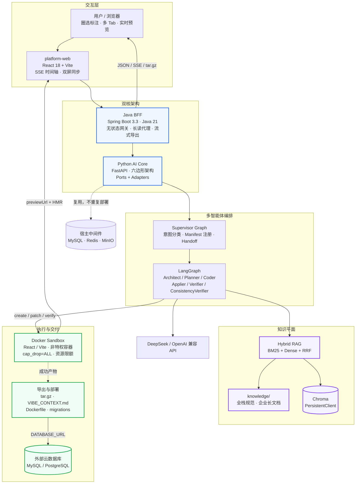

<div align="center">

# vibe-platform

**AI 全栈研发引擎 · 从一句自然语言，到可构建、可回滚、可部署的全栈产物**

画布圈选 → 契约澄清 → 多智能体编排 → 沙盒构建自愈 → 一键导出部署

`React 18` · `Java 21` · `Python 3.12` · `LangGraph` · `Hybrid RAG` · `Docker Sandbox`

</div>

> 这不是“补全一段代码”的编辑器插件。
> 它把**不确定的 LLM** 关进**确定性的工程笼子**：契约先行、工具受控、构建可验、失败可回滚、产物可交付。
> 当前状态：M3 收尾，316 项 Python 单测全绿，前后端构建通过。

---

## 一、它到底在做什么

一句“做一个带登录和报表的工作台”，大多数 AI 会直接吐出一坨无法运行的 JSX。
vibe-platform 的处理方式是：

1. **先问清楚**：Architect 按 `CRITICAL / MAJOR / MINOR` 分级澄清，最多 10 轮，用户可一键采用建议，但 AI 无权替用户拍板。
2. **再签契约**：生成《全栈实施契约》，明确页面、组件、路由、接口、数据模型与验收标准；契约未确认，UI 改动被强门控冻结。
3. **多智能体执行**：Supervisor 只路由，Architect / Planner / Coder / Applier / Verifier / ConsistencyVerifier 各司其职。
4. **沙盒里真构建**：每个项目独立 Docker 沙盒，`npm run build` 失败自动回传错误重试，最多 3 次。
5. **一致性自愈**：前端调用的 Method / Path / Payload 与后端真实路由逐条比对，缺路由就让 BackendCoder 补，最多 2 次，仍失败才阻断。
6. **交付而非演示**：成功产物可导出 tar.gz，带 `VIBE_CONTEXT.md`、多阶段非 root Dockerfile、显式 SQL 迁移、健康检查与前端错误拦截器。

### 能力矩阵

| 能力 | 你看到的体验 | 工程落点 |
|---|---|---|
| 画布级意图 | 圈选页面元素，直接说“改成蓝色 / 放大一倍 / 加个提交按钮” | `AnnotationEnvelope` + 世界坐标 + ADD/MODIFY 判定 |
| 多智能体协同 | 一句话自动进入 UI / Architect / 企业专属 Agent，不用选菜单 | Supervisor Graph + 声明式 Manifest + Handoff |
| 强门控 | 先确认契约，再改界面；阶段时间轴实时可见 | 项目锁 + `AWAITING_CONTRACT → RELEASED` 状态机 |
| Hybrid RAG | 规范条款精确命中，企业长文档语义召回 | BM25 + Chroma + RRF(k=60) + 单路降级 |
| 构建自愈 | 首次构建失败自动修，3 次预算耗尽才失败 | LangGraph 回环 + Verifier 错误上下文 |
| 产物交付 | 导出即可 `npm ci && npm run build`，可直接上云 | tar.gz + 迁移脚本 + 健康检查 + 非 root 镜像 |

---

## 二、全局架构



**依赖方向**：`Web → BFF → AI Core → Sandbox`，永远单向。
Java 不碰模型 SDK，Python 不碰浏览器状态，沙盒不信任生成代码。

---

## 三、双核架构：把“网关”和“大脑”拆开

| 维度 | Java BFF | Python AI Core |
|---|---|---|
| 定位 | 无状态边缘网关 | 有状态的 Agent 编排内核 |
| 技术 | Java 21 / Spring Boot 3.3 | Python 3.12 / FastAPI / LangGraph |
| 职责 | 鉴权、路由、参数校验、长读代理、tar.gz 流式透传 | 契约、RAG、模型调用、沙盒生命周期、Git checkpoint |
| 失败语义 | Python 不可达返回 `503 + DEGRADED`，绝不 500 | 业务失败返回 `200 + status=FAILED`，参数错误 4xx |
| 扩展点 | 新增 REST 端点 / 账户体系 | 新增 Manifest / Skill / Tool / RAG Provider |

关键工程细节：

- **HTTP/1.1 强制**：JDK HttpClient 默认尝试 `h2c Upgrade`，Uvicorn 不支持升级，POST body 会丢失（表现为 FastAPI 422 missing body）。AI Core 客户端显式锁定 HTTP/1.1。
- **流式导出**：BFF 不落盘、不解析 tar.gz，直接把 AI Core 的 `InputStream` 复制到 Servlet 输出流，内存占用与项目大小解耦。
- **契约单一真源**：数组上限、字段校验、状态机都在 Python；BFF 只做透传，避免 Java / Python 双份 schema 漂移。

---

## 四、多智能体协同：Supervisor 只路由，不写代码

```text
用户输入 + 画布标注
        │
        ▼
Supervisor Graph ── 显式指令 > 关键词 > 标注 ──▶ 意图分类
        │
        ├── handoff_ui         → UI Graph（局部修改 · 沙盒构建）
        ├── handoff_architect  → Architect Graph（澄清 + 全栈契约）
        ├── handoff_custom     → 企业专属 Agent（Manifest 注册）
        └── handoff_both       → 强门控（契约确认后才释放 UI Run）
```

- **声明式注册**：`agent/manifest.json` 描述能力、关键词、Skill 与 Tool 挂载；新增 Agent 只加 JSON，不改 Java / Python 编排代码。
- **企业 Agent 秒级接入**：放入 `config/custom_agents/*.json`，调用 `POST /api/v1/internal/supervisor/agents/reload` 即可热重扫，无需重启。
- **both 强门控**：Architect 未确认契约时，UI Run 被项目锁冻结，不创建沙盒；确认后按 `AWAITING_CONTRACT → RELEASED` 放行。
- **扩展平面**：`ToolRegistry`（shell / web research）、`SkillRegistry`（Tailwind / 可访问性 / 生产级规范）、MCP stdio Server 白名单调用。

面试演示入口：`docs/DEMO_3_MIN.md`。

---

## 五、Hybrid RAG：硬约束走 BM25，软知识走向量

纯向量检索会丢接口名、字段名、规范条款；纯关键词检索又捞不到“鉴权方式”“过期时间”这类语义表达。
所以两条路同时走，再用 RRF 融合。

```text
query
  ├── BM25（Markdown Skill）───────┐
  │   精确命中：OAuth 2.1 / RS256 / 15 分钟
  │                                ├── RRF 1/(60 + rank) ── Top-K
  └── Chroma（Dense）──────────────┘
      语义召回：企业长文档、API 手册、安全规范
```

| 设计点 | 实现 |
|---|---|
| 本地向量库 | `chromadb==1.0.15` `PersistentClient`，数据落 `data/chroma`，无独立服务 |
| Embedding | 内置 ONNX MiniLM，无 API Key / 无 PyTorch；镜像构建期预热，运行期离线 |
| 同语料 | 两路统一索引 `knowledge/`（fullstack 规范 + enterprise_docs），排名才可比较 |
| 切块一致性 | 复用同一 Markdown parser，`path + section` 作为 RRF 去重键 |
| 增量同步 | 内容寻址 Chunk ID（`sha1`），`upsert` 新增，分页扫描并删除下线文档 |
| 并行召回 | `ThreadPoolExecutor`，每路取 `max(10, top_k × 3)` 候选 |
| 降级 | 单路异常自动 fail-open，另一路继续；两路都挂才抛 `RAGProviderError` |
| 可观测 | metadata 保留 `bm25Rank / chromaRank / rrfScore / retrievalSources` |

**实测**（`demo/rag_hybrid_demo.py`）：

| 问题 | RRF Top-1 | 两路排名 |
|---|---|---|
| 我们公司的 API 用什么鉴权方式？ | 二、API 鉴权方式（OAuth 2.1 / IAM 签发 JWT） | bm25=1, chroma=1 |
| JWT 过期时间设多久？ | 三、JWT 令牌规范（访问令牌 15 分钟 / 刷新令牌 7 天） | bm25=2, chroma=1 |

> 默认 MiniLM 对中文短查询可用但非最优。升级 BGE-M3 的配置路径见 `CURRENT_CONTEXT.md`，环境变量 `EMBEDDING_MODEL` 已预留。

---

## 六、沙盒自愈：让失败发生在可回滚的地方

```text
planner → coder → applier → verifier → evaluator
            ↑                    │
            └──── retry ≤ 3 ─────┘
                                 ├── success → AWAITING_APPROVAL
                                 └── exhausted → FAILED
```

四道确定性闸门，专门拦截 LLM 的“自信胡说”：

| 闸门 | 拦什么 | 机制 |
|---|---|---|
| `should_use_skeleton` | 抽象目标被脑补成完整业务 | “做个工作台”这类目标确定性拦截，**完全不调用 LLM**；契约标记 `skeletonMode=true`，只渲染 Header + Sidebar + 占位主区 |
| JSON / Pydantic Gate | 结构错误的模型输出 | 校验失败把**原始输出 + 错误**回传模型重试，`AGENT_JSON_RETRY_LIMIT=2`；Planner 耗尽降级文本计划 |
| Build Verifier | 能说不能跑 | 沙盒内真实 `npm run build`，错误日志回传 Coder 整体重试，上限 3 次 |
| ConsistencyVerifier | 前端调不存在的后端接口 | 比对前端 Method / Path / Payload 与 `api-routes.json.routes`，缺失路由只让 BackendCoder 补，最多 2 次；仍失败才阻断构建 |

沙盒安全边界：

- `cap_drop=ALL`、`no-new-privileges`、内存 / CPU / PID 限额；
- 预览端口只绑定 `127.0.0.1` 随机端口，不暴露局域网；
- 导入 zip 拒绝 Zip Slip、符号链接、加密包、解压炸弹、超量条目，过滤 `.env` / 密钥文件；
- 每个成功 Run 生成 Git commit 与 thread checkpoint，回滚时 `git reset --hard` 与记忆恢复在同一请求内完成。

> 本地开发通过挂载 Docker Socket 创建沙盒，等价于宿主 root 权限。生产环境必须替换为独立沙盒节点 + gVisor，业务容器不得直接挂载 Docker Socket。

---

## 七、全栈生成与导出部署

### 契约先行

Architect 输出的《全栈实施契约》包含页面、组件、路由、接口、数据模型、验收标准与 `includeAiCapability` 等开关。
契约确认后，Fullstack Graph 生成：

- **前端**：React / Vite，真实 `onClick`、Loading / Error / Success 三态、全局 fetch 拦截器；
- **后端**：Express 业务路由 + Mock 处理 + `api-routes.json` 路由清单；
- **基础设施**：多阶段非 root Dockerfile、`server/migrations/001_init.sql` + `_schema_migrations` 校验和、`migrate.mjs`；
- **AI 能力**：按契约生成真实 OpenAI 兼容调用与对话 / 上传 UI。

### 导出与导入

| 动作 | 行为 |
|---|---|
| 导出 | 直接读取运行中的沙盒，`tar -czf` 排除 `node_modules/.git/dist`，附带 `VIBE_CONTEXT.md`（画布意图 + 验收标准 + 完整标注 JSON） |
| 导入 React zip | 解压 → 校验入口 → `npm install` → `npm run build` → 新 Tab + 预览 |
| 导入静态 HTML / 图片 | 内置静态服务器 / 视觉模型生成 React（无 Key 时确定性占位页） |
| 导入平台 tar.gz | 自动双启 Express(3000) / Vite(5173)，补 `/api` 代理，重注入 `data-source` |

### 生产级验收

`scripts/acceptance_test.py` 会真实走完：生成 → 导出 → 安全解压 → 三件套校验 → 前后端路由比对 → 纯净容器 `npm build` → 无 DB env 跑通 SQLite CRUD → 云端发布模拟（未迁移 503 → 独立 migrate → 直连校验表 / checksum → 200 + CRUD → 重复迁移幂等）。

出口只有一句：

```text
🎉 生产级产物验收通过，可直接交付云端部署
```

---

## 八、工程底座

- **六边形架构**：`domain` 纯模型，`ports` 只定义契约，`adapters` 封装 DeepSeek / Docker / Chroma / Redis / Editor；依赖方向由 `tests/test_hexagonal_architecture.py` AST 扫描强制。
- **可替换适配器**：`ModelClient`、`SandboxProvider`、`RAGProvider`、`CheckpointerProvider`、`CodeEditor` 全部可注入，测试不需要真实模型或知识库。
- **Token 成本**：每节点采集 usage，reducer 累加，随 SSE 事件下发；`LLM_PRICING` 可配。
- **记忆隔离**：项目级 `ThreadMemoryStore` + 历史压缩，跨项目字段由测试断言禁止泄漏。
- **可观测**：SSE 时间轴、节点状态、Diff 审批、Git checkpoint、Eval 报告（JSON / Markdown / JUnit）。

---

## 九、快速启动

前置：Docker / Docker Compose，宿主机已有 `~/Workspace/infra` 提供的 MySQL 3306、Redis 6379、MinIO 9000/9001。
**本项目不重复部署这些中间件。**

```bash
cp .env.example .env        # 首次执行；按需填入 DEEPSEEK_API_KEY
./scripts/init-db.sh        # 首次执行；创建 users / projects / runs
docker compose up --build -d
docker compose ps
```

| 服务 | 宿主端口 | 容器内地址 |
|---|---|---|
| platform-web | 5173 | `http://platform-web:5173` |
| java-bff | 8080 | `http://java-bff:8080` |
| python-ai | 8100 | `http://python-ai:8100` |

打开 <http://127.0.0.1:5173>，点击 **一键体验** 进入工作台。
无 `DEEPSEEK_API_KEY` 时自动回退本地 Mock，完整闭环仍可离线演示。

---

## 十、配置速查

| 变量 | 默认 | 说明 |
|---|---|---|
| `DEEPSEEK_API_KEY` | 空 | 为空时使用 Mock；填入后 Planner / Coder 走真实模型 |
| `DEEPSEEK_MODEL` | `deepseek-chat` | 模型名，可换 OpenAI 兼容端点 |
| `ARCHITECT_RAG_PROVIDER` | `hybrid` | `hybrid` / `markdown` / `chroma` |
| `RAG_KNOWLEDGE_ROOT` | `knowledge` | Hybrid 双路统一语料根目录 |
| `CHROMA_PERSIST_DIR` | `data/chroma` | 本地向量库持久化目录 |
| `CHROMA_HYBRID_COLLECTION_NAME` | `knowledge_corpus` | Hybrid 使用的 collection |
| `RAG_HYBRID_RRF_K` | `60` | RRF 平滑常数 |
| `EMBEDDING_MODEL` | 空 | 预留：空 = 内置 MiniLM；可指向 BGE-M3 |
| `AGENT_JSON_RETRY_LIMIT` | `2` | 结构化输出校验失败重试次数 |
| `SANDBOX_MEMORY_MB` | `768` | 单沙盒内存上限 |
| `SANDBOX_CPU_LIMIT` | `1.0` | 单沙盒 CPU 上限 |

完整清单见 `.env.example`。

---

## 十一、验证

```bash
# Python 全量单测（316 项；unittest 组织，可被 pytest 收集）
docker run --rm --entrypoint python \
  -v "$PWD:/repo" -w /repo/services/orchestrator \
  -e PYTHONPATH=/repo/services/orchestrator \
  vibe-platform/python-ai:dev -m unittest discover -s tests -q

# 前端构建
cd apps/platform-web && npm run build

# 离线 Eval（10 条核心用例，约 40ms）
./scripts/eval_suite.sh run

# 真实沙盒 Eval（需三服务已启动）
python scripts/run_eval.py

# 全链路 E2E：Vite 代理 → BFF → AI Core → 沙盒 → 构建 → 预览
python3 scripts/platform_e2e_test.py

# 沙盒生命周期 / 自动修复 / 3 次上限
python3 scripts/sandbox_e2e_test.py
python3 scripts/agent_e2e_test.py
```

---

## 十二、目录

```text
apps/platform-web/                    React 18 + Vite（画布 / 多 Tab / 预览 / Diff）
apps/platform-bff/                    Java 21 + Spring Boot 3.3 BFF
services/orchestrator/                Python 3.12 + FastAPI + LangGraph AI Core
  ai_core/domain/                     纯领域模型（标注 / 契约 / 状态 / Skill）
  ai_core/ports/                      端口（Model / Sandbox / RAG / Checkpoint / Editor）
  ai_core/adapters/                   DeepSeek / Docker / Markdown·Chroma·Hybrid / Redis
  ai_core/agent/                      ui_graph 编排
  ai_core/architect/                  architect_graph 编排 + 骨架门禁
  ai_core/fullstack/                  fullstack_graph + ConsistencyVerifier
  ai_core/supervisor/                 Supervisor 路由与 Handoff
  knowledge/fullstack/                硬性开发规范（BM25）
  knowledge/enterprise_docs/          企业长文档（Chroma / Hybrid）
  sandbox_template/                   React / Vue + Vite 沙盒镜像
  config/custom_agents/                企业专属 Agent Manifest
  config/skills/                      外部 Skill
scripts/                              E2E / 验收 / 导入导出 / 演示脚本
docs/design/                          架构与接口设计（01–10）
docs/memory/                          带日期的阶段总结
docs/INTERVIEW_GUIDE.md               5 个踩坑与自愈答辩案例
docker-compose.yml                    只编排平台自身服务
```

---

## 十三、设计文档与答辩素材

| 文档 | 内容 |
|---|---|
| [`docs/design/02.整体架构设计.md`](docs/design/02.整体架构设计.md) | 系统上下文、逻辑架构、数据 / 安全 / 部署 |
| [`docs/design/03.API接口设计.md`](docs/design/03.API接口设计.md) | 公共 / 内部 API 契约；§14 中台端点索引 |
| [`docs/design/05.Supervisor_Multi_Agent.md`](docs/design/05.Supervisor_Multi_Agent.md) | Supervisor、Manifest、both 强门控 |
| [`docs/design/06.Agent_OS_Data_Management.md`](docs/design/06.Agent_OS_Data_Management.md) | Knowledge Service、Admin / Prompt Registry、Feedback 闭环 |
| [`docs/design/10.混合RAG架构.md`](docs/design/10.混合RAG架构.md) | BM25 + Chroma 双路召回、RRF 与配置 |
| [`docs/INTERVIEW_GUIDE.md`](docs/INTERVIEW_GUIDE.md) | 5 个“踩坑 → 根因 → 自愈 → 验证”答辩案例 |
| [`docs/DEMO_3_MIN.md`](docs/DEMO_3_MIN.md) | 3 分钟现场演示脚本 |

---

## 十四、边界与诚实清单

- Docker Socket 挂载在本地方便，但等价于宿主 root；生产需独立沙盒节点 + gVisor。
- Chroma 是单机嵌入式，无多副本 / 扩缩容；当前 MiniLM 对中文非最优，BGE-M3 为预留升级路径。
- BFF 当前无业务数据库持久化；平台中间件仅配置复用，生成产物才走真实 MySQL / SQLite + 迁移。
- 部署按钮当前只做指引；云端部署为本地模拟验收，尚未实际发布 Render / 阿里云。
- 平台不对外网暴露，镜像拉取与模型下载需在构建阶段完成。

---

## 十五、停止

```bash
docker compose down
```
