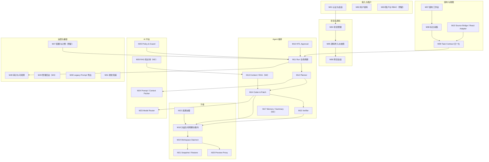

# 01. 功能模块梳理

> 状态：v1.0（M1 设计基线，已按 Q1–Q8 决策收敛）
> 日期：2026-11-04
> 项目：vibe-platform
> 依据：用户 Q1–Q8 决策、两条最高优先级架构铁律、补充约束，以及 `apps/legacy`（原 vibe-app）的 01–03 设计文档
> 范围：产品定位、角色、模块边界、主流程、MVP 范围与模块间契约；不包含具体代码实现

---

## 1. 文档目的

本文回答四个问题：

1. `vibe-platform` 由哪些功能模块组成；
2. 每个模块负责什么、不负责什么、依赖谁、产出什么；
3. 哪些能力进入 M1，哪些留到 M2/M3；
4. 模块之间通过什么契约协作，避免把画布、Agent、沙盒、计费混成一个黑盒。

本文是 `02.整体架构设计.md` 与 `03.API接口设计.md` 的功能基线。三份文档使用同一套模块编号、状态枚举和术语。

---

## 2. 产品定位与边界

### 2.1 一句话定位

> **Vibe Platform 是一个以画布为空间输入、以对话为意图输入、以 LangGraph 为编排内核、以云端沙盒为可信执行的 AI 前端开发平台。**

M1 聚焦：**React + Vite 项目的前端功能开发闭环**——圈选/对话提出修改，Agent 生成补丁，沙盒内构建、测试、截图，用户确认后写入项目快照。

### 2.2 目标用户

| 用户 | 核心诉求 | M1 支持 |
|---|---|---|
| 独立开发者 | 用画布和自然语言快速改前端 | 是 |
| 前端工程师 | 精准圈选、审查 Diff、控制修改范围 | 是 |
| 产品/设计 | 不写代码，直接描述界面修改 | 是（React 项目） |
| 团队/企业 | 协作、RBAC、审计、私有化 | M2/M3 |
| 非 React 项目用户 | Vue/Svelte/Next 的源码级修改 | M1 仅视觉兜底，M2 适配 |

### 2.3 系统做与不做

| 做 | 不做 |
|---|---|
| 管理用户、项目、源码快照、运行记录 | 不替代 Git 托管平台 |
| 在隔离沙盒内应用补丁、构建、测试、截图 | 不在宿主或用户本地直接执行生成代码 |
| 通过 LangGraph 编排 Agent 与 HITL | 不让 LLM 直接决定资源分配与安全策略 |
| 生成可审查的 Patch 与证据链 | 不生成并自动合并到用户生产分支 |
| 保存项目快照、运行产物、审计日志 | M1 不做团队协作、计费、模板市场 |
| 支持 React/Vite 源码级标注 | M1 不做 Vue/Svelte/Next 源码级适配 |
| 保留 legacy Prompt 导出与视觉兜底 | 不把 legacy 改造成新平台主链路 |

### 2.4 与 legacy 的关系

- `apps/legacy` 是原 `vibe-app` 的冻结副本，保留 Prompt-only、视觉模式、本地 Vite 接入能力。
- M1 新平台只承接 **React + Vite 源码模式** 的写任务。
- 非 React 项目、纯截图场景、Prompt 导出场景，M1 继续由 `apps/legacy` 提供；新平台预留入口与协议，不重复实现。
- legacy 只修关键 bug，不新增功能；不参与新平台的构建与部署主链路。

---

## 3. 核心决策

### 3.1 Q1–Q8 决策

| 编号 | 决策 | 对模块的影响 |
|---|---|---|
| Q1-B | 云端单租户，schema 预留 `tenant_id` | 所有业务表带 `tenant_id`；注册时创建 personal tenant；M1 不做组织管理 |
| Q2-B | 独立沙盒节点 + gVisor，接口抽象 `SandboxProvider`；本地开发用同机 Docker | 新增 Sandbox Service；M1 实现 `DockerProvider`，M2 实现 `GVisorProvider` |
| Q3-B | Java Spring Boot BFF/核心业务 + Python FastAPI AI 编排双核 | Java 管用户/项目/计费/长连接；Python 管 LangGraph/模型/沙盒调度 |
| Q4-B | 云端 Docker 沙盒权威验证 | 构建、测试、截图只在沙盒内执行；WebContainer 不进入 M1 |
| Q5-A | M1 仅 React Adapter，多框架预留 | Vite 插件只服务 React；非 React 走 legacy 视觉模式 |
| Q6-B | 邮箱/OAuth 单用户账号，RBAC 预留 | M1 个人账号；`membership/role` 表结构预留 |
| Q7-C | 数据持久化，代码存 MinIO，快照默认 30 天，日志脱敏 | MinIO 桶布局、生命周期、审计与脱敏模块 |
| Q8-B | M1 前端功能开发；完成 = 构建 + 测试 + 截图视觉验收 + 用户确认；自动修复 ≤3 次；RAG M2 | Run 状态机、Verifier、Approval、Budget 模块 |

### 3.2 架构铁律

| 编号 | 铁律 | 落地方式 |
|---|---|---|
| R1 | **禁止物理外键** | MySQL DDL、Flyway、MyBatis-Plus、SQLAlchemy 均不得出现 `FOREIGN KEY`；关联一致性由业务代码、唯一索引、对账任务保证 |
| R2 | **MVP 可妥协，但必须保留生产级替换路径** | 所有关键外部依赖通过接口抽象：`SandboxProvider`、`ModelRouter`、`EventBus`、`ObjectStorage`；在 02 文档设专节列出妥协点与替换路径 |
| R3 | 复用现有 Docker 中间件 | MySQL/Redis/MinIO 继续使用 `~/Workspace/infra`；平台不重复部署；沙盒容器独立启动 |
| R4 | 跨平台 | 服务统一 Docker Compose 编排；代码禁止硬编码绝对路径；路径用 `Path`/`Path.of`，配置用环境变量 |
| R5 | Monorepo | 新平台与 legacy 同仓；legacy 冻结在 `apps/legacy`；协议、画布核心、插件抽成 `packages/*` |

---

## 4. 核心概念

| 概念 | 定义 |
|---|---|
| Tenant | 租户。M1 每个用户注册时创建一个 personal tenant；所有业务数据带 `tenant_id` |
| Project | 一个前端项目，绑定框架、构建工具、源码模式和当前快照 |
| Snapshot | 项目源码的一次不可变快照，源码存 MinIO；运行快照默认 30 天 |
| Task Contract | 一次 Run 的输入契约：目标、范围、约束、验收标准、预算 |
| Annotation Envelope | 画布标注归一化后的结构化信封，包含 target、snippet、visual、drag、payload |
| Run | 一次 Agent 执行实例，有独立状态机、预算、事件流、沙盒和证据 |
| Patch | Agent 生成的代码变更，支持 Search/Replace 与 Unified Diff |
| Approval | 用户对补丁/结果的确认，M1 所有写入项目快照的操作都必须经过确认 |
| Sandbox | 隔离的运行环境，负责应用补丁、构建、测试、截图；有租约与 fencing token |
| Preview Session | 用户手动浏览项目时创建的沙盒预览会话 |
| Artifact | Run 产生的构建日志、测试报告、截图、Diff 等产物 |
| Source Mode | `source`（React/Vite 源码锚点）或 `visual`（仅截图，无源码定位） |

### 4.1 Run 状态

```text
QUEUED → PLANNING → CODING → APPLYING → VERIFYING → AWAITING_APPROVAL
   ↘         ↘         ↘         ↘           ↘
    CANCELLED / FAILED / REPAIRING → APPLYING
AWAITING_APPROVAL → SUCCEEDED / REJECTED / EXPIRED
```

| 状态 | 含义 |
|---|---|
| `QUEUED` | Java 已创建 Run，等待 Python 接单 |
| `PLANNING` | 生成计划与 Task Contract |
| `CODING` | 生成补丁 |
| `APPLYING` | 在沙盒原子应用补丁 |
| `VERIFYING` | 构建、测试、截图 |
| `REPAIRING` | 有界自动修复（≤3 次） |
| `AWAITING_APPROVAL` | 等待用户确认 |
| `SUCCEEDED` | 用户确认，已生成项目快照 |
| `REJECTED` | 用户拒绝，项目不变 |
| `FAILED` | 预算耗尽或不可恢复 |
| `CANCELLED` | 用户取消 |
| `EXPIRED` | 审批超时或沙盒过期 |

### 4.2 关键语义

1. **沙盒内的修改是临时的**。只有用户确认后，才把沙盒结果固化为新的项目快照。
2. **M1 所有写项目快照的操作都必须用户确认**；L0 自动应用留到 M2。
3. **非 React 项目不能创建写 Run**；M1 走 legacy 视觉/Prompt 导出。
4. **Run 的完成标准**：构建通过 + 测试通过（若项目有测试）+ 截图已生成 + 用户确认。
5. **自动修复最多 3 次**；超过后进入失败态，由用户决定重试或接管。

---

## 5. 角色与权限

| 角色 | 说明 | M1 权限 |
|---|---|---|
| 个人用户 | 注册/登录后的项目所有者 | 管理自己的项目、创建 Run、审批、查看产物 |
| 平台运维 | 部署与排障 | 只读审计、查看队列/沙盒状态；M1 用运维脚本 |
| Agent 系统 | LangGraph 与工具调用方 | 只能通过内部 API 访问沙盒/模型；不能直接写 MySQL |
| Sandbox | 执行环境 | 只接受带租约与 fencing token 的写命令 |
| Legacy | 旧版工具 | 独立运行；不共享新平台写权限 |

> RBAC（owner/admin/member/viewer）在表结构中预留，M1 不做团队 UI 与邀请流程。

---

## 6. 模块总览



### 6.1 模块清单

| ID | 模块 | 所属服务 | M1 | M2 | M3 |
|---|---|---|---|---|---|
| M01 | 认证与会话 | Java BFF | ✅ | 增强 | SSO |
| M02 | 用户资料 | Java BFF | ✅ | — | — |
| M03 | 租户与 RBAC | Java BFF | 预留 | 团队 | 企业 |
| M04 | 项目管理 | Java BFF | ✅ | — | — |
| M05 | 源码导入与快照 | Java BFF + MinIO | ✅ | Git 集成 | — |
| M06 | 预览会话 | Java BFF + Sandbox | ✅ | 多标签 | — |
| M07 | 画布工作台 | platform-web | ✅ | 多框架 | 协作画布 |
| M08 | 标注采集 | platform-web | ✅ | 更多标注类型 | — |
| M09 | Task Contract 归一化 | platform-web + protocol | ✅ | 约束模板 | — |
| M10 | Source Bridge / React Adapter | vite-plugin + SDK | ✅ | Vue/Svelte | Next/Angular |
| M11 | Run 生命周期 | Java BFF + AI Core | ✅ | 多 Agent | 队列/优先级 |
| M12 | Planner | AI Core | ✅ | 分层计划 | — |
| M13 | Context / RAG | AI Core + RAG | 基础上下文 | RAG | 知识图谱 |
| M14 | Coder & Patch | AI Core | ✅ | 多候选 | — |
| M15 | Verifier | AI Core + Sandbox | ✅ | 视觉模型 | 多浏览器 |
| M16 | HITL Approval | Java BFF + AI Core | ✅ | 自动审批 | 审批流 |
| M17 | Memory / Summary | AI Core | 简单摘要 | 分层摘要 | 跨项目记忆 |
| M18 | 沙盒生命周期与租约 | Sandbox | ✅ | gVisor | K8s/Firecracker |
| M19 | Workspace Daemon | Sandbox | ✅ | 性能优化 | — |
| M20 | Preview Proxy | Sandbox | ✅ | 通配子域 | 多区域 |
| M21 | Snapshot / Restore | Sandbox + MinIO | ✅ | 增量快照 | 跨区复制 |
| M22 | 资源治理 | Sandbox | 基础 | 配额/熔断 | 多节点调度 |
| M23 | Model Router | AI Core | DeepSeek + Mock | 多 provider | 路由策略 |
| M24 | Prompt / Context Packer | AI Core | ✅ | 预算化 | — |
| M25 | Policy & Guard | AI Core + Java | ✅ | 风险分级 | 合规策略 |
| M26 | RAG 知识库 | RAG | ❌ | ✅ | 多租户索引 |
| M27 | 配额与计费 | Java BFF | 预留 | 用量 | 计费 |
| M28 | 审计与可观测 | Java BFF + 全链路 | ✅ | OTel/Langfuse | 多区域 |
| M29 | 管理后台 | Java BFF | ❌ | 基础 | 完整 |
| M30 | Legacy Prompt 导出 | legacy | ✅ | 兼容 | — |
| M31 | 视觉兜底 | legacy | ✅ | 合并进新平台 | — |

---

## 7. 模块详述

### 7.1 接入与租户（M01–M03）

| 模块 | 核心职责 | 关键输入/输出 | 依赖 | 明确不做 |
|---|---|---|---|---|
| M01 认证与会话 | 注册、登录、OAuth、JWT、刷新、登出、WS ticket | 邮箱/密码/OAuth code → access/refresh token、用户上下文 | MySQL、Redis | 不做企业 SSO（M3） |
| M02 用户资料 | 昵称、头像、偏好、默认模型 | 用户资料 CRUD | MySQL | 不做社交关系 |
| M03 租户与 RBAC | personal tenant、membership、role 预留 | tenant_id、role | MySQL | M1 不做邀请/团队 UI |

**关键规则**

- 注册时在一个本地事务内创建 `user_account` + `tenant` + `membership(owner)`；不使用物理外键，靠业务代码保证。
- JWT `sub=userId`、`tenant_id`、`roles`；M1 `roles=["owner"]`。
- Access token 15 分钟；refresh token 30 天、旋转、HttpOnly Cookie；access token 只存内存。
- 所有业务查询强制带 `tenant_id`，防止跨租户读取。

### 7.2 项目与源码（M04–M06）

| 模块 | 核心职责 | 关键输入/输出 | 依赖 | 明确不做 |
|---|---|---|---|---|
| M04 项目管理 | 项目 CRUD、框架/构建工具/源码模式 | 项目元数据 | MySQL、M01 | 不做 Git 托管 |
| M05 源码导入与快照 | 上传 zip/tar、校验、存 MinIO、生成快照 | 源码归档 → snapshotId、storageKey | MinIO、MySQL | M1 不做 Git clone |
| M06 预览会话 | 从快照创建沙盒、返回预览 URL | projectId/snapshotId → preview URL | Sandbox、Preview Proxy | 不做多标签协作预览 |

**关键规则**

- M1 只接受 `framework=vite-react`、`buildTool=vite`、`sourceMode=source` 的项目创建“写 Run”。
- 上传包过滤 `node_modules`、`.git`、`dist`、`.next`；最大 200 MB；服务端扫描路径逃逸与二进制可执行文件。
- 快照不可变；源码 key：`tenants/{tenantId}/projects/{projectId}/snapshots/{snapshotId}/source.tar.zst`。
- 项目当前版本与已批准快照保留到项目删除；运行临时快照/产物默认 30 天。
- 预览会话 TTL 30 分钟；预览 URL 带短期签名 token，不能直接暴露沙盒。

### 7.3 画布与意图（M07–M10）

| 模块 | 核心职责 | 关键输入/输出 | 依赖 | 明确不做 |
|---|---|---|---|---|
| M07 画布工作台 | 无限画布、预览 iframe、三透镜、Diff 抽屉 | 用户交互 | platform-web | 不做源码编辑器全功能 |
| M08 标注采集 | note/draw/drag/visual-draw、截图、坐标 | CanvasAnnotation | M07 | 不自动截取跨域 iframe |
| M09 Task Contract 归一化 | 标注 + 对话 → Task Contract | RunCreateRequest | protocol | 不把自由文本直接丢给模型 |
| M10 Source Bridge | Vite 插件注入 `data-source`；SDK 握手/快照/命中/片段 | Target + snippet | vite-plugin、SDK | M1 不做 Vue/Svelte |

**关键规则**

- 无 `target.source` 的 element/region 标注不能进入写 Run，返回 `SOURCE_ANCHOR_REQUIRED`。
- 页面级对话（scope=page）允许没有标注，但项目必须是 `source` 模式。
- 标注坐标统一转成 `world` 坐标系；后端只接收选中目标投影，不接收完整 DOM。
- M1 只实现 React Adapter；`FrameworkAdapter` 接口与 `SourceAnchorV2` 字段在 `packages/protocol` 预留。
- 非 React 项目 `sourceMode=visual`，不能创建写 Run；前端引导到 legacy 视觉模式。

### 7.4 Agent 编排（M11–M17）

| 模块 | 核心职责 | 关键输入/输出 | 依赖 | 明确不做 |
|---|---|---|---|---|
| M11 Run 生命周期 | 创建、调度、状态机、预算、取消、事件 | Run + RunEvent | Java BFF、AI Core、Redis | 不做无界重试 |
| M12 Planner | 生成计划、范围、验收标准 | Task Contract → Plan | M23、M24 | 不让模型决定资源锁 |
| M13 Context / RAG | 上下文装配；M2 接 RAG | Context Pack | M24、M26 | M1 不做向量检索 |
| M14 Coder & Patch | 生成补丁、选择格式、校验 | Plan → Patch | M23、M24、M25 | 不整文件重写 |
| M15 Verifier | 构建、测试、截图、视觉证据 | VerificationResult | Sandbox、M23 | 不把 LLM 当作唯一裁判 |
| M16 HITL Approval | 审批卡、决定、恢复图 | Approval → Decision | Java BFF、LangGraph | 不做自动应用（M1） |
| M17 Memory / Summary | 会话/任务摘要；M2 分层 | Summary | Redis、M2 RAG | 不摘要代码原文 |

**关键规则**

- M1 单 Agent；M2 才引入 Supervisor/多 Agent。
- 自动修复最多 3 次；同错误指纹重复、无进展、预算耗尽都停止。
- M1 所有补丁在验证通过后进入 `AWAITING_APPROVAL`；用户确认才生成项目快照。
- HITL 使用 LangGraph durable interrupt；审批等待期间仍持有 checkpoint，不持有沙盒写锁。
- 用户拒绝 → `REJECTED`，沙盒丢弃，项目不变。

### 7.5 沙盒（M18–M22）

| 模块 | 核心职责 | 关键输入/输出 | 依赖 | 明确不做 |
|---|---|---|---|---|
| M18 沙盒生命周期与租约 | 创建/销毁、单写者租约、fencing token | sandboxId、lease | Docker/gVisor | 不做多写者共享 |
| M19 Workspace Daemon | 文件、补丁、命令、构建、git | 原子写/执行结果 | 沙盒容器 | 不访问宿主文件 |
| M20 Preview Proxy | 预览 URL、鉴权、HMR WS 代理 | previewUrl | 沙盒、Ingress | 不暴露沙盒端口 |
| M21 Snapshot / Restore | git commit/bundle、MinIO 快照、恢复 | snapshotKey | MinIO | 不做跨区复制（M3） |
| M22 资源治理 | CPU/内存/pids/磁盘/超时/回收 | 资源指标 | Docker/cgroups | 不做跨节点调度（M1） |

**关键规则**

- 单写者：每个沙盒任一时刻只有一个 writer，写命令必须带 `fencingToken`。
- 所有写操作走 Mutation Gateway；文件写带 `baseHash`，冲突返回 `PATCH_CONFLICT`。
- 沙盒不挂载宿主目录、不注入宿主环境变量、默认非 root、只读根、网络默认关闭或 allowlist。
- M1 `DockerProvider` 同机运行；M2 `GVisorProvider` 独立节点；接口不变。
- 预览代理必须校验短期 token；不能把沙盒内部端口直接暴露给浏览器。

### 7.6 AI 平台（M23–M26）

| 模块 | 核心职责 | 关键输入/输出 | 依赖 | 明确不做 |
|---|---|---|---|---|
| M23 Model Router | DeepSeek/Mock 路由、超时、重试、用量 | completion/usage | 外部模型 | M1 不做多 provider 自动路由 |
| M24 Prompt / Context Packer | 系统提示、上下文预算、片段裁剪 | Prompt/Context | protocol、M13 | 不把完整 DOM/源码塞入 |
| M25 Policy & Guard | 脱敏、输出校验、风险分级、危险操作拦截 | 允许/拒绝/脱敏后内容 | Java/Python | 不让 LLM 决定策略 |
| M26 RAG 知识库 | 组件卡索引、混合检索、重排 | Component Cards | Qdrant、Embedding | M1 不做 |

**关键规则**

- M1 模型固定 `DeepSeek + Mock`；`ModelRouter` 接口保留。
- 输出必须经过格式/危险内容校验；禁止 Diff 之外的整文件重写。
- 发送模型前脱敏邮箱、手机号、Token、AK/SK、Authorization 等；截图中的文字无法自动脱敏，前端明确提示。
- 策略引擎是确定性代码，LLM 只能给建议，不能 override。

### 7.7 运营与兼容（M27–M31）

| 模块 | 核心职责 | 关键输入/输出 | 依赖 | 明确不做 |
|---|---|---|---|---|
| M27 配额与计费 | 并发/项目/Token/沙盒分钟配额；用量记录 | quota、usage | MySQL、Redis | M1 不收费 |
| M28 审计与可观测 | 操作审计、Run 时间线、指标、日志 | audit、metrics、traces | OTel | M1 基础版 |
| M29 管理后台 | 用户/项目/沙盒/队列排障 | 运维视图 | M28 | M1 不做 |
| M30 Legacy Prompt 导出 | 旧版 Prompt 生成与复制 | Prompt | legacy | 不接入新 Run |
| M31 视觉兜底 | 任意页面截图圈画 | visual annotation | legacy | M1 不合并进新平台 |

---

## 8. 主流程

### 8.1 注册与登录

1. 用户注册 → Java BFF 创建 `user_account`、personal `tenant`、`membership(owner)`。
2. 登录成功 → 返回 access token（内存）+ refresh token（HttpOnly Cookie）。
3. 前端建立 WS 连接前，调用 `POST /auth/ws-ticket` 获取短期 ticket。

### 8.2 创建项目与上传源码

1. `POST /projects` 创建项目，指定 `framework=vite-react`、`buildTool=vite`、`sourceMode=source`。
2. `POST /projects/{id}/source/upload-url` 获取 MinIO 预签名上传 URL。
3. 前端直传 zip/tar → `POST /projects/{id}/source/snapshots` 校验、解压、扫描、生成 `project_snapshot`。
4. 预览会话从最新快照创建沙盒，返回签名预览 URL。

### 8.3 预览与 SDK 握手

1. 画布 iframe 加载预览 URL。
2. legacy SDK/Vite 插件（M1 复用）完成 `HELLO/WELCOME` 握手。
3. SDK 上报快照、`data-source`、JSX 片段能力。
4. 握手失败 → 项目仍可视觉预览，但不能创建写 Run。

### 8.4 标注 + 对话 → Task Contract

1. 用户点选元素/圈选区域/旁注/拖拽，或直接输入页面级需求。
2. 画布归一化为 Annotation Envelope：target、snippet、worldTarget、payload；再与对话合并为 Task Contract。
3. 前端组装 Task Contract，调用 `POST /projects/{id}/runs`。
4. 无 source 的 element/region 标注被拦截；非 React 项目被拦截。

### 8.5 Run 执行

1. Java BFF 校验、鉴权、配额、幂等键，写入 `run` 与 outbox。
2. Java 调用 Python AI Core `POST /internal/v1/executions`。
3. Python 创建 LangGraph checkpoint，调用 Sandbox Service 创建沙盒。
4. 图节点：Planner → Coder → Patch → Apply → Verify →（失败则 Repair ≤3）→ Approval。
5. Python 把事件写入 Redis Stream；Java 消费、持久化 `run_event`、推送 WS。

### 8.6 审批、应用与完成

1. 验证通过 → Python 发 `approval.required`；Java 写 `run_approval` 并推送审批卡。
2. 用户查看 Diff、构建/测试结果、改前/改后截图。
3. 用户批准 → Java 调用 Python 恢复图；Python 固化沙盒快照 → 发 `run.succeeded`。
4. Java 写入新的 `project_snapshot`，更新项目当前版本；旧版本按保留策略处理。
5. 用户拒绝 → Python 丢弃沙盒，发 `run.rejected`；项目不变。

### 8.7 修复循环与 HITL

- 失败 → Diagnose → 进度/指纹判断 → Repair（≤3）。
- 同一错误指纹重复、连续无进展、预算耗尽 → 停止，进入 `FAILED`；用户可重试、缩小范围或接管。
- 用户可取消、重试、缩小范围、手动接管。

### 8.8 快照与回滚

- 每次 Run 开始前固定 `baseSnapshotId`。
- 沙盒内每个补丁做一次 git commit；运行结束生成临时快照。
- 用户批准后，快照转为项目版本；可回滚到任意保留期内快照。
- 快照/产物默认 30 天；项目当前版本与已批准版本保留到项目删除。

### 8.9 非 React 视觉兜底

- 非 React 项目创建时 `sourceMode=visual`。
- 平台前端显示“当前项目仅支持视觉模式”，引导到 legacy 画布。
- legacy 继续提供截图圈画 + Prompt 导出；不进入新平台写 Run。

### 8.10 legacy Prompt 导出

- legacy 保持独立运行，可作为兼容基线。
- 新平台不调用 legacy 的内部实现；只保留入口链接与数据格式兼容说明。

---

## 9. 模块交互矩阵

| 调用方 | 被调用方 | 协议 | 说明 |
|---|---|---|---|
| platform-web | Java BFF | HTTPS REST | 认证、项目、Run、审批 |
| platform-web | Java BFF | WSS | Run 事件、审批、日志 |
| platform-web | Preview Proxy | HTTPS/WSS | iframe 预览、HMR |
| platform-web | Preview SDK | postMessage (L1) | 快照、命中、片段、高亮 |
| Java BFF | AI Core | HTTP internal | 创建/取消/审批 Run |
| AI Core | Java BFF | Redis Stream / HTTP fallback | Run 事件 |
| AI Core | Sandbox Service | HTTP internal | 创建沙盒、执行、验证、快照 |
| Sandbox Service | Docker/gVisor | Docker API / runtime | 容器生命周期 |
| Sandbox Service | MinIO | S3 API | 源码/快照/产物 |
| Java BFF | MySQL/Redis/MinIO | TCP | 业务数据、缓存、对象存储 |
| AI Core | Redis | TCP | checkpoint、事件、租约 |
| legacy | 用户项目 | iframe/postMessage | 旧版只读/视觉 |

---

## 10. MVP 范围与验收

### 10.1 M1 必须

| 能力 | 验收标准 |
|---|---|
| 账号 | 邮箱/密码 + 至少一个 OAuth 登录；JWT/刷新可用 |
| 项目 | 创建 React/Vite 项目、上传源码、生成快照 |
| 预览 | 从快照创建沙盒、iframe 可访问、SDK 握手成功 |
| 画布 | 元素点选、旁注、圈画、拖拽；生成 Annotation Envelope |
| Run | 创建、流式事件、取消、状态可查询 |
| Agent | Planner → Coder → Patch → Verify → Approval 闭环 |
| 沙盒 | 单写者租约、原子补丁、构建、测试、截图 |
| 审批 | 审批卡展示 Diff/证据；批准生成快照，拒绝不改项目 |
| 修复 | 自动修复 ≤3 次；失败可解释 |
| 数据 | MySQL/Redis/MinIO 复用现有实例；快照 30 天 |
| 兼容 | 非 React 走 legacy 视觉模式，不创建写 Run |

### 10.2 M1 不做

- Vue/Svelte/Next/Angular 源码级适配；
- RAG、多 Agent、团队 RBAC、计费、模板市场；
- WebContainer、gVisor 生产集群、K8s 调度；
- 生产级多区域、SSO、审计导出。

### 10.3 M1 验收指标

| 指标 | 目标 |
|---|---|
| 金任务成功率 | ≥70% |
| 首次预览 P95 | <60s |
| 自动修复收敛率 | ≥50% |
| 审批通过率 | ≥80% |
| 跨租户数据泄漏 | 0 |
| 回滚成功率 | 100% |
| 20 并发沙盒 | 无端口冲突、无 OOM |

---

## 11. 关键规则汇总

1. **禁止物理外键**：所有关联靠业务代码、唯一索引、对账任务。
2. **所有业务表带 `tenant_id`**：M1 也要带，查询强制过滤。
3. **无绝对路径**：配置走环境变量，路径用 `Path`/`Path.of`，容器工作目录可配置。
4. **沙盒是唯一写入口**：宿主、Java、Python 都不直接写用户源码。
5. **沙盒修改默认临时**：用户确认后才固化为项目快照。
6. **M1 只支持 React/Vite 源码模式**；非 React 走 legacy 视觉兜底。
7. **自动修复最多 3 次**；预算、指纹、进展、风险四道闸门。
8. **Java 是业务系统 of record**；Python 是 Agent 执行状态 of record；事件最终一致。
9. **M1 所有写快照必须用户确认**；自动审批留到 M2。
10. **legacy 冻结**：只修 bug，不新增功能，不参与新平台主链路。

---

## 12. 风险与待确认

| 风险 | 影响 | 缓解 |
|---|---|---|
| Java/Python 双核通信复杂 | 状态不一致、排障困难 | 明确 source of truth；事件带 seq；对账任务；traceId 贯穿 |
| 无物理外键 | 孤儿数据 | 业务校验、唯一索引、定时对账、软删除 |
| 同机 Docker 隔离弱 | 多租户安全 | M1 仅受控用户；M2 gVisor/独立节点 |
| React-only | 非 React 用户流失 | legacy 视觉兜底；M2 适配器 |
| 30 天快照 | 用户找不到历史 | 项目当前/已批准版本长期保留；明确 UI 提示 |
| 审批疲劳 | 用户放弃 | 审批卡聚合、证据充分、M2 信任阶梯 |
| 沙盒成本 | 账单失控 | 配额、TTL、预热池、预算硬闸 |

---

## 13. 决策追溯

| 决策 | 本文落点 |
|---|---|
| Q1-B | 3.1、7.1、11 |
| Q2-B | 3.1、7.5 |
| Q3-B | 3.1、7.4、7.5 |
| Q4-B | 3.1、8.5、8.6 |
| Q5-A | 3.1、7.3、8.9 |
| Q6-B | 3.1、7.1 |
| Q7-C | 3.1、7.2、8.8 |
| Q8-B | 3.1、7.4、10 |
| R1 禁止物理外键 | 3.2、11 |
| R2 MVP 妥协 | 02 文档第 14 节 |
| R3 复用中间件 | 3.2、02 部署 |
| R4 跨平台 | 3.2、02 部署 |
| R5 Monorepo | 3.2、02 项目结构 |
