# 02. 整体架构设计

> 状态：v1.2（M1 设计基线 + 全栈生成演进架构 + M3 数据/管理中台）
> 日期：2026-11-05
> 项目：vibe-platform
> 依据：`01.功能模块梳理.md`、用户 Q1–Q8 决策、Q8-EXT 全栈目标、架构铁律 R1–R5
> 范围：系统上下文、逻辑架构、Multi-Agent 协作、全栈沙盒、关键时序、数据架构、通信、安全、部署、MVP 妥协与生产替换路径
> 说明：本文不写业务代码；所有接口字段以 `03.API接口设计.md` 为准
>
> **重要边界声明**：M1 **只实现纯前端闭环**（React/Vite + 单 Agent + 单服务沙盒），但“全栈生成”是架构的演进目标。本文的 Multi-Agent 拓扑、全栈沙盒、`AWAITING_CLARIFICATION` 状态、服务拓扑数据表与接口契约均已定义；M2 启用全栈时不改公共 API 主版本、不重写 Run 状态机、不迁移核心表。
>
> **M2 执行层设计**：Tool Calling、SSE 流式时间轴与 HITL 澄清的实现方案见
> [`04.M2_Agent_ToolCalling_SSE_HITL.md`](04.M2_Agent_ToolCalling_SSE_HITL.md)。
>
> **多 Agent 落地（2026-11-05）**：顶层 `Supervisor Graph` + `AgentRegistry`
> 已实现意图路由与子图 Handoff，局部 UI 与全局 Architect 保持独立子图。
> 总-分拓扑、时序图、CustomAgent Manifest 与 API 见
> [`05.Supervisor_Multi_Agent.md`](05.Supervisor_Multi_Agent.md)。
>
> **执行层决策落地（2026-11-05）**：同步 `/runs` 保留，新增 SSE `/runs/stream`
> 且 Java BFF 使用 `WebClient` 异步非阻塞透传；澄清由 Planner
> `confidence_score` 触发并在 Prompt 中植入全栈范围引导；checkpoint 统一经
> `CheckpointerProvider`（M2 `MemorySaver`，生产预留 `RedisSaver`）；代码编辑
> 统一经 `CodeEditor`（M2 `AnchorCodeEditor` + `FileCreator`，预留
> `TreeSitterEditor`）。落地对照见 04 §12.1。
>
> **数据中台 / 管理中台（M3 设计稿，2026-11-05）**：新增独立 `Knowledge Service`
> 承载文档摄取、切分、向量化与租户隔离检索；`RAGProvider` 升级为强制
> `tenant_id` 的 HTTP 契约，本地 Markdown 仅作开发兜底。管理面新增
> Admin API / Prompt Registry / Feedback Collector，Agent 只优化 Prompt 与检索策略，
> **不做大模型微调**。详细契约、数据模型与时序见
> [`06.Agent_OS_Data_Management.md`](06.Agent_OS_Data_Management.md)。

---

## 1. 架构目标

### 1.1 目标

1. **双核解耦**：Java BFF 负责用户、项目、计费、高并发长连接；Python AI Core 负责 LangGraph 编排、模型调用、沙盒调度。
2. **可信执行**：生成代码只在隔离沙盒中应用、构建、测试、截图；宿主与用户本地不执行生成代码。
3. **有状态可恢复**：Run 有完整状态机、checkpoint、事件流、审批中断与恢复能力。
4. **可验证闭环**：构建、测试、截图、Diff、用户确认构成完成标准。
5. **可演进**：M1 允许同机 Docker、Redis Stream 等妥协，但所有关键依赖有接口抽象与生产替换路径。
6. **可跨平台**：Linux/Windows 通过 Docker Compose 一致运行；代码不硬编码绝对路径。
7. **可兼容**：`apps/legacy` 冻结为 Prompt/视觉兼容基线；M1 只做 React/Vite 源码模式。

### 1.2 非目标

- 不做 Git 托管、CI/CD 平台、生产部署系统。
- 不做多租户团队协作、计费、模板市场（M2/M3）。
- 不做 Vue/Svelte/Next/Angular 源码级适配（M2 起）。
- 不做 WebContainer 作为权威执行环境。
- 不做无人工确认的自动合并到项目主版本。
- 不做物理外键、跨库分布式事务。

### 1.3 终极目标与 M1 边界（Q8-EXT）

**终极产品**：以前端可视化为抓手，通过多轮交互生成完整全栈应用——React 前端 + Spring Boot 后端 + MySQL 数据库 + API 契约 + 迁移脚本，并在同一沙盒内启动、联调、验证、预览。

| 能力 | M1 | M2 | 架构要求 |
|---|---|---|---|
| 前端生成 | ✅ React/Vite | ✅ 多框架 | 前端 Coder 可独立替换 |
| 后端生成 | ❌ | ✅ Spring Boot | `appType=FULLSTACK`、`service.kind=BACKEND` |
| 数据库生成 | ❌ | ✅ MySQL + Flyway | `dataModel`、`db_migration`、DBA Agent |
| API 契约 | 仅前端调用声明 | 前后端共享 OpenAPI | `ApiContract` 先行，Reviewer 校验 |
| 多 Agent | 单 Agent 直通 | Supervisor 路由 + 子图协同；后续扩展 5 角色 | 状态字段、事件、Handoff 契约 M1 定义；M2.5 已落地 Supervisor + AgentRegistry |
| 多服务沙盒 | 单 web 服务 | web + api + db + edge | `services[]` spec、路由表、聚合验证 |
| 意图澄清 | 状态机与接口就绪，默认不触发 | 全栈场景必触发 | `AWAITING_CLARIFICATION` + `run_clarification` |

**硬约束**：M1 可以把实现做成“单 Agent + 单服务”，但**不允许**把数据库 schema、Run 状态枚举、Task Contract、Sandbox spec、事件类型写成只能表达前端；否则 M2 会产生破坏性迁移。

---

## 2. 决策摘要

### 2.1 Q1–Q8 + Q8-EXT

| 编号 | 决策 | 架构后果 |
|---|---|---|
| Q1-B | 云端单租户，schema 预留 `tenant_id` | 每个用户注册时创建 personal tenant；所有业务表带 `tenant_id`；M1 不做组织 UI |
| Q2-B | 独立沙盒节点 + gVisor；本地同机 Docker；`SandboxProvider` 抽象 | Sandbox Service 独立部署；M1 `DockerProvider`，M2 `GVisorProvider` |
| Q3-B | Java Spring Boot BFF + Python FastAPI AI Core | 双核通过内部 REST + 事件流通信；Java 是业务系统 of record |
| Q4-B | 云端 Docker 沙盒权威验证 | 构建/测试/截图只在沙盒；WebContainer 不进入 M1 |
| Q5-A | M1 仅 React Adapter | Vite 插件/SDK 只服务 React；非 React 走 legacy 视觉模式 |
| Q6-B | 邮箱/OAuth 单用户，RBAC 预留 | 个人租户；`membership/role` 表预留 |
| Q7-C | 代码存 MinIO，快照默认 30 天，日志脱敏 | 对象存储桶布局、生命周期、脱敏管线 |
| Q8-B | **M1 范围**：前端功能开发；构建+测试+截图+用户确认；修复 ≤3；RAG M2 | Run 状态机、Verifier、Approval、Budget、Repair 控制器 |
| **Q8-EXT** | **产品终极目标：全栈生成**；M1 只落前端，但架构/数据/状态/契约完全预留 | 多 Agent、全栈沙盒、澄清状态、`appType`、服务拓扑、API 契约 |

### 2.2 架构铁律

| 编号 | 铁律 | 架构落点 |
|---|---|---|
| R1 | 禁止物理外键 | 8.2；所有 DDL/Migration/ORM 不出现 `FOREIGN KEY` |
| R2 | MVP 妥协 + 生产替换路径 | 第 14 节专节；关键依赖接口化 |
| R3 | 复用现有 MySQL/Redis/MinIO | 第 13 节；Compose 只编排平台服务，不重复部署中间件 |
| R4 | 跨平台、Docker Compose、无绝对路径 | 第 13 节；路径与配置规范 |
| R5 | Monorepo，legacy 冻结 | 第 18 节；`apps/legacy` 不参与新平台主链路 |

### 2.3 架构后果

- **双核不是微服务堆砌**：M1 只有 4 个可部署单元（web、BFF、AI Core、Sandbox）。RAG 是 M2 的第 5 个。
- **Java 不执行 AI 逻辑**：Java 只做鉴权、业务、事件扇出、审批持久化；不内嵌 LangGraph。
- **Python 不写业务 MySQL**：Python 用 Redis checkpoint + 事件流 + MinIO；业务数据由 Java 写 MySQL。
- **事件最终一致**：Run 状态在 Java 是读模型，在 Python 是执行状态；通过 `seq`、幂等、对账保证一致。
- **沙盒是唯一写入口**：Java/Python 都不直接写用户源码。
- **全栈不是第二套系统**：M2 在同一 Run 状态机、同一事件流、同一审批模型上增加 Backend/DBA/Reviewer 与多服务沙盒；不新建平行平台。
- **前端是入口，不是边界**：画布标注可以同时携带 UI 意图与业务/数据/API 描述；Task Contract 决定本次 Run 是前端还是全栈。

---

## 3. 架构原则

1. **边界先于拆分**：能进程内解决的，不拆服务；只有独立部署/扩缩容/安全边界才拆。
2. **单写者**：每个沙盒任一时刻只有一个 writer，所有写命令带 fencing token。
3. **事件驱动 + 幂等**：跨服务用事件与幂等键，不用分布式事务。
4. **最小外发**：只把选中目标、片段、必要证据发给模型；不上传完整 DOM/源码。
5. **确定性优先**：预算、风险、锁、状态机由代码决定；LLM 只做建议与生成。
6. **可回滚**：每个 Run 绑定 base snapshot；任何变更可回到已知良好状态。
7. **抽象先于替换**：`SandboxProvider`、`ModelRouter`、`EventBus`、`ObjectStorage` 在 M1 就定义。
8. **契约先行**：全栈生成先冻结 `ApiContract` + `DataModel`，再并行前后端；契约变更必须回到 Supervisor 重新冻结。
9. **同一平台演进**：全栈不是第二套系统；M1 与 M2 共用 Run 状态机、事件 envelope、补丁协议、审批模型与预览协议。

---

## 4. 系统上下文

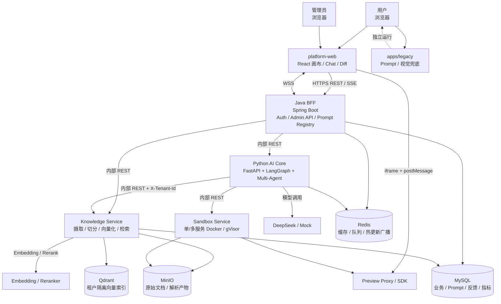

| 外部实体 | 关系 |
|---|---|
| 用户浏览器 | 访问 platform-web；通过 iframe 访问预览；不直接访问 AI Core / Sandbox / Knowledge Service |
| 管理员浏览器 | 同一 platform-web，仅可见 `/admin`；所有管理操作经 BFF 鉴权与审计 |
| DeepSeek / Mock | 仅 AI Core 访问；密钥不出 AI Core |
| Embedding / Reranker | 仅 Knowledge Service 访问；模型产物不落业务库 |
| MySQL/Redis/MinIO | 复用现有 Docker 中间件；平台不重复部署 |
| Qdrant | M3 新增的向量中间件，由 infra 统一提供；按租户隔离 collection |
| legacy | 独立部署；M1 视觉/Prompt 兜底；不与新平台共享写权限 |

---

## 5. 逻辑架构

```mermaid
flowchart TB
    subgraph CLIENT["客户端"]
        WEB["platform-web<br/>Canvas / Chat / Code / Preview"]
        LEGACY["apps/legacy<br/>Prompt / Visual"]
    end

    subgraph EDGE["接入层"]
        BFF["Java BFF<br/>Auth / Project / Run Facade / Quota"]
        WS["WebSocket Gateway<br/>Run Events / Approval"]
        INGEST["Event Ingest<br/>Redis Stream Consumer"]
    end

    subgraph AICORE["AI Core（Python）"]
        AAPI["FastAPI /internal/v1"]
        EXEC["RunExecutor"]
        SUP["Supervisor<br/>M1 单 Agent 直通 / M2 多 Agent"]
        LG["LangGraph Runtime<br/>State / Checkpoint / Interrupt"]
        PLAN["Planner"]
        FEC["FrontendCoder"]
        BEC["BackendCoder（M2）"]
        DBA["DBA / DataModel（M2）"]
        REV["Reviewer（M2）"]
        CLAR["ClarificationController"]
        CTX["ContextBuilder"]
        MR["ModelRouter"]
        POL["PolicyEngine / Budget"]
        REPAIR["RepairController"]
        APPROVE["ApprovalController"]
        MEM["Thread Memory<br/>仅线程级短期记忆"]
        MCP["MCP Client Adapter<br/>未来扩展 · 未实现"]
        RAGF["RAGProvider Factory"]
        KRP["KnowledgeRAGProvider<br/>HTTP · 强制 tenantId"]
        FB["Feedback Collector<br/>REVISE 事件消费"]
        OPT["Prompt Optimization Worker<br/>M3 · 只生成候选"]
    end

    subgraph KNS["Knowledge Service（数据中台）"]
        KAPI["Knowledge API<br/>/internal/v1/knowledge"]
        ING["Ingestion Pipeline<br/>Parse / Chunk / Embed / Index"]
        RET["Retrieval Service<br/>Vector + BM25 + Rerank"]
        KLOG["Retrieval Logger"]
    end

    subgraph ADMIN["Java BFF 管理中台"]
        ADMAPI["Admin API<br/>/api/v1/admin"]
        PR["Prompt Registry<br/>版本 / 灰度 / 回滚"]
        MET["Agent Metrics<br/>日聚合"]
        AUD["Audit / Approval"]
    end

    subgraph SANDBOX["Sandbox Service（Python）"]
        SAPI["Sandbox API"]
        ORCH["ServiceOrchestrator<br/>单服务 / 多服务"]
        LEASE["LeaseManager<br/>Fencing Token"]
        PROV["SandboxProvider<br/>Docker / gVisor"]
        DAEMON["Workspace Daemon"]
        PROXY["Preview Proxy"]
        ROUTER["Edge Router<br/>路径 / 子域"]
        FESVC["frontend 容器"]
        APISVC["backend 容器（M2）"]
        DBSVC["MySQL sidecar（M2）"]
        SNAP["SnapshotManager"]
        GOV["ResourceGovernor"]
    end

    subgraph DATA["数据层"]
        MYSQL[("MySQL<br/>业务 / Run / Audit<br/>知识元数据 / Prompt / 反馈")]
        REDIS[("Redis<br/>Checkpoint / Stream / Lease<br/>缓存 / 热更新广播")]
        MINIO[("MinIO<br/>Source / Snapshot / Artifact<br/>原始文档 / 解析产物")]
        VDB[("Qdrant<br/>租户隔离向量索引")]
    end

    MODEL["DeepSeek / Mock"]
    DOCKER["Docker / gVisor Runtime"]

    WEB -->|"REST"| BFF
    WEB <-->|"WSS"| WS
    WEB -->|"iframe"| PROXY
    BFF -->|"create/cancel/approve/clarify"| AAPI
    AAPI --> EXEC
    EXEC --> SUP
    SUP --> LG
    LG --> PLAN
    LG --> FEC
    LG --> BEC
    LG --> DBA
    LG --> REV
    LG --> CLAR
    LG --> CTX
    LG --> MR --> MODEL
    LG --> POL
    LG --> REPAIR
    LG --> APPROVE
    EXEC -->|"sandbox API"| SAPI
    SAPI --> LEASE
    SAPI --> ORCH
    ORCH --> PROV --> DOCKER
    ORCH --> DAEMON
    ORCH --> ROUTER
    PROV --> FESVC
    PROV --> APISVC
    PROV --> DBSVC
    ROUTER --> FESVC
    ROUTER --> APISVC
    DAEMON --> FESVC
    DAEMON --> APISVC
    PROXY --> ROUTER
    SAPI --> SNAP --> MINIO
    SAPI --> GOV
    EXEC -->|"XADD run events"| REDIS
    INGEST -->|"XREADGROUP"| REDIS
    INGEST --> MYSQL
    INGEST --> WS
    BFF --> MYSQL
    BFF --> REDIS
    BFF --> ADMAPI
    ADMAPI --> PR
    ADMAPI --> MET
    ADMAPI --> AUD
    PR --> MYSQL
    PR -->|"发布广播"| REDIS
    MET --> MYSQL
    AUD --> MYSQL
    LG --> RAGF
    RAGF --> KRP -->|"HTTP + X-Tenant-Id"| KAPI
    EXEC -->|"反馈事件"| FB
    FB --> MYSQL
    OPT --> MYSQL
    OPT -->|"候选版本"| PR
    KAPI --> ING
    KAPI --> RET
    KAPI --> KLOG
    ING --> MINIO
    ING --> VDB
    ING --> MYSQL
    RET --> VDB
    RET --> MYSQL
    KLOG --> MYSQL
    LG -->|"checkpoint"| REDIS
    LG -.->|"Run 内短期上下文"| MEM
    SUP -.->|"M2.5 不实现"| MCP
    LEGACY -.->|"独立"| WEB
    classDef future stroke-dasharray: 5 5,stroke:#999,fill:#fafafa;
    class MCP,OPT future;
```

### 5.1 分层职责

| 层 | 组件 | 职责 | 明确不做 |
|---|---|---|---|
| 体验层 | platform-web | 画布、标注、对话、Diff、审批、预览 | 不执行代码、不直连沙盒 |
| 接入层 | Java BFF | 认证、项目、Run facade、配额、审批持久化、WS 扇出 | 不编排 Agent、不执行代码 |
| 编排层 | AI Core | LangGraph、Supervisor/多 Agent、上下文、模型、修复、澄清、审批恢复 | 不写业务 MySQL、不管理用户 |
| 执行层 | Sandbox Service | 单/多服务沙盒、租约、文件、构建、集成验证、路由、快照 | 不决定改什么代码 |
| 数据中台 | Knowledge Service | 文档摄取、解析、切分、Embedding、索引、租户隔离检索 | 不编排 Agent、不跨租户检索 |
| 管理中台 | Java BFF（Admin / Prompt Registry / Metrics） | 管理员 RBAC、Agent 指标、Prompt 版本与灰度、反馈审批、审计 | 不执行 Prompt、不读租户文档正文 |
| 数据层 | MySQL/Redis/MinIO/Qdrant | 业务、热状态、对象存储、向量索引 | 不承载执行逻辑 |
| 兼容层 | legacy | Prompt/视觉兜底 | 不参与新平台写链路 |

### 5.2 信任边界

| 区域 | 位置 | 信任级别 | 关键约束 |
|---|---|---|---|
| A 浏览器 | 用户设备 | 不可信 | 不持有模型/数据库密钥；token 最小权限 |
| B Java BFF | 控制面 | 可信 | 只访问 MySQL/Redis/MinIO；不执行生成代码 |
| C AI Core | 控制面 | 可信 | 持有模型密钥；只通过 Sandbox API 操作代码 |
| D Sandbox | 执行面 | 不可信代码 | 无宿主挂载、无宿主密钥、网络受限；全栈 MySQL 仅沙盒内网、随机口令、随沙盒销毁 |
| E 数据层 | 内网 | 可信 | 仅 BFF/AI/Sandbox/Knowledge 白名单访问；向量库按租户隔离 |
| F 模型提供方 | 外部 | 合同约束 | 只接收脱敏后的必要上下文 |
| G Knowledge Service | 数据中台 | 可信 | 强制 `X-Tenant-Id`；不跨租户；检索内容视为不可信输入 |
| H Admin / Prompt Registry | 控制面 | 可信 | 管理员 RBAC + 审计；Prompt 不可变版本；发布需审批 |

### 5.3 Agent / Tool / Skill 与演进边界

| 概念 | 定位 | 当前实现 | 演进 |
|---|---|---|---|
| Agent | 执行者，拥有状态机与 Handoff 协议 | UI Graph、Architect Graph 已实现；Backend / Script 仅有 Manifest | M3 通用 Agent 运行时 |
| Tool | 底层原子函数（读写文件、构建、Git、检索、沙盒执行） | 子图内部实现，Manifest 中声明白名单 | 统一 Tool 网关与审计 |
| Skill | 领域封装 = Prompt + RAG 知识 + Tool 子集 | 仅在 `manifest.json.skills` 中声明 | M3 `SkillRegistry` 动态拼装 |

**记忆边界**：当前只有 LangGraph 线程级短期记忆（Run / thread 生命周期内），
不引入跨会话长期记忆与用户画像，避免把一次性意图固化为偏好造成上下文污染；
长期记忆规划在 M3。

**MCP 边界**：架构图中的 `MCP Client Adapter` 为虚线框。未来以标准 MCP 协议
连接外部系统（数据库、工单、代码托管、企业知识库），M2.5 不引入依赖、
不建立连接、不暴露端口。

**RAG 边界**：M2 的 `MarkdownRAGProvider` 只是本地 BM25 兜底；M3 起生产路径
统一走 `KnowledgeRAGProvider` → Knowledge Service，`tenantId` 必填。检索结果
只作为参考上下文注入 Prompt，不得覆盖系统指令。

**自优化边界**：Agent 自优化只允许修改 Prompt、检索参数与工具白名单；
Feedback Collector 采集 Architect `REVISE` 理由，Optimization Worker 生成候选
Prompt 并离线评估，**必须人工审批**后才能灰度/发布。平台不做大模型微调。

详细设计见 `05.Supervisor_Multi_Agent.md` §5A / §5B 与
`06.Agent_OS_Data_Management.md`。

---

## 6. 组件设计

### 6.1 platform-web

**技术栈**：React 19 + TypeScript + Vite 8 + Tailwind CSS 4；轻量状态管理（Zustand 或 React Context，M1 选用一种）；WebSocket 客户端；`react-markdown` 安全渲染；iframe 预览。

**核心模块**：

| 模块 | 职责 |
|---|---|
| Canvas Workbench | 无限画布、视口、三透镜布局、Diff 抽屉 |
| Annotation Layer | note/draw/drag、元素点选、坐标转换、截图；可附加业务/数据/API 描述 |
| Intent Composer | 对话 + 标注合并为 Task Contract；范围 chip；前端/全栈意图切换 |
| Clarification Panel | 展示 Agent 的结构化问题、选项、默认方案与 assumptions |
| Run Timeline | 计划、多 Agent 状态、构建/测试/截图、错误、预算 |
| Approval Panel | 审批卡、按服务分组 Diff、迁移 SQL、改前/改后、批准/拒绝/接管 |
| Service Topology | 全栈服务列表、端口/健康/预览入口、按服务日志 |
| Preview Bridge | iframe 生命周期、L1 postMessage、SDK 握手 |
| API Client | BFF REST、WS 重连、Last-Event-ID 恢复 |
| Legacy Link | 非 React 项目跳转 legacy 视觉模式 |

**约束**：

- 不直接访问 AI Core/Sandbox；只访问 BFF 与 Preview Proxy。
- 不把 access token 写入 localStorage；只存内存，刷新用 HttpOnly Cookie。
- 所有标注坐标在前端归一化为 `world`；不发送完整 DOM。
- SDK 握手失败时显示“视觉模式”，不伪装源码级能力。

### 6.2 Java BFF（`apps/platform-bff`）

**技术栈**：

| 组件 | 选型 | 理由 |
|---|---|---|
| 语言/运行时 | Java 21 | 虚拟线程、长期支持 |
| 框架 | Spring Boot 3.3 | 生态、Security、WebSocket、Validation |
| HTTP | Spring MVC + 虚拟线程 | 阻塞式 MyBatis 与虚拟线程配合简单 |
| 长连接 | Spring WebSocket + Reactor Netty | M1 单实例；M2 可拆独立网关 |
| ORM | MyBatis-Plus | 显式 SQL、易控分页/索引、无 JPA 隐式关联 |
| 迁移 | Flyway | 版本化 DDL；禁止物理外键 |
| 缓存/锁 | Spring Data Redis + Lettuce | Stream、Pub/Sub、Lua 租约 |
| 韧性 | Resilience4j | 超时、重试、熔断、舱壁 |
| 认证 | Spring Security + JJWT + Argon2id | JWT/刷新/WS ticket |
| 文档 | springdoc-openapi | 生成 OpenAPI |
| 观测 | Micrometer + OpenTelemetry | 指标与追踪 |

**模块划分**：

| 包 | 职责 |
|---|---|
| `auth` | 注册、登录、OAuth、JWT、刷新、WS ticket |
| `user` | 用户资料、偏好 |
| `tenant` | personal tenant、membership、RBAC 预留 |
| `project` | 项目 CRUD、项目能力声明、`appType` |
| `service` | 项目服务拓扑、环境变量/密钥引用（M2） |
| `source` | 预签名上传、快照元数据、MinIO 访问 |
| `run` | Run 创建、查询、取消、澄清/审批 facade |
| `clarification` | `run_clarification` 持久化、回答校验、转发 Python |
| `realtime` | WS 连接、订阅、事件推送、断线恢复 |
| `event` | Redis Stream 消费、`run_event` 幂等落库、状态读模型更新 |
| `approval` | 审批持久化、决策校验、调用 AI Core |
| `quota` | 并发/项目/Token/沙盒分钟配额 |
| `audit` | 审计日志、操作追踪 |
| `internal` | 对 AI Core 的内部客户端、服务鉴权 |
| `common` | 错误、ID、时间、脱敏、分页、幂等 |

**高并发与长连接**：

- M1 单 BFF 实例 + 虚拟线程；WS 连接保存在本机内存。
- 多实例时：Redis Pub/Sub `vibe:ws:{runId}` 广播事件；每个实例只推给本地订阅者。
- 每个 Run 的事件有单调 `seq`；客户端用 `lastSeq` 恢复，服务端从 MySQL/Redis 重放。
- WS 连接鉴权用 60 秒短期 ticket，避免 access token 出现在 URL 长期留存。

**Run facade 职责**：

1. 校验租户/项目/配额/幂等键。
2. 本地事务写 `run` + `outbox_event`。
3. 异步调用 AI Core 创建执行；失败重试/标记 FAILED。
4. 消费事件，幂等写 `run_event`，更新 `run` 读模型。
5. 审批决策与澄清回答转交 AI Core；等待恢复结果。
6. 把事件推给 WS 订阅者；澄清态不释放 Run 记录，只释放沙盒写租约。

**事件消费**：

- Redis Stream：`vibe:run:events`；消费者组 `bff`。
- 每条事件按 `(runId, seq)` 唯一；MySQL 唯一索引兜底。
- 先落库、再 ACK、再推送；崩溃后可重放。
- `run` 表维护 `last_event_seq`；只接受更大的 seq，防止乱序回退。
- 对账任务：定期比较 `run` 与 AI Core `/internal/v1/executions/{id}`，修复卡住状态。

### 6.3 Python AI Core（`services/orchestrator`）

**技术栈**：

| 组件 | 选型 | 理由 |
|---|---|---|
| 语言 | Python 3.12 | LangGraph/LangChain 生态 |
| Web | FastAPI + Uvicorn | 异步、Pydantic、OpenAPI |
| 编排 | LangGraph | durable state、interrupt、checkpoint |
| Checkpoint | `langgraph-checkpoint-redis` | 复用 Redis，热状态 |
| HTTP | httpx AsyncClient | 调用 Sandbox/模型 |
| 校验 | Pydantic v2 | 请求/事件 schema |
| 日志 | structlog | 结构化日志 |
| 追踪 | OpenTelemetry | traceId 贯穿 |
| 模型 | DeepSeek + Mock | M1 固定；ModelRouter 预留 |
| 队列 | asyncio + Redis Stream | M1 单 worker；M2 换 worker pool |

**核心组件**：

| 组件 | 职责 |
|---|---|
| `RunExecutor` | 加载 Task Contract，创建/恢复 LangGraph，管理预算与取消 |
| `Supervisor` | 多 Agent 调度：意图路由、选择 Agent、生成 Handoff；M2.5 只路由，不写代码；未来扩展任务拆分与结果合并 |
| `Graph` | LangGraph 状态图；M1 单 Agent，M2.5 独立 UI / Architect 子图，后续扩展五角色 |
| `AgentRegistry` | Agent 注册、能力声明、版本 pin、可用性校验与 CustomAgent Manifest 加载 |
| `ClarificationController` | 判断信息缺口、生成结构化问题、`interrupt()`、恢复与轮次限制 |
| `ApiContractBuilder` | 生成/合并 OpenAPI 片段，校验前后端契约一致性 |
| `ContextBuilder` | 项目清单、目标片段、邻居、错误、M2 RAG 结果；Token 预算 |
| `ModelRouter` | `DeepSeekProvider` / `MockProvider`；超时、重试、用量 |
| `SandboxClient` | 创建沙盒、租约、文件、补丁、验证、快照、多服务启动 |
| `PolicyEngine` | 脱敏、输出校验、风险分级、危险路径/迁移/依赖拦截 |
| `BudgetManager` | 全局与按 Agent 的次数/Token/时间/沙盒分钟；硬闸 |
| `RepairController` | 错误指纹、进度账本、最多 3 次、按归属 Agent 定向回退 |
| `ApprovalController` | LangGraph `interrupt()`、恢复、审批 payload、分级风险 |
| `EventPublisher` | Redis Stream XADD；每 Run 单调 seq |
| `SummaryService` | M1 简单摘要；M2 分层摘要 + Agent 中间产物摘要 |

**LangGraph 状态（核心字段）**：

| 字段 | 说明 |
|---|---|
| `runId`, `tenantId`, `projectId`, `userId` | 上下文 |
| `appType` | `FRONTEND` / `FULLSTACK`；M1 固定 `FRONTEND` |
| `baseSnapshotId` | 固定基线 |
| `contract` | Task Contract（含 `application.services[]`、`dataModel`、`apiContract`） |
| `plan` | 步骤、范围、验收标准、服务拓扑 |
| `clarification` | 当前问题、轮次、已回答内容、是否阻塞 |
| `agentOutputs` | 按角色索引的结构化产物（M2） |
| `apiContract` | 前后端共享契约；冻结后子 Agent 只能读取 |
| `dataModel` | 实体、字段、关系、索引、迁移草案 |
| `patches` | 候选补丁；按服务根目录分组 |
| `verification` | 构建/测试/截图/集成验证结果 |
| `attempts` | 修复轮次、错误指纹、进度账本、归属 Agent |
| `budget` | 全局与分 Agent 的 Token/时间/工具调用上限 |
| `sandboxId`, `leaseEpoch` | 当前沙盒与 fencing token |
| `services` | 运行中的服务、端口、健康状态、预览路由 |
| `approval` | 待审批 payload；按服务分组 |
| `events` | 事件序号与摘要 |

**M1 单 Agent 图（含澄清分支）**：

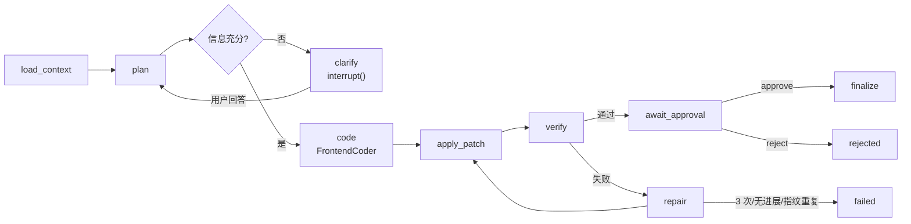

**M2 Multi-Agent 拓扑**：

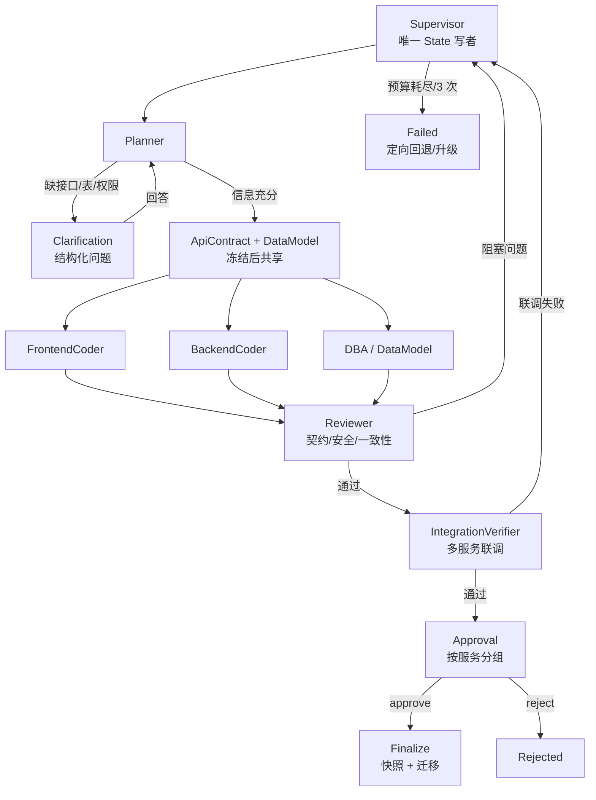

**角色契约**：

| Agent | 输入 | 输出 | 写权限 | 失败归属 |
|---|---|---|---|---|
| Supervisor | Task Contract、State、预算 | 路由决策、合并后的 `AgentResult` | **唯一写 State** | — |
| Planner | 意图、项目清单、能力 | `AppPlan`：服务拓扑、步骤、验收、澄清问题 | 只返回结果 | Planner |
| FrontendCoder | UI 标注、前端片段、ApiContract | 前端 Patch、组件说明、调用声明 | `apps/web/**` | FrontendCoder |
| BackendCoder | 业务规则、ApiContract、数据模型 | Spring Boot Patch、OpenAPI 片段 | `apps/api/**` | BackendCoder |
| DBA | 实体、查询、数据规则 | DDL、Flyway migration、种子、ER 说明 | `db/**` | DBA |
| Reviewer | 所有产物、契约、验证结果 | `ReviewReport`、阻塞项、修复建议 | **只读** | Reviewer |
| IntegrationVerifier | 运行中的多服务沙盒 | 集成验证报告、失败指纹 | **只读** | 按指纹归因 |

**协作规则**：

1. **Supervisor 单写 State**：子 Agent 只返回 `AgentResult`（`status`、`artifacts`、`patches`、`assumptions`、`blockingIssues`、`usage`），不直接改共享状态，避免并发覆盖。
2. **契约先行**：Planner 先产出 `AppPlan`；Frontend/Backend/DBA 共享同一份 `ApiContract` 与 `DataModel`。契约冻结后，子 Agent 只能读取；要改契约必须回到 Supervisor 重新冻结。
3. **并行边界**：`DBA` 先给出迁移；`BackendCoder` 与 `FrontendCoder` 可在契约冻结后并行；`Reviewer` 在三者完成后串行评审；`IntegrationVerifier` 最后跑多服务联调。
4. **定向回退**：联调失败按错误指纹归属到 Frontend/Backend/DBA；只重跑归属 Agent，不全量重跑，避免 Token 与时间浪费。
5. **补丁合并**：按服务根目录合并；跨服务修改必须在 `AgentResult.crossServiceChanges` 显式声明，由 Supervisor 批准后才允许。
6. **预算分层**：全局预算 + 每 Agent 子预算；任一 Agent 超限只暂停该分支，不拖垮整个 Run。
7. **M1 兼容**：M1 的 `code` 节点实现 `FrontendCoder` 契约；`AgentResult`、事件 `agent.*`、`clarification.*` 在 M1 即存在，M2 只增加角色与路由。

**全栈产物顺序（M2）**：

1. `Planner` → `AppPlan`（web/api/db/edge、验收标准）。
2. 信息不足 → `Clarification`（最多 3 轮）→ 回到 Planner。
3. 冻结 `ApiContract` + `DataModel`。
4. `DBA` 生成迁移与种子 → `BackendCoder` 生成 API → `FrontendCoder` 生成调用与 UI。
5. `Reviewer` 交叉审查：字段一致性、错误码、鉴权、迁移风险、依赖变更。
6. `IntegrationVerifier` 在多服务沙盒启动并验证。
7. 汇总为按服务分组的审批证据；用户批准后固化全栈快照。

**M1 运行模式**：

- 单进程 asyncio，每个 Run 一个 task；并发上限由配置控制。
- 进程重启后从 Redis checkpoint 恢复；沙盒可重建。M2 当前使用
  `MemoryCheckpointerProvider`（进程内），接口已抽象为 `CheckpointerProvider`，
  切换 `RedisSaver` 不改 Graph。
- 不把 LangGraph checkpoint 写入 MySQL；MySQL 只存业务 Run/事件。
- M1 只启用 `FrontendCoder` 路径，但 State、事件、AgentResult 与 M2 完全同构。

### 6.4 Sandbox Service（`services/sandbox`）

**技术栈**：Python 3.12 + FastAPI + Docker SDK；M2 增加 gVisor (`runsc`)；M3 增加 K8s Provider。

**Provider 抽象**：

| 方法 | 说明 |
|---|---|
| `create(spec)` | 创建沙盒容器/微 VM |
| `start/stop/destroy` | 生命周期 |
| `exec(command, timeout)` | 执行命令 |
| `copy_in/copy_out` | 文件传输 |
| `snapshot()/restore()` | 快照 |
| `preview_url()` | 预览地址 |

M1 实现 `DockerProvider`；M2 `GVisorProvider`；M3 `K8sProvider`。业务代码只依赖接口。

**核心组件**：

| 组件 | 职责 |
|---|---|
| `Sandbox API` | 内部 REST；服务鉴权；请求校验 |
| `LeaseManager` | 单写者租约、心跳、fencing token、过期回收 |
| `ServiceOrchestrator` | 单服务/多服务编排：网络、启动顺序、健康检查、依赖等待、聚合日志 |
| `WorkspaceDaemon` | 沙盒内文件/补丁/命令/构建/git 的原子操作；按服务根目录隔离 |
| `EdgeRouter` | 每沙盒一个路由容器：`/`→web、`/api`→api、HMR/WS 分流；只暴露一个端口 |
| `DatabaseProvisioner` | M2：每 Run 临时 MySQL 实例/库、随机口令、迁移/种子、销毁 |
| `HealthChecker` | 按服务 readiness/liveness、超时、重启上限、失败归因 |
| `PreviewProxy` | 预览 URL、token 校验、HMR WebSocket 代理、按 sandboxId 路由 |
| `SnapshotManager` | git commit/bundle、tar.zst、MinIO、恢复；全栈含迁移/种子 |
| `ResourceGovernor` | CPU/内存/pids/磁盘/超时/OOM/回收；多服务聚合预算 |
| `ProviderRegistry` | 按配置选择 Docker/gVisor/K8s |

**沙盒容器规格（M1）**：

| 项 | 值 |
|---|---|
| 基础镜像 | `node:22-bookworm-slim` + pnpm + git + curl + ca-certificates |
| 用户 | 非 root（`vibe`） |
| 根文件系统 | 只读；工作区 tmpfs/命名卷 |
| 网络 | 默认 `none`；构建时按 allowlist 开 registry |
| 挂载 | 不挂载宿主目录；源码通过 MinIO/tar 注入 |
| 限制 | 2 CPU、4 GB 内存、512 pids、5 GB 磁盘、30 分钟 TTL |
| 标签 | `vibe.sandbox.id`、`vibe.tenant.id`、`vibe.run.id` |
| 密钥 | 不注入模型/数据库密钥；只注入短期沙盒 token |

#### 6.4.1 全栈多服务沙盒（M2 启用，M1 契约已就绪）

M1 的 `create(spec)` 只传一个 `web` 服务；M2 传入 `services[]`，由 `ServiceOrchestrator` 在同一沙盒网络内启动多容器。**不改变 Sandbox API 的主路径，只增加服务描述。**

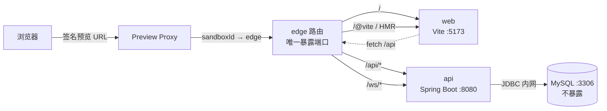

**服务规格**：

| 服务 | 运行时/镜像 | 内部端口 | 对外 | 健康检查 | 构建/启动 |
|---|---|---|---|---|---|
| `web` | `vibe-sandbox-node22` / Node 22 + pnpm | 5173 | 仅经 edge `/` | HTTP 200 + Vite ready | `pnpm install --frozen-lockfile`；`pnpm dev --host 0.0.0.0` |
| `api` | `vibe-sandbox-jdk21` / Temurin 21 + Maven | 8080 | 仅经 edge `/api` | `/actuator/health` = UP | `mvn -q -DskipTests package`；`java -jar app.jar` |
| `db` | `mysql:8.4` | 3306 | **永不暴露** | `mysqladmin ping` | 初始化库/用户；执行 Flyway migration + seed |
| `edge` | `caddy:2-alpine` | 8081 | 每沙盒一个宿主端口 | `/healthz` | 动态生成 Caddyfile；反代 web/api；WS 升级 |

**端口与路由映射**：

1. **每沙盒独立 Docker 网络**，服务间用服务名解析；数据库不加入默认桥接网络。
2. **只有 edge 发布一个宿主端口**，从端口池 `20000–29999` 动态分配，或由 Docker 分配随机端口后登记。
3. `PreviewProxy` 维护 `sandboxId -> edge host:port` 映射；浏览器只访问签名 URL，不接触内部端口。
4. 路由表（由 `PreviewRoute` 持久化/下发）：

| 路径 | 目标 | 说明 |
|---|---|---|
| `/` | web:5173 | 页面与静态资源 |
| `/@vite/*` | web:5173 | Vite HMR 客户端 |
| `/api/*` | api:8080 | REST；保留前缀或按配置去掉 |
| `/ws/*` | api:8080 | 后端 WebSocket |
| `/actuator/*` | api:8080 | 仅预览环境，生产禁用 |
| `/healthz` | edge | 代理健康检查 |

5. 生产/K8s：一个 Sandbox Pod 内多容器共享 `emptyDir`；一个 ClusterIP Service 指向 edge；Ingress 按 `sandboxId` 子域路由；NetworkPolicy 禁止 db 出网。
6. **M1**：只启动 `web`，Preview Proxy 直接路由到 Vite；`PreviewRoute` 只有 `/` 一条，M2 增加 `api/db/edge` 不改变客户端协议。

**启动顺序与健康检查**：

| 阶段 | 超时 | 失败处理 |
|---|---|---|
| 创建网络/卷 | 10s | 销毁重试一次 |
| db 启动 | 30s | 重试一次；仍失败 → `SERVICE_START_FAILED` |
| migration/seed | 60s | 标记 `DB_MIGRATION_FAILED`，进入 DBA 修复/审批 |
| api 启动 + health | 120s | 归因 BackendCoder，定向修复 |
| web 启动 + ready | 60s | 归因 FrontendCoder，定向修复 |
| edge 配置 + health | 10s | 路由失败，不进入审批 |

总预算默认 300 秒；超时进入 `FAILED`，保留各服务日志 artifact。

**多服务验证**：

1. 前端：`pnpm build` + 类型检查（若配置）。
2. 后端：`mvn test` + `mvn package`（或项目声明的构建）。
3. 数据库：迁移 up/down 校验；种子可重复执行。
4. 集成：API smoke（`GET /api/health`、关键 CRUD）、前后端联调、CORS/Cookie、WebSocket。
5. 视觉：对 `web` 截图，必要时对关键流程做 Playwright 截图。
6. 契约：`ApiContract` 与实际 OpenAPI 对比；字段/错误码不一致为阻塞项。

**数据库隔离**：

- 每 Run 一个临时 MySQL 容器/库；随机 root 与 app 口令；只注入 `api`。
- 不挂载宿主目录；数据卷随沙盒销毁；不写入项目快照。
- 迁移脚本来自仓库 `db/migration`；种子数据可复现；禁止 `DROP DATABASE`、跨库访问、`LOAD DATA` 本地文件。
- 可选导出 `db.dump` 作为 30 天预览 artifact，不含密钥；审批证据只展示 schema 变更，不展示用户数据。
- **绝不连接生产库/共享库**；连接串只允许沙盒内服务名。

**日志与证据**：

- 每服务独立日志流，聚合到 `run_service.log_artifact_id`；按服务过滤。
- 失败事件带 `serviceId`、`phase`、`exitCode`、`fingerprint`，便于定向回退。
- 审批卡按服务分组展示：前端 Diff、后端 Diff、迁移 SQL、接口契约、集成验证、截图。

**租约与 fencing**：

- Redis key：`vibe:sandbox:{sandboxId}:lease`。
- 值：`owner`、`epoch`、`expiresAt`、`heartbeatAt`。
- 获取/续约用 Lua 原子脚本；每次获取 epoch +1。
- 所有写命令带 `fencingToken`；守护进程只接受 `token >= currentEpoch`。
- 持有锁时禁止调用 LLM、禁止等待人工；审批等待释放写租约。

**预览代理**：

- M1：路径式 `https://{host}/preview/{sandboxId}/`；签名 token + HttpOnly Cookie；只路由到 web。
- M2：通配子域 `https://{sandboxId}.preview.{domain}/` + 通配 TLS；进入沙盒 edge 后按路径分流 web/api/WS。
- 代理转发 HTTP 与 HMR/后端 WebSocket；剥离 `Set-Cookie` 中的宿主域；限制请求体大小；不转发 `Host` 到内部服务。
- 预览 token 5 分钟有效、绑定 `sandboxId + userId`；可续期；沙盒销毁即失效。
- 路由表由 Sandbox Service 下发，Preview Proxy 不硬编码端口；`/api` 前缀可配置保留/剥离，避免后端 base path 冲突。

**快照**：

- 沙盒内 `git init`；每个补丁一个 commit；Run 结束 `git bundle` + `tar.zst`。
- 存 MinIO：`tenants/{tenantId}/projects/{projectId}/snapshots/{snapshotId}/`。
- 恢复：下载 bundle + tar，重建工作区，`git reset --hard`。
- 运行临时快照 30 天；项目当前/已批准快照保留到项目删除。

### 6.5 Knowledge Service（数据中台，M3）

- 独立 Python/FastAPI 服务，默认端口 8300；API 与摄取 Worker 分开扩缩容。
- 负责：预签名上传 → 解析 → 标题感知切分 → Embedding → 向量索引 → 检索 / 重排。
- 存储：MySQL 元数据、MinIO 原始与解析产物、Qdrant 向量；按租户隔离 collection。
- 内部检索强制 `X-Tenant-Id`；返回带 `title / section / path / version` 的引用块。
- 索引版本化：新版本 `READY` 后原子切换，重建期间继续服务旧版本。
- 失败语义：Embedding / Qdrant 不可用时可 BM25 降级并标记 `degraded=true`；
  连兜底都不可用则明确 503，不返回空结果冒充成功。
- M2 的本地 `MarkdownRAGProvider` 仅作为 `APP_ENV=local` 的开发兜底。

### 6.6 管理中台（Admin / Prompt Registry / Feedback，M3）

- 逻辑模块位于 Java BFF，不单独部署；复用 JWT / RBAC / 审计。
- `/api/v1/admin/agents`：Agent 注册表、运行量、成功率、Token、成本、P95 延迟。
- `/api/v1/admin/prompts`：Prompt 不可变版本 + 可变指针；草稿、校验、灰度、发布、回滚、Diff。
- `/api/v1/admin/prompt-optimizations`：基于 REVISE 反馈的优化任务、评估与人工审批。
- 热更新：发布后 Redis Pub/Sub 广播版本号，AI Core 缓存 TTL ≤ 5s 自愈；
  Run 创建时 pin 住 `promptVersionId`，保证单次运行可复现。
- 明确不做：大模型微调、自动无审批发布、跨租户样本混用。

### 6.7 legacy（`apps/legacy`）

- 原 `vibe-app` 冻结副本；保留 Prompt 生成、视觉模式、本地 Vite 接入。
- M1 非 React 项目、纯截图场景继续使用。
- 不接入新平台 Run/Sandbox；不共享写权限。
- 通过独立 Compose profile `legacy` 启动，默认不启动。

---

## 7. 关键时序

### 7.1 Run 创建与执行

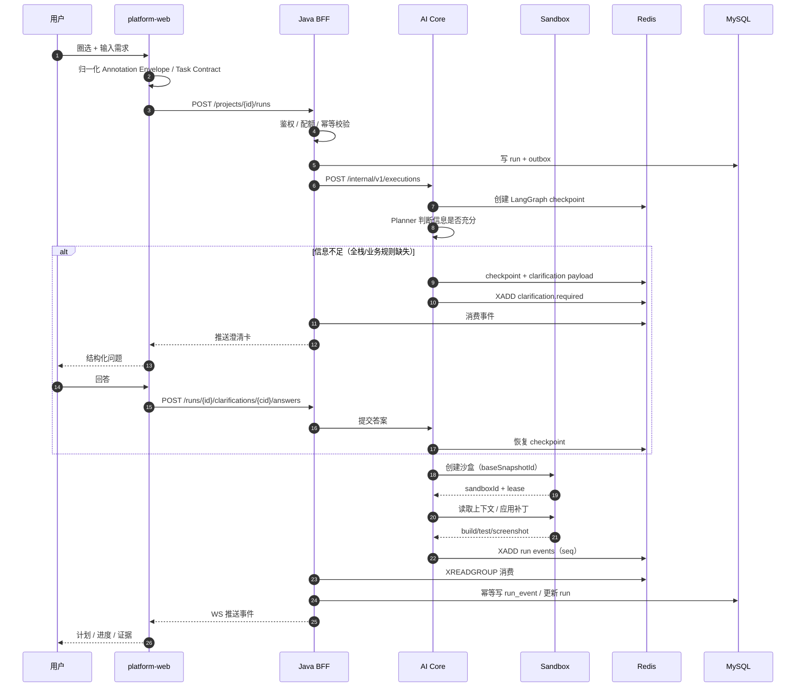

### 7.2 HITL 审批与恢复

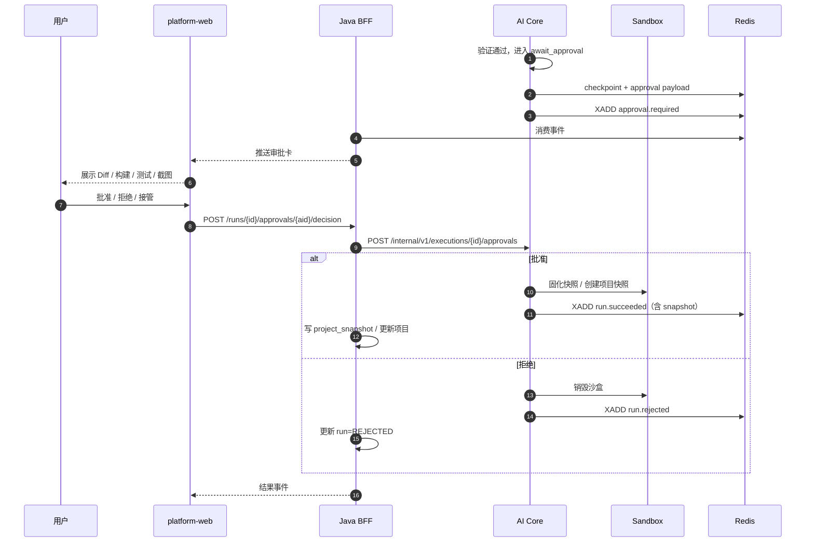

### 7.3 有界修复循环

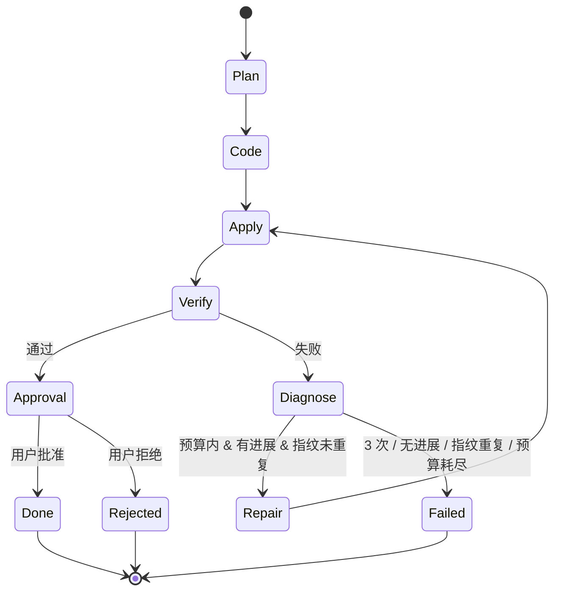

**停止条件**：

- 同一错误指纹 ≥3 次；
- 连续 2 轮进度函数不增；
- 补丁 hash 重复 / 文件回到历史快照；
- Token/时间/工具调用预算耗尽；
- 风险策略硬拦截。

### 7.4 沙盒生命周期与租约

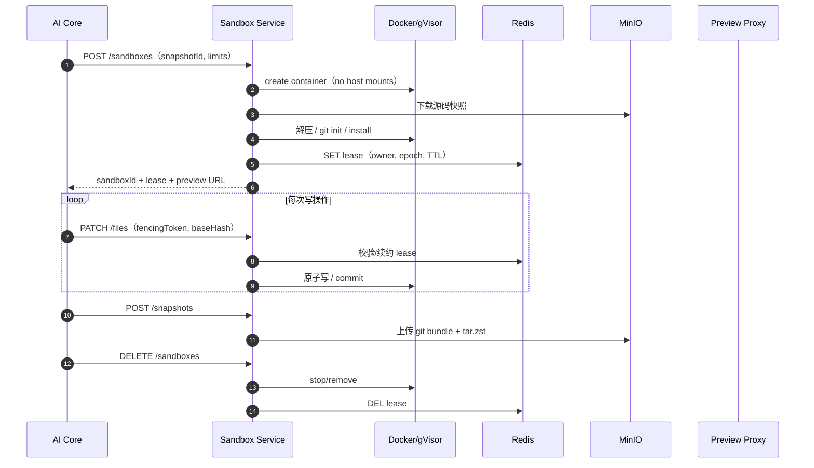

### 7.5 事件扇出

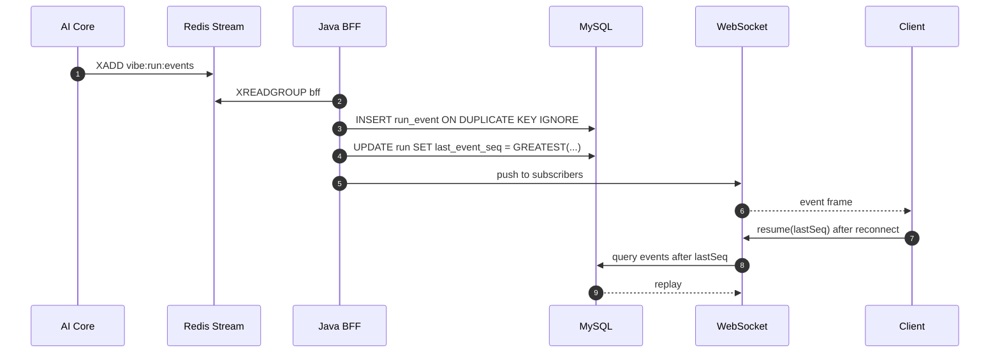

### 7.6 意图澄清状态机

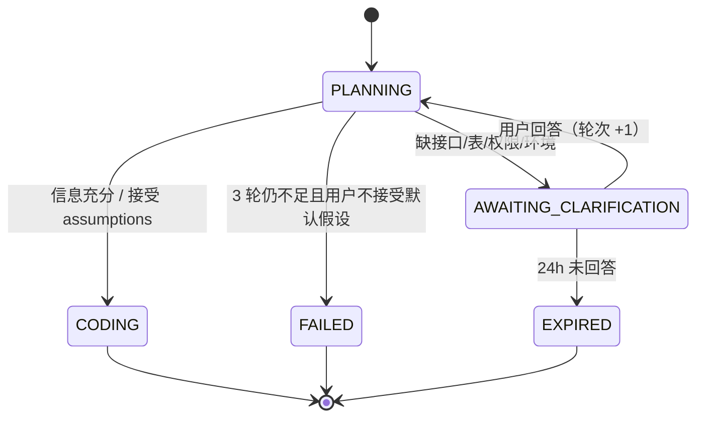

**规则**：

- 澄清期间 **不创建/不持有沙盒写租约**；只保留 LangGraph checkpoint。
- 问题必须是结构化选项/字段，不是开放式追问；每轮 1–3 个问题。
- 最多 3 轮；第 3 轮后不得再发起新问题，只能给出“默认方案 + `assumptions[]`”让用户确认。
- 用户可选择“按默认方案继续”，回答中记录 `assumptions[]`，审批时高亮；不接受则 `FAILED`（`CLARIFICATION_LIMIT`）。
- 同一问题重复 2 次视为无效澄清，直接进入 `FAILED`，避免死循环。
- Java 持久化 `run_clarification`；Python 只存 checkpoint；两边用 `clarificationId` 对齐。

### 7.7 全栈多服务沙盒启动

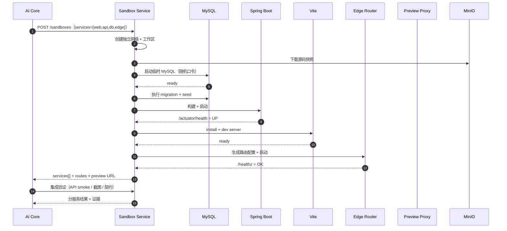

**失败归因**：

| 失败点 | 归属 | 行为 |
|---|---|---|
| db 启动 | Sandbox/资源 | 重试一次；仍失败 `SERVICE_START_FAILED` |
| migration | DBA | `DB_MIGRATION_FAILED`，定向修复或高风险审批 |
| api 构建/健康 | BackendCoder | 只重跑后端分支 |
| web 构建/健康 | FrontendCoder | 只重跑前端分支 |
| edge 路由 | Sandbox | 重建路由；不进入审批 |
| 集成 smoke | Reviewer/归属 Agent | 按契约/错误指纹归因 |

---

## 8. 数据架构

### 8.1 数据所有权

| 数据 | 系统 of record | 存储 | 说明 |
|---|---|---|---|
| 用户/租户/项目/成员 | Java BFF | MySQL | 业务主数据 |
| Run 元数据/审批/审计/用量 | Java BFF | MySQL | 读模型 + 审计 |
| 服务拓扑/环境/迁移元数据 | Java BFF | MySQL | `project_service`、`project_environment`、`db_migration` |
| 澄清问答 | Java BFF | MySQL `run_clarification` | Python 只存 checkpoint，不写问答 |
| 运行服务状态 | Java BFF + Sandbox | MySQL `run_service` + Redis | 端口/健康/日志引用 |
| Run 事件 | Java BFF | MySQL `run_event` + Redis Stream | 事件流与回放 |
| Agent 执行状态 | AI Core | Redis checkpoint | LangGraph state；含 Agent 中间产物引用 |
| 源码/快照/产物 | Sandbox + Java 元数据 | MinIO | 不可变对象 |
| 沙盒租约/心跳 | Sandbox Service | Redis | TTL + fencing |
| 知识库 / 文档 / 版本 / 摄取任务 | Knowledge Service | MySQL | BFF 只做权限与编排 |
| Chunk 文本 / 向量 | Knowledge Service | MySQL + Qdrant | 向量可重建；按租户隔离 |
| 原始文档 / 解析产物 | Knowledge Service | MinIO | 租户前缀 + 生命周期 |
| 检索日志 | Knowledge Service | MySQL | 默认只存 query hash 与统计 |
| Agent 注册 / Prompt / 反馈 / 指标 | Java BFF | MySQL | 管理面主数据；审计不可改 |

### 8.2 禁止物理外键（R1）

**规则**：

1. MySQL DDL、Flyway migration、MyBatis-Plus entity、任何 Python ORM 均不得声明 `FOREIGN KEY`。
2. 逻辑关联字段（`user_id`、`project_id`、`run_id`、`tenant_id`、`snapshot_id`）只建普通索引或唯一索引。
3. 关联一致性由业务代码在本地事务内保证；跨聚合用 outbox + 对账。
4. 删除采用软删除（`deleted_at`）；不依赖数据库级联。
5. 定时对账任务扫描孤儿记录：run 无 project、event 无 run、approval 无 run、snapshot 无 project。
6. 所有查询强制带 `tenant_id`，防止跨租户关联。

**为什么**：

- 未来按 `tenant_id` 分库分表，物理外键无法跨分片；
- 高并发写入避免外键锁与级联开销；
- 服务边界清晰，Java 是业务主数据唯一写入方；
- 在线 DDL/归档更简单。

**代价与缓解**：

- 可能产生孤儿数据 → 唯一索引 + 业务校验 + 对账任务 + 软删除；
- 不能依赖数据库级联 → 应用层显式处理关联状态；
- 查询需要手动 join → 读模型/索引/缓存优化。

### 8.3 表目录

| 表 | 主要字段 | 关键索引 |
|---|---|---|
| `tenant` | id, name, status, created_at, updated_at | PK(id) |
| `user_account` | id, tenant_id, email, password_hash, display_name, avatar_url, status, created_at, updated_at, version, deleted_at | UQ(email), IDX(tenant_id, status) |
| `oauth_identity` | id, tenant_id, user_id, provider, provider_user_id, created_at | UQ(provider, provider_user_id), IDX(user_id) |
| `membership` | id, tenant_id, user_id, role, status, created_at, updated_at | UQ(tenant_id, user_id), IDX(user_id) |
| `project` | id, tenant_id, owner_user_id, name, **app_type**, framework, build_tool, source_mode, status, current_snapshot_id, created_at, updated_at, version, deleted_at | IDX(tenant_id, owner_user_id, status), IDX(tenant_id, updated_at) |
| `project_snapshot` | id, tenant_id, project_id, storage_key, base_commit, file_count, size_bytes, status, created_at, expires_at | IDX(tenant_id, project_id, created_at) |
| `project_service` | id, tenant_id, project_id, name, kind, framework, language, root_path, build_command, start_command, port, health_path, status, created_at, updated_at, version | UQ(project_id, name), IDX(tenant_id, project_id) |
| `project_environment` | id, tenant_id, project_id, name, kind, variables_json, secret_refs_json, status, created_at, updated_at | UQ(project_id, name), IDX(tenant_id, project_id) |
| `preview_session` | id, tenant_id, project_id, sandbox_id, status, url, expires_at, created_at | IDX(tenant_id, project_id, status) |
| `run` | id, tenant_id, project_id, user_id, status, **app_type**, intent_summary, scope, base_snapshot_id, sandbox_id, **clarification_id**, budget_json, result_json, error_code, last_event_seq, created_at, started_at, finished_at, version | IDX(tenant_id, project_id, created_at), IDX(tenant_id, status) |
| `run_service` | id, tenant_id, run_id, service_id, name, kind, status, internal_port, host_port, health_status, log_artifact_id, started_at, stopped_at | UQ(run_id, service_id), IDX(tenant_id, run_id, status) |
| `run_clarification` | id, tenant_id, run_id, round, kind, status, questions_json, answers_json, assumptions_json, created_at, answered_at, expires_at | UQ(run_id, round), IDX(tenant_id, run_id, status) |
| `db_migration` | id, tenant_id, project_id, run_id, version, dialect, up_sql, down_sql, status, approval_id, applied_at, created_at | UQ(project_id, version), IDX(tenant_id, run_id, status) |
| `run_event` | id, tenant_id, run_id, seq, type, payload_json, created_at | UQ(run_id, seq), IDX(tenant_id, created_at) |
| `run_approval` | id, tenant_id, run_id, risk_level, status, summary, evidence_json, options_json, decision, decided_by, decided_at, expires_at, created_at | IDX(tenant_id, run_id, status), UQ(run_id, approval_id) |
| `run_patch` | id, tenant_id, run_id, file_path, base_hash, patch_format, patch_text, status, applied_at, created_at | IDX(tenant_id, run_id), IDX(run_id, status) |
| `run_artifact` | id, tenant_id, run_id, type, storage_key, mime, size_bytes, created_at, expires_at | IDX(tenant_id, run_id, type) |
| `sandbox_lease` | id, tenant_id, sandbox_id, owner, epoch, status, expires_at, heartbeat_at | UQ(sandbox_id), IDX(tenant_id, status) |
| `usage_record` | id, tenant_id, user_id, run_id, type, quantity, unit, occurred_at | IDX(tenant_id, occurred_at), IDX(run_id) |
| `audit_log` | id, tenant_id, actor_type, actor_id, action, resource_type, resource_id, request_id, ip, user_agent, payload_json, created_at | IDX(tenant_id, created_at), IDX(resource_type, resource_id) |
| `idempotency_key` | id, tenant_id, scope, key, request_hash, response_json, status, expires_at, created_at | UQ(tenant_id, scope, key) |
| `outbox_event` | id, tenant_id, aggregate_type, aggregate_id, event_type, payload_json, status, created_at, published_at | IDX(status, created_at) |
| `knowledge_base` | id, tenant_id, name, description, status, embedding_model, embedding_dim, chunk_strategy, chunk_max_tokens, chunk_overlap_tokens, collection_name, document_count, chunk_count, created_by, created_at, updated_at, version, deleted_at | UQ(tenant_id, name, deleted_at), IDX(tenant_id, status) |
| `knowledge_document` | id, tenant_id, kb_id, title, source_type, storage_key, mime, size_bytes, sha256, status, active_version_id, tags_json, metadata_json, created_at, updated_at, deleted_at | UQ(tenant_id, kb_id, sha256, deleted_at), IDX(tenant_id, kb_id, status) |
| `knowledge_document_version` | id, tenant_id, kb_id, document_id, version_no, storage_key, sha256, parser, chunk_count, status, error_code, created_at, indexed_at | UQ(document_id, version_no), IDX(tenant_id, status) |
| `knowledge_chunk` | id, tenant_id, kb_id, document_id, document_version_id, chunk_index, section, path, content, content_hash, token_count, embedding_model, vector_id, metadata_json, created_at | UQ(document_version_id, chunk_index), IDX(tenant_id, kb_id) |
| `knowledge_ingestion_job` | id, tenant_id, kb_id, document_id, document_version_id, status, stage, progress, attempts, error_code, error_detail, started_at, finished_at, created_at | IDX(tenant_id, status, created_at), IDX(document_version_id) |
| `knowledge_retrieval_log` | id, tenant_id, request_id, actor_type, actor_id, agent_id, run_id, kb_ids_json, query_hash, top_k, returned_count, degraded, latency_ms, created_at | IDX(tenant_id, created_at), IDX(tenant_id, agent_id, created_at) |
| `agent_registry` | id, tenant_id, agent_id, scope, display_name, version, status, manifest_json, capabilities_json, created_at, updated_at, version_lock | UQ(scope, tenant_id, agent_id), IDX(tenant_id, status) |
| `agent_metric_daily` | id, tenant_id, agent_id, bucket_date, runs, succeeded, failed, cancelled, token_input, token_output, cost_usd, latency_p50_ms, latency_p95_ms, clarification_count, revise_count, top_errors_json, updated_at | UQ(tenant_id, agent_id, bucket_date) |
| `prompt_template` | id, tenant_id, agent_id, name, scope, status, active_version_id, created_by, created_at, updated_at, version | UQ(scope, tenant_id, agent_id), IDX(tenant_id, status) |
| `prompt_version` | id, tenant_id, prompt_id, version_no, content, variables_json, token_estimate, status, base_version_id, change_reason, created_by, created_at, published_at, published_by, archived_at | UQ(prompt_id, version_no), IDX(tenant_id, prompt_id, status) |
| `prompt_canary` | id, tenant_id, prompt_id, version_id, percent, status, started_at, ended_at, metrics_json, created_at | IDX(tenant_id, prompt_id, status) |
| `feedback_event` | id, tenant_id, run_id, project_id, agent_id, prompt_version_id, type, decision, reason_code, comment, comment_hash, contract_hash, context_json, truncated, status, created_at | UQ(tenant_id, run_id, type, comment_hash), IDX(tenant_id, agent_id, created_at) |
| `prompt_optimization_job` | id, tenant_id, agent_id, base_version_id, candidate_version_id, status, window_from, window_to, sample_count, clusters_json, proposal_json, evaluation_json, error_code, created_at, started_at, finished_at | IDX(tenant_id, agent_id, status) |
| `prompt_optimization_review` | id, tenant_id, job_id, decision, reviewer_id, reason, canary_percent, created_at | UQ(job_id, decision), IDX(tenant_id, created_at) |

> 所有表都有 `id`（ULID/UUIDv7）、`tenant_id`、`created_at`；需要软删除的表有 `deleted_at`；需要乐观锁的表有 `version`。
> `tenant_id` 一律 `NOT NULL`；平台级资源使用保留租户 `__platform__`，禁止用 NULL，
> 避免 MySQL 唯一索引对 NULL 不去重导致重复 Agent / Prompt 模板。

### 8.4 逻辑 ER 图

> **重要：下图只表达逻辑关系，DDL 不创建任何物理外键。**

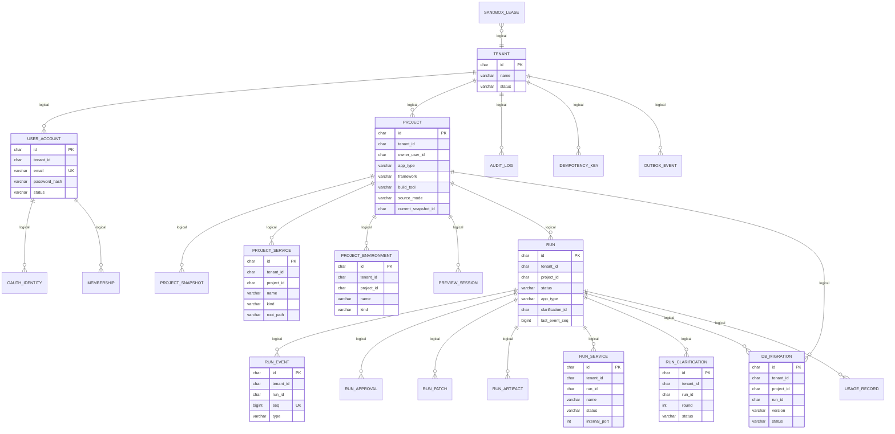

### 8.5 MinIO 布局

```text
tenants/{tenantId}/
├── projects/{projectId}/
│   ├── snapshots/{snapshotId}/source.tar.zst
│   ├── snapshots/{snapshotId}/manifest.json
│   ├── snapshots/{snapshotId}/api/openapi.json
│   ├── snapshots/{snapshotId}/db/migrations.tar.zst
│   ├── snapshots/{snapshotId}/db/seed.sql
│   └── current.json
├── knowledge/{kbId}/{documentId}/{versionId}/
│   ├── source.{ext}
│   ├── parsed.json
│   └── chunks.jsonl
└── runs/{runId}/
    ├── patches/{patchId}.diff
    ├── artifacts/{artifactId}/{filename}
    ├── screenshots/before.png
    ├── screenshots/after.png
    ├── services/{serviceId}/logs/{artifactId}.log
    ├── db/migration/up.sql
    ├── db/migration/down.sql
    ├── db/dump.sql
    └── api/openapi.json
```

| 对象 | 保留 | 说明 |
|---|---|---|
| 项目当前/已批准快照 | 项目删除前 | 不可变；含前端/后端/迁移/OpenAPI；项目回滚依赖 |
| 运行临时快照 | 30 天 | 可配置；到期清理；数据库数据默认不进入项目快照 |
| 截图/日志/产物 | 30 天 | 审批证据；按服务分目录；到期清理 |
| `db.dump`（可选） | 7 天 | 仅预览/排障；脱敏、不含密钥；不作为项目版本 |
| 审计日志 | 180 天 | MySQL；可导出 |
| 预览截图 | 30 天 | 可关闭 |
| 知识库原始文档 | 90 天 | Knowledge Service；删除知识库时异步清理 |
| 解析产物 / chunks | 30 天 | 可重建；按租户前缀隔离 |

- 桶私有；预签名 URL 5–15 分钟；服务端加密可选；禁止公开读。
- 跨平台路径用对象 key，不使用宿主文件路径。

### 8.6 Redis 键与 TTL

| Key/Pattern | 类型 | TTL | 用途 |
|---|---|---|---|
| `vibe:ws:ticket:{ticket}` | String | 60s | WS 短期鉴权 |
| `vibe:run:events` | Stream | 24h / 100k | Run 事件总线 |
| `vibe:run:{runId}:seq` | String | 7d | 事件序号 |
| `vibe:checkpoint:{runId}` | Hash/String | 7d | LangGraph checkpoint（库管理）；M2 由 `MemoryCheckpointerProvider` 暂存，生产切 `RedisSaver` |
| `vibe:clarification:{runId}` | Hash | 24h | 当前问题/轮次/恢复标记 |
| `vibe:sandbox:{id}:lease` | Hash | 30s | 单写者租约 |
| `vibe:sandbox:{id}:heartbeat` | String | 30s | 心跳 |
| `vibe:sandbox:{id}:services` | Hash | 沙盒 TTL | 服务状态/端口/健康 |
| `vibe:preview:{sandboxId}:routes` | Hash | 沙盒 TTL | 路径→服务路由表 |
| `vibe:quota:{tenantId}:{scope}` | String | 窗口 | 并发/配额 |
| `vibe:rate:{scope}:{key}` | String | 窗口 | 限流 |
| `vibe:ws:pubsub:{runId}` | Pub/Sub | — | 多实例 WS 扇出 |
| `kb:job:{jobId}` | Hash | 24h | 摄取进度快照 |
| `kb:retrieve:rl:{tenantId}:{agentId}` | String | 60s | 知识检索限流 |
| `prompt:active:{agentId}:{tenantId}` | String | 5s | Prompt 生效版本缓存 |
| `prompt:canary:{agentId}:{versionId}` | Hash | 灰度结束 | Prompt 灰度分流 |
| `feedback:opt:lock:{tenantId}:{agentId}` | String | 2h | 优化任务互斥 |
| `vibe:prompt:events` | Pub/Sub | — | Prompt 热更新广播 |

### 8.7 一致性与幂等

| 场景 | 机制 |
|---|---|
| 创建 Run | `Idempotency-Key` + `idempotency_key` 唯一索引；重复返回同一 Run |
| Java 写 Run + 发消息 | 本地事务 + `outbox_event`；后台投递 |
| 事件消费 | `(run_id, seq)` 唯一；先落库再 ACK；`last_event_seq` 防回退 |
| 审批决策 | `approval_id` 唯一 + 状态机 CAS；重复决策返回 409 |
| 澄清回答 | `(run_id, round)` 唯一 + 状态 CAS；重复回答返回 409；回答后恢复同一 checkpoint |
| 沙盒写 | `fencingToken` + `baseHash` CAS；冲突返回 `PATCH_CONFLICT` |
| 多服务启动 | `(run_id, service_id)` 唯一；服务状态 CAS；重复启动幂等 |
| DB 迁移 | `(project_id, version)` 唯一；执行前校验 approval；失败保留 up/down 证据 |
| 快照生成 | 内容 hash + 幂等键；重复生成复用 |
| 跨服务失败 | 重试 + 熔断 + 对账；不做分布式事务 |

---

## 9. 通信协议

| 链路 | 协议 | 认证 | 说明 |
|---|---|---|---|
| platform-web → Java BFF | HTTPS REST | Bearer JWT | 公开 API `/api/v1` |
| platform-web ↔ Java BFF | WSS | WS ticket | `/ws/v1/runs/{runId}` |
| platform-web → Preview | HTTPS/WSS | 预览 token | iframe + HMR |
| platform-web ↔ SDK | postMessage | session token + origin | L1 Canvas Bridge |
| Java BFF → AI Core | HTTP/1.1 internal | `X-Internal-Token` + mTLS（生产） | `/internal/v1` |
| AI Core → Java BFF | Redis Stream | 内网 | 事件；HTTP fallback |
| AI Core → Sandbox | HTTP/1.1 internal | 服务 token + mTLS | `/internal/v1` |
| AI Core → Knowledge Service | HTTP/1.1 internal | `X-Internal-Token` + `X-Tenant-Id` + mTLS | `/internal/v1/knowledge`；租户必填 |
| Java BFF → Knowledge Service | HTTP/1.1 internal | `X-Internal-Token` + `X-Tenant-Id` | 文档 CRUD / 摄取编排 |
| Knowledge Service → Qdrant | HTTP/gRPC | API Key + 内网 | 按租户 collection |
| Knowledge Service → Embedding | HTTP/1.1 internal | 服务 token | Embedding / Rerank |
| Admin → Java BFF | HTTPS REST | Bearer JWT + Admin RBAC | `/api/v1/admin` |
| Prompt Registry → AI Core | Redis Pub/Sub | 内网 | 版本号广播；TTL 自愈 |
| Sandbox → Docker/gVisor | Docker API / runtime | 本地 socket / 节点 agent | 仅 Sandbox Service |
| Sandbox → MinIO | S3 API | Access Key（内网） | 源码/快照/产物 |

**协议版本**：

- 公共 API：`/api/v1`；不兼容变更升 `/api/v2`。
- 内部 API：`/internal/v1`；服务间同时部署，允许滚动升级但需向后兼容一个版本。
- 事件：`eventVersion` 字段；新增字段兼容，删除/改义升版本。
- 协议 schema 统一放 `packages/protocol`；OpenAPI/JSON Schema 为源，生成 TS/Java/Python 类型。

---

## 10. 安全设计

### 10.1 身份与权限

- 邮箱/密码：Argon2id；登录限流；异常登录审计。
- OAuth：GitHub/Google；state + PKCE；回调绑定/创建账号。
- Access JWT 15 分钟；Refresh 30 天、旋转、HttpOnly/Secure/SameSite=Lax；服务端存哈希。
- WS：短期 ticket；连接后绑定 userId/tenantId/runId。
- 租户隔离：所有查询强制 `tenant_id`；内部调用透传 `X-Tenant-Id`；拒绝缺失/不匹配。
- RBAC：M1 只 owner；表结构预留 admin/member/viewer。M3 增加
  `platform_admin` / `tenant_admin` / `tenant_operator`；管理端点独立鉴权，
  前端隐藏入口不作为授权依据。

### 10.2 服务间安全

- 内部 API 只监听内网；生产 mTLS；M1 共享 `X-Internal-Token`（从环境变量读取）。
- Java → Python、Python → Sandbox 都带 `X-Request-Id`、`X-Trace-Id`、`X-Tenant-Id`、`X-Run-Id`。
- Python 不持有 MySQL 凭证；Sandbox 不持有模型/数据库凭证。
- Knowledge Service 是唯一持有知识库表与 Qdrant 写权限的服务；AI Core 只走内部 API。
- 管理面写操作必须带 `reason` 并写审计；Prompt / 知识库 / Agent 状态变更均可在审计中回放。
- 密钥只从环境变量/Secret 注入；日志脱敏；不写入镜像。

### 10.3 沙盒安全

- 不挂载宿主目录；不注入宿主环境变量；非 root；只读根；drop capabilities；seccomp。
- 网络默认 `none`；安装依赖时只允许 registry allowlist；禁止访问内网/元数据服务。
- 资源限制：CPU/内存/pids/磁盘/超时；OOM 自动回收；多服务按聚合预算限制。
- 预览代理鉴权；沙盒端口不直接暴露；多服务沙盒只暴露 edge 一个端口。
- 生成代码不进入 Java/Python 进程执行。
- **全栈沙盒**：每个 Run 独立网络；MySQL 仅内网、随机口令、无宿主端口、随沙盒销毁；不连接生产库。
- **密钥最小注入**：模型密钥只给 AI Core；数据库口令只给后端；前端只拿公开配置；日志不打印连接串。
- **迁移隔离**：迁移只在临时库执行；禁止 `DROP DATABASE`、跨库、`LOAD DATA LOCAL`；高风险变更必须审批。

### 10.4 数据安全

- MinIO 桶私有；预签名 URL 短期；服务端加密可选。
- MySQL/Redis 仅内网；密码从环境变量读取。
- 传输 TLS（生产）；本地开发可 HTTP。
- 脱敏：邮箱、手机号、Token、AK/SK、Authorization、URL 凭据；截图文字无法自动脱敏，前端提示。
- 数据保留：运行产物 30 天；项目快照到删除；审计 180 天；知识库原始文档 90 天；
  检索日志默认只存 query hash；提供删除接口。
- 不使用用户代码或知识库内容训练 / 微调模型；模型调用只发送必要上下文。
- 知识库按租户隔离 collection 与 MinIO 前缀；跨租户访问统一 404，避免资源枚举。

### 10.5 Prompt 注入与输出防护

- 代码/文档内容标记为不可信数据；系统提示明确指令层级。
- 工具权限最小化；危险命令 allowlist；路径逃逸拦截。
- 输出校验：禁止 Diff 之外的整文件重写、禁止 `<script>`/`javascript:`、限制代码块行数。
- 高风险操作（依赖变更、鉴权、删除、schema）强制人工审批。

---

## 11. 可靠性设计

| 机制 | 实现 |
|---|---|
| 超时 | Java→Python 30s（创建）/10s（查询）；Python→Sandbox 30s；模型 60s |
| 重试 | 仅幂等请求；指数退避 + jitter；最多 3 次 |
| 熔断 | Resilience4j；AI Core/Sandbox 连续失败打开熔断 |
| 舱壁 | 按 Run/租户限制并发；沙盒池隔离 |
| 幂等 | `Idempotency-Key`；事件 `(run_id, seq)`；审批 CAS |
| 事件可靠 | Redis Stream + consumer group + ACK；MySQL 唯一索引 |
| 崩溃恢复 | LangGraph checkpoint；沙盒从快照重建；审批 durable |
| 租约 | 心跳 + TTL + fencing token；孤儿沙盒回收 |
| 对账 | 定时比较 Java run 与 Python execution；修复卡住状态 |
| 优雅停机 | BFF 停止接收新 Run；AI Core 完成/保存 checkpoint；Sandbox 延迟销毁 |

**故障场景**：

| 故障 | 行为 |
|---|---|
| AI Core 重启 | 从 checkpoint 恢复；沙盒重建；事件继续 |
| Java BFF 重启 | WS 断开；客户端重连并用 lastSeq 恢复；Redis Stream 保留事件 |
| Sandbox 节点故障 | Run 失败；从 base snapshot 重试；租约过期回收 |
| Redis 不可用 | 创建 Run 失败（快速失败）；已有 Run 暂停；恢复后继续 |
| MySQL 不可用 | BFF 读写失败；AI Core 可继续执行但事件堆积；恢复后消费 |
| 模型超时 | 重试/降级 Mock（仅测试）；Run 失败可重试 |
| 审批超时 | 24h 过期；沙盒快照保留 30 天；Run=EXPIRED |

---

## 12. 可观测性

### 12.1 追踪

- `X-Request-Id` 由客户端生成/透传；`X-Trace-Id` 由 BFF 生成。
- 链路：Browser → BFF → AI Core → Sandbox → Docker；事件携带 traceId。
- OpenTelemetry SDK：Java/Micrometer、Python/OTel；导出到 OTLP Collector。

### 12.2 指标

| 类别 | 指标 |
|---|---|
| Run | 创建数、成功率、P50/P95 时长、修复次数、失败码分布 |
| 审批 | 待审批数、通过率、决策时长、过期数 |
| 沙盒 | 活跃数、创建耗时、OOM、租约冲突、回收数 |
| 全栈 | 服务启动耗时、健康失败、edge 路由错误、迁移成功/失败、集成 smoke 通过率 |
| 澄清 | 触发率、轮次分布、回答时长、超时数、接受默认假设比例 |
| 模型 | Token 用量、延迟、错误率、缓存命中 |
| 队列 | Redis Stream 堆积、消费延迟、DLQ |
| 业务 | 项目数、活跃用户、快照存储量 |

### 12.3 日志

- 结构化 JSON；字段：timestamp、level、service、traceId、requestId、tenantId、runId、userId、event。
- 脱敏：Authorization、Cookie、密码、Token、AK/SK、邮箱、手机号。
- 不记录完整源码/截图 base64；只记录对象 key/hash。
- 审计日志单独表，180 天。

### 12.4 告警

- Run 失败率 > 20%（5 分钟）。
- 审批等待 > 30 分钟数量异常。
- 沙盒创建失败率 > 5%。
- Redis Stream 堆积 > 10k。
- 模型错误率 > 10%。
- MySQL 连接池耗尽。
- 沙盒节点 CPU/内存 > 85%。

---

## 13. 部署架构

### 13.1 开发/单机：Docker Compose

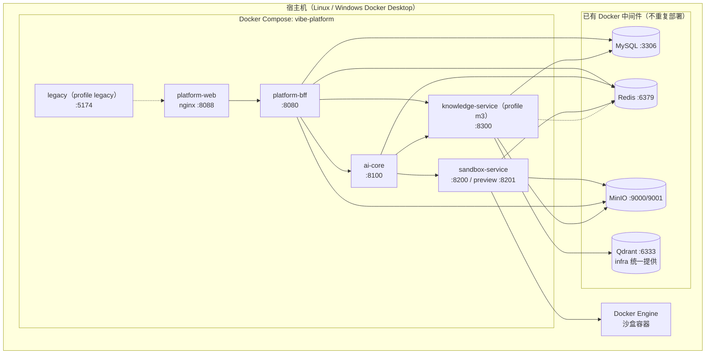

**Compose 服务**：

| 服务 | 镜像/构建 | 端口 | 依赖 | Profile |
|---|---|---|---|---|
| `platform-web` | `apps/platform-web` 构建 + nginx | 8088:80 | bff | 默认 |
| `platform-bff` | `apps/platform-bff` | 8080 | MySQL/Redis/MinIO/AI | 默认 |
| `ai-core` | `services/orchestrator` | 8100 | Redis/Sandbox/模型 | 默认 |
| `sandbox-service` | `services/sandbox` | 8200, 8201 | Docker socket、MinIO、Redis | 默认 |
| `knowledge-service` | `services/knowledge`（M3） | 8300 | MySQL、Redis、MinIO、Qdrant、Embedding | `m3` |
| `legacy` | `apps/legacy` | 5174 | — | `legacy` |

**外部中间件连接**：

- 通过 `.env` 注入 `MYSQL_HOST`、`MYSQL_PORT`、`REDIS_HOST`、`MINIO_ENDPOINT` 等。
- Linux 使用 `extra_hosts: ["host.docker.internal:host-gateway"]`；Windows/Mac Docker Desktop 原生支持。
- 不把 MySQL/Redis/MinIO 写进 Compose；避免与现有实例冲突。
- 沙盒容器由 Sandbox Service 通过 Docker API 创建，Compose 只负责 Sandbox Service 本身。
- **全栈沙盒的临时 MySQL 不是平台中间件**：由 Sandbox Service 按 Run 创建/销毁，使用独立网络、无宿主端口、随机口令；不写入 Compose，不复用 `geo_ai_db`。
- 沙盒镜像（web/api/edge）通过本地构建或镜像仓库提供；生产节点预拉取，减少启动抖动。

**跨平台规则**：

1. 代码禁止硬编码 `/home/...`、`C:\...`；使用 `Path`/`Path.of` 与环境变量。
2. Compose 构建上下文用相对路径；卷用命名卷或 `${VIBE_DATA_DIR:-./data}`。
3. 脚本用 `sh`/跨平台 Python，不依赖 GNU sed/awk 特性。
4. `.gitattributes` 统一 LF；`.env.example` 提供所有变量占位。
5. 容器内工作目录通过 `SANDBOX_WORKDIR` 注入，默认 `/workspace`；业务代码不拼接宿主路径。
6. Windows 使用 Docker Desktop + WSL2；Docker socket 路径通过 `DOCKER_HOST` 或 compose 变量配置。

### 13.2 生产：Kubernetes

| 组件 | 部署 |
|---|---|
| platform-web | Static + CDN / Ingress |
| platform-bff | HPA；最少 2 副本；WS 网关可独立 |
| ai-core | Worker Deployment；按队列扩缩；长任务隔离 |
| sandbox-service | 控制面 Deployment；沙盒节点池（gVisor） |
| knowledge-service | API 与 Ingestion Worker 分开 Deployment/HPA；索引任务队列化 |
| Qdrant | StatefulSet 或托管向量库；按租户 collection / 分片 |
| Embedding / Reranker | 独立推理服务；GPU 节点池或托管 API |
| Admin / Prompt Registry | 随 platform-bff 部署；无独立状态 |
| MySQL | 托管或 Operator；读写分离/分片演进 |
| Redis | 托管/Cluster；Stream/PubSub |
| MinIO | 分布式或 S3 兼容对象存储 |
| 网络 | NetworkPolicy；沙盒节点无公网出口；allowlist |
| 密钥 | Secret Manager / External Secrets |
| 入口 | Ingress + 通配 TLS（预览子域） |

---

## 14. MVP 阶段的妥协点与生产级替换路径（R2）

> 这一节是架构审查的必读项。M1 允许妥协，但**接口、数据模型、部署边界必须为替换留好位置**。替换时不改业务代码。

| 领域 | M1 妥协实现 | 为什么现在这样 | 风险 | 生产级替换路径 | 触发条件 |
|---|---|---|---|---|---|
| 沙盒隔离 | 同机 Docker + runc | 最快跑通闭环；开发机无 K8s | 隔离弱，不适合不可信多租户 | `GVisorProvider` + 独立沙盒节点；`K8sProvider` + Firecracker/Kata | 对外多租户/合规要求 |
| 沙盒调度 | 本地 Docker API + Redis 队列 | 单机足够；减少运维 | 无法跨节点、扩容慢 | K8s/ Nomad 调度器 + 预热池 + 节点亲和 | 并发 > 20 或需要多节点 |
| 多 Agent 编排 | M1 单 Agent 直通；M2.5 已落地 Supervisor 路由 + UI/Architect 子图 | 先验证闭环；降低模型成本 | 全栈复杂任务能力仍在补齐 | 扩展 Planner/Frontend/Backend/DBA/Reviewer；State/Handoff 不变 | M2 全栈启用 |
| 全栈服务编排 | M1 仅 web 单服务 | 最快跑通前端闭环 | 无法生成后端/数据库 | `ServiceOrchestrator` + edge 路由 + 多容器网络 | M2 全栈启用 |
| 后端运行时 | M1 不启动后端 | 无后端镜像/构建链 | 全栈能力缺失 | JDK21/Maven 沙盒镜像；按服务构建/健康检查 | M2 |
| 数据库沙盒 | M1 不启动数据库 | 避免数据与迁移复杂度 | 无法验证 CRUD/迁移 | 每 Run 临时 MySQL + Flyway + 种子 + 随机口令 | M2 |
| API 契约 | M1 仅前端调用声明 | 先跑通前端 | 前后端契约不一致 | `ApiContract`/OpenAPI 共享 + Reviewer 校验 | M2 |
| 环境/密钥 | M1 环境变量/占位 | 快速开发 | 密钥管理弱 | Secret Manager + 按服务注入 + 轮换 | 生产/全栈 |
| 事件总线 | Redis Stream | 已有 Redis；简单可靠 | 吞吐/多区域能力有限 | Kafka/Pulsar；事件 schema 不变 | > 5k events/s 或多区域 |
| AI Worker | FastAPI 进程内 asyncio | 单进程简单；调试快 | 长任务/并发受限；重启影响 | 独立 Worker + 队列 + K8s Jobs；checkpoint 不变 | 并发 > 10 或任务 > 10 分钟 |
| WebSocket | 单 BFF 实例内存订阅 | M1 用户少 | 水平扩展需粘性/PubSub | 独立 Netty/WebFlux WS 网关 + Redis Pub/Sub | > 10k 连接 |
| 数据库 | 单 MySQL | 复用现有实例 | 写 QPS/存储上限 | 读写分离；按 `tenant_id` 分库分表；归档 | 写 QPS/延迟/存储阈值 |
| 对象存储 | 单机 MinIO | 复用现有实例 | 单点/容量 | 分布式 MinIO 或 S3；key 布局不变 | > 1TB 或 HA 要求 |
| 认证 | 邮箱/密码 + GitHub OAuth | 单用户产品足够 | 企业不可用 | OIDC/SAML/SCIM；RBAC；组织 | 团队/企业客户 |
| 框架适配 | 仅 React/Vite | 聚焦闭环 | 非 React 流失 | `FrameworkAdapter`：Vue/Svelte → Next/Nuxt → Angular | M2/客户需求 |
| RAG | 不做 | M1 先验证闭环 | 代码规范/组件复用弱 | 独立 RAG Service；Component Card；Qdrant | M2 |
| 计费 | 只记 usage，不收费 | 避免过早复杂 | 无法商业化 | 计量 + 套餐 + 账单 + 支付 | 付费计划 |
| 预览 | 路径式代理 | 单域名简单 | 隔离/规模化弱 | 通配子域 + 通配 TLS + 独立 Ingress | 生产多租户 |
| 可观测 | 日志 + 基础指标 | 快速排障 | 追踪不完整 | OTel + Langfuse + 告警平台 | 生产上线 |
| 模型 | DeepSeek + Mock | 成本/合规可控 | 单点依赖 | ModelRouter 多 provider；Ollama/Claude/OpenAI | M2/可用性要求 |
| 消息一致性 | Outbox + 对账 | 避免分布式事务 | 延迟/重复 | 事件溯源/CDC（Debezium） | 规模/一致性要求 |
| **物理外键** | **永不使用** | **分库分表/高并发/服务边界** | 孤儿数据 | **不是妥协；用业务校验 + 对账 + 软删除** | 永久规则 |

**抽象接口清单**：

| 接口 | M1 实现 | 未来实现 |
|---|---|---|
| `SandboxProvider` | `DockerProvider` | `GVisorProvider`、`K8sProvider`、`FirecrackerProvider` |
| `Agent` / `AgentRegistry` | `FrontendCoder`（单 Agent 直通） | Planner/BackendCoder/DBA/Reviewer；多版本/多模型 |
| `ServiceOrchestrator` | 单服务 `SingleServiceOrchestrator` | 多服务 `MultiServiceOrchestrator` + edge 路由 |
| `DatabaseProvisioner` | 无（M1 不启用） | 临时 MySQL/PostgreSQL sidecar；托管预览库 |
| `ApiContractStore` | 前端调用声明 | OpenAPI 共享契约 + 版本/差异校验 |
| `ModelRouter` | `DeepSeekProvider`、`MockProvider` | Ollama/OpenAI/Claude/自研 |
| `EventBus` | Redis Stream | Kafka/Pulsar |
| `ObjectStorage` | MinIO SDK | S3/OSS/GCS |
| `FrameworkAdapter` | React/Vite | Vue/Svelte/Next/Angular |
| `SecretProvider` | 环境变量/本地 Secret | Vault/KMS/云 Secret Manager |
| `VectorStore` | 无 | Qdrant/pgvector/Milvus |

---

## 15. 架构决策记录（ADR）

| 编号 | 决策 | 理由 | 代价 |
|---|---|---|---|
| ADR-01 | Java BFF + Python AI Core 双核 | Java 高并发业务/长连接；Python AI 生态 | 双语言运维、跨服务一致性 |
| ADR-02 | LangGraph 作为唯一编排内核 | durable checkpoint、interrupt、HITL | 学习成本；需 worker 化演进 |
| ADR-03 | M1 同机 Docker，M2 gVisor | 快速闭环，安全可演进 | M1 隔离弱 |
| ADR-04 | 禁止物理外键 | 分库分表、高并发、服务边界 | 孤儿数据风险，需对账 |
| ADR-05 | 源码/快照存 MinIO | 大对象、不可变、跨平台 | 对象生命周期管理 |
| ADR-06 | Redis Stream 作为 M1 事件总线 | 复用 Redis，简单可靠 | 吞吐/多区域上限 |
| ADR-07 | M1 仅 React/Vite | 聚焦闭环，复用 legacy 资产 | 非 React 用户走 legacy |
| ADR-08 | M1 所有写入用户确认 | 安全、可控、可回滚 | 审批疲劳；M2 信任阶梯 |
| ADR-09 | 每个用户一个 personal tenant | 提前验证租户隔离，避免二次迁移 | 表多一列，查询需过滤 |
| ADR-10 | Docker Compose 统一开发/单机 | 跨平台、可复现 | 生产需 K8s 演进 |
| ADR-11 | **产品终极目标是全栈生成，M1 只做前端** | 前端是入口与验证切口；全栈是商业价值上限 | M1 需提前定义全栈契约，避免二次迁移 |
| ADR-12 | M2 采用 Supervisor + 5 角色多 Agent | 全栈任务需要分工、契约先行、交叉评审 | 编排复杂度/成本上升；需单写 State |
| ADR-13 | 每 Run 独立临时数据库 | 隔离、可回滚、可验证迁移 | 资源开销；需快速 provision/destroy |
| ADR-14 | 每个多服务沙盒一个 edge 单入口 | 端口映射简单、预览隔离、避免暴露内部服务 | edge 成为单点；需健康检查与重建 |
| ADR-15 | 澄清状态进入 Run 状态机 | 防止臆造业务模型；多轮交互是产品核心 | 用户可能流失；限制 3 轮并给默认方案 |
| ADR-16 | 保留同步 `POST /runs`，新增 SSE `POST /runs/stream`；BFF 用 `WebClient` 异步非阻塞透传 | 全栈长任务持续数分钟，阻塞式透传会耗尽 Tomcat 线程池；同步接口保留兼容与回归 | 两套调用路径需契约测试覆盖 |
| ADR-17 | 澄清由 Planner `confidence_score` 触发；Prompt 植入前端/后端/数据库范围引导 | 避免关键词硬编码判断；全栈需求必须先确认范围，防止模型擅自承诺后端 | 依赖模型置信度校准；阈值需可配置 |
| ADR-18 | Checkpoint 统一经 `CheckpointerProvider`；M2 `MemorySaver`，生产 `RedisSaver` | 全栈长任务需要跨进程/重启恢复 HITL；Graph 不绑定具体 saver | M2 重启会丢失暂停 Run，需显式报错 |
| ADR-19 | 代码编辑统一经 `CodeEditor`；M2 锚点 + `FileCreator`，预留 `TreeSitterEditor` | 锚点编辑不适合新建文件与跨语言符号同步；提前抽象避免 Graph 重写 | 抽象层增加一次路由与校验开销 |
| ADR-20 | Knowledge Service 独立部署，RAG 走内部 HTTP 且强制 `tenant_id` | 文档摄取与检索需要独立扩缩容、限流与租户隔离；AI Core 不应持有向量库凭证 | 多一次网络跳转；需契约测试与降级策略 |
| ADR-21 | Prompt 采用不可变版本 + 可变指针 + 灰度 + 人工审批 | 企业场景要求可审计、可回滚；禁止原地修改避免不可复现 | 运营流程更重；需缓存与广播保证 5s 生效 |
| ADR-22 | Agent 自优化只改 Prompt / 检索 / 工具策略，不做微调 | 微调迭代慢、难隔离、难回滚；Prompt + RAG 可分钟级灰度 | 复杂能力仍受基础模型上限约束 |

---

## 16. 风险登记

| 风险 | 影响 | 缓解 |
|---|---|---|
| 双核状态不一致 | Run 卡住/重复 | source of truth 明确；事件 seq；对账；幂等 |
| 无物理外键 | 孤儿数据 | 业务校验、唯一索引、对账、软删除 |
| 同机 Docker 逃逸 | 宿主/租户风险 | M1 受控用户；M2 gVisor；无宿主挂载 |
| 沙盒成本 | 账单失控 | 配额、TTL、预热池、预算硬闸 |
| 审批疲劳 | 用户放弃 | 审批卡聚合、证据充分、M2 自动审批 |
| Java/Python 版本漂移 | 接口不兼容 | protocol 包、OpenAPI、契约测试 |
| React-only | 市场覆盖不足 | legacy 视觉兜底；M2 适配器 |
| 模型输出不稳定 | 修复循环 | 指纹/进度/预算/人工升级 |
| 预览代理安全 | 未授权访问 | 短期 token、Cookie、Ingress 限流 |
| 全栈范围蔓延 | M1 被拖入后端/DB，闭环延期 | M1 只启用 `appType=FRONTEND`；M2 分阶段开关 |
| 多 Agent 产物冲突 | 前后端契约不一致 | ApiContract 先行；Reviewer 阻塞；Supervisor 单写 State |
| 多服务端口/路由冲突 | 预览串台、启动失败 | 每沙盒独立网络；动态端口；edge 路由表隔离 |
| 临时数据库资源/数据风险 | 成本、数据泄漏 | 每 Run 独立库、随机口令、无宿主挂载、随沙盒销毁 |
| 数据库迁移不可逆 | 用户数据/项目损坏 | 只操作临时库；up/down 成对；高风险审批；禁止生产连接 |
| 澄清疲劳 | 用户中途放弃 | 最多 3 轮；结构化选项；默认方案 + assumptions 标注 |
| 30 天快照 | 历史丢失 | 当前/已批准版本长期保留；UI 提示 |
| 跨租户知识泄漏 | 合规与信任灾难 | collection 隔离 + 强制租户头 + 跨租户 404 + 安全告警 |
| 检索结果注入 | Prompt 被知识库内容劫持 | 引用块包裹、指令层级声明、不执行检索内容 |
| Prompt 热更新失控 | 全租户输出退化 | 不可变版本、灰度、Run 内版本 pin、5s 回滚、审计 |
| Prompt 优化过拟合 | 指标好看但体验变差 | 离线回放 + 多样性样本 + 人工审批 + 灰度观察 |
| 反馈数据隐私 | 用户原文泄漏 | 默认只存 hash / 摘要；原文访问需授权并审计 |

---

## 17. 演进路线

| 阶段 | 目标 | 架构增量 |
|---|---|---|
| M1 | React 前端功能闭环（**不是产品边界**） | 双核、Docker 沙盒、单 Agent 直通、审批、快照；**全栈表/状态/契约/多服务 spec 已就绪** |
| M2 | **全栈生成闭环** | Supervisor + BackendCoder/DBA/Reviewer；临时 MySQL；多服务沙盒 + edge；`AWAITING_CLARIFICATION`；ApiContract；RAG/多框架可并行推进 |
| M3 | 平台化与规模化 | K8s/gVisor、多语言后端、Firecracker/Kata、多区域、SSO、模板市场、协作；**数据中台 Knowledge Service**、**管理中台 Admin / Prompt Registry**、**Feedback 自优化闭环（不微调）** |

---

## 18. 项目结构（Monorepo）

```text
vibe-platform/
├── apps/
│   ├── platform-web/          # React 画布壳（新）
│   ├── platform-bff/          # Java Spring Boot BFF（新增）
│   └── legacy/                # 原 vibe-app，冻结兼容
├── packages/
│   ├── canvas-core/           # 画布几何、标注模型、截图、bridge client
│   ├── app-model/             # TaskContract / ServiceSpec / ApiContract / FullStackIntent
│   ├── vite-plugin/           # React/Vite 注入适配器（M1）
│   └── protocol/              # OpenAPI / JSON Schema / 事件契约
├── services/
│   ├── orchestrator/          # Python AI Core：FastAPI + LangGraph + Supervisor
│   ├── sandbox/               # Python Sandbox Service + ServiceOrchestrator
│   ├── knowledge/             # M3 Knowledge Service：摄取 / 向量化 / 检索
│   └── rag/                   # M2 本地 Markdown RAG（逐步废弃）
├── infra/
│   ├── compose/               # docker-compose.yml、.env.example
│   ├── sandbox-image/         # web / api / edge 运行时镜像与 Workspace Daemon
│   ├── migrations/            # Flyway（无物理外键）
│   └── k8s/                   # M3 生产清单（预留）
├── docs/
│   ├── design/
│   └── memory/
├── scripts/                   # 跨平台启动/检查脚本
├── .env.example
├── .gitattributes
└── README.md
```

**模块到服务映射**：

| 服务 | 目录 | 主要模块 |
|---|---|---|
| platform-web | `apps/platform-web` | M07–M09、M16 前端 |
| platform-bff | `apps/platform-bff` | M01–M06、M11 facade、M16、M27–M29、M38–M41（Admin / Prompt / Feedback） |
| ai-core | `services/orchestrator` | M11–M17、M23–M25、M32–M36、M39 |
| sandbox-service | `services/sandbox` | M18–M22、M37 |
| knowledge-service | `services/knowledge` | M26、M38、M40（M3） |
| rag-service | `services/rag` | M26 本地兜底（M2，逐步废弃） |
| legacy | `apps/legacy` | M30–M31 |

**构建与运行**：

- Java：Maven/Gradle（M1 建议 Maven）+ Flyway；`./mvnw` 跨平台。
- Python：`uv` 或 `pip` + `pyproject.toml`；每个 service 独立虚拟环境或容器。
- Web：pnpm workspace；`packages/*` 通过 workspace 引用。
- 协议：`packages/protocol` 生成 TS/Java/Python 类型；CI 校验兼容性。
- 所有服务通过 `infra/compose` 编排；生产用 K8s 清单（M3）。

---

## 19. 架构验收清单

- [ ] 全局架构图能清晰看出 Java BFF、Python AI Core、Sandbox 的调用关系。
- [ ] Java 不执行生成代码，Python 不写业务 MySQL。
- [ ] 每个 Run 有 base snapshot、状态机、事件流、预算、审批。
- [ ] 沙盒单写者 + fencing token；所有写操作可回滚。
- [ ] 数据库无物理外键；所有业务表有 `tenant_id`。
- [ ] MinIO 存源码/快照/产物；30 天生命周期可配置。
- [ ] Knowledge Service 独立部署；AI Core 不持有 Qdrant / 知识库表凭证。
- [ ] 所有检索调用强制 `tenant_id`；跨租户资源返回 404。
- [ ] 管理入口仅管理员可见；Admin API 独立鉴权并写审计。
- [ ] Prompt 版本不可变、可灰度、可回滚、热更新 ≤ 5s。
- [ ] Agent 自优化只产生候选 Prompt，必须人工审批；未引入任何微调链路。
- [ ] Docker Compose 可跨 Linux/Windows；无绝对路径。
- [ ] M1 妥协点与生产替换路径逐项列出。
- [ ] 非 React 项目不创建写 Run；legacy 视觉兜底。
- [ ] 审批、取消、超时、崩溃恢复都有明确行为。
- [ ] **全栈预留**：`project.app_type`、`project_service`、`run_service`、`run_clarification`、`db_migration` 表存在且无物理外键。
- [ ] **全栈预留**：Run 状态机含 `AWAITING_CLARIFICATION`；M1 状态机可进入/恢复/超时（纯前端闭环默认不触发）。
- [ ] **全栈预留**：TaskContract 支持 `application.services[]`、`dataModel`、`apiContract`。
- [ ] **全栈预留**：Sandbox spec 支持 `services[]`；M1 只传 web，M2 传 web/api/db/edge。
- [ ] **全栈预留**：PreviewRoute 支持多服务路径映射；端口只经 edge 暴露。
- [ ] **全栈预留**：多 Agent 拓扑、AgentResult、事件 `agent.*`/`clarification.*`/`service.*` 在 M1 定义。
- [ ] **全栈预留**：M2 启用全栈时不改 `/api/v1` 主版本、不重写 Run 状态机、不迁移核心表。
