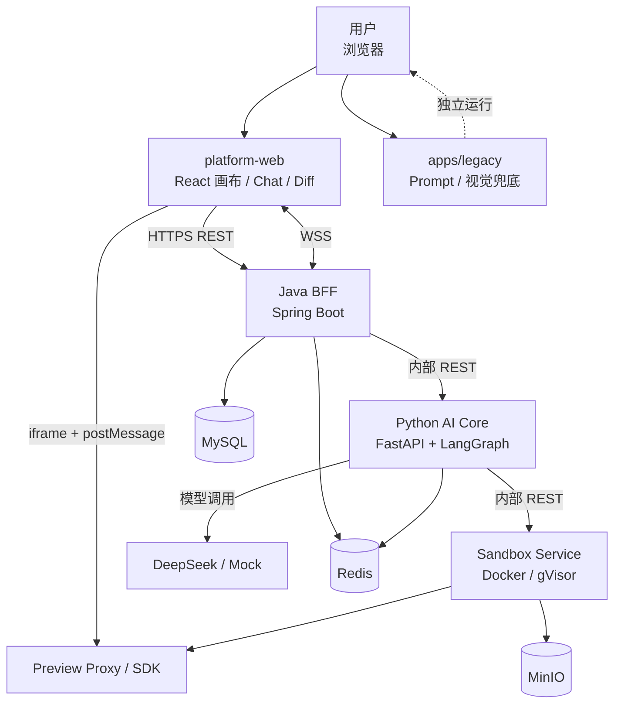
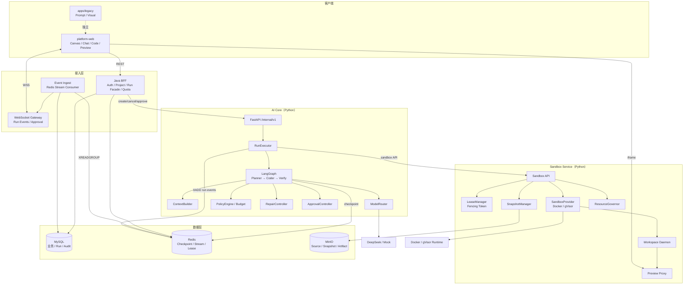
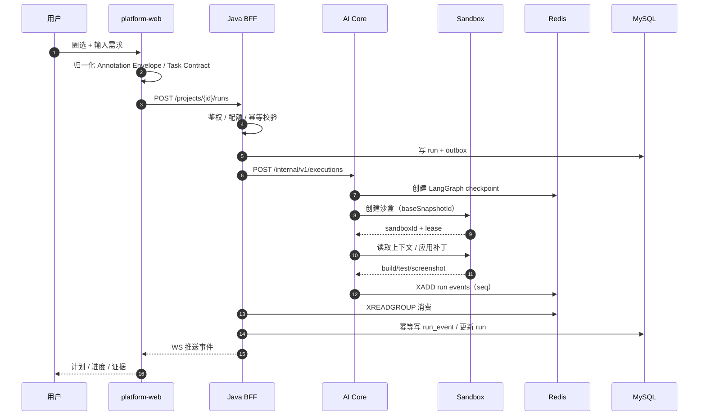
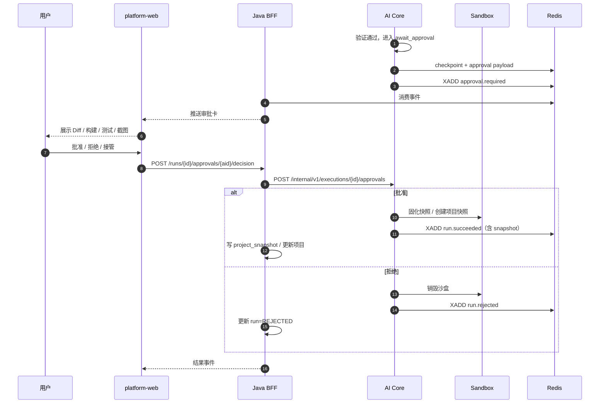
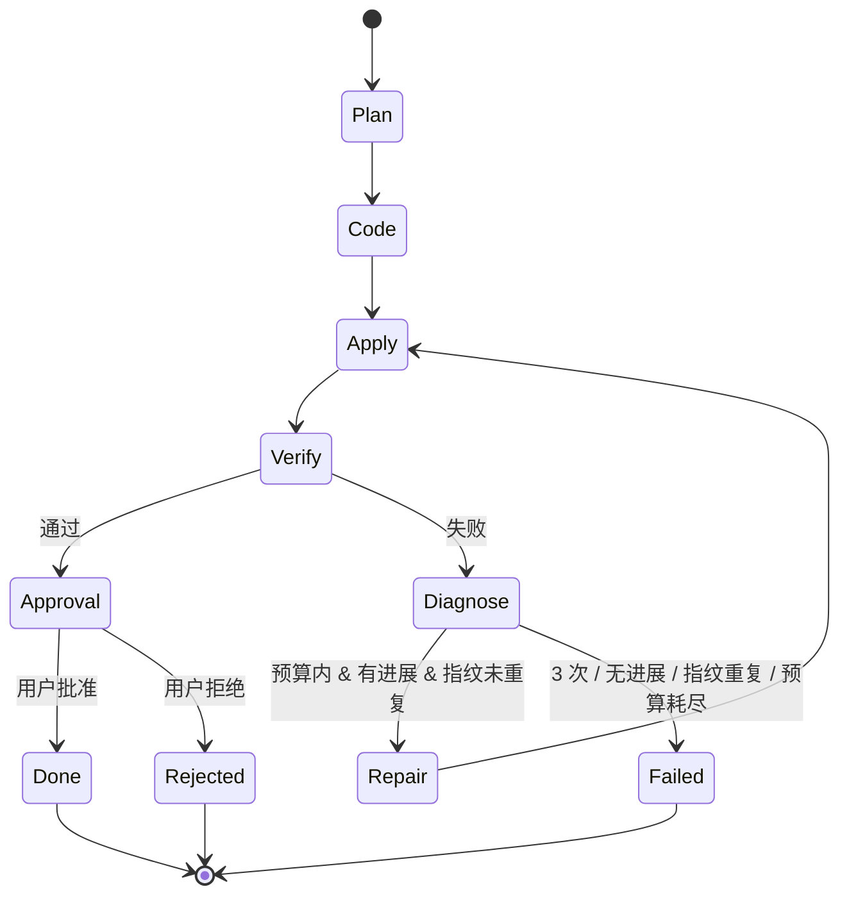
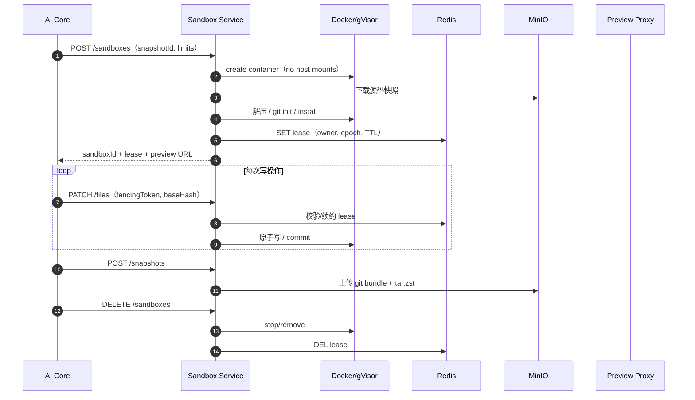
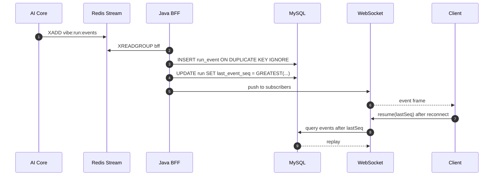
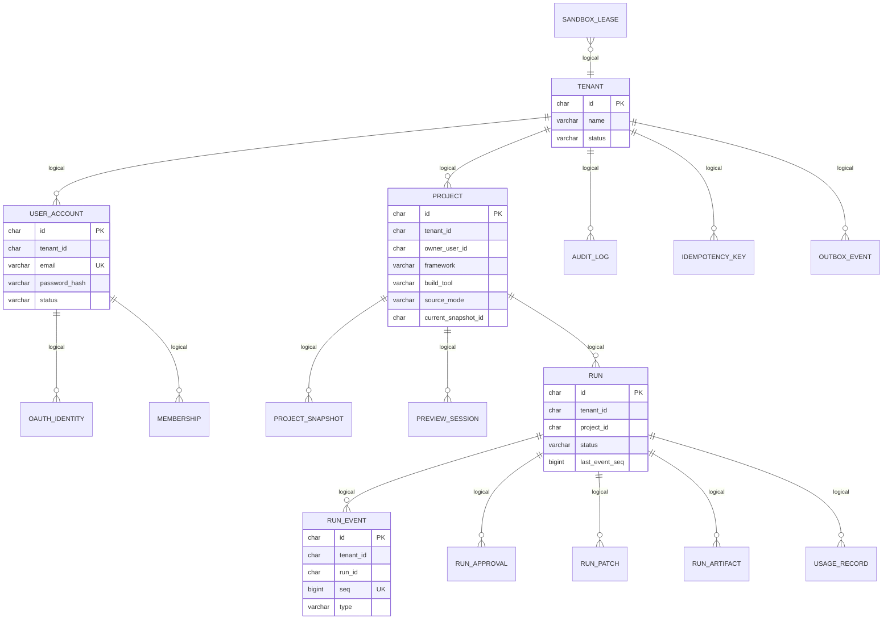
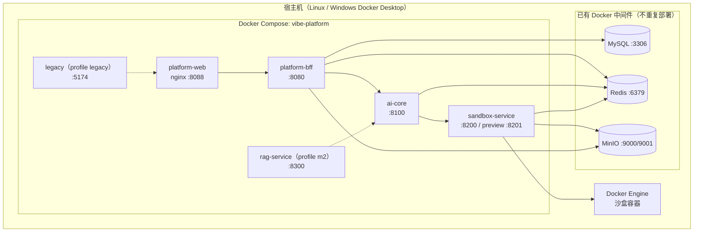

# 02. 整体架构设计

> 状态：v1.0（M1 设计基线，含项目设计）
> 日期：2026-11-04
> 项目：vibe-platform
> 依据：`01.功能模块梳理.md`、用户 Q1–Q8 决策、架构铁律 R1–R5
> 范围：系统上下文、逻辑架构、组件职责、关键时序、数据架构、通信、安全、部署、MVP 妥协与生产替换路径
> 说明：本文不写业务代码；所有接口字段以 `03.API接口设计.md` 为准

---

## 1. 架构目标

### 1.1 目标

1. **双核解耦**：Java BFF 负责用户、项目、计费、高并发长连接；Python AI Core 负责 LangGraph 编排、模型调用、沙盒调度。
2. **可信执行**：生成代码只在隔离沙盒中应用、构建、测试、截图；宿主与用户本地不执行生成代码。
3. **有状态可恢复**：Run 有完整状态机、checkpoint、事件流、审批中断与恢复能力。
4. **可验证闭环**：构建、测试、截图、Diff、用户确认构成完成标准。
5. **可演进**：M1 允许同机 Docker、Redis Stream 等妥协，但所有关键依赖有接口抽象与生产替换路径。
6. **可跨平台**：Linux/Windows 通过 Docker Compose 一致运行；代码不硬编码绝对路径。
7. **可兼容**：`apps/legacy` 冻结为 Prompt/视觉兼容基线；M1 只做 React/Vite 源码模式。

### 1.2 非目标

- 不做 Git 托管、CI/CD 平台、生产部署系统。
- 不做多租户团队协作、计费、模板市场（M2/M3）。
- 不做 Vue/Svelte/Next/Angular 源码级适配（M2 起）。
- 不做 WebContainer 作为权威执行环境。
- 不做无人工确认的自动合并到项目主版本。
- 不做物理外键、跨库分布式事务。

---

## 2. 决策摘要

### 2.1 Q1–Q8

| 编号 | 决策 | 架构后果 |
|---|---|---|
| Q1-B | 云端单租户，schema 预留 `tenant_id` | 每个用户注册时创建 personal tenant；所有业务表带 `tenant_id`；M1 不做组织 UI |
| Q2-B | 独立沙盒节点 + gVisor；本地同机 Docker；`SandboxProvider` 抽象 | Sandbox Service 独立部署；M1 `DockerProvider`，M2 `GVisorProvider` |
| Q3-B | Java Spring Boot BFF + Python FastAPI AI Core | 双核通过内部 REST + 事件流通信；Java 是业务系统 of record |
| Q4-B | 云端 Docker 沙盒权威验证 | 构建/测试/截图只在沙盒；WebContainer 不进入 M1 |
| Q5-A | M1 仅 React Adapter | Vite 插件/SDK 只服务 React；非 React 走 legacy 视觉模式 |
| Q6-B | 邮箱/OAuth 单用户，RBAC 预留 | 个人租户；`membership/role` 表预留 |
| Q7-C | 代码存 MinIO，快照默认 30 天，日志脱敏 | 对象存储桶布局、生命周期、脱敏管线 |
| Q8-B | M1 前端功能开发；构建+测试+截图+用户确认；修复 ≤3；RAG M2 | Run 状态机、Verifier、Approval、Budget、Repair 控制器 |

### 2.2 架构铁律

| 编号 | 铁律 | 架构落点 |
|---|---|---|
| R1 | 禁止物理外键 | 8.2；所有 DDL/Migration/ORM 不出现 `FOREIGN KEY` |
| R2 | MVP 妥协 + 生产替换路径 | 第 14 节专节；关键依赖接口化 |
| R3 | 复用现有 MySQL/Redis/MinIO | 第 13 节；Compose 只编排平台服务，不重复部署中间件 |
| R4 | 跨平台、Docker Compose、无绝对路径 | 第 13 节；路径与配置规范 |
| R5 | Monorepo，legacy 冻结 | 第 18 节；`apps/legacy` 不参与新平台主链路 |

### 2.3 架构后果

- **双核不是微服务堆砌**：M1 只有 4 个可部署单元（web、BFF、AI Core、Sandbox）。RAG 是 M2 的第 5 个。
- **Java 不执行 AI 逻辑**：Java 只做鉴权、业务、事件扇出、审批持久化；不内嵌 LangGraph。
- **Python 不写业务 MySQL**：Python 用 Redis checkpoint + 事件流 + MinIO；业务数据由 Java 写 MySQL。
- **事件最终一致**：Run 状态在 Java 是读模型，在 Python 是执行状态；通过 `seq`、幂等、对账保证一致。
- **沙盒是唯一写入口**：Java/Python 都不直接写用户源码。

---

## 3. 架构原则

1. **边界先于拆分**：能进程内解决的，不拆服务；只有独立部署/扩缩容/安全边界才拆。
2. **单写者**：每个沙盒任一时刻只有一个 writer，所有写命令带 fencing token。
3. **事件驱动 + 幂等**：跨服务用事件与幂等键，不用分布式事务。
4. **最小外发**：只把选中目标、片段、必要证据发给模型；不上传完整 DOM/源码。
5. **确定性优先**：预算、风险、锁、状态机由代码决定；LLM 只做建议与生成。
6. **可回滚**：每个 Run 绑定 base snapshot；任何变更可回到已知良好状态。
7. **抽象先于替换**：`SandboxProvider`、`ModelRouter`、`EventBus`、`ObjectStorage` 在 M1 就定义。

---

## 4. 系统上下文



| 外部实体 | 关系 |
|---|---|
| 用户浏览器 | 访问 platform-web；通过 iframe 访问预览；不直接访问 AI Core/Sandbox |
| DeepSeek / Mock | 仅 AI Core 访问；密钥不出 AI Core |
| MySQL/Redis/MinIO | 复用现有 Docker 中间件；平台不重复部署 |
| legacy | 独立部署；M1 视觉/Prompt 兜底；不与新平台共享写权限 |

---

## 5. 逻辑架构



### 5.1 分层职责

| 层 | 组件 | 职责 | 明确不做 |
|---|---|---|---|
| 体验层 | platform-web | 画布、标注、对话、Diff、审批、预览 | 不执行代码、不直连沙盒 |
| 接入层 | Java BFF | 认证、项目、Run facade、配额、审批持久化、WS 扇出 | 不编排 Agent、不执行代码 |
| 编排层 | AI Core | LangGraph、上下文、模型、修复、审批恢复 | 不写业务 MySQL、不管理用户 |
| 执行层 | Sandbox Service | 沙盒生命周期、租约、文件、构建、截图、快照 | 不决定改什么代码 |
| 数据层 | MySQL/Redis/MinIO | 业务、热状态、对象存储 | 不承载执行逻辑 |
| 兼容层 | legacy | Prompt/视觉兜底 | 不参与新平台写链路 |

### 5.2 信任边界

| 区域 | 位置 | 信任级别 | 关键约束 |
|---|---|---|---|
| A 浏览器 | 用户设备 | 不可信 | 不持有模型/数据库密钥；token 最小权限 |
| B Java BFF | 控制面 | 可信 | 只访问 MySQL/Redis/MinIO；不执行生成代码 |
| C AI Core | 控制面 | 可信 | 持有模型密钥；只通过 Sandbox API 操作代码 |
| D Sandbox | 执行面 | 不可信代码 | 无宿主挂载、无宿主密钥、网络受限 |
| E 数据层 | 内网 | 可信 | 仅 BFF/AI/Sandbox 白名单访问 |
| F 模型提供方 | 外部 | 合同约束 | 只接收脱敏后的必要上下文 |

---

## 6. 组件设计

### 6.1 platform-web

**技术栈**：React 19 + TypeScript + Vite 8 + Tailwind CSS 4；轻量状态管理（Zustand 或 React Context，M1 选用一种）；WebSocket 客户端；`react-markdown` 安全渲染；iframe 预览。

**核心模块**：

| 模块 | 职责 |
|---|---|
| Canvas Workbench | 无限画布、视口、三透镜布局、Diff 抽屉 |
| Annotation Layer | note/draw/drag、元素点选、坐标转换、截图 |
| Intent Composer | 对话 + 标注合并为 Task Contract；范围 chip |
| Run Timeline | 计划、工具调用、构建/测试/截图、错误、预算 |
| Approval Panel | 审批卡、Diff、改前/改后、批准/拒绝/接管 |
| Preview Bridge | iframe 生命周期、L1 postMessage、SDK 握手 |
| API Client | BFF REST、WS 重连、Last-Event-ID 恢复 |
| Legacy Link | 非 React 项目跳转 legacy 视觉模式 |

**约束**：

- 不直接访问 AI Core/Sandbox；只访问 BFF 与 Preview Proxy。
- 不把 access token 写入 localStorage；只存内存，刷新用 HttpOnly Cookie。
- 所有标注坐标在前端归一化为 `world`；不发送完整 DOM。
- SDK 握手失败时显示“视觉模式”，不伪装源码级能力。

### 6.2 Java BFF（`apps/platform-bff`）

**技术栈**：

| 组件 | 选型 | 理由 |
|---|---|---|
| 语言/运行时 | Java 21 | 虚拟线程、长期支持 |
| 框架 | Spring Boot 3.3 | 生态、Security、WebSocket、Validation |
| HTTP | Spring MVC + 虚拟线程 | 阻塞式 MyBatis 与虚拟线程配合简单 |
| 长连接 | Spring WebSocket + Reactor Netty | M1 单实例；M2 可拆独立网关 |
| ORM | MyBatis-Plus | 显式 SQL、易控分页/索引、无 JPA 隐式关联 |
| 迁移 | Flyway | 版本化 DDL；禁止物理外键 |
| 缓存/锁 | Spring Data Redis + Lettuce | Stream、Pub/Sub、Lua 租约 |
| 韧性 | Resilience4j | 超时、重试、熔断、舱壁 |
| 认证 | Spring Security + JJWT + Argon2id | JWT/刷新/WS ticket |
| 文档 | springdoc-openapi | 生成 OpenAPI |
| 观测 | Micrometer + OpenTelemetry | 指标与追踪 |

**模块划分**：

| 包 | 职责 |
|---|---|
| `auth` | 注册、登录、OAuth、JWT、刷新、WS ticket |
| `user` | 用户资料、偏好 |
| `tenant` | personal tenant、membership、RBAC 预留 |
| `project` | 项目 CRUD、项目能力声明 |
| `source` | 预签名上传、快照元数据、MinIO 访问 |
| `run` | Run 创建、查询、取消、审批 facade |
| `realtime` | WS 连接、订阅、事件推送、断线恢复 |
| `event` | Redis Stream 消费、`run_event` 幂等落库、状态读模型更新 |
| `approval` | 审批持久化、决策校验、调用 AI Core |
| `quota` | 并发/项目/Token/沙盒分钟配额 |
| `audit` | 审计日志、操作追踪 |
| `internal` | 对 AI Core 的内部客户端、服务鉴权 |
| `common` | 错误、ID、时间、脱敏、分页、幂等 |

**高并发与长连接**：

- M1 单 BFF 实例 + 虚拟线程；WS 连接保存在本机内存。
- 多实例时：Redis Pub/Sub `vibe:ws:{runId}` 广播事件；每个实例只推给本地订阅者。
- 每个 Run 的事件有单调 `seq`；客户端用 `lastSeq` 恢复，服务端从 MySQL/Redis 重放。
- WS 连接鉴权用 60 秒短期 ticket，避免 access token 出现在 URL 长期留存。

**Run facade 职责**：

1. 校验租户/项目/配额/幂等键。
2. 本地事务写 `run` + `outbox_event`。
3. 异步调用 AI Core 创建执行；失败重试/标记 FAILED。
4. 消费事件，幂等写 `run_event`，更新 `run` 读模型。
5. 审批决策转交 AI Core；等待恢复结果。
6. 把事件推给 WS 订阅者。

**事件消费**：

- Redis Stream：`vibe:run:events`；消费者组 `bff`。
- 每条事件按 `(runId, seq)` 唯一；MySQL 唯一索引兜底。
- 先落库、再 ACK、再推送；崩溃后可重放。
- `run` 表维护 `last_event_seq`；只接受更大的 seq，防止乱序回退。
- 对账任务：定期比较 `run` 与 AI Core `/internal/v1/executions/{id}`，修复卡住状态。

### 6.3 Python AI Core（`services/orchestrator`）

**技术栈**：

| 组件 | 选型 | 理由 |
|---|---|---|
| 语言 | Python 3.12 | LangGraph/LangChain 生态 |
| Web | FastAPI + Uvicorn | 异步、Pydantic、OpenAPI |
| 编排 | LangGraph | durable state、interrupt、checkpoint |
| Checkpoint | `langgraph-checkpoint-redis` | 复用 Redis，热状态 |
| HTTP | httpx AsyncClient | 调用 Sandbox/模型 |
| 校验 | Pydantic v2 | 请求/事件 schema |
| 日志 | structlog | 结构化日志 |
| 追踪 | OpenTelemetry | traceId 贯穿 |
| 模型 | DeepSeek + Mock | M1 固定；ModelRouter 预留 |
| 队列 | asyncio + Redis Stream | M1 单 worker；M2 换 worker pool |

**核心组件**：

| 组件 | 职责 |
|---|---|
| `RunExecutor` | 加载 Task Contract，创建/恢复 LangGraph，管理预算与取消 |
| `Graph` | `load_context → plan → code → apply_patch → verify → repair → await_approval → finalize` |
| `ContextBuilder` | 项目清单、目标片段、邻居、错误、M2 RAG 结果；Token 预算 |
| `ModelRouter` | `DeepSeekProvider` / `MockProvider`；超时、重试、用量 |
| `SandboxClient` | 创建沙盒、租约、文件、补丁、验证、快照 |
| `PolicyEngine` | 脱敏、输出校验、风险分级、危险路径拦截 |
| `BudgetManager` | 次数/Token/时间/沙盒分钟；硬闸 |
| `RepairController` | 错误指纹、进度账本、最多 3 次、升级策略 |
| `ApprovalController` | LangGraph `interrupt()`、恢复、审批 payload |
| `EventPublisher` | Redis Stream XADD；每 Run 单调 seq |
| `SummaryService` | M1 简单摘要；M2 分层摘要 |

**LangGraph 状态（核心字段）**：

| 字段 | 说明 |
|---|---|
| `runId`, `tenantId`, `projectId`, `userId` | 上下文 |
| `baseSnapshotId` | 固定基线 |
| `contract` | Task Contract |
| `plan` | 步骤、范围、验收标准 |
| `patches` | 候选补丁 |
| `verification` | 构建/测试/截图结果 |
| `attempts` | 修复轮次、错误指纹、进度账本 |
| `budget` | Token/时间/工具调用上限 |
| `sandboxId`, `leaseEpoch` | 当前沙盒与 fencing token |
| `approval` | 待审批 payload |
| `events` | 事件序号与摘要 |

**M1 图节点**：

1. `load_context`：读取项目清单、目标片段、最近错误。
2. `plan`：生成计划与验收标准。
3. `code`：生成 Search/Replace 补丁。
4. `apply_patch`：通过 Sandbox API 原子应用。
5. `verify`：构建、测试、截图。
6. `repair`：失败时诊断、修复；条件边最多 3 次。
7. `await_approval`：`interrupt()` 持久化审批。
8. `finalize`：固化快照、发成功事件。

**M1 运行模式**：

- 单进程 asyncio，每个 Run 一个 task；并发上限由配置控制。
- 进程重启后从 Redis checkpoint 恢复；沙盒可重建。
- 不把 LangGraph checkpoint 写入 MySQL；MySQL 只存业务 Run/事件。

### 6.4 Sandbox Service（`services/sandbox`）

**技术栈**：Python 3.12 + FastAPI + Docker SDK；M2 增加 gVisor (`runsc`)；M3 增加 K8s Provider。

**Provider 抽象**：

| 方法 | 说明 |
|---|---|
| `create(spec)` | 创建沙盒容器/微 VM |
| `start/stop/destroy` | 生命周期 |
| `exec(command, timeout)` | 执行命令 |
| `copy_in/copy_out` | 文件传输 |
| `snapshot()/restore()` | 快照 |
| `preview_url()` | 预览地址 |

M1 实现 `DockerProvider`；M2 `GVisorProvider`；M3 `K8sProvider`。业务代码只依赖接口。

**核心组件**：

| 组件 | 职责 |
|---|---|
| `Sandbox API` | 内部 REST；服务鉴权；请求校验 |
| `LeaseManager` | 单写者租约、心跳、fencing token、过期回收 |
| `WorkspaceDaemon` | 沙盒内文件/补丁/命令/构建/git 的原子操作 |
| `PreviewProxy` | 预览 URL、token 校验、HMR WebSocket 代理 |
| `SnapshotManager` | git commit/bundle、tar.zst、MinIO、恢复 |
| `ResourceGovernor` | CPU/内存/pids/磁盘/超时/OOM/回收 |
| `ProviderRegistry` | 按配置选择 Docker/gVisor/K8s |

**沙盒容器规格（M1）**：

| 项 | 值 |
|---|---|
| 基础镜像 | `node:22-bookworm-slim` + pnpm + git + curl + ca-certificates |
| 用户 | 非 root（`vibe`） |
| 根文件系统 | 只读；工作区 tmpfs/命名卷 |
| 网络 | 默认 `none`；构建时按 allowlist 开 registry |
| 挂载 | 不挂载宿主目录；源码通过 MinIO/tar 注入 |
| 限制 | 2 CPU、4 GB 内存、512 pids、5 GB 磁盘、30 分钟 TTL |
| 标签 | `vibe.sandbox.id`、`vibe.tenant.id`、`vibe.run.id` |
| 密钥 | 不注入模型/数据库密钥；只注入短期沙盒 token |

**租约与 fencing**：

- Redis key：`vibe:sandbox:{sandboxId}:lease`。
- 值：`owner`、`epoch`、`expiresAt`、`heartbeatAt`。
- 获取/续约用 Lua 原子脚本；每次获取 epoch +1。
- 所有写命令带 `fencingToken`；守护进程只接受 `token >= currentEpoch`。
- 持有锁时禁止调用 LLM、禁止等待人工；审批等待释放写租约。

**预览代理**：

- M1：路径式 `https://{host}/preview/{sandboxId}/`；签名 token + HttpOnly Cookie。
- M2：通配子域 `https://{sandboxId}.preview.{domain}/` + 通配 TLS。
- 代理转发 HTTP 与 HMR WebSocket；剥离 `Set-Cookie` 中的宿主域；限制请求体大小。
- 预览 token 5 分钟有效，可续期；沙盒销毁即失效。

**快照**：

- 沙盒内 `git init`；每个补丁一个 commit；Run 结束 `git bundle` + `tar.zst`。
- 存 MinIO：`tenants/{tenantId}/projects/{projectId}/snapshots/{snapshotId}/`。
- 恢复：下载 bundle + tar，重建工作区，`git reset --hard`。
- 运行临时快照 30 天；项目当前/已批准快照保留到项目删除。

### 6.5 RAG Service（M2，占位）

- 独立 Python 服务；Qdrant + bge-m3 + bge-reranker。
- 以 Component Card 为索引单位；支持增量索引与版本 pin。
- M1 只定义接口与数据契约，不部署。

### 6.6 legacy（`apps/legacy`）

- 原 `vibe-app` 冻结副本；保留 Prompt 生成、视觉模式、本地 Vite 接入。
- M1 非 React 项目、纯截图场景继续使用。
- 不接入新平台 Run/Sandbox；不共享写权限。
- 通过独立 Compose profile `legacy` 启动，默认不启动。

---

## 7. 关键时序

### 7.1 Run 创建与执行



### 7.2 HITL 审批与恢复



### 7.3 有界修复循环



**停止条件**：

- 同一错误指纹 ≥3 次；
- 连续 2 轮进度函数不增；
- 补丁 hash 重复 / 文件回到历史快照；
- Token/时间/工具调用预算耗尽；
- 风险策略硬拦截。

### 7.4 沙盒生命周期与租约



### 7.5 事件扇出



---

## 8. 数据架构

### 8.1 数据所有权

| 数据 | 系统 of record | 存储 | 说明 |
|---|---|---|---|
| 用户/租户/项目/成员 | Java BFF | MySQL | 业务主数据 |
| Run 元数据/审批/审计/用量 | Java BFF | MySQL | 读模型 + 审计 |
| Run 事件 | Java BFF | MySQL `run_event` + Redis Stream | 事件流与回放 |
| Agent 执行状态 | AI Core | Redis checkpoint | LangGraph state |
| 源码/快照/产物 | Sandbox + Java 元数据 | MinIO | 不可变对象 |
| 沙盒租约/心跳 | Sandbox Service | Redis | TTL + fencing |
| RAG 索引（M2） | RAG Service | Qdrant | 可重建 |

### 8.2 禁止物理外键（R1）

**规则**：

1. MySQL DDL、Flyway migration、MyBatis-Plus entity、任何 Python ORM 均不得声明 `FOREIGN KEY`。
2. 逻辑关联字段（`user_id`、`project_id`、`run_id`、`tenant_id`、`snapshot_id`）只建普通索引或唯一索引。
3. 关联一致性由业务代码在本地事务内保证；跨聚合用 outbox + 对账。
4. 删除采用软删除（`deleted_at`）；不依赖数据库级联。
5. 定时对账任务扫描孤儿记录：run 无 project、event 无 run、approval 无 run、snapshot 无 project。
6. 所有查询强制带 `tenant_id`，防止跨租户关联。

**为什么**：

- 未来按 `tenant_id` 分库分表，物理外键无法跨分片；
- 高并发写入避免外键锁与级联开销；
- 服务边界清晰，Java 是业务主数据唯一写入方；
- 在线 DDL/归档更简单。

**代价与缓解**：

- 可能产生孤儿数据 → 唯一索引 + 业务校验 + 对账任务 + 软删除；
- 不能依赖数据库级联 → 应用层显式处理关联状态；
- 查询需要手动 join → 读模型/索引/缓存优化。

### 8.3 表目录

| 表 | 主要字段 | 关键索引 |
|---|---|---|
| `tenant` | id, name, status, created_at, updated_at | PK(id) |
| `user_account` | id, tenant_id, email, password_hash, display_name, avatar_url, status, created_at, updated_at, version, deleted_at | UQ(email), IDX(tenant_id, status) |
| `oauth_identity` | id, tenant_id, user_id, provider, provider_user_id, created_at | UQ(provider, provider_user_id), IDX(user_id) |
| `membership` | id, tenant_id, user_id, role, status, created_at, updated_at | UQ(tenant_id, user_id), IDX(user_id) |
| `project` | id, tenant_id, owner_user_id, name, framework, build_tool, source_mode, status, current_snapshot_id, created_at, updated_at, version, deleted_at | IDX(tenant_id, owner_user_id, status), IDX(tenant_id, updated_at) |
| `project_snapshot` | id, tenant_id, project_id, storage_key, base_commit, file_count, size_bytes, status, created_at, expires_at | IDX(tenant_id, project_id, created_at) |
| `preview_session` | id, tenant_id, project_id, sandbox_id, status, url, expires_at, created_at | IDX(tenant_id, project_id, status) |
| `run` | id, tenant_id, project_id, user_id, status, intent_summary, scope, base_snapshot_id, sandbox_id, budget_json, result_json, error_code, last_event_seq, created_at, started_at, finished_at, version | IDX(tenant_id, project_id, created_at), IDX(tenant_id, status) |
| `run_event` | id, tenant_id, run_id, seq, type, payload_json, created_at | UQ(run_id, seq), IDX(tenant_id, created_at) |
| `run_approval` | id, tenant_id, run_id, risk_level, status, summary, evidence_json, options_json, decision, decided_by, decided_at, expires_at, created_at | IDX(tenant_id, run_id, status), UQ(run_id, approval_id) |
| `run_patch` | id, tenant_id, run_id, file_path, base_hash, patch_format, patch_text, status, applied_at, created_at | IDX(tenant_id, run_id), IDX(run_id, status) |
| `run_artifact` | id, tenant_id, run_id, type, storage_key, mime, size_bytes, created_at, expires_at | IDX(tenant_id, run_id, type) |
| `sandbox_lease` | id, tenant_id, sandbox_id, owner, epoch, status, expires_at, heartbeat_at | UQ(sandbox_id), IDX(tenant_id, status) |
| `usage_record` | id, tenant_id, user_id, run_id, type, quantity, unit, occurred_at | IDX(tenant_id, occurred_at), IDX(run_id) |
| `audit_log` | id, tenant_id, actor_type, actor_id, action, resource_type, resource_id, request_id, ip, user_agent, payload_json, created_at | IDX(tenant_id, created_at), IDX(resource_type, resource_id) |
| `idempotency_key` | id, tenant_id, scope, key, request_hash, response_json, status, expires_at, created_at | UQ(tenant_id, scope, key) |
| `outbox_event` | id, tenant_id, aggregate_type, aggregate_id, event_type, payload_json, status, created_at, published_at | IDX(status, created_at) |

> 所有表都有 `id`（ULID/UUIDv7）、`tenant_id`、`created_at`；需要软删除的表有 `deleted_at`；需要乐观锁的表有 `version`。

### 8.4 逻辑 ER 图

> **重要：下图只表达逻辑关系，DDL 不创建任何物理外键。**



### 8.5 MinIO 布局

```text
tenants/{tenantId}/
├── projects/{projectId}/
│   ├── snapshots/{snapshotId}/source.tar.zst
│   ├── snapshots/{snapshotId}/manifest.json
│   └── current.json
└── runs/{runId}/
    ├── patches/{patchId}.diff
    ├── artifacts/{artifactId}/{filename}
    ├── screenshots/before.png
    ├── screenshots/after.png
    └── logs/{artifactId}.log
```

| 对象 | 保留 | 说明 |
|---|---|---|
| 项目当前/已批准快照 | 项目删除前 | 不可变；项目回滚依赖 |
| 运行临时快照 | 30 天 | 可配置；到期清理 |
| 截图/日志/产物 | 30 天 | 审批证据；到期清理 |
| 审计日志 | 180 天 | MySQL；可导出 |
| 预览截图 | 30 天 | 可关闭 |

- 桶私有；预签名 URL 5–15 分钟；服务端加密可选；禁止公开读。
- 跨平台路径用对象 key，不使用宿主文件路径。

### 8.6 Redis 键与 TTL

| Key/Pattern | 类型 | TTL | 用途 |
|---|---|---|---|
| `vibe:ws:ticket:{ticket}` | String | 60s | WS 短期鉴权 |
| `vibe:run:events` | Stream | 24h / 100k | Run 事件总线 |
| `vibe:run:{runId}:seq` | String | 7d | 事件序号 |
| `vibe:checkpoint:{runId}` | Hash/String | 7d | LangGraph checkpoint（库管理） |
| `vibe:sandbox:{id}:lease` | Hash | 30s | 单写者租约 |
| `vibe:sandbox:{id}:heartbeat` | String | 30s | 心跳 |
| `vibe:quota:{tenantId}:{scope}` | String | 窗口 | 并发/配额 |
| `vibe:rate:{scope}:{key}` | String | 窗口 | 限流 |
| `vibe:ws:pubsub:{runId}` | Pub/Sub | — | 多实例 WS 扇出 |

### 8.7 一致性与幂等

| 场景 | 机制 |
|---|---|
| 创建 Run | `Idempotency-Key` + `idempotency_key` 唯一索引；重复返回同一 Run |
| Java 写 Run + 发消息 | 本地事务 + `outbox_event`；后台投递 |
| 事件消费 | `(run_id, seq)` 唯一；先落库再 ACK；`last_event_seq` 防回退 |
| 审批决策 | `approval_id` 唯一 + 状态机 CAS；重复决策返回 409 |
| 沙盒写 | `fencingToken` + `baseHash` CAS；冲突返回 `PATCH_CONFLICT` |
| 快照生成 | 内容 hash + 幂等键；重复生成复用 |
| 跨服务失败 | 重试 + 熔断 + 对账；不做分布式事务 |

---

## 9. 通信协议

| 链路 | 协议 | 认证 | 说明 |
|---|---|---|---|
| platform-web → Java BFF | HTTPS REST | Bearer JWT | 公开 API `/api/v1` |
| platform-web ↔ Java BFF | WSS | WS ticket | `/ws/v1/runs/{runId}` |
| platform-web → Preview | HTTPS/WSS | 预览 token | iframe + HMR |
| platform-web ↔ SDK | postMessage | session token + origin | L1 Canvas Bridge |
| Java BFF → AI Core | HTTP/1.1 internal | `X-Internal-Token` + mTLS（生产） | `/internal/v1` |
| AI Core → Java BFF | Redis Stream | 内网 | 事件；HTTP fallback |
| AI Core → Sandbox | HTTP/1.1 internal | 服务 token + mTLS | `/internal/v1` |
| Sandbox → Docker/gVisor | Docker API / runtime | 本地 socket / 节点 agent | 仅 Sandbox Service |
| Sandbox → MinIO | S3 API | Access Key（内网） | 源码/快照/产物 |

**协议版本**：

- 公共 API：`/api/v1`；不兼容变更升 `/api/v2`。
- 内部 API：`/internal/v1`；服务间同时部署，允许滚动升级但需向后兼容一个版本。
- 事件：`eventVersion` 字段；新增字段兼容，删除/改义升版本。
- 协议 schema 统一放 `packages/protocol`；OpenAPI/JSON Schema 为源，生成 TS/Java/Python 类型。

---

## 10. 安全设计

### 10.1 身份与权限

- 邮箱/密码：Argon2id；登录限流；异常登录审计。
- OAuth：GitHub/Google；state + PKCE；回调绑定/创建账号。
- Access JWT 15 分钟；Refresh 30 天、旋转、HttpOnly/Secure/SameSite=Lax；服务端存哈希。
- WS：短期 ticket；连接后绑定 userId/tenantId/runId。
- 租户隔离：所有查询强制 `tenant_id`；内部调用透传 `X-Tenant-Id`；拒绝缺失/不匹配。
- RBAC：M1 只 owner；表结构预留 admin/member/viewer。

### 10.2 服务间安全

- 内部 API 只监听内网；生产 mTLS；M1 共享 `X-Internal-Token`（从环境变量读取）。
- Java → Python、Python → Sandbox 都带 `X-Request-Id`、`X-Trace-Id`、`X-Tenant-Id`、`X-Run-Id`。
- Python 不持有 MySQL 凭证；Sandbox 不持有模型/数据库凭证。
- 密钥只从环境变量/Secret 注入；日志脱敏；不写入镜像。

### 10.3 沙盒安全

- 不挂载宿主目录；不注入宿主环境变量；非 root；只读根；drop capabilities；seccomp。
- 网络默认 `none`；安装依赖时只允许 registry allowlist；禁止访问内网/元数据服务。
- 资源限制：CPU/内存/pids/磁盘/超时；OOM 自动回收。
- 预览代理鉴权；沙盒端口不直接暴露。
- 生成代码不进入 Java/Python 进程执行。

### 10.4 数据安全

- MinIO 桶私有；预签名 URL 短期；服务端加密可选。
- MySQL/Redis 仅内网；密码从环境变量读取。
- 传输 TLS（生产）；本地开发可 HTTP。
- 脱敏：邮箱、手机号、Token、AK/SK、Authorization、URL 凭据；截图文字无法自动脱敏，前端提示。
- 数据保留：运行产物 30 天；项目快照到删除；审计 180 天；提供删除接口。
- 不使用用户代码训练模型；模型调用只发送必要上下文。

### 10.5 Prompt 注入与输出防护

- 代码/文档内容标记为不可信数据；系统提示明确指令层级。
- 工具权限最小化；危险命令 allowlist；路径逃逸拦截。
- 输出校验：禁止 Diff 之外的整文件重写、禁止 `<script>`/`javascript:`、限制代码块行数。
- 高风险操作（依赖变更、鉴权、删除、schema）强制人工审批。

---

## 11. 可靠性设计

| 机制 | 实现 |
|---|---|
| 超时 | Java→Python 30s（创建）/10s（查询）；Python→Sandbox 30s；模型 60s |
| 重试 | 仅幂等请求；指数退避 + jitter；最多 3 次 |
| 熔断 | Resilience4j；AI Core/Sandbox 连续失败打开熔断 |
| 舱壁 | 按 Run/租户限制并发；沙盒池隔离 |
| 幂等 | `Idempotency-Key`；事件 `(run_id, seq)`；审批 CAS |
| 事件可靠 | Redis Stream + consumer group + ACK；MySQL 唯一索引 |
| 崩溃恢复 | LangGraph checkpoint；沙盒从快照重建；审批 durable |
| 租约 | 心跳 + TTL + fencing token；孤儿沙盒回收 |
| 对账 | 定时比较 Java run 与 Python execution；修复卡住状态 |
| 优雅停机 | BFF 停止接收新 Run；AI Core 完成/保存 checkpoint；Sandbox 延迟销毁 |

**故障场景**：

| 故障 | 行为 |
|---|---|
| AI Core 重启 | 从 checkpoint 恢复；沙盒重建；事件继续 |
| Java BFF 重启 | WS 断开；客户端重连并用 lastSeq 恢复；Redis Stream 保留事件 |
| Sandbox 节点故障 | Run 失败；从 base snapshot 重试；租约过期回收 |
| Redis 不可用 | 创建 Run 失败（快速失败）；已有 Run 暂停；恢复后继续 |
| MySQL 不可用 | BFF 读写失败；AI Core 可继续执行但事件堆积；恢复后消费 |
| 模型超时 | 重试/降级 Mock（仅测试）；Run 失败可重试 |
| 审批超时 | 24h 过期；沙盒快照保留 30 天；Run=EXPIRED |

---

## 12. 可观测性

### 12.1 追踪

- `X-Request-Id` 由客户端生成/透传；`X-Trace-Id` 由 BFF 生成。
- 链路：Browser → BFF → AI Core → Sandbox → Docker；事件携带 traceId。
- OpenTelemetry SDK：Java/Micrometer、Python/OTel；导出到 OTLP Collector。

### 12.2 指标

| 类别 | 指标 |
|---|---|
| Run | 创建数、成功率、P50/P95 时长、修复次数、失败码分布 |
| 审批 | 待审批数、通过率、决策时长、过期数 |
| 沙盒 | 活跃数、创建耗时、OOM、租约冲突、回收数 |
| 模型 | Token 用量、延迟、错误率、缓存命中 |
| 队列 | Redis Stream 堆积、消费延迟、DLQ |
| 业务 | 项目数、活跃用户、快照存储量 |

### 12.3 日志

- 结构化 JSON；字段：timestamp、level、service、traceId、requestId、tenantId、runId、userId、event。
- 脱敏：Authorization、Cookie、密码、Token、AK/SK、邮箱、手机号。
- 不记录完整源码/截图 base64；只记录对象 key/hash。
- 审计日志单独表，180 天。

### 12.4 告警

- Run 失败率 > 20%（5 分钟）。
- 审批等待 > 30 分钟数量异常。
- 沙盒创建失败率 > 5%。
- Redis Stream 堆积 > 10k。
- 模型错误率 > 10%。
- MySQL 连接池耗尽。
- 沙盒节点 CPU/内存 > 85%。

---

## 13. 部署架构

### 13.1 开发/单机：Docker Compose



**Compose 服务**：

| 服务 | 镜像/构建 | 端口 | 依赖 | Profile |
|---|---|---|---|---|
| `platform-web` | `apps/platform-web` 构建 + nginx | 8088:80 | bff | 默认 |
| `platform-bff` | `apps/platform-bff` | 8080 | MySQL/Redis/MinIO/AI | 默认 |
| `ai-core` | `services/orchestrator` | 8100 | Redis/Sandbox/模型 | 默认 |
| `sandbox-service` | `services/sandbox` | 8200, 8201 | Docker socket、MinIO、Redis | 默认 |
| `rag-service` | `services/rag` | 8300 | Qdrant | `m2` |
| `legacy` | `apps/legacy` | 5174 | — | `legacy` |

**外部中间件连接**：

- 通过 `.env` 注入 `MYSQL_HOST`、`MYSQL_PORT`、`REDIS_HOST`、`MINIO_ENDPOINT` 等。
- Linux 使用 `extra_hosts: ["host.docker.internal:host-gateway"]`；Windows/Mac Docker Desktop 原生支持。
- 不把 MySQL/Redis/MinIO 写进 Compose；避免与现有实例冲突。
- 沙盒容器由 Sandbox Service 通过 Docker API 创建，Compose 只负责 Sandbox Service 本身。

**跨平台规则**：

1. 代码禁止硬编码 `/home/...`、`C:\...`；使用 `Path`/`Path.of` 与环境变量。
2. Compose 构建上下文用相对路径；卷用命名卷或 `${VIBE_DATA_DIR:-./data}`。
3. 脚本用 `sh`/跨平台 Python，不依赖 GNU sed/awk 特性。
4. `.gitattributes` 统一 LF；`.env.example` 提供所有变量占位。
5. 容器内工作目录通过 `SANDBOX_WORKDIR` 注入，默认 `/workspace`；业务代码不拼接宿主路径。
6. Windows 使用 Docker Desktop + WSL2；Docker socket 路径通过 `DOCKER_HOST` 或 compose 变量配置。

### 13.2 生产：Kubernetes

| 组件 | 部署 |
|---|---|
| platform-web | Static + CDN / Ingress |
| platform-bff | HPA；最少 2 副本；WS 网关可独立 |
| ai-core | Worker Deployment；按队列扩缩；长任务隔离 |
| sandbox-service | 控制面 Deployment；沙盒节点池（gVisor） |
| rag-service | M2；Qdrant StatefulSet/托管 |
| MySQL | 托管或 Operator；读写分离/分片演进 |
| Redis | 托管/Cluster；Stream/PubSub |
| MinIO | 分布式或 S3 兼容对象存储 |
| 网络 | NetworkPolicy；沙盒节点无公网出口；allowlist |
| 密钥 | Secret Manager / External Secrets |
| 入口 | Ingress + 通配 TLS（预览子域） |

---

## 14. MVP 阶段的妥协点与生产级替换路径（R2）

> 这一节是架构审查的必读项。M1 允许妥协，但**接口、数据模型、部署边界必须为替换留好位置**。替换时不改业务代码。

| 领域 | M1 妥协实现 | 为什么现在这样 | 风险 | 生产级替换路径 | 触发条件 |
|---|---|---|---|---|---|
| 沙盒隔离 | 同机 Docker + runc | 最快跑通闭环；开发机无 K8s | 隔离弱，不适合不可信多租户 | `GVisorProvider` + 独立沙盒节点；`K8sProvider` + Firecracker/Kata | 对外多租户/合规要求 |
| 沙盒调度 | 本地 Docker API + Redis 队列 | 单机足够；减少运维 | 无法跨节点、扩容慢 | K8s/ Nomad 调度器 + 预热池 + 节点亲和 | 并发 > 20 或需要多节点 |
| 事件总线 | Redis Stream | 已有 Redis；简单可靠 | 吞吐/多区域能力有限 | Kafka/Pulsar；事件 schema 不变 | > 5k events/s 或多区域 |
| AI Worker | FastAPI 进程内 asyncio | 单进程简单；调试快 | 长任务/并发受限；重启影响 | 独立 Worker + 队列 + K8s Jobs；checkpoint 不变 | 并发 > 10 或任务 > 10 分钟 |
| WebSocket | 单 BFF 实例内存订阅 | M1 用户少 | 水平扩展需粘性/PubSub | 独立 Netty/WebFlux WS 网关 + Redis Pub/Sub | > 10k 连接 |
| 数据库 | 单 MySQL | 复用现有实例 | 写 QPS/存储上限 | 读写分离；按 `tenant_id` 分库分表；归档 | 写 QPS/延迟/存储阈值 |
| 对象存储 | 单机 MinIO | 复用现有实例 | 单点/容量 | 分布式 MinIO 或 S3；key 布局不变 | > 1TB 或 HA 要求 |
| 认证 | 邮箱/密码 + GitHub OAuth | 单用户产品足够 | 企业不可用 | OIDC/SAML/SCIM；RBAC；组织 | 团队/企业客户 |
| 框架适配 | 仅 React/Vite | 聚焦闭环 | 非 React 流失 | `FrameworkAdapter`：Vue/Svelte → Next/Nuxt → Angular | M2/客户需求 |
| RAG | 不做 | M1 先验证闭环 | 代码规范/组件复用弱 | 独立 RAG Service；Component Card；Qdrant | M2 |
| 计费 | 只记 usage，不收费 | 避免过早复杂 | 无法商业化 | 计量 + 套餐 + 账单 + 支付 | 付费计划 |
| 预览 | 路径式代理 | 单域名简单 | 隔离/规模化弱 | 通配子域 + 通配 TLS + 独立 Ingress | 生产多租户 |
| 可观测 | 日志 + 基础指标 | 快速排障 | 追踪不完整 | OTel + Langfuse + 告警平台 | 生产上线 |
| 模型 | DeepSeek + Mock | 成本/合规可控 | 单点依赖 | ModelRouter 多 provider；Ollama/Claude/OpenAI | M2/可用性要求 |
| 消息一致性 | Outbox + 对账 | 避免分布式事务 | 延迟/重复 | 事件溯源/CDC（Debezium） | 规模/一致性要求 |
| **物理外键** | **永不使用** | **分库分表/高并发/服务边界** | 孤儿数据 | **不是妥协；用业务校验 + 对账 + 软删除** | 永久规则 |

**抽象接口清单**：

| 接口 | M1 实现 | 未来实现 |
|---|---|---|
| `SandboxProvider` | `DockerProvider` | `GVisorProvider`、`K8sProvider`、`FirecrackerProvider` |
| `ModelRouter` | `DeepSeekProvider`、`MockProvider` | Ollama/OpenAI/Claude/自研 |
| `EventBus` | Redis Stream | Kafka/Pulsar |
| `ObjectStorage` | MinIO SDK | S3/OSS/GCS |
| `FrameworkAdapter` | React/Vite | Vue/Svelte/Next/Angular |
| `VectorStore` | 无 | Qdrant/pgvector/Milvus |

---

## 15. 架构决策记录（ADR）

| 编号 | 决策 | 理由 | 代价 |
|---|---|---|---|
| ADR-01 | Java BFF + Python AI Core 双核 | Java 高并发业务/长连接；Python AI 生态 | 双语言运维、跨服务一致性 |
| ADR-02 | LangGraph 作为唯一编排内核 | durable checkpoint、interrupt、HITL | 学习成本；需 worker 化演进 |
| ADR-03 | M1 同机 Docker，M2 gVisor | 快速闭环，安全可演进 | M1 隔离弱 |
| ADR-04 | 禁止物理外键 | 分库分表、高并发、服务边界 | 孤儿数据风险，需对账 |
| ADR-05 | 源码/快照存 MinIO | 大对象、不可变、跨平台 | 对象生命周期管理 |
| ADR-06 | Redis Stream 作为 M1 事件总线 | 复用 Redis，简单可靠 | 吞吐/多区域上限 |
| ADR-07 | M1 仅 React/Vite | 聚焦闭环，复用 legacy 资产 | 非 React 用户走 legacy |
| ADR-08 | M1 所有写入用户确认 | 安全、可控、可回滚 | 审批疲劳；M2 信任阶梯 |
| ADR-09 | 每个用户一个 personal tenant | 提前验证租户隔离，避免二次迁移 | 表多一列，查询需过滤 |
| ADR-10 | Docker Compose 统一开发/单机 | 跨平台、可复现 | 生产需 K8s 演进 |

---

## 16. 风险登记

| 风险 | 影响 | 缓解 |
|---|---|---|
| 双核状态不一致 | Run 卡住/重复 | source of truth 明确；事件 seq；对账；幂等 |
| 无物理外键 | 孤儿数据 | 业务校验、唯一索引、对账、软删除 |
| 同机 Docker 逃逸 | 宿主/租户风险 | M1 受控用户；M2 gVisor；无宿主挂载 |
| 沙盒成本 | 账单失控 | 配额、TTL、预热池、预算硬闸 |
| 审批疲劳 | 用户放弃 | 审批卡聚合、证据充分、M2 自动审批 |
| Java/Python 版本漂移 | 接口不兼容 | protocol 包、OpenAPI、契约测试 |
| React-only | 市场覆盖不足 | legacy 视觉兜底；M2 适配器 |
| 模型输出不稳定 | 修复循环 | 指纹/进度/预算/人工升级 |
| 预览代理安全 | 未授权访问 | 短期 token、Cookie、Ingress 限流 |
| 30 天快照 | 历史丢失 | 当前/已批准版本长期保留；UI 提示 |

---

## 17. 演进路线

| 阶段 | 目标 | 架构增量 |
|---|---|---|
| M1 | React 前端功能闭环 | 双核、Docker 沙盒、单 Agent、审批、快照 |
| M2 | 多 Agent + RAG + 多框架 | Supervisor、gVisor、Qdrant、Vue/Svelte Adapter、RBAC、计费 |
| M3 | 平台化 | K8s、Firecracker/Kata、多区域、SSO、模板市场、协作 |

---

## 18. 项目结构（Monorepo）

```text
vibe-platform/
├── apps/
│   ├── platform-web/          # React 画布壳（新）
│   ├── platform-bff/          # Java Spring Boot BFF（新增）
│   └── legacy/                # 原 vibe-app，冻结兼容
├── packages/
│   ├── canvas-core/           # 画布几何、标注模型、截图、bridge client
│   ├── vite-plugin/           # React/Vite 注入适配器（M1）
│   └── protocol/              # OpenAPI / JSON Schema / 事件契约
├── services/
│   ├── orchestrator/          # Python AI Core：FastAPI + LangGraph
│   ├── sandbox/               # Python Sandbox Service
│   └── rag/                   # M2 RAG Service
├── infra/
│   ├── compose/               # docker-compose.yml、.env.example
│   ├── sandbox-image/         # 沙盒基础镜像与 Workspace Daemon
│   ├── migrations/            # Flyway（无物理外键）
│   └── k8s/                   # M3 生产清单（预留）
├── docs/
│   ├── design/
│   └── memory/
├── scripts/                   # 跨平台启动/检查脚本
├── .env.example
├── .gitattributes
└── README.md
```

**模块到服务映射**：

| 服务 | 目录 | 主要模块 |
|---|---|---|
| platform-web | `apps/platform-web` | M07–M09、M16 前端 |
| platform-bff | `apps/platform-bff` | M01–M06、M11 facade、M16、M27–M28 |
| ai-core | `services/orchestrator` | M11–M17、M23–M25 |
| sandbox-service | `services/sandbox` | M18–M22 |
| rag-service | `services/rag` | M26（M2） |
| legacy | `apps/legacy` | M30–M31 |

**构建与运行**：

- Java：Maven/Gradle（M1 建议 Maven）+ Flyway；`./mvnw` 跨平台。
- Python：`uv` 或 `pip` + `pyproject.toml`；每个 service 独立虚拟环境或容器。
- Web：pnpm workspace；`packages/*` 通过 workspace 引用。
- 协议：`packages/protocol` 生成 TS/Java/Python 类型；CI 校验兼容性。
- 所有服务通过 `infra/compose` 编排；生产用 K8s 清单（M3）。

---

## 19. 架构验收清单

- [ ] 全局架构图能清晰看出 Java BFF、Python AI Core、Sandbox 的调用关系。
- [ ] Java 不执行生成代码，Python 不写业务 MySQL。
- [ ] 每个 Run 有 base snapshot、状态机、事件流、预算、审批。
- [ ] 沙盒单写者 + fencing token；所有写操作可回滚。
- [ ] 数据库无物理外键；所有业务表有 `tenant_id`。
- [ ] MinIO 存源码/快照/产物；30 天生命周期可配置。
- [ ] Docker Compose 可跨 Linux/Windows；无绝对路径。
- [ ] M1 妥协点与生产替换路径逐项列出。
- [ ] 非 React 项目不创建写 Run；legacy 视觉兜底。
- [ ] 审批、取消、超时、崩溃恢复都有明确行为。
