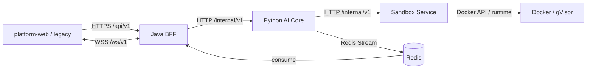
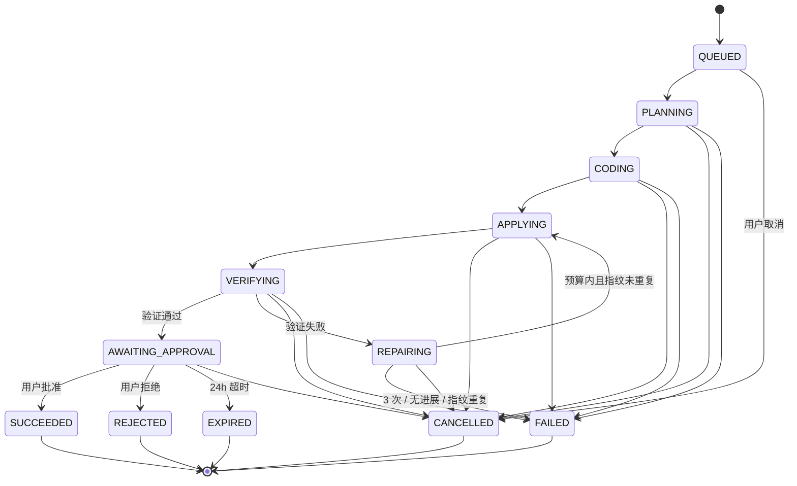
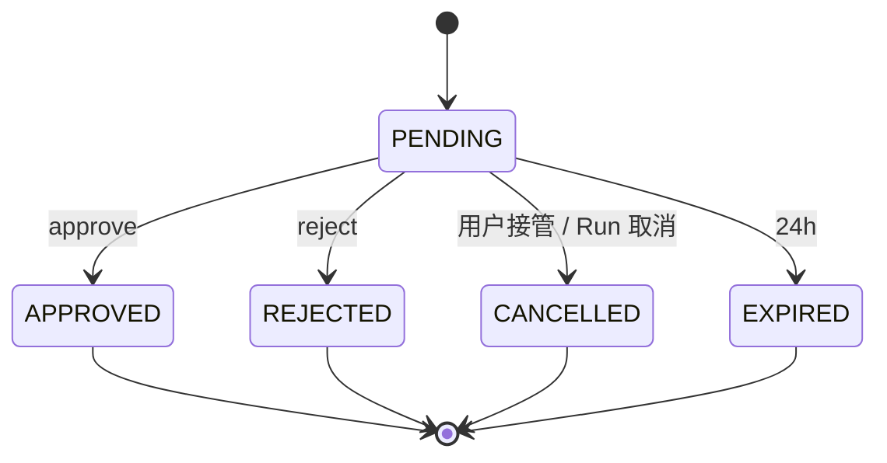
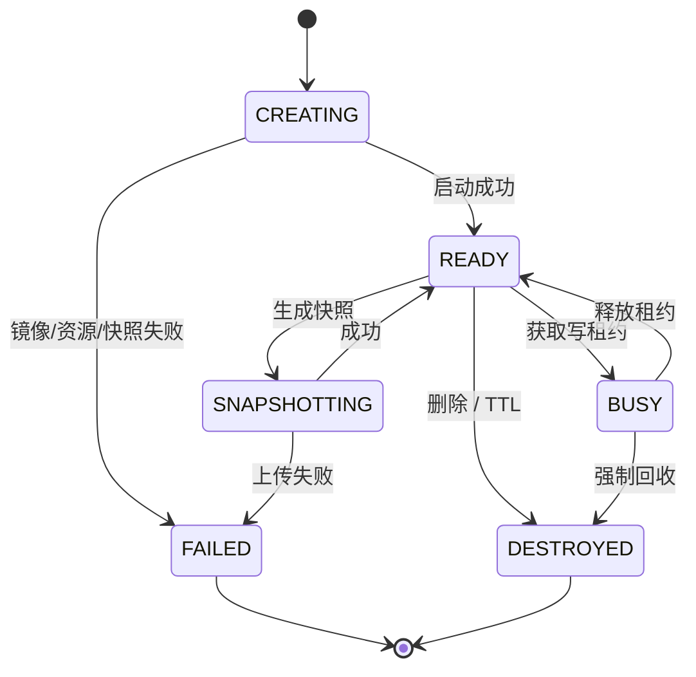

# 03. API 接口设计

> 状态：v1.0（M1 契约基线）
> 日期：2026-11-04
> 项目：vibe-platform
> 依据：`01.功能模块梳理.md`、`02.整体架构设计.md`、Q1–Q8 决策、架构铁律 R1–R5
> 范围：公共 API（Java BFF）、内部 API（Java → Python）、内部 API（Python → Sandbox）、L1 Canvas Bridge、数据契约、状态机、错误码、安全与示例

---

## 0. 设计原则

1. **协议即契约**：`packages/protocol` 中的 OpenAPI / JSON Schema 是唯一事实源；TS/Java/Python 类型由它生成。
2. **公共与内部分离**：`/api/v1` 面向浏览器；`/internal/v1` 只允许内网服务调用，不暴露给公网。
3. **资源化 + 命令化并存**：CRUD 用资源；Run/审批/取消等有状态操作使用命令端点。
4. **所有写操作可幂等**：创建 Run、审批、快照、预览会话必须支持 `Idempotency-Key`。
5. **事件优先**：长任务不靠 HTTP 轮询；Run 进度通过 WebSocket/SSE 推送，HTTP 只做补偿查询。
6. **最小上下文**：公共 API 不接收完整 DOM/整仓源码；只接收标注、目标片段、对象引用。
7. **租户隔离**：公共 API 的 `tenant_id` 从 JWT 推导，禁止客户端传入；内部 API 必须显式透传并校验。
8. **错误可编程**：稳定错误码 + 结构化 details；客户端不解析自然语言 message。

---

## 1. 总览

### 1.1 四类接口



| 类别 | 基址 | 调用方 | 认证 |
|---|---|---|---|
| 公共 REST | `https://{host}/api/v1` | 浏览器 | Bearer JWT |
| 公共 WS | `wss://{host}/ws/v1` | 浏览器 | WS ticket |
| 内部 Java→Python | `http://ai-core:8100/internal/v1` | Java BFF | `X-Internal-Token` + 网络隔离（生产 mTLS） |
| 内部 Python→Sandbox | `http://sandbox-service:8200/internal/v1` | AI Core | 服务 token + `X-Sandbox-Token`（生产 mTLS） |
| 事件流 | Redis Stream `vibe:run:events` | AI Core → Java BFF | 内网 |
| Canvas Bridge | `postMessage` | platform-web ↔ iframe | session token + origin allowlist |

### 1.2 环境与基址

| 环境 | 公共 API | WS | 说明 |
|---|---|---|---|
| 本地 | `http://127.0.0.1:8080/api/v1` | `ws://127.0.0.1:8080/ws/v1` | Docker Compose |
| 预发 | `https://staging-api.{domain}/api/v1` | `wss://staging-api.{domain}/ws/v1` | TLS |
| 生产 | `https://api.{domain}/api/v1` | `wss://api.{domain}/ws/v1` | TLS + WAF |

> 前端不硬编码主机；通过 `VITE_API_BASE_URL` 注入。预览地址由后端返回，前端不拼接。

### 1.3 通用请求头

| Header | 必填 | 说明 |
|---|---|---|
| `Authorization: Bearer <jwt>` | 公共 API 是 | Access Token，15 分钟 |
| `Content-Type: application/json` | 有 body 时 | 文件上传用预签名，不直传 BFF |
| `Idempotency-Key` | 写命令建议/部分必填 | 8–128 字符；24 小时 |
| `X-Request-Id` | 否 | 客户端生成 UUID；缺省由 BFF 生成 |
| `X-Trace-Id` | 否 | 通常由 BFF 生成；内部透传 |
| `If-Match` | 更新/审批可选 | 资源 `version` 或 ETag；乐观锁 |
| `X-Internal-Token` | 内部 API 是 | 服务间共享密钥；生产替换 mTLS |
| `X-Tenant-Id` | 内部 API 是 | 由 Java 从 JWT 推导后透传 |
| `X-Run-Id` | 内部 API 是 | 关联执行 |
| `X-Sandbox-Token` | Sandbox API 是 | 创建沙盒时签发的短期 token |
| `Last-Event-ID` | SSE 恢复 | 最后收到的事件 `seq` |

**禁止**：

- 公共 API 不接受客户端传入 `tenantId`、`userId`、`status`、`createdAt` 等服务器字段。
- 不允许在 URL query 中放 access token；WS 只允许短期 ticket。
- 不允许把模型密钥、数据库口令放入任何公共请求。

### 1.4 通用响应结构

**成功（单资源）**：

```json
{
  "data": {
    "id": "01J9Z6K3M8Q2V4T7R1N5B0C6XD",
    "createdAt": "2026-11-04T10:00:00Z"
  },
  "requestId": "7f3c2a1e-9b7d-4c5a-8e21-3d4f5a6b7c8d"
}
```

**成功（列表）**：

```json
{
  "data": {
    "items": [],
    "nextCursor": "eyJpZCI6IjAxSjla...",
    "hasMore": false
  },
  "requestId": "7f3c2a1e-9b7d-4c5a-8e21-3d4f5a6b7c8d"
}
```

**失败**：

```json
{
  "error": {
    "code": "RUN_STATE_CONFLICT",
    "message": "Run 当前状态不允许取消",
    "details": {
      "runId": "01J9Z6K3M8Q2V4T7R1N5B0C6XD",
      "currentStatus": "SUCCEEDED",
      "allowedStatuses": ["QUEUED", "PLANNING", "CODING", "APPLYING", "VERIFYING", "REPAIRING", "AWAITING_APPROVAL"]
    },
    "retryable": false
  },
  "requestId": "7f3c2a1e-9b7d-4c5a-8e21-3d4f5a6b7c8d",
  "traceId": "4bf92f3577b34da6a3ce929d0e0e4736"
}
```

**约定**：

- `data` 包裹成功数据；`error` 包裹失败；两者不共存。
- 所有时间为 RFC 3339 UTC，例如 `2026-11-04T10:00:00Z`。
- 所有 ID 为 26 位 ULID 字符串；`requestId`/`traceId` 为 UUID/十六进制。
- 枚举值使用 `SCREAMING_SNAKE_CASE`；JSON 字段使用 `camelCase`。
- 空列表返回 `items: []`，不返回 `null`。

### 1.5 分页

| 参数 | 说明 |
|---|---|
| `limit` | 1–100，默认 20 |
| `cursor` | 不透明字符串；只由服务端生成 |
| `order` | `asc`/`desc`，默认 `desc`（按创建时间） |

响应 `nextCursor` 为 `null` 时表示结束；客户端不得解析 cursor。

### 1.6 幂等

| 端点 | 是否要求 | 说明 |
|---|---|---|
| `POST /projects/{id}/runs` | 是 | 防止重复扣配额/重复执行 |
| `POST /conversations/{id}/messages`（mode=run） | 是 | 同上 |
| `POST /runs/{id}/approvals/{aid}/decision` | 是 | 防止重复审批 |
| `POST /projects/{id}/source/snapshots` | 是 | 防止重复上传/快照 |
| `POST /projects/{id}/preview-sessions` | 建议 | 防止重复创建沙盒 |
| `POST /runs/{id}/cancel` | 建议 | 重复取消返回最终状态 |
| `POST /projects` | 建议 | 防重复建项目 |

**行为**：

- 同一 `Idempotency-Key` + 同一请求体：返回首次结果（相同状态码/响应），并带 `Idempotent-Replayed: true`。
- 同一 key + 不同请求体：`409 IDEMPOTENCY_CONFLICT`。
- key 保留 24 小时；到期后可复用。
- 服务端存储请求体 hash，不存敏感原文。

### 1.7 限流

| 范围 | 限制（M1 默认） | 响应 |
|---|---|---|
| 注册/登录 | 5 次/分钟/IP，20 次/小时/账号 | `429 RATE_LIMITED` + `Retry-After` |
| 创建 Run | 10 次/分钟/用户，2 并发/用户 | `429 RUN_CONCURRENCY_LIMIT` |
| 上传/快照 | 20 次/分钟/用户 | `429 RATE_LIMITED` |
| 审批 | 30 次/分钟/用户 | `429 RATE_LIMITED` |
| WS 连接 | 5 个/用户 | `429` 或关闭旧连接 |
| 内部 API | 1000 次/分钟/服务 | `429 RATE_LIMITED` |

### 1.8 版本与兼容

- URL 主版本：`/api/v1`；不兼容变更升 `/api/v2`。
- 事件带 `version`；只增字段不删字段；删除/改义升版本。
- 响应头：`X-API-Version: 1`、`Deprecation`、`Sunset`。
- 内部 API 滚动升级需兼容上一个版本；契约测试在 CI 执行。
- `packages/protocol` 生成类型；手写 DTO 禁止与 schema 漂移。

---

## 2. 认证与授权

### 2.1 Token 模型

| Token | 载体 | 有效期 | 说明 |
|---|---|---|---|
| Access JWT | `Authorization` | 15 分钟 | 无状态；含 `sub`、`tenantId`、`role`、`jti` |
| Refresh Token | HttpOnly Cookie | 30 天 | 旋转；服务端存哈希；可撤销 |
| WS Ticket | query `ticket` | 60 秒 | 一次性；绑定 userId/tenantId |
| Preview Token | Cookie/query | 5 分钟 | 绑定 sandboxId/userId；可续期 |
| Internal Token | Header | 长期（轮换） | 服务间；生产 mTLS |
| Sandbox Token | Header | 沙盒生命周期 | 单沙盒；创建时签发 |

**Access JWT claims**：

```json
{
  "iss": "vibe-platform",
  "sub": "01J9Z6K3M8Q2V4T7R1N5B0C6XD",
  "tenantId": "01J9Z6K3M8Q2V4T7R1N5B0C6XE",
  "role": "OWNER",
  "jti": "0f8fad5b-d9cb-469f-a165-70867728950e",
  "iat": 1762240800,
  "exp": 1762241700,
  "typ": "access"
}
```

### 2.2 认证端点

#### POST `/auth/register`

创建用户 + personal tenant + membership（OWNER）。

**请求**：

```json
{
  "email": "dev@example.com",
  "password": "S3cure!Passw0rd",
  "displayName": "Dev"
}
```

**响应 201**：

```json
{
  "data": {
    "user": {
      "id": "01J9Z6K3M8Q2V4T7R1N5B0C6XD",
      "email": "dev@example.com",
      "displayName": "Dev",
      "status": "ACTIVE"
    },
    "tenant": {
      "id": "01J9Z6K3M8Q2V4T7R1N5B0C6XE",
      "name": "Dev 的个人空间",
      "role": "OWNER"
    },
    "accessToken": "eyJhbGciOi...",
    "expiresIn": 900
  },
  "requestId": "..."
}
```

同时 `Set-Cookie: vibe_refresh=...; HttpOnly; Secure; SameSite=Lax; Path=/api/v1/auth`。

**错误**：`AUTH_EMAIL_EXISTS`、`AUTH_WEAK_PASSWORD`、`VALIDATION_ERROR`、`RATE_LIMITED`。

#### POST `/auth/login`

**请求**：`{ "email": "...", "password": "..." }`

**响应 200**：同注册的 `user/tenant/accessToken/expiresIn`；刷新 Cookie。

**错误**：`AUTH_INVALID_CREDENTIALS`、`AUTH_ACCOUNT_LOCKED`、`RATE_LIMITED`。

#### POST `/auth/refresh`

无 body；读取 Refresh Cookie；旋转 refresh token。

**响应 200**：

```json
{
  "data": {
    "accessToken": "eyJhbGciOi...",
    "expiresIn": 900
  }
}
```

**错误**：`AUTH_REFRESH_INVALID`、`AUTH_REFRESH_REVOKED`、`AUTH_REFRESH_EXPIRED`。

#### POST `/auth/logout`

撤销当前 refresh token；清 Cookie。**响应 204**。

#### GET `/auth/me`

**响应 200**：

```json
{
  "data": {
    "user": {
      "id": "01J9...",
      "email": "dev@example.com",
      "displayName": "Dev",
      "avatarUrl": null,
      "status": "ACTIVE"
    },
    "tenant": {
      "id": "01J9...",
      "name": "Dev 的个人空间",
      "role": "OWNER"
    },
    "memberships": [
      { "tenantId": "01J9...", "role": "OWNER" }
    ],
    "capabilities": {
      "canCreateProject": true,
      "canRunWrite": true,
      "maxConcurrentRuns": 2
    }
  }
}
```

#### GET `/auth/oauth/{provider}/authorize`

`provider`：`github` | `google`。返回 `302` 到提供方；或 `Accept: application/json` 时返回：

```json
{ "data": { "authorizeUrl": "https://github.com/login/oauth/authorize?...", "state": "..." } }
```

#### GET `/auth/oauth/{provider}/callback`

处理回调；成功设置 Refresh Cookie 并 `302` 到 `{WEB_ORIGIN}/auth/callback?status=ok`；失败带 `status=error&code=...`。

#### POST `/auth/ws-ticket`

**请求**：

```json
{ "runId": "01J9Z6K3M8Q2V4T7R1N5B0C6XF" }
```

**响应 200**：

```json
{
  "data": {
    "ticket": "ws_01J9Z6...",
    "expiresIn": 60
  }
}
```

**错误**：`RUN_NOT_FOUND`（不泄露是否存在：统一 404）、`TENANT_FORBIDDEN`。

---

## 3. 公共 API（Java BFF）

### 3.1 租户与用户

#### GET `/tenants/current`

```json
{
  "data": {
    "id": "01J9...",
    "name": "Dev 的个人空间",
    "plan": "FREE",
    "status": "ACTIVE",
    "limits": {
      "maxProjects": 20,
      "maxConcurrentRuns": 2,
      "maxSandboxMinutesPerDay": 120
    }
  }
}
```

#### PATCH `/tenants/current`

仅 `name` 可改。请求：`{ "name": "我的工作区" }`；`If-Match` 可选。响应同上。

#### GET `/users/me/preferences`

返回 UI 偏好（默认透镜、主题、自动滚动）。M1 只读/简单更新，不做复杂配置。

---

### 3.2 项目

#### GET `/projects`

Query：`status=ACTIVE|ARCHIVED`、`cursor`、`limit`、`order`。

**响应 200**：

```json
{
  "data": {
    "items": [
      {
        "id": "01J9Z6K3M8Q2V4T7R1N5B0C6XG",
        "name": "landing-page",
        "framework": "vite-react",
        "buildTool": "vite",
        "sourceMode": "source",
        "status": "ACTIVE",
        "currentSnapshotId": "01J9Z6K3M8Q2V4T7R1N5B0C6XH",
        "createdAt": "2026-11-04T09:00:00Z",
        "updatedAt": "2026-11-04T10:00:00Z",
        "version": 3
      }
    ],
    "nextCursor": null,
    "hasMore": false
  }
}
```

#### POST `/projects`

**请求**：

```json
{
  "name": "landing-page",
  "framework": "vite-react",
  "buildTool": "vite",
  "sourceMode": "source",
  "description": "产品落地页"
}
```

| 字段 | 必填 | 约束 |
|---|---|---|
| `name` | 是 | 2–80 字符；同租户唯一（软删除除外） |
| `framework` | 是 | M1 仅 `vite-react`；其他返回 `UNSUPPORTED_FRAMEWORK` |
| `buildTool` | 是 | M1 仅 `vite` |
| `sourceMode` | 是 | `source`（源码级）或 `visual`（视觉兜底） |
| `description` | 否 | ≤500 字符 |

**响应 201**：项目对象；`currentSnapshotId=null`。

**错误**：`PROJECT_NAME_CONFLICT`、`UNSUPPORTED_FRAMEWORK`、`QUOTA_EXCEEDED`。

#### GET `/projects/{projectId}`

返回项目详情 + 最近 Run 摘要 + 能力。

```json
{
  "data": {
    "project": {
      "id": "01J9...",
      "name": "landing-page",
      "framework": "vite-react",
      "buildTool": "vite",
      "sourceMode": "source",
      "status": "ACTIVE",
      "currentSnapshotId": "01J9...",
      "version": 3
    },
    "latestRun": {
      "id": "01J9...",
      "status": "SUCCEEDED",
      "finishedAt": "2026-11-04T10:05:00Z"
    },
    "capabilities": { "sourceLevel": true, "writeRuns": true }
  }
}
```

#### PATCH `/projects/{projectId}`

可改 `name`、`description`、`status`（`ACTIVE`/`ARCHIVED`）。带 `If-Match` 时版本不匹配返回 `409 PROJECT_VERSION_CONFLICT`；不带则 last-write-wins（M1 允许，记录审计）。

#### DELETE `/projects/{projectId}`

软删除项目及其快照元数据；异步清理 MinIO（30 天内可恢复，M2 提供回收站）。**响应 204**。

#### GET `/projects/{projectId}/capabilities`

前端据此决定 UI 模式，不靠猜测。

```json
{
  "data": {
    "framework": "vite-react",
    "sourceMode": "source",
    "sourceLevel": true,
    "annotationTypes": ["note", "draw", "drag", "visual-draw"],
    "features": {
      "build": true,
      "test": true,
      "screenshot": true,
      "preview": true,
      "writeRuns": true,
      "rag": false,
      "multiAgent": false
    },
    "limits": {
      "maxAnnotations": 50,
      "maxSnippetLines": 40,
      "maxSnippetBytes": 4096,
      "maxRepairAttempts": 3,
      "maxConcurrentRuns": 2,
      "runTtlSeconds": 1800,
      "approvalTtlSeconds": 86400
    },
    "unsupportedReasons": []
  }
}
```

**非 React / `sourceMode=visual`**：

```json
{
  "data": {
    "framework": "other",
    "sourceMode": "visual",
    "sourceLevel": false,
    "features": { "writeRuns": false, "preview": true },
    "unsupportedReasons": ["SOURCE_ADAPTER_NOT_AVAILABLE"]
  }
}
```

---

### 3.3 源码上传与快照

#### POST `/projects/{projectId}/source/upload-url`

**请求**：

```json
{
  "fileName": "source.zip",
  "sizeBytes": 5242880,
  "sha256": "9f86d081884c7d659a2feaa0c55ad015..."
}
```

**响应 200**：

```json
{
  "data": {
    "uploadUrl": "https://minio.../presigned",
    "objectKey": "tenants/01J9.../projects/01J9.../uploads/01J9....zip",
    "expiresAt": "2026-11-04T10:15:00Z",
    "maxBytes": 52428800
  }
}
```

约束：

- 仅接受 `.zip`/`.tar.gz`；单文件 ≤50 MB；解压后 ≤200 MB、≤5000 文件。
- 预签名 URL 15 分钟；上传后由 BFF 校验 sha256/size。
- 禁止路径穿越、符号链接、`node_modules`、`.git`、二进制大文件。

#### POST `/projects/{projectId}/source/snapshots`

**请求**：

```json
{
  "objectKey": "tenants/.../uploads/01J9....zip",
  "sha256": "9f86d081884c7d659a2feaa0c55ad015...",
  "manifest": {
    "entry": "src/main.tsx",
    "packageManager": "pnpm",
    "hasLockfile": true
  }
}
```

**响应 202**：

```json
{
  "data": {
    "snapshotId": "01J9Z6K3M8Q2V4T7R1N5B0C6XH",
    "status": "UPLOADING",
    "createdAt": "2026-11-04T10:00:00Z"
  }
}
```

**错误**：`SOURCE_UPLOAD_INVALID`、`SOURCE_TOO_LARGE`、`SOURCE_UNSAFE_PATH`、`SOURCE_MANIFEST_INVALID`、`SNAPSHOT_NOT_READY`。

#### GET `/projects/{projectId}/snapshots`

返回快照列表：

```json
{
  "data": {
    "items": [
      {
        "id": "01J9...",
        "status": "READY",
        "source": "UPLOAD",
        "baseCommit": null,
        "fileCount": 128,
        "sizeBytes": 5242880,
        "createdAt": "2026-11-04T10:00:00Z",
        "expiresAt": null
      }
    ],
    "nextCursor": null,
    "hasMore": false
  }
}
```

#### GET `/projects/{projectId}/snapshots/{snapshotId}`

返回快照详情 + `downloadUrl`（仅 owner，15 分钟）。

#### POST `/projects/{projectId}/snapshots/{snapshotId}/restore`

把历史快照设为项目当前版本；M1 只允许 `READY` 且属于该项目的快照。

**请求**：`{ "reason": "回滚到稳定版本" }`

**响应 202**：`{ "data": { "restoreId": "...", "status": "QUEUED" } }`

> 回滚本身也是写操作；M1 只允许项目 owner，且记录审计。审批通过后的快照可直接 restore。

---

### 3.4 预览会话

#### POST `/projects/{projectId}/preview-sessions`

**请求**：

```json
{
  "snapshotId": "01J9Z6K3M8Q2V4T7R1N5B0C6XH",
  "mode": "dev",
  "viewport": { "width": 1440, "height": 900 }
}
```

| 字段 | 说明 |
|---|---|
| `snapshotId` | 必填；必须是 READY |
| `mode` | `dev`（HMR）或 `preview`（构建产物） |
| `viewport` | 仅用于截图/初始布局，不影响沙盒 |

**响应 201**：

```json
{
  "data": {
    "previewSessionId": "01J9...",
    "sandboxId": "sbx_01J9...",
    "status": "STARTING",
    "previewUrl": "https://app.example.com/preview/sbx_01J9.../",
    "expiresAt": "2026-11-04T10:30:00Z"
  }
}
```

**错误**：`SNAPSHOT_NOT_READY`、`SANDBOX_CREATE_FAILED`、`QUOTA_EXCEEDED`。

#### GET `/preview-sessions/{previewSessionId}`

返回 `STARTING|READY|FAILED|EXPIRED|STOPPED` + `previewUrl` + `expiresAt`。

#### DELETE `/preview-sessions/{previewSessionId}`

停止沙盒；**响应 204**。重复调用幂等。

---

### 3.5 对话

#### POST `/projects/{projectId}/conversations`

**请求**：`{ "title": "首页改版" }`；**响应 201**：`{ "id", "title", "createdAt" }`。

#### GET `/conversations/{conversationId}`

返回会话元数据 + 最近消息游标。

#### GET `/conversations/{conversationId}/messages?cursor=&limit=`

返回消息列表；消息含 `role`、`content`、`annotations`、`runId`、`createdAt`。

#### POST `/conversations/{conversationId}/messages`

**请求**：

```json
{
  "clientMessageId": "c_01J9...",
  "mode": "chat",
  "content": "把标题改成更醒目的样式",
  "annotations": []
}
```

| `mode` | 行为 |
|---|---|
| `chat` | 只存消息，返回消息；不创建 Run |
| `run` | 存消息并创建 Run；响应含 `run`；必须带 `Idempotency-Key` |

**响应 201（mode=run）**：

```json
{
  "data": {
    "message": {
      "id": "01J9...",
      "role": "USER",
      "content": "把标题改成更醒目的样式",
      "createdAt": "2026-11-04T10:00:00Z"
    },
    "run": {
      "id": "01J9Z6K3M8Q2V4T7R1N5B0C6XF",
      "status": "QUEUED",
      "createdAt": "2026-11-04T10:00:00Z"
    }
  }
}
```

> `mode=run` 与 `POST /projects/{id}/runs` 走同一个 Run 创建 facade；不能绕过配额/幂等/能力校验。

---

### 3.6 Run

#### POST `/projects/{projectId}/runs`

**请求**：

```json
{
  "intent": "把主标题改成渐变文字，并增大字号",
  "scope": {
    "mode": "element",
    "target": {
      "file": "src/App.tsx",
      "line": 42,
      "column": 5,
      "endLine": 42,
      "endColumn": 18,
      "component": "App",
      "sourceKind": "jsx",
      "selector": "[data-source='src/App.tsx:42:5']"
    }
  },
  "annotations": [
    {
      "version": 1,
      "annotationId": "ann_01J9...",
      "type": "drag",
      "worldTarget": { "x": 120, "y": 80, "width": 320, "height": 64, "zoom": 1.0 },
      "target": {
        "mode": "source",
        "source": {
          "file": "src/App.tsx",
          "line": 42,
          "column": 5,
          "endLine": 42,
          "endColumn": 18,
          "component": "App",
          "sourceKind": "jsx"
        },
        "selector": "[data-source='src/App.tsx:42:5']",
        "snippet": {
          "startLine": 30,
          "endLine": 52,
          "content": "export default function App() { ... }",
          "hash": "sha256:..."
        }
      },
      "payload": {
        "text": "标题再大一点",
        "from": { "x": 120, "y": 80 },
        "to": { "x": 440, "y": 144 }
      },
      "createdAt": "2026-11-04T10:00:00Z"
    }
  ],
  "conversationId": "01J9...",
  "messageId": "01J9...",
  "baseSnapshotId": "01J9Z6K3M8Q2V4T7R1N5B0C6XH",
  "acceptance": {
    "build": true,
    "tests": true,
    "screenshot": true,
    "userApproval": true
  },
  "budget": {
    "maxRepairAttempts": 3,
    "maxTokens": 60000,
    "maxDurationSeconds": 900
  }
}
```

**字段约束**：

| 字段 | 必填 | 约束 |
|---|---|---|
| `intent` | 是 | 1–2000 字符；非空 |
| `scope.mode` | 是 | `element`/`region`/`project`/`visual` |
| `scope.target` | element 时是 | 必须是 React/Vite 可定位源码 |
| `annotations` | 否 | ≤50；每条 ≤8 KB；截图 ≤1 MB |
| `baseSnapshotId` | 否 | 缺省用项目当前快照；必须是 READY |
| `budget.maxRepairAttempts` | 否 | 0–3；缺省 3 |
| `acceptance.userApproval` | 否 | M1 固定 `true`，传 false 返回 `VALIDATION_ERROR` |

**响应 202**：

```json
{
  "data": {
    "runId": "01J9Z6K3M8Q2V4T7R1N5B0C6XF",
    "status": "QUEUED",
    "createdAt": "2026-11-04T10:00:00Z",
    "baseSnapshotId": "01J9Z6K3M8Q2V4T7R1N5B0C6XH",
    "stream": {
      "wsUrl": "wss://api.example.com/ws/v1/runs/01J9Z6K3M8Q2V4T7R1N5B0C6XF",
      "sseUrl": "https://api.example.com/api/v1/runs/01J9Z6K3M8Q2V4T7R1N5B0C6XF/events/stream"
    },
    "approvalRequired": true
  }
}
```

**校验顺序**（任一失败即拒绝）：

1. 认证/租户/项目归属；
2. 项目 `sourceMode=source` 且 `framework=vite-react`；
3. `element`/`region` 目标必须能解析到源码锚点；`project` 允许无 target，但必须有可用项目清单；
4. 快照 READY 且属于项目；
5. 并发/配额/预算；
6. 幂等键。

**错误**：

| 错误码 | HTTP | 场景 |
|---|---|---|
| `UNSUPPORTED_FRAMEWORK` | 422 | 非 `vite-react` |
| `SOURCE_ANCHOR_REQUIRED` | 422 | 源码模式但没有可定位目标 |
| `VISUAL_MODE_READONLY` | 422 | `sourceMode=visual` 却创建写 Run |
| `SNAPSHOT_NOT_READY` | 409 | 快照未就绪 |
| `RUN_CONCURRENCY_LIMIT` | 429 | 超过并发 |
| `QUOTA_EXCEEDED` | 429 | 日配额/Token 配额 |
| `IDEMPOTENCY_CONFLICT` | 409 | 同 key 不同 body |
| `VALIDATION_ERROR` | 422 | 字段/大小/枚举非法 |

#### GET `/runs/{runId}`

```json
{
  "data": {
    "id": "01J9Z6K3M8Q2V4T7R1N5B0C6XF",
    "projectId": "01J9...",
    "status": "AWAITING_APPROVAL",
    "phase": "VERIFYING",
    "intent": "把主标题改成渐变文字，并增大字号",
    "baseSnapshotId": "01J9...",
    "sandboxId": "sbx_01J9...",
    "attempts": {
      "repairCount": 1,
      "maxRepairAttempts": 3,
      "lastErrorFingerprint": "sha256:..."
    },
    "budget": {
      "maxTokens": 60000,
      "usedTokens": 18240,
      "maxDurationSeconds": 900,
      "elapsedSeconds": 96
    },
    "progress": {
      "message": "构建、测试、截图已通过，等待确认",
      "percent": 90
    },
    "approval": {
      "approvalId": "apr_01J9...",
      "status": "PENDING",
      "expiresAt": "2026-11-05T10:00:00Z"
    },
    "result": null,
    "error": null,
    "lastEventSeq": 42,
    "createdAt": "2026-11-04T10:00:00Z",
    "startedAt": "2026-11-04T10:00:02Z",
    "finishedAt": null
  }
}
```

**状态**：见第 7 节。`phase` 是更细的执行阶段，仅用于 UI，不参与状态机判断。

#### GET `/projects/{projectId}/runs`

Query：`status`（可重复）、`cursor`、`limit`、`order`。返回 Run 摘要列表，不返回大 payload。

#### POST `/runs/{runId}/cancel`

**请求**：`{ "reason": "用户取消" }`（可选，≤200 字符）。

**响应 202**：

```json
{
  "data": {
    "runId": "01J9...",
    "status": "CANCELLED",
    "cancelRequestedAt": "2026-11-04T10:02:00Z"
  }
}
```

行为：

- `QUEUED/PLANNING/CODING/APPLYING/VERIFYING/REPAIRING/AWAITING_APPROVAL` 可取消。
- 终态重复取消返回 200 + 最终状态（幂等）。
- Python 收到取消后设置协作式取消标志；沙盒销毁；checkpoint 保留 7 天。
- 审批中的 Run 取消后审批自动 `CANCELLED`。

**错误**：`RUN_NOT_FOUND`、`RUN_ALREADY_FINISHED`、`RUN_CANCEL_NOT_ALLOWED`。

#### GET `/runs/{runId}/events?afterSeq=&limit=`

用于回放/补偿。返回：

```json
{
  "data": {
    "items": [
      {
        "eventId": "evt_01J9...",
        "runId": "01J9...",
        "seq": 42,
        "type": "approval.required",
        "version": 1,
        "ts": "2026-11-04T10:01:36Z",
        "payload": { "approvalId": "apr_01J9..." }
      }
    ],
    "nextCursor": null,
    "hasMore": false
  }
}
```

#### GET `/runs/{runId}/patches`

返回补丁列表（不含完整源码，仅 search/replace + hash）：

```json
{
  "data": {
    "items": [
      {
        "patchId": "pat_01J9...",
        "filePath": "src/App.tsx",
        "format": "search_replace",
        "baseHash": "sha256:...",
        "status": "APPLIED",
        "appliedAt": "2026-11-04T10:00:40Z"
      }
    ]
  }
}
```

#### GET `/runs/{runId}/artifacts`

返回截图、构建日志、测试报告等元数据；下载走单独端点。

#### GET `/runs/{runId}/artifacts/{artifactId}/download-url`

**响应 200**：

```json
{
  "data": {
    "url": "https://minio.../presigned",
    "expiresAt": "2026-11-04T10:10:00Z",
    "mime": "image/png",
    "sizeBytes": 284512
  }
}
```

---

### 3.7 审批

#### GET `/approvals?status=PENDING`

当前用户的待审批收件箱；返回 Run 摘要、风险等级、过期时间。

#### GET `/runs/{runId}/approvals`

返回该 Run 的全部审批记录（M1 通常 1 条）。

**审批对象**：

```json
{
  "data": {
    "approvalId": "apr_01J9...",
    "runId": "01J9...",
    "status": "PENDING",
    "riskLevel": "MEDIUM",
    "summary": "修改 src/App.tsx：标题渐变 + 字号 48px",
    "options": ["approve", "reject", "takeover"],
    "evidence": {
      "diffSummary": { "filesChanged": 1, "insertions": 4, "deletions": 2 },
      "patches": [
        {
          "patchId": "pat_01J9...",
          "filePath": "src/App.tsx",
          "format": "search_replace",
          "search": "<h1 className=\"title\">Welcome</h1>",
          "replace": "<h1 className=\"title title--hero\">Welcome</h1>"
        }
      ],
      "verification": {
        "build": { "status": "PASSED", "durationMs": 8200 },
        "tests": { "status": "PASSED", "total": 12, "failed": 0 },
        "screenshot": {
          "beforeArtifactId": "art_01J9...",
          "afterArtifactId": "art_01J9..."
        }
      },
      "riskNotes": ["仅样式变更", "未修改依赖"]
    },
    "expiresAt": "2026-11-05T10:00:00Z",
    "createdAt": "2026-11-04T10:01:36Z"
  }
}
```

#### POST `/runs/{runId}/approvals/{approvalId}/decision`

**请求**：

```json
{
  "decision": "approve",
  "comment": "效果可以",
  "expectedVersion": 1
}
```

| decision | 行为 |
|---|---|
| `approve` | 固化快照、更新项目 current snapshot、Run=SUCCEEDED |
| `reject` | 丢弃沙盒改动、Run=REJECTED；保留 evidence 30 天 |
| `takeover` | 用户接管：Run=CANCELLED（reason=USER_TAKEOVER）；沙盒保留 30 分钟供手动导出/预览 |

**响应 202**：

```json
{
  "data": {
    "approval": {
      "approvalId": "apr_01J9...",
      "status": "APPROVED",
      "decidedAt": "2026-11-04T10:03:00Z"
    },
    "run": {
      "runId": "01J9...",
      "status": "SUCCEEDED"
    }
  }
}
```

**规则**：

- 只有 run owner 可决策；M1 不支持他人审批。
- 审批必须处于 `PENDING`；过期返回 `APPROVAL_EXPIRED`。
- 同一 `Idempotency-Key` 重复提交返回首次结果；不同 decision 用同一 key 返回 `APPROVAL_DECISION_CONFLICT`。
- 批准后 Python 仍需完成快照上传；若上传失败，Run=`FAILED`，审批记录保留，项目回滚到 base snapshot。
- M1 **所有写操作必须人工批准**；不存在自动批准。

---

### 3.8 WebSocket

**连接**：

```text
wss://{host}/ws/v1/runs/{runId}?ticket={wsTicket}
```

**客户端帧**：

```json
{ "type": "subscribe", "runId": "01J9...", "lastSeq": 0 }
{ "type": "ack", "seq": 42 }
{ "type": "ping", "ts": 1762240800000 }
```

**服务端帧**：

```json
{ "type": "hello", "connectionId": "ws_01J9...", "serverTime": "2026-11-04T10:00:00Z", "heartbeatIntervalMs": 25000 }
{ "type": "run.event", "event": { "eventId": "evt_...", "runId": "01J9...", "seq": 1, "type": "run.queued", "version": 1, "ts": "2026-11-04T10:00:00Z", "payload": {} } }
{ "type": "resume.complete", "fromSeq": 0, "toSeq": 42 }
{ "type": "pong", "ts": 1762240800000 }
{ "type": "error", "code": "RUN_NOT_FOUND", "message": "..." }
```

**规则**：

- 连接后 5 秒内必须 `subscribe`；否则关闭。
- `lastSeq` 用于断线恢复；服务端先推历史（最多 500 条），再推实时。
- 服务端每 25 秒 ping；客户端 60 秒无消息可重连。
- 事件按 `seq` 单调；客户端忽略重复 seq。
- 连接数超限关闭最旧连接；关闭码 `4001`（鉴权失败）、`4003`（无权限）、`4008`（限流）、`1012`（服务重启）。

### 3.9 SSE 回退

```text
GET /api/v1/runs/{runId}/events/stream?afterSeq=0
Accept: text/event-stream
```

```text
id: 42
event: run.event
data: {"eventId":"evt_...","seq":42,"type":"approval.required","payload":{...}}

```

- 支持 `Last-Event-ID`；与 WS 同一事件 envelope。
- 每 15 秒发送注释心跳 `: ping`。
- 适合企业代理屏蔽 WS 的场景；M1 保留，默认前端用 WS。

---

### 3.10 Legacy 兼容

#### POST `/legacy/prompt-export`

为非 React 项目导出 Prompt 包，交给 legacy 视觉模式。

**请求**：

```json
{
  "projectId": "01J9...",
  "annotations": [],
  "intent": "把按钮改成圆角"
}
```

**响应 200**：

```json
{
  "data": {
    "prompt": "...",
    "format": "markdown",
    "legacyUrl": "http://127.0.0.1:5174/?import=01J9..."
  }
}
```

规则：

- 不创建 Run、不启动沙盒、不写项目源码。
- 仅返回 Prompt/深链；实际执行在 legacy。
- 非 React 项目的唯一 AI 入口；UI 必须明确标注“视觉模式，不支持源码级修改”。

---

## 4. 内部 API：Java BFF → Python AI Core

**基址**：`http://ai-core:8100/internal/v1`

**认证**：

```http
X-Internal-Token: <service-token>
X-Tenant-Id: <tenantId>
X-Request-Id: <uuid>
X-Trace-Id: <traceId>
X-Run-Id: <runId>
Content-Type: application/json
```

生产环境叠加 mTLS；令牌轮换；缺失/不匹配返回 `401 INTERNAL_UNAUTHORIZED`。

### 4.1 POST `/executions`

创建执行；按 `runId` 幂等。

**请求**：

```json
{
  "runId": "01J9Z6K3M8Q2V4T7R1N5B0C6XF",
  "tenantId": "01J9...",
  "projectId": "01J9...",
  "userId": "01J9...",
  "baseSnapshotId": "01J9...",
  "conversationId": "01J9...",
  "contract": {
    "version": 1,
    "intent": "把主标题改成渐变文字，并增大字号",
    "scope": {
      "mode": "element",
      "target": {
        "file": "src/App.tsx",
        "line": 42,
        "column": 5,
        "endLine": 42,
        "endColumn": 18,
        "component": "App",
        "sourceKind": "jsx"
      }
    },
    "constraints": {
      "framework": "vite-react",
      "mustPreserve": ["现有路由", "现有文案"],
      "forbidden": ["新增依赖", "修改鉴权"]
    },
    "acceptance": {
      "build": true,
      "tests": true,
      "screenshot": true,
      "userApproval": true
    },
    "context": {
      "annotations": [],
      "attachments": []
    }
  },
  "budget": {
    "maxRepairAttempts": 3,
    "maxTokens": 60000,
    "maxDurationSeconds": 900,
    "maxToolCalls": 40
  },
  "callback": {
    "eventStream": "vibe:run:events"
  }
}
```

**响应 202**：

```json
{
  "data": {
    "executionId": "exec_01J9...",
    "runId": "01J9...",
    "accepted": true,
    "checkpointId": "ckpt_01J9...",
    "createdAt": "2026-11-04T10:00:01Z"
  }
}
```

**幂等**：

- 相同 `runId` 重复创建：返回首次 `executionId`，`Idempotent-Replayed: true`。
- 相同 `runId` 但 contract hash 不同：`409 EXECUTION_CONFLICT`。
- Python 接收后先写 checkpoint，再返回 202；避免“已接受但无状态”。

**错误**：`EXECUTION_CONFLICT`、`SNAPSHOT_NOT_FOUND`、`BUDGET_INVALID`、`INTERNAL_UNAUTHORIZED`。

### 4.2 GET `/executions/{runId}`

```json
{
  "data": {
    "executionId": "exec_01J9...",
    "runId": "01J9...",
    "status": "AWAITING_APPROVAL",
    "phase": "VERIFYING",
    "attempts": { "repairCount": 1, "lastErrorFingerprint": "sha256:..." },
    "budgetUsed": { "tokens": 18240, "toolCalls": 19, "elapsedSeconds": 96 },
    "sandbox": { "sandboxId": "sbx_01J9...", "status": "READY" },
    "approval": {
      "approvalId": "apr_01J9...",
      "status": "PENDING",
      "expiresAt": "2026-11-05T10:00:00Z"
    },
    "lastSeq": 42,
    "error": null,
    "updatedAt": "2026-11-04T10:01:36Z"
  }
}
```

用途：Java 对账、断线恢复、审批页刷新。**不返回完整 checkpoint / 源码 / 模型 prompt**。

### 4.3 POST `/executions/{runId}/cancel`

**请求**：`{ "reason": "USER_CANCELLED", "requestedBy": "01J9..." }`

**响应 202**：

```json
{ "data": { "runId": "01J9...", "status": "CANCELLED", "accepted": true } }
```

- 协作式取消；节点在安全点检查。
- 已终态返回 200 + 当前状态。
- 取消后释放沙盒租约；checkpoint 保留 7 天。

### 4.4 POST `/executions/{runId}/approvals`

**请求**：

```json
{
  "approvalId": "apr_01J9...",
  "decision": "approve",
  "comment": "效果可以",
  "decidedBy": "01J9...",
  "decidedAt": "2026-11-04T10:03:00Z"
}
```

**响应 202**：

```json
{
  "data": {
    "runId": "01J9...",
    "approvalId": "apr_01J9...",
    "accepted": true,
    "resumeToken": "resume_01J9..."
  }
}
```

- `resumeToken` 仅用于日志追踪，不暴露给客户端。
- Python 校验 `approvalId` 与 checkpoint 中一致；不匹配 `409 APPROVAL_STATE_CONFLICT`。
- 批准后恢复 `await_approval` 节点；拒绝后走 `rejected` 分支。
- 重复提交同一 decision 幂等；不同 decision 返回 409。

### 4.5 GET `/internal/v1/health` / `/capabilities`

**健康**：

```json
{
  "status": "UP",
  "version": "1.0.0",
  "dependencies": {
    "redis": "UP",
    "sandbox": "UP",
    "model": "DEGRADED"
  }
}
```

**能力**：

```json
{
  "data": {
    "languages": ["typescript", "javascript"],
    "frameworks": ["vite-react"],
    "sandboxProviders": ["docker"],
    "repairMaxAttempts": 3,
    "ragEnabled": false
  }
}
```

---

## 5. 内部 API：Python AI Core → Sandbox Service

**基址**：`http://sandbox-service:8200/internal/v1`

**认证**：

```http
X-Internal-Token: <service-token>
X-Sandbox-Token: <sandbox-token>   # 创建后返回；单沙盒
X-Tenant-Id: <tenantId>
X-Run-Id: <runId>
X-Request-Id: <uuid>
X-Trace-Id: <traceId>
```

生产 mTLS；Sandbox Service 只监听内网；不暴露公网。

### 5.1 POST `/sandboxes`

**请求**：

```json
{
  "sandboxId": "sbx_01J9...",
  "tenantId": "01J9...",
  "runId": "01J9...",
  "baseSnapshotId": "01J9...",
  "image": "vibe-sandbox-node22:1.0.0",
  "workdir": "/workspace",
  "resources": {
    "cpu": 2,
    "memoryMb": 4096,
    "pids": 512,
    "diskMb": 5120
  },
  "network": {
    "mode": "none",
    "allowlist": ["registry.npmjs.org"]
  },
  "ttlSeconds": 1800,
  "env": {
    "NODE_ENV": "development",
    "CI": "true"
  }
}
```

**响应 201**：

```json
{
  "data": {
    "sandboxId": "sbx_01J9...",
    "status": "READY",
    "lease": {
      "owner": "ai-core:run:01J9...",
      "epoch": 1,
      "fencingToken": "1",
      "expiresAt": "2026-11-04T10:30:00Z"
    },
    "preview": {
      "url": "https://app.example.com/preview/sbx_01J9.../",
      "token": "pvt_01J9...",
      "expiresAt": "2026-11-04T10:05:00Z"
    },
    "sandboxToken": "sbt_01J9...",
    "expiresAt": "2026-11-04T10:30:00Z",
    "createdAt": "2026-11-04T10:00:02Z"
  }
}
```

**错误**：`SANDBOX_CREATE_FAILED`、`SANDBOX_RESOURCE_EXCEEDED`、`SNAPSHOT_NOT_FOUND`、`SANDBOX_IMAGE_UNAVAILABLE`。

### 5.2 GET `/sandboxes/{sandboxId}`

返回状态、资源使用、租约、预览、TTL；不返回宿主路径。

### 5.3 DELETE `/sandboxes/{sandboxId}`

销毁沙盒；幂等。**响应 204**。若仍有写租约，返回 `409 SANDBOX_BUSY`（除非带 `force=true` 且调用方是服务管理员）。

### 5.4 租约

#### POST `/sandboxes/{sandboxId}/lease`

**请求**：`{ "owner": "ai-core:run:01J9...", "ttlSeconds": 30 }`

**响应 200**：

```json
{
  "data": {
    "owner": "ai-core:run:01J9...",
    "epoch": 2,
    "fencingToken": "2",
    "expiresAt": "2026-11-04T10:01:00Z"
  }
}
```

**错误**：`SANDBOX_LEASE_CONFLICT`（他人持有）、`SANDBOX_NOT_READY`。

#### POST `/sandboxes/{sandboxId}/lease/renew`

**请求**：`{ "fencingToken": "2", "ttlSeconds": 30 }`

**响应 200**：新 `expiresAt`；token 过期/不匹配返回 `409 SANDBOX_LEASE_EXPIRED`。

#### DELETE `/sandboxes/{sandboxId}/lease`

**请求**：`{ "fencingToken": "2" }`；**响应 204**。用于审批等待/主动释放。

### 5.5 文件

#### POST `/sandboxes/{sandboxId}/files/read`

**请求**：

```json
{
  "fencingToken": "2",
  "paths": ["src/App.tsx", "package.json"],
  "maxBytes": 65536
}
```

**响应 200**：

```json
{
  "data": {
    "files": [
      { "path": "src/App.tsx", "content": "...", "hash": "sha256:...", "bytes": 1820, "truncated": false }
    ]
  }
}
```

#### POST `/sandboxes/{sandboxId}/files/list`

**请求**：`{ "path": ".", "depth": 2, "include": ["**/*.tsx"], "exclude": ["node_modules/**"] }`

**响应**：文件树 + hash；用于 ContextBuilder。

#### POST `/sandboxes/{sandboxId}/files/write`

原子写；只允许工作区内相对路径。

**请求**：

```json
{
  "fencingToken": "2",
  "path": "src/App.tsx",
  "content": "...",
  "baseHash": "sha256:...",
  "mode": "replace"
}
```

**响应 200**：`{ "path": "src/App.tsx", "hash": "sha256:...", "bytes": 1840, "commit": "abc1234" }`

**错误**：`SANDBOX_PATCH_CONFLICT`（baseHash 不匹配）、`SANDBOX_PATH_FORBIDDEN`、`SANDBOX_LEASE_EXPIRED`、`SANDBOX_DISK_EXCEEDED`。

#### POST `/sandboxes/{sandboxId}/patches/apply`

**请求**：

```json
{
  "fencingToken": "2",
  "patchId": "pat_01J9...",
  "format": "search_replace",
  "files": [
    {
      "path": "src/App.tsx",
      "baseHash": "sha256:...",
      "search": "<h1 className=\"title\">Welcome</h1>",
      "replace": "<h1 className=\"title title--hero\">Welcome</h1>",
      "expectedOccurrences": 1
    }
  ]
}
```

**响应 200**：

```json
{
  "data": {
    "applied": true,
    "commit": "abc1234",
    "files": [
      { "path": "src/App.tsx", "hash": "sha256:...", "occurrences": 1 }
    ]
  }
}
```

**规则**：

- 原子：全部成功或全部回滚（`git stash`/临时 commit）。
- `expectedOccurrences` 不匹配 → `SANDBOX_PATCH_CONFLICT`，不写入。
- 禁止绝对路径、`..`、符号链接逃逸、`.git` 写入。
- 应用后自动 `git commit`，message 含 `runId/patchId`。

### 5.6 命令执行

#### POST `/sandboxes/{sandboxId}/exec`

**请求**：

```json
{
  "fencingToken": "2",
  "command": "pnpm",
  "args": ["run", "build"],
  "cwd": "/workspace",
  "timeoutSeconds": 180,
  "env": { "CI": "true" }
}
```

**响应 200**：

```json
{
  "data": {
    "exitCode": 0,
    "stdout": "...",
    "stderr": "",
    "truncated": false,
    "durationMs": 8200,
    "timedOut": false
  }
}
```

**限制**：

- 只允许 allowlist 命令：`pnpm`、`npm`、`npx`、`node`、`git`、`vitest`、`vite`、`playwright`。
- 不接受 shell 字符串；`command` 与 `args` 分离；禁止 `;|&>`。
- 输出上限 256 KB；超出截断并置 `truncated=true`。
- 超时杀进程组；返回 `timedOut=true`；AI Core 决定是否失败。
- 命令在非 root、无宿主挂载、网络受限的沙盒内运行。

### 5.7 验证

#### POST `/sandboxes/{sandboxId}/verify`

**请求**：

```json
{
  "fencingToken": "2",
  "checks": ["install", "build", "test", "screenshot"],
  "timeoutSeconds": 300,
  "screenshot": {
    "viewport": { "width": 1440, "height": 900 },
    "fullPage": true,
    "waitUntil": "networkidle"
  }
}
```

**响应 200**：

```json
{
  "data": {
    "overall": "PASSED",
    "build": { "status": "PASSED", "exitCode": 0, "durationMs": 8200, "logArtifactId": "art_01J9..." },
    "tests": { "status": "PASSED", "total": 12, "failed": 0, "durationMs": 3400, "reportArtifactId": "art_01J9..." },
    "screenshot": {
      "status": "PASSED",
      "artifactId": "art_01J9...",
      "width": 1440,
      "height": 2400
    },
    "errors": []
  }
}
```

`overall`：`PASSED|FAILED|PARTIAL|SKIPPED`。

- `install` 只在首次或依赖变更时执行；使用 lockfile；失败即 FAILED。
- `test` 无测试脚本时 `SKIPPED`，不视为失败（M1 允许，UI 明示）。
- `screenshot` 失败不单独判失败，但审批卡标记“截图不可用”。
- 所有产物上传 MinIO，返回 `artifactId`。

### 5.8 快照

#### POST `/sandboxes/{sandboxId}/snapshots`

**请求**：

```json
{
  "fencingToken": "2",
  "message": "run 01J9... approved",
  "include": ["source", "lockfile"],
  "exclude": ["node_modules", "dist", ".cache"]
}
```

**响应 201**：

```json
{
  "data": {
    "snapshotId": "01J9...",
    "storageKey": "tenants/.../snapshots/01J9.../source.tar.zst",
    "commit": "abc1234",
    "fileCount": 129,
    "sizeBytes": 5312000,
    "sha256": "...",
    "createdAt": "2026-11-04T10:03:10Z"
  }
}
```

- 生成 `git bundle` + `tar.zst` + `manifest.json`。
- 成功后才允许 Run=SUCCEEDED；失败则 Run=FAILED。
- 临时快照 30 天；项目已批准快照长期保留（由 Java 标记）。

#### POST `/sandboxes/{sandboxId}/restore`

**请求**：`{ "fencingToken": "2", "snapshotId": "01J9..." }`

**响应 200**：`{ "restored": true, "commit": "abc1234" }`。用于沙盒重建/崩溃恢复。

### 5.9 预览

#### GET `/sandboxes/{sandboxId}/preview`

**响应 200**：

```json
{
  "data": {
    "url": "https://app.example.com/preview/sbx_01J9.../",
    "token": "pvt_01J9...",
    "expiresAt": "2026-11-04T10:05:00Z",
    "hmr": true
  }
}
```

#### POST `/sandboxes/{sandboxId}/heartbeat`

**请求**：`{ "fencingToken": "2" }`；**响应 200**：`{ "ok": true, "expiresAt": "..." }`。仅租约持有者可续期。

### 5.10 健康

`GET /internal/v1/health`：

```json
{
  "status": "UP",
  "docker": "UP",
  "activeSandboxes": 3,
  "capacity": { "cpu": 16, "memoryMb": 32768 }
}
```

---

## 6. 数据契约

### 6.1 通用类型

```json
{
  "id": "01J9Z6K3M8Q2V4T7R1N5B0C6XD",
  "tenantId": "01J9Z6K3M8Q2V4T7R1N5B0C6XE",
  "createdAt": "2026-11-04T10:00:00Z",
  "updatedAt": "2026-11-04T10:00:00Z",
  "version": 1
}
```

### 6.2 AnnotationEnvelope

统一承载 `note/draw/drag/visual-draw`；L1 Bridge 的原始消息在客户端转换为该结构。

```json
{
  "version": 1,
  "annotationId": "ann_01J9...",
  "type": "drag",
  "worldTarget": {
    "x": 120,
    "y": 80,
    "width": 320,
    "height": 64,
    "zoom": 1.0
  },
  "target": {
    "mode": "source",
    "source": {
      "file": "src/App.tsx",
      "line": 42,
      "column": 5,
      "endLine": 42,
      "endColumn": 18,
      "component": "App",
      "sourceKind": "jsx"
    },
    "selector": "[data-source='src/App.tsx:42:5']",
    "snippet": {
      "startLine": 30,
      "endLine": 52,
      "content": "export default function App() { ... }",
      "hash": "sha256:..."
    }
  },
  "payload": {
    "text": "标题再大一点",
    "from": { "x": 120, "y": 80 },
    "to": { "x": 440, "y": 144 },
    "strokes": []
  },
  "screenshot": {
    "artifactId": "art_01J9...",
    "crop": { "x": 0, "y": 0, "width": 1440, "height": 900 }
  },
  "createdAt": "2026-11-04T10:00:00Z"
}
```

| 字段 | 必填 | 说明 |
|---|---|---|
| `version` | 是 | 当前 1 |
| `annotationId` | 是 | 客户端生成，幂等去重 |
| `type` | 是 | `note`/`draw`/`drag`/`visual-draw` |
| `worldTarget` | 是 | 画布世界坐标；服务端不依赖视口 |
| `target` | 源码模式必填 | 源码锚点；visual 模式可为 `null` |
| `target.mode` | 是 | `source`/`visual` |
| `target.snippet` | 否 | ≤40 行 / 4 KB；由 SDK 提供 |
| `payload` | 否 | 文本/轨迹/拖拽起止点 |
| `screenshot` | 否 | 对象引用，不传 base64 |
| `createdAt` | 是 | 客户端时间；服务端记录接收时间 |

**校验**：

- 单条 ≤8 KB；每条轨迹点 ≤100（记录点 ≤5000，仅本地）。
- `annotations` ≤50。
- 源码锚点必须匹配 `SOURCE_PATTERN`（`.jsx/.tsx/.js/.ts`）且在项目内。
- 不允许传完整 DOM、整文件、`data:` URL、`<script>`。

### 6.3 TaskContract

```json
{
  "version": 1,
  "intent": "把主标题改成渐变文字，并增大字号",
  "scope": {
    "mode": "element",
    "target": {
      "file": "src/App.tsx",
      "line": 42,
      "column": 5,
      "endLine": 42,
      "endColumn": 18,
      "component": "App",
      "sourceKind": "jsx"
    },
    "region": null,
    "files": ["src/App.tsx"]
  },
  "constraints": {
    "framework": "vite-react",
    "mustPreserve": ["现有路由", "现有文案"],
    "forbidden": ["新增依赖", "修改鉴权"]
  },
  "acceptance": {
    "build": true,
    "tests": true,
    "screenshot": true,
    "userApproval": true
  },
  "context": {
    "annotations": [],
    "attachments": []
  },
  "riskHints": ["STYLE_ONLY"]
}
```

| `scope.mode` | 含义 | 写 Run |
|---|---|---|
| `element` | 选中单个源码元素 | 允许 |
| `region` | 选中画布区域，映射到多个元素 | 允许（M1 需至少一个源码锚点） |
| `project` | 全项目级需求 | 允许（M1 限制影响面） |
| `visual` | 仅截图/视觉 | 拒绝 `SOURCE_ANCHOR_REQUIRED` |

### 6.4 Run

```json
{
  "id": "01J9...",
  "tenantId": "01J9...",
  "projectId": "01J9...",
  "userId": "01J9...",
  "status": "CODING",
  "phase": "GENERATING_PATCH",
  "intent": "把主标题改成渐变文字，并增大字号",
  "baseSnapshotId": "01J9...",
  "sandboxId": "sbx_01J9...",
  "attempts": {
    "repairCount": 0,
    "maxRepairAttempts": 3,
    "lastErrorFingerprint": null
  },
  "budget": {
    "maxTokens": 60000,
    "usedTokens": 4200,
    "maxDurationSeconds": 900,
    "elapsedSeconds": 18
  },
  "approval": null,
  "result": null,
  "error": null,
  "lastEventSeq": 12,
  "createdAt": "2026-11-04T10:00:00Z",
  "startedAt": "2026-11-04T10:00:02Z",
  "finishedAt": null
}
```

**`result`（成功）**：

```json
{
  "snapshotId": "01J9...",
  "commit": "abc1234",
  "patches": ["pat_01J9..."],
  "artifacts": ["art_01J9..."],
  "verification": {
    "build": "PASSED",
    "tests": "PASSED",
    "screenshot": "PASSED"
  }
}
```

**`error`（失败）**：

```json
{
  "code": "REPAIR_EXHAUSTED",
  "message": "同一错误连续 3 次未修复",
  "fingerprint": "sha256:...",
  "details": { "attempts": 3 },
  "retryable": true
}
```

### 6.5 RunCreateRequest / Response

已在 3.6 给出完整示例。补充：

| 字段 | 服务端处理 |
|---|---|
| `conversationId` | 校验属于当前用户/项目；只作上下文 |
| `messageId` | 校验属于该会话；不重复扣费 |
| `baseSnapshotId` | 不属于项目则 404；非 READY 则 409 |
| `budget` | 夹紧到平台上限；超过上限返回 422 |
| `acceptance.userApproval=false` | 422；M1 强制审批 |

### 6.6 RunEvent

```json
{
  "eventId": "evt_01J9...",
  "runId": "01J9...",
  "seq": 12,
  "type": "patch.applied",
  "version": 1,
  "ts": "2026-11-04T10:00:40Z",
  "traceId": "4bf92f3577b34da6a3ce929d0e0e4736",
  "payload": {
    "patchId": "pat_01J9...",
    "files": ["src/App.tsx"],
    "commit": "abc1234"
  }
}
```

| `type` | 触发 | 关键 payload |
|---|---|---|
| `run.queued` | 创建后 | `queuePosition` |
| `run.started` | 开始执行 | `sandboxId` |
| `plan.created` | 计划完成 | `steps`、`scope` |
| `tool.started` | 工具调用 | `tool`、`inputSummary` |
| `tool.finished` | 工具结束 | `tool`、`status`、`durationMs` |
| `patch.proposed` | 生成补丁 | `patchId`、`files`、`diffSummary` |
| `patch.applied` | 沙盒应用 | `patchId`、`commit` |
| `verify.started` | 开始验证 | `checks` |
| `verify.passed` | 验证通过 | `build`、`tests`、`screenshot` |
| `verify.failed` | 验证失败 | `errors`、`fingerprint` |
| `repair.started` | 进入修复 | `attempt`、`fingerprint` |
| `approval.required` | 等待审批 | `approvalId`、`expiresAt` |
| `run.succeeded` | 成功 | `snapshotId`、`commit`、`artifacts` |
| `run.rejected` | 用户拒绝 | `approvalId` |
| `run.failed` | 失败 | `code`、`message`、`retryable` |
| `run.cancelled` | 取消 | `reason` |
| `run.expired` | 审批超时 | `approvalId` |
| `artifact.created` | 产物生成 | `artifactId`、`type` |
| `log.appended` | 增量日志 | `text`（≤4 KB，脱敏） |

**顺序**：同一 Run 的 `seq` 从 1 单调递增；不同 Run 独立。客户端按 `seq` 去重/排序。

### 6.7 Approval

```json
{
  "approvalId": "apr_01J9...",
  "runId": "01J9...",
  "status": "PENDING",
  "riskLevel": "LOW",
  "summary": "修改 1 个文件：标题样式",
  "options": ["approve", "reject", "takeover"],
  "evidence": {
    "diffSummary": { "filesChanged": 1, "insertions": 4, "deletions": 2 },
    "patches": [],
    "verification": {},
    "riskNotes": ["仅样式变更"]
  },
  "expiresAt": "2026-11-05T10:00:00Z",
  "createdAt": "2026-11-04T10:01:36Z"
}
```

**风险等级**：

| 等级 | 示例 | M1 行为 |
|---|---|---|
| `LOW` | 样式、文案 | 必须人工批准 |
| `MEDIUM` | 组件结构、路由参数 | 必须人工批准 + 高亮 |
| `HIGH` | 依赖、鉴权、数据写入、schema | 必须人工批准 + 二次确认 |

### 6.8 Patch

```json
{
  "patchId": "pat_01J9...",
  "runId": "01J9...",
  "filePath": "src/App.tsx",
  "format": "search_replace",
  "baseHash": "sha256:...",
  "search": "<h1 className=\"title\">Welcome</h1>",
  "replace": "<h1 className=\"title title--hero\">Welcome</h1>",
  "status": "APPLIED",
  "appliedAt": "2026-11-04T10:00:40Z"
}
```

**格式**：

- `search_replace`：M1 唯一可应用格式；要求唯一匹配。
- `unified`：仅用于展示/导出，**不可直接应用**；需要至少 3 行上下文。
- 禁止整文件重写、`<script>`、`javascript:`、二进制。

### 6.9 Artifact

```json
{
  "artifactId": "art_01J9...",
  "runId": "01J9...",
  "type": "SCREENSHOT",
  "mime": "image/png",
  "sizeBytes": 284512,
  "storageKey": "tenants/.../runs/.../screenshots/after.png",
  "createdAt": "2026-11-04T10:01:30Z",
  "expiresAt": "2026-12-04T10:01:30Z"
}
```

`type`：`SCREENSHOT`、`BUILD_LOG`、`TEST_REPORT`、`PATCH_EXPORT`、`SNAPSHOT_MANIFEST`。

### 6.10 Sandbox

```json
{
  "sandboxId": "sbx_01J9...",
  "status": "READY",
  "provider": "docker",
  "lease": {
    "owner": "ai-core:run:01J9...",
    "epoch": 2,
    "fencingToken": "2",
    "expiresAt": "2026-11-04T10:01:00Z"
  },
  "preview": {
    "url": "https://app.example.com/preview/sbx_01J9.../",
    "expiresAt": "2026-11-04T10:05:00Z"
  },
  "resources": {
    "cpu": 2,
    "memoryMb": 4096,
    "diskUsedMb": 820
  },
  "expiresAt": "2026-11-04T10:30:00Z",
  "createdAt": "2026-11-04T10:00:02Z"
}
```

### 6.11 Capabilities

见 3.2 项目 → `GET /projects/{projectId}/capabilities`。前端只依据 `capabilities` 决定是否展示源码级入口；不根据 `framework` 字符串猜测。

### 6.12 Error

```json
{
  "error": {
    "code": "SANDBOX_PATCH_CONFLICT",
    "message": "补丁基线不一致，文件可能已被修改",
    "details": {
      "path": "src/App.tsx",
      "expectedHash": "sha256:...",
      "actualHash": "sha256:..."
    },
    "retryable": true
  },
  "requestId": "...",
  "traceId": "..."
}
```

---

## 7. 状态机

### 7.1 Run 状态



**状态定义**：

| 状态 | 含义 | 终态 |
|---|---|---|
| `QUEUED` | 已创建，等待执行 | 否 |
| `PLANNING` | 生成计划 | 否 |
| `CODING` | 生成补丁 | 否 |
| `APPLYING` | 沙盒应用补丁 | 否 |
| `VERIFYING` | 构建/测试/截图 | 否 |
| `REPAIRING` | 修复循环 | 否 |
| `AWAITING_APPROVAL` | 等待人工审批 | 否 |
| `SUCCEEDED` | 已批准并固化 | 是 |
| `REJECTED` | 用户拒绝 | 是 |
| `FAILED` | 失败 | 是 |
| `CANCELLED` | 用户取消/接管 | 是 |
| `EXPIRED` | 审批超时 | 是 |

**允许的转换**（服务端 CAS + `version`）：

| 当前 | 允许下一状态 |
|---|---|
| `QUEUED` | `PLANNING`、`CANCELLED`、`FAILED` |
| `PLANNING` | `CODING`、`CANCELLED`、`FAILED` |
| `CODING` | `APPLYING`、`REPAIRING`、`CANCELLED`、`FAILED` |
| `APPLYING` | `VERIFYING`、`REPAIRING`、`CANCELLED`、`FAILED` |
| `VERIFYING` | `AWAITING_APPROVAL`、`REPAIRING`、`CANCELLED`、`FAILED` |
| `REPAIRING` | `APPLYING`、`FAILED`、`CANCELLED` |
| `AWAITING_APPROVAL` | `SUCCEEDED`、`REJECTED`、`EXPIRED`、`CANCELLED` |
| 终态 | 无 |

### 7.2 Approval 状态



### 7.3 Sandbox 状态



### 7.4 Patch 状态

| 状态 | 含义 |
|---|---|
| `PROPOSED` | 模型生成，未应用 |
| `APPLIED` | 已应用并 commit |
| `VERIFIED` | 验证通过 |
| `REJECTED` | 用户拒绝/被替换 |
| `CONFLICT` | baseHash/occurrence 冲突 |

---

## 8. 错误码

### 8.1 认证/租户

| 错误码 | HTTP | 可重试 | 说明 |
|---|---|---|---|
| `AUTH_INVALID_CREDENTIALS` | 401 | 否 | 邮箱/密码错误 |
| `AUTH_TOKEN_EXPIRED` | 401 | 是（刷新） | Access Token 过期 |
| `AUTH_TOKEN_INVALID` | 401 | 否 | 签名/格式错误 |
| `AUTH_REFRESH_INVALID` | 401 | 否 | Refresh Cookie 无效 |
| `AUTH_REFRESH_REVOKED` | 401 | 否 | 已撤销 |
| `AUTH_REFRESH_EXPIRED` | 401 | 否 | 已过期 |
| `AUTH_EMAIL_EXISTS` | 409 | 否 | 邮箱已注册 |
| `AUTH_WEAK_PASSWORD` | 422 | 否 | 密码强度不足 |
| `AUTH_ACCOUNT_LOCKED` | 423 | 否 | 多次失败锁定 |
| `AUTH_OAUTH_STATE_INVALID` | 400 | 否 | OAuth state 不匹配 |
| `AUTH_RATE_LIMITED` | 429 | 是 | 登录限流 |
| `TENANT_FORBIDDEN` | 403 | 否 | 无租户权限 |
| `TENANT_MISMATCH` | 403 | 否 | 内部租户不一致 |

### 8.2 项目/源码

| 错误码 | HTTP | 可重试 | 说明 |
|---|---|---|---|
| `PROJECT_NOT_FOUND` | 404 | 否 | 不存在/无权限 |
| `PROJECT_NAME_CONFLICT` | 409 | 否 | 同租户重名 |
| `PROJECT_VERSION_CONFLICT` | 409 | 是 | 乐观锁冲突 |
| `PROJECT_DELETED` | 410 | 否 | 已软删除 |
| `UNSUPPORTED_FRAMEWORK` | 422 | 否 | M1 非 React |
| `SOURCE_UPLOAD_INVALID` | 422 | 否 | 格式/校验失败 |
| `SOURCE_TOO_LARGE` | 413 | 否 | 超出大小 |
| `SOURCE_UNSAFE_PATH` | 422 | 否 | 路径穿越/符号链接 |
| `SOURCE_MANIFEST_INVALID` | 422 | 否 | 清单/入口非法 |
| `SNAPSHOT_NOT_FOUND` | 404 | 否 | 快照不存在 |
| `SNAPSHOT_NOT_READY` | 409 | 是 | 仍在处理 |
| `SNAPSHOT_EXPIRED` | 410 | 否 | 已过期 |
| `SOURCE_ANCHOR_REQUIRED` | 422 | 否 | 缺少源码锚点 |
| `VISUAL_MODE_READONLY` | 422 | 否 | 视觉模式不可写 |

### 8.3 Run/审批

| 错误码 | HTTP | 可重试 | 说明 |
|---|---|---|---|
| `RUN_NOT_FOUND` | 404 | 否 | 不存在/无权限 |
| `RUN_CONCURRENCY_LIMIT` | 429 | 是 | 并发超限 |
| `RUN_QUOTA_EXCEEDED` | 429 | 是 | 配额耗尽 |
| `RUN_STATE_CONFLICT` | 409 | 否 | 状态不允许 |
| `RUN_ALREADY_FINISHED` | 409 | 否 | 已终态 |
| `RUN_CANCEL_NOT_ALLOWED` | 409 | 否 | 不可取消 |
| `RUN_BUDGET_EXCEEDED` | 422 | 否 | 预算非法/超限 |
| `RUN_TIMEOUT` | 504 | 是 | 执行超时 |
| `APPROVAL_NOT_FOUND` | 404 | 否 | 审批不存在 |
| `APPROVAL_NOT_PENDING` | 409 | 否 | 已决策 |
| `APPROVAL_EXPIRED` | 410 | 否 | 已过期 |
| `APPROVAL_FORBIDDEN` | 403 | 否 | 非 owner |
| `APPROVAL_DECISION_CONFLICT` | 409 | 否 | 同 key 不同决策 |
| `APPROVAL_STATE_CONFLICT` | 409 | 否 | Python checkpoint 不一致 |

### 8.4 沙盒/模型/通用

| 错误码 | HTTP | 可重试 | 说明 |
|---|---|---|---|
| `SANDBOX_NOT_FOUND` | 404 | 否 | 不存在 |
| `SANDBOX_NOT_READY` | 409 | 是 | 未就绪 |
| `SANDBOX_CREATE_FAILED` | 503 | 是 | 创建失败 |
| `SANDBOX_LEASE_CONFLICT` | 409 | 是 | 他人持有 |
| `SANDBOX_LEASE_EXPIRED` | 409 | 是 | token 过期 |
| `SANDBOX_PATCH_CONFLICT` | 409 | 是 | 基线/匹配冲突 |
| `SANDBOX_PATH_FORBIDDEN` | 422 | 否 | 路径越界 |
| `SANDBOX_EXEC_TIMEOUT` | 504 | 是 | 命令超时 |
| `SANDBOX_RESOURCE_EXCEEDED` | 429 | 是 | CPU/内存/磁盘 |
| `SANDBOX_DISK_EXCEEDED` | 429 | 否 | 磁盘配额 |
| `SANDBOX_IMAGE_UNAVAILABLE` | 503 | 是 | 镜像缺失 |
| `MODEL_TIMEOUT` | 504 | 是 | 模型超时 |
| `MODEL_RATE_LIMITED` | 429 | 是 | 模型限流 |
| `MODEL_OUTPUT_INVALID` | 422 | 是 | 输出不合规 |
| `MODEL_UNAVAILABLE` | 503 | 是 | 模型不可用 |
| `VALIDATION_ERROR` | 422 | 否 | 字段校验失败 |
| `IDEMPOTENCY_CONFLICT` | 409 | 否 | 同 key 不同 body |
| `RATE_LIMITED` | 429 | 是 | 通用限流 |
| `INTERNAL_UNAUTHORIZED` | 401 | 否 | 内部服务鉴权失败 |
| `INTERNAL_ERROR` | 500 | 是 | 未预期错误 |
| `SERVICE_UNAVAILABLE` | 503 | 是 | 依赖不可用 |
| `NOT_IMPLEMENTED` | 501 | 否 | M1 未实现 |

**客户端处理建议**：

- 401：尝试刷新一次；失败跳登录。
- 409：不要盲目重试；刷新资源后提示冲突。
- 429：按 `Retry-After` 退避；Run 并发限制提示排队。
- 5xx/504：可重试；创建 Run 必须复用同一 `Idempotency-Key`。

---

## 9. 安全设计

### 9.1 公共 API

- 所有端点默认需要 JWT，除了 `/auth/register`、`/auth/login`、`/auth/refresh`、`/auth/oauth/*`、`/health`。
- 租户从 JWT 推导；任何请求体/query 中的 `tenantId` 被忽略并记录审计。
- 资源级授权：项目/ Run / 审批必须属于当前用户；不存在与无权限统一 404，避免枚举。
- CORS：仅允许 `WEB_ORIGIN` 列表；携带 Cookie 时不用 `*`。
- CSRF：Refresh Cookie `SameSite=Lax`；跨站场景加 `X-CSRF-Token`。
- 请求体限制：JSON ≤1 MB；截图 ≤1 MB；标注 ≤50 条；文本 ≤2000 字符。
- 输入校验：路径/命令/URL/枚举白名单；拒绝 `data:`、`javascript:`、`file:`。
- 输出编码：Markdown 渲染禁用原始 HTML；Diff 只读。

### 9.2 内部 API

- 只监听内网/服务网络；不经过公网 Ingress。
- `X-Internal-Token` 从 Secret 注入；定期轮换；生产 mTLS。
- 调用方必须带 `X-Tenant-Id`、`X-Run-Id`、`X-Request-Id`；接收方校验租户与 Run 归属。
- 内部 API 不返回源码全文/prompt/密钥；只返回必要状态与对象引用。
- 速率限制与请求体限制；异常统一错误码，不泄露堆栈。

### 9.3 Sandbox API

- 每沙盒 `sandboxToken`；与 `X-Internal-Token` 双重校验。
- 所有写操作必须带 `fencingToken`；过期/不匹配拒绝。
- 路径规范化：只允许工作区相对路径；拒绝 `..`、绝对路径、符号链接、`.git` 写入。
- 命令 allowlist；不接受 shell 字符串；输出截断；超时杀进程组。
- 不注入模型/数据库/对象存储密钥；只注入沙盒 token 与必要环境变量。
- 预览 token 短 TTL；代理剥离宿主 Cookie；限制上传/请求体。

### 9.4 数据与日志

- 日志脱敏：`Authorization`、`Cookie`、`password`、`token`、`secret`、`apiKey`、邮箱、手机号、URL 凭据。
- 不记录完整源码、截图 base64、模型 prompt；只记录 hash/对象 key/摘要。
- MinIO 桶私有；预签名 URL 短期；下载需鉴权。
- 审计：登录、创建项目、上传、创建 Run、审批、取消、回滚、删除。
- 数据保留：运行产物 30 天；项目快照到删除；审计 180 天。

---

## 10. 端到端示例

### 10.1 注册 → 建项目 → 上传 → 创建 Run → 审批

```bash
# 1. 注册
curl -s -X POST http://127.0.0.1:8080/api/v1/auth/register \
  -H 'Content-Type: application/json' \
  -d '{"email":"dev@example.com","password":"S3cure!Passw0rd","displayName":"Dev"}'

# 2. 建项目（使用上一步 accessToken）
curl -s -X POST http://127.0.0.1:8080/api/v1/projects \
  -H "Authorization: Bearer $ACCESS" \
  -H 'Content-Type: application/json' \
  -H 'Idempotency-Key: proj-landing-001' \
  -d '{"name":"landing-page","framework":"vite-react","buildTool":"vite","sourceMode":"source"}'

# 3. 获取上传 URL（省略实际 PUT）
curl -s -X POST http://127.0.0.1:8080/api/v1/projects/$PROJECT/source/upload-url \
  -H "Authorization: Bearer $ACCESS" \
  -H 'Content-Type: application/json' \
  -d '{"fileName":"source.zip","sizeBytes":5242880,"sha256":"..."}'

# 4. 创建快照
curl -s -X POST http://127.0.0.1:8080/api/v1/projects/$PROJECT/source/snapshots \
  -H "Authorization: Bearer $ACCESS" \
  -H 'Content-Type: application/json' \
  -H 'Idempotency-Key: snap-001' \
  -d '{"objectKey":"tenants/.../uploads/....zip","sha256":"..."}'

# 5. 创建 Run
curl -s -X POST http://127.0.0.1:8080/api/v1/projects/$PROJECT/runs \
  -H "Authorization: Bearer $ACCESS" \
  -H 'Content-Type: application/json' \
  -H 'Idempotency-Key: run-001' \
  -d '{
    "intent":"把主标题改成渐变文字，并增大字号",
    "scope":{"mode":"element","target":{"file":"src/App.tsx","line":42,"column":5,"endLine":42,"endColumn":18,"component":"App","sourceKind":"jsx"}},
    "annotations":[],
    "baseSnapshotId":"'$SNAPSHOT'",
    "acceptance":{"build":true,"tests":true,"screenshot":true,"userApproval":true},
    "budget":{"maxRepairAttempts":3,"maxTokens":60000,"maxDurationSeconds":900}
  }'

# 6. 连接 WS（先换 ticket）
curl -s -X POST http://127.0.0.1:8080/api/v1/auth/ws-ticket \
  -H "Authorization: Bearer $ACCESS" \
  -H 'Content-Type: application/json' \
  -d '{"runId":"'$RUN'"}'
# wss://127.0.0.1:8080/ws/v1/runs/$RUN?ticket=$TICKET

# 7. 审批
curl -s -X POST http://127.0.0.1:8080/api/v1/runs/$RUN/approvals/$APPROVAL/decision \
  -H "Authorization: Bearer $ACCESS" \
  -H 'Content-Type: application/json' \
  -H 'Idempotency-Key: apr-run-001' \
  -d '{"decision":"approve","comment":"效果可以","expectedVersion":1}'
```

### 10.2 事件示例

```json
{
  "type": "run.event",
  "event": {
    "eventId": "evt_01J9Z6K3M8Q2V4T7R1N5B0C6XK",
    "runId": "01J9Z6K3M8Q2V4T7R1N5B0C6XF",
    "seq": 42,
    "type": "approval.required",
    "version": 1,
    "ts": "2026-11-04T10:01:36Z",
    "traceId": "4bf92f3577b34da6a3ce929d0e0e4736",
    "payload": {
      "approvalId": "apr_01J9Z6K3M8Q2V4T7R1N5B0C6XM",
      "riskLevel": "LOW",
      "summary": "修改 src/App.tsx：标题渐变 + 字号 48px",
      "expiresAt": "2026-11-05T10:00:00Z"
    }
  }
}
```

### 10.3 错误示例

```json
{
  "error": {
    "code": "SOURCE_ANCHOR_REQUIRED",
    "message": "源码模式需要可定位的元素或文件范围",
    "details": {
      "projectId": "01J9...",
      "scopeMode": "visual",
      "suggestion": "请点选页面元素后重试，或切换到视觉模式 Prompt 导出"
    },
    "retryable": false
  },
  "requestId": "7f3c2a1e-9b7d-4c5a-8e21-3d4f5a6b7c8d",
  "traceId": "4bf92f3577b34da6a3ce929d0e0e4736"
}
```

---

## 11. L1 Canvas Bridge（复用与扩展）

### 11.1 消息封装

```json
{
  "protocol": "vibe-canvas",
  "version": 1,
  "requestId": "req_01J9...",
  "type": "vibe:hit-test",
  "payload": { "x": 420, "y": 180 }
}
```

### 11.2 消息类型

| 方向 | type | 说明 |
|---|---|---|
| parent → iframe | `vibe:hello` | 建立会话，带 sessionToken/origin |
| iframe → parent | `vibe:ready` | SDK 就绪，返回 framework/capabilities |
| parent → iframe | `vibe:snapshot` | 请求元素快照 |
| iframe → parent | `vibe:snapshot-result` | 元素列表（≤200） |
| parent → iframe | `vibe:hit-test` | 坐标命中测试 |
| iframe → parent | `vibe:hit-test-result` | 元素 + `data-source` |
| parent → iframe | `vibe:snippet` | 请求源码片段 |
| iframe → parent | `vibe:snippet-result` | `JSXSnippet`（≤40 行/4 KB） |
| parent → iframe | `vibe:highlight` | 高亮/滚动到元素 |
| parent → iframe | `vibe:ping` | 心跳 |
| iframe → parent | `vibe:pong` | 心跳响应 |

### 11.3 安全

- 只接受 `event.origin === PREVIEW_ORIGIN`；只向 `PREVIEW_ORIGIN` 发送。
- 会话建立时校验 `sessionToken`；iframe 侧校验父窗口 origin。
- 单消息 ≤64 KB；快照元素 ≤200；片段 ≤4 KB；拒绝 HTML/脚本注入。
- `data-source` 只作为定位线索，服务端仍校验文件属于项目、行号在范围内。
- SDK 不可用时返回 `vibe:error`，前端降级视觉模式；不伪造源码级能力。

### 11.4 与 AnnotationEnvelope 映射

| Bridge 字段 | AnnotationEnvelope |
|---|---|
| `hit-test-result.element.source` | `target.source` |
| `snippet-result` | `target.snippet` |
| 画布坐标 | `worldTarget` |
| 拖拽起止 | `payload.from/to` |
| 截图裁剪 | `screenshot.crop` |

---

## 12. 兼容性、测试与验收

### 12.1 契约测试

- `packages/protocol` 生成 OpenAPI/JSON Schema；CI 运行：
  - Java DTO ↔ schema；
  - Python Pydantic ↔ schema；
  - TS 类型 ↔ schema；
  - 事件 schema 向后兼容检查。
- 内部 API 采用 consumer-driven contract（Pact 或 schema diff）。
- 禁止手写与 schema 不一致的 DTO。

### 12.2 必测用例

| 类别 | 用例 |
|---|---|
| Auth | 注册/登录/刷新/撤销/过期/限流 |
| 租户 | 跨租户访问返回 404；tenantId 伪造被忽略 |
| 项目 | 重名、版本冲突、软删除、非 React 拒绝 |
| 源码 | 路径穿越、超大文件、sha256 不匹配、快照未就绪 |
| Run | 幂等创建、并发限制、取消、超时、预算耗尽 |
| 审批 | 重复决策、过期、非 owner、takeover |
| 事件 | seq 乱序/重复、断线恢复、WS/SSE 一致 |
| 沙盒 | 租约冲突、fencing 过期、补丁冲突、路径逃逸 |
| 安全 | 内部 token 缺失、sandbox token 伪造、CORS、脱敏 |

### 12.3 验收清单

- [ ] 公共/内部 API 基址、认证、错误 envelope 一致。
- [ ] 所有写命令支持幂等；同 key 不同 body 返回 409。
- [ ] Run 状态机与 `01` 完全一致；非法转换返回 409。
- [ ] M1 仅 React/Vite；非 React 返回 `UNSUPPORTED_FRAMEWORK` 或走 legacy。
- [ ] 源码模式必须有锚点；视觉模式不可创建写 Run。
- [ ] 所有写操作必须审批；`approve/reject/takeover` 行为明确。
- [ ] 自动修复最多 3 次；预算/指纹/进度可查。
- [ ] 事件 `seq` 单调、可重放、WS/SSE 同构。
- [ ] 沙盒 API 有租约/fencing/路径/命令限制。
- [ ] 数据保留 30 天；审计 180 天；日志脱敏。
- [ ] 无物理外键；所有业务查询带 `tenant_id`。
- [ ] OpenAPI/JSON Schema 可生成，契约测试通过。

---

## 13. 与 `01`/`02` 的追踪关系

| 本文内容 | 对应模块/章节 |
|---|---|
| 认证/租户 | M01–M03 |
| 项目/源码/快照 | M04–M06 |
| 预览/画布/Bridge | M07–M10 |
| Run/Agent/审批/修复 | M11–M17 |
| 沙盒/租约/验证/快照 | M18–M22 |
| 模型/上下文/预算 | M23–M25 |
| RAG（M2） | M26 |
| 配额/审计/运维 | M27–M29 |
| legacy Prompt 导出 | M30–M31 |
| Java/Python/Sandbox 交互 | `02` 第 5、7 节 |
| 无物理外键/租户隔离 | `02` 第 8 节、`01` 第 11 节 |
| MVP 妥协与替换 | `02` 第 14 节 |
