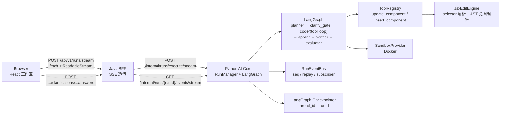

# 04. M2 Agent 执行架构：Tool Calling、SSE 时间轴与 HITL 澄清

> 状态：v2.0 设计稿（待确认后实现）
> 日期：2026-11-04
> 范围：Python AI Core 执行层、Java BFF 流式代理、前端运行时间轴与澄清交互
> 前置：`02.整体架构设计.md`、`03.API接口设计.md`
> 说明：本文只定义架构、状态机、工具契约与 SSE 协议，不包含实现代码

---

## 1. 目标与边界

### 1.1 本阶段目标

M2 不再依赖“把 Prompt 调得更长”来获得新增组件能力，而是把 Agent 的输出
收敛为**可校验、可审计、可回放的 Tool Call**，同时解决两个体验问题：

1. **消除等待焦虑**：Run 执行过程通过 SSE 实时推送节点、工具、校验事件，
   前端渲染任务时间轴，而不是一个持续转圈的 Loading。
2. **防幻觉**：Planner 之后增加意图校验门。信息不足时 LangGraph
   `interrupt()`，Run 进入 `AWAITING_CLARIFICATION`；用户在同一个悬浮框内
   回答问题后恢复状态机，而不是让模型猜。

### 1.2 非目标

- 不在本阶段引入多 Agent Supervisor、Backend/DBA Agent。
- 不把完整 Chain-of-Thought 推给前端；只推送**可读的节点摘要、工具调用与
  校验结果**，避免泄密、噪音与不可控的 token 成本。
- 不重写沙盒、Applier、Verifier、Git checkpoint 与回滚机制。
- 不改变 `AnnotationEnvelope`、`annotationId`、`threadId` 的既有语义。
- M2.0 仍允许单实例内存事件总线与内存 checkpointer；生产化替换路径见 §9。

### 1.3 兼容策略

| 能力 | M1 现状 | M2 目标 | 兼容方式 |
|---|---|---|---|
| Coder | 一次生成 diff / files | Tool Calling 循环 | 新增 `AGENT_CODER_MODE=tools|legacy`，默认 tools；legacy 保留一个版本 |
| 代码编辑 | Mock 字符串直接替换 | `CodeEditor` 抽象 + 锚点编辑器 | 先实现 `AnchorStringEditor`；`FileCreator` / `TreeSitterEditor` 仅留接口 |
| Run 接口 | `POST /runs` 同步 JSON | 新增 SSE 接口 | 保留同步 `/runs`，前端灰度切换 |
| BFF 透传 | `RestClient` 同步阻塞 | WebClient + 异步响应 | 每个 SSE 连接不占用 BFF 工作线程 |
| 事件 | 节点 messages 数组 | SSE RunEvent | 事件 envelope 复用 `03.API接口设计.md` §6.6 |
| 澄清 | 未实现 | `AWAITING_CLARIFICATION` | 状态与字段在 M1 文档已预留，M2 启用 |
| Checkpoint | 无 | `CheckpointerProvider` | M2 用 `MemorySaver`，生产切 `RedisSaver` 不改 Graph |
| 回滚 | Git checkpoint | 不变 | Tool 执行结果最终仍落到 `generated_files`，Applier/Verifier 不变 |

---

## 2. 目标拓扑



关键原则：

1. **执行与连接解耦**：Run 在后台执行；SSE 断开不影响执行，客户端可凭
   `runId + afterSeq` 重放。HTTP 连接只是事件订阅者。
2. **事件单一真源**：Python 生成 `seq`；BFF 只透传，不重新编号。
3. **工具执行确定性**：LLM 只负责选择工具与参数；源码修改由 Tool Executor
   校验并执行，失败返回结构化错误，模型可纠正一次。
4. **澄清先于写代码**：`clarify_gate` 在 Coder 之前；未确认的信息不会进入
   Applier，保证“没有把握就不改代码”。

---

## 3. Tool Calling 设计

### 3.1 图拓扑变化

```text
START
  │
  ▼
planner ──► clarify_gate ──(清晰)──► coder ──► applier ──► verifier ──► evaluator
  ▲              │                        ▲                              │
  │              │(模糊)                  └──────── repair (<=3) ◄───────┤
  │              ▼                                                       │
  │        interrupt()                                                   ├─► awaiting_approval
  │              │                                                       └─► failed
  │              ▼
  │      AWAITING_CLARIFICATION ──(用户回答)──► planner (round + 1)
  │
  └────────── clarify_gate 重新校验（最多 3 轮）
```

- `clarify_gate` 是独立节点，不把澄清逻辑塞进 Planner。这样 SSE 时间轴能
  明确显示“理解意图 → 检查信息完整性 → 生成修改方案”。
- `coder` 内部是工具循环，不再是“一次 LLM 调用返回 patch/files”。
- `applier / verifier / evaluator / awaiting_approval / failed` 保持现有职责。

### 3.2 标准工具定义

工具使用 OpenAI-compatible Function Calling 协议；DeepSeek 通过
`ChatOpenAI.bind_tools()` 调用。工具名固定为：

#### `update_component`

修改一个已存在的组件。只允许修改白名单属性，禁止执行任意 JS。

```json
{
  "name": "update_component",
  "description": "修改画布圈选到的已有组件。只修改明确指定的属性，其余保持不变。",
  "parameters": {
    "type": "object",
    "additionalProperties": false,
    "required": ["target", "changes", "reason"],
    "properties": {
      "target": {
        "type": "object",
        "additionalProperties": false,
        "required": ["selector"],
        "properties": {
          "file": { "type": "string", "description": "可选；默认使用该标注的 targetFile" },
          "selector": { "type": "string", "description": "优先使用 [data-vibe-target='xxx']" },
          "annotationId": { "type": "string", "description": "该工具调用服务哪个标注" }
        }
      },
      "changes": {
        "type": "object",
        "additionalProperties": false,
        "properties": {
          "text": { "type": "string", "maxLength": 200 },
          "className": { "type": "string", "maxLength": 120 },
          "style": {
            "type": "object",
            "description": "CSS 属性到值的映射，例如 {\"backgroundColor\":\"#ff0000\"}",
            "additionalProperties": { "type": "string", "maxLength": 120 }
          },
          "attributes": {
            "type": "object",
            "description": "仅允许 type / placeholder / aria-* / data-* 等安全属性",
            "additionalProperties": { "type": "string", "maxLength": 200 }
          }
        }
      },
      "reason": { "type": "string", "maxLength": 300 }
    }
  }
}
```

#### `insert_component`

在指定父级内部或指定兄弟节点前后插入一个完整 JSX 组件。

```json
{
  "name": "insert_component",
  "description": "在画布圈选区域新增组件。保留原有 DOM，不得覆盖或删除已有节点。",
  "parameters": {
    "type": "object",
    "additionalProperties": false,
    "required": ["position", "component", "reason"],
    "properties": {
      "target": {
        "type": "object",
        "additionalProperties": false,
        "properties": {
          "file": { "type": "string" },
          "annotationId": { "type": "string" }
        }
      },
      "position": {
        "enum": ["append", "prepend", "before", "after"],
        "description": "append/prepend 相对 parent；before/after 相对 sibling"
      },
      "parent": {
        "type": "object",
        "additionalProperties": false,
        "properties": {
          "selector": { "type": "string", "description": "容器选择器；append/prepend 时必填" }
        }
      },
      "sibling": {
        "type": "object",
        "additionalProperties": false,
        "properties": {
          "selector": { "type": "string", "description": "位置参考元素；before/after 时必填" }
        }
      },
      "component": {
        "type": "object",
        "additionalProperties": false,
        "required": ["tag"],
        "properties": {
          "tag": {
            "enum": ["button", "div", "span", "section", "a", "p", "label", "input", "img", "h1", "h2", "h3"]
          },
          "text": { "type": "string", "maxLength": 200 },
          "className": { "type": "string", "maxLength": 120 },
          "attributes": {
            "type": "object",
            "additionalProperties": { "type": "string", "maxLength": 200 }
          },
          "style": {
            "type": "object",
            "additionalProperties": { "type": "string", "maxLength": 120 }
          }
        }
      },
      "reason": { "type": "string", "maxLength": 300 }
    }
  }
}
```

**参数决策规则**（写入 Coder System Prompt）：

1. 修改颜色、文字、字号、间距、属性 → `update_component`。
2. 添加按钮、卡片、输入框、提示文案等新节点 → `insert_component`。
3. 用户圈中容器（如 `data-vibe-target='card'`）并要求“在这里添加”时，
   优先 `position=append`, `parent=容器选择器`。
4. 用户圈中叶子元素（按钮 / 标题 / 文案）并要求“在它旁边添加”时，
   优先 `position=after`, `sibling=该元素选择器`，**不得**把按钮插进
   `<p>` / `<h1>` 内部。
5. `action=ADD` 的标注必须至少产生一次 `insert_component`；
   `action=MODIFY` 至少产生一次 `update_component`。缺失视为工具计划不完整。

### 3.3 Tool Executor 契约

```python
class ToolCallRequest(TypedDict):
    tool_call_id: str
    name: Literal["update_component", "insert_component"]
    arguments: dict


class ToolCallResult(TypedDict):
    tool_call_id: str
    status: Literal["ok", "error"]
    changed_files: list[str]
    diff: str
    error: dict | None  # {code, message, hint}
```

执行流程：

```text
LLM tool_calls
   │
   ▼
Pydantic 校验参数
   │ 失败 → ToolMessage(error) → 模型纠正（最多 2 次）
   ▼
解析目标文件 / selector
   │ 找不到 → ToolMessage(error) → 模型改 selector 或说明无法完成
   ▼
JsxEditEngine 应用范围编辑
   │ 结构冲突 / AST 解析失败 → ToolMessage(error)
   ▼
返回 ToolMessage + 更新 current_files
   │
   ▼
下一轮 LLM（或结束）
```

实现模块建议：

```text
ai_core/agent/tools/
  schemas.py       # UpdateComponentArgs / InsertComponentArgs（Pydantic v2）
  registry.py      # OpenAI function schema + 工具注册
  executor.py      # 校验、幂等、调用编辑器、生成 ToolCallResult
  editor.py        # CodeEditor 协议（跨文件/全量生成/结构化编辑的统一入口）
  anchor_editor.py # M2 实现：基于 data-vibe-target 锚点与 CSS 字符串编辑
  # 后续实现：
  # file_creator.py    -> create_file / 全量生成新文件
  # tree_sitter_editor -> 跨文件 AST 范围编辑
```

### 3.3.1 CodeEditor 抽象

`CodeEditor` 是工具执行层与“如何改代码”之间的稳定边界。M2 只实现锚点
字符串编辑器；全栈阶段新增文件与跨语言结构化编辑时，只增加实现，不改
Tool Executor 与 Graph。

```python
class CodeEditor(Protocol):
    def update_component(
        self, files: dict[str, str], request: UpdateComponentArgs
    ) -> EditResult: ...

    def insert_component(
        self, files: dict[str, str], request: InsertComponentArgs
    ) -> EditResult: ...

    def create_file(
        self, files: dict[str, str], path: str, content: str
    ) -> EditResult:
        """全栈阶段由 FileCreator 实现；M2 可返回 NOT_IMPLEMENTED。"""
```

实现选择：

| 实现 | 阶段 | 能力 |
|---|---|---|
| `AnchorStringEditor` | M2 | `data-vibe-target` 锚点定位、CSS 追加、文案替换、锚点前后插入 |
| `FileCreator` | 全栈 | 新建 Java / Python / SQL / 配置文件，负责模板与路径白名单 |
| `TreeSitterEditor` | 全栈 | 多语言 AST 范围编辑、跨文件符号定位 |

**JsxEditEngine 语义**

| 操作 | 实现策略 |
|---|---|
| 定位元素 | 解析 `[data-vibe-target='xxx']`，用 tree-sitter 找 JSXOpeningElement 范围 |
| 改文本 | 替换 JSXElement 子节点中的文本范围，保留元素与属性 |
| 改样式 | 在文件已有 `<style>` JSX 字符串中追加/覆盖 `selector{prop:value}`；无 `<style>` 时在根节点内创建 |
| 改属性 | 修改 JSXAttribute；禁止 `dangerouslySetInnerHTML`、`on*` 事件、`ref` |
| 插入组件 | `append/prepend` 取父元素 opening/closing 范围；`before/after` 取兄弟元素范围；在范围边界插入完整 JSX |
| 生成标记 | 新组件自动补唯一 `data-vibe-target="generated-<runShort>-<n>"`，便于后续圈选二改 |
| 幂等 | `(runId, toolCallId)` 去重；重复执行同一调用直接返回上次结果 |
| 冲突 | 同一轮多个工具按调用顺序串行应用；后写声明覆盖先写同名属性 |

`tree-sitter` 与 `tree-sitter-javascript` 加入 Python 依赖；工具执行在 AI Core
进程内完成，不进入沙盒执行生成代码。

### 3.4 Coder 工具循环

```text
1. 组装系统提示、标注上下文、计划、当前源码、工具 schema
2. 循环（最多 6 轮 / 最多 12 个工具调用）：
   a. 调用 LLM（tools=..., tool_choice=auto）
   b. 无 tool_calls → 结束循环
   c. 有 tool_calls → 逐个 emit tool.started → 执行 → emit tool.finished
      → 追加 ToolMessage
3. 校验：
   - 每个 annotation 至少被一个工具覆盖
   - 所有变更文件都在 target_files
   - 没有未解决的 tool error
4. 用修改前后源码生成展示用 unified diff
5. 输出 generated_files / generated_patch（Graph 下游保持不变）
```

失败策略：

- 单次工具参数错误：把结构化错误回传模型，允许纠正 **2 次**。
- 6 轮后仍无有效结果：进入 `evaluator`，按现有 3 次修复预算重试。
- selector 无法解析：不猜，要求模型改用其他 selector 或返回
  `TOOL_TARGET_NOT_FOUND`，由修复轮处理。

### 3.5 Mock LLM 与真实模型同构

Mock 不再自己拼接源码。它只实现“确定性 Tool Call”：

| 用户意图 | Mock 工具调用 |
|---|---|
| 改成红色 | `update_component(selector, changes.style.backgroundColor="#ff0000")` |
| 文字改成提交 | `update_component(selector, changes.text="提交")` |
| 放大一倍 | `update_component(selector, changes.style.transform="scale(2)")` |
| 添加一个红色的提交按钮 | `insert_component(parent=card, position=append, component={tag:"button", text:"提交", style:{backgroundColor:"#ff0000"}})` |
| 改好看点 | Planner 返回 `needs_clarification=true`，不产生工具调用 |

这样 Mock E2E 与 DeepSeek 走同一个 `ToolRegistry → Executor → JsxEditEngine`
路径，避免“Mock 能过、真实模型不过”的双实现漂移。

---

## 4. HITL 意图澄清

### 4.1 何时触发

`clarify_gate` 使用“确定性规则 + Planner 结构化判断”双重策略：

| 信号 | 示例 | 结果 |
|---|---|---|
| 只有形容词，没有可执行属性 | “改好看点”“优化一下”“大气一点” | 询问具体维度（颜色/字号/间距/布局） |
| ADD 缺少组件类型或内容 | “在这里加点东西” | 询问新增什么组件、文案是什么 |
| MODIFY 未命中元素且无 selector | 圈选空白区域 + “改一下” | 询问要改哪个元素 |
| 多个标注互相冲突 | A 要求放大、B 要求缩小同一元素 | 询问优先级 |
| 选择器无法解析且无可靠目标 | 片段中没有对应标记 | 询问目标组件 |
| 指令具体、目标明确、置信度 ≥ 0.7 | “把按钮改成红色” | 直接执行 |

Planner 输出结构化字段（不再只是自由文本）：

```json
{
  "plan": "将 CTA 背景改为红色，其余不变",
  "confidence": 0.93,
  "needs_clarification": false,
  "clarification": null
}
```

模糊时（问题字段沿用 `03.API接口设计.md` §3.7.1 的 `questionId/type/prompt`）：

```json
{
  "plan": "用户希望“改好看点”，但未指定具体视觉维度",
  "confidence": 0.31,
  "needs_clarification": true,
  "clarification": {
    "reason": "ambiguous_intent",
    "questions": [
      {
        "questionId": "q1",
        "type": "single_choice",
        "prompt": "你希望优先调整哪一项？",
        "required": true,
        "options": [
          { "value": "color", "label": "颜色" },
          { "value": "font", "label": "字号" },
          { "value": "spacing", "label": "间距" },
          { "value": "layout", "label": "布局" }
        ],
        "defaultValue": "color"
      },
      {
        "questionId": "q2",
        "type": "free_text",
        "prompt": "或者直接描述你想要的效果",
        "required": false
      }
    ]
  }
}
```

前端把 `q1` 渲染为 chips、`q2` 渲染为同一气泡内的输入框；两者至少回答一个。
内部状态使用 snake_case（`plan_needs_clarification`），SSE payload 使用 API
既有的 camelCase，由事件序列化层统一转换。

触发条件：

- `clarification_mode=auto`（默认）：`confidence_score < agent_clarification_threshold`
  或 Planner 明确标记缺少关键槽位；
- `clarification_mode=always`：即使置信度高，也先让用户确认范围（仅调试）；
- `clarification_mode=off`：禁用中断，按当前最佳计划执行（用于回归与降级）。
- 阈值默认 `0.7`，由 `AGENT_CLARIFICATION_THRESHOLD` 配置，不写死在节点里。

**全栈引导（System Prompt 必须包含）**：

```text
如果用户描述的是业务需求（登录、注册、订单、列表增删改查、数据保存、
接口、数据库、权限等），而不是纯视觉修改：
- 先判断需求是否已经明确包含“前端界面 / 后端接口 / 数据库”的范围；
- 如果缺少范围，needs_clarification=true，问题必须引导用户确认：
  “本次先生成前端界面，还是同时生成后端接口和数据库？”
- 在 M2 只有前端能力时，不得擅自承诺或生成后端/数据库代码；
  用户明确要求全栈时，在计划中标注 fullstack_requested=true，
  由上层能力开关决定是否继续。
```

问题字段与 `03.API接口设计.md` §3.7.1 一致；每轮 1–3 个问题。

### 4.2 LangGraph 中断与恢复

```text
planner 完成
   │
   ▼
clarify_gate
   ├─ 信息充分 → 写入 plan → coder
   └─ 信息不足
        ├─ emit node.started("clarify_gate")
        ├─ interrupt({clarificationId, round, questions, expiresAt})
        ├─ emit clarification.required
        ├─ checkpoint 保存（thread_id = runId）
        └─ Run 状态 = AWAITING_CLARIFICATION，SSE 关闭
```

恢复：

```text
POST /internal/runs/{runId}/clarifications
   │ 校验 clarificationId / round / 答案完整性
   ▼
返回 202（Run 状态 PLANNING）
   │
   ▼
后台：emit clarification.answered
   │
   ▼
graph.invoke(Command(resume=answers), config={thread_id: runId})
   │
   ▼
clarify_gate 收到答案 → 合并进 clarificationContext
   │
   ▼
planner 重新规划（round + 1）→ clarify_gate 再次校验
   │
   ├─ 清晰 → coder 继续
   └─ 仍模糊且 round < 3 → 再次 interrupt
```

前端收到 202 后用 `GET /runs/{runId}/events/stream?afterSeq=lastSeq` 重放并订阅
后续事件。

规则：

- `round` 从 1 开始，最大 3 轮。
- 超过 3 轮：返回 `CLARIFICATION_LIMIT`；Run `FAILED`，**不写任何代码**，
  避免猜测。
- 同一 `clarificationId` 仅接受一次有效回答；相同答案重复提交幂等返回，
  不同答案返回 `409 CLARIFICATION_STATE_CONFLICT`。
- 24 小时未回答：Run `EXPIRED`，checkpoint 与沙盒按 TTL 清理。
- 回答内容同时写入该标注 thread 的 `chatHistory`，刷新页面后悬浮框仍能恢复
  问答上下文。

### 4.3 CheckpointerProvider 与状态

- 编译图时不直接 `new MemorySaver()`，统一通过：

```python
class CheckpointerProvider(Protocol):
    def get(self) -> BaseCheckpointSaver: ...
    def close(self) -> None: ...

class MemoryCheckpointerProvider:
    """M2：进程内，单实例共享，thread_id 隔离每次 Run。"""

class RedisCheckpointerProvider:
    """全栈长任务：RedisSaver，checkpoint TTL 与 Run 生命周期对齐。"""
```

- Graph 只依赖 `CheckpointerProvider.get()`；M2 注入 `MemoryCheckpointerProvider`，
  生产切 `RedisCheckpointerProvider` 不改 Graph / Service。
- 编译时 `config.configurable.thread_id=runId`；同一 Run 的暂停与恢复必须落在
  同一 thread。
- `AgentState` 新增字段：

```text
clarification_round: int
clarification: dict | None          # 当前问题、clarificationId、expiresAt
clarification_answers: list[dict]   # 已收到的回答
plan_confidence: float
plan_needs_clarification: bool
clarification_outcome: str          # proceed | replan | exhausted
tool_calls: list[dict]              # 工具调用轨迹
tool_results: list[dict]
node_timings: dict[str, int]
```

- Python 重启会丢失内存 checkpoint；M2.0 返回
  `RUN_CHECKPOINT_LOST`，用户在悬浮框重新发送即可。生产切 RedisSaver 后，
  checkpoint 与 Run 状态同 TTL。

---

## 5. SSE 事件协议

### 5.1 传输约定

#### 启动 Run（流式）

```text
POST /api/v1/runs/stream
Content-Type: application/json
Accept: text/event-stream

{
  "runId": "run_...",
  "projectId": "proj_...",
  "annotations": [ ... ],
  "files": { "src/App.jsx": "..." },
  "options": { "llmProvider": "auto", "maxRetries": 3 }
}
```

响应：

```text
HTTP/1.1 200 OK
Content-Type: text/event-stream; charset=utf-8
Cache-Control: no-cache, no-transform
Connection: keep-alive
X-Accel-Buffering: no
```

> 使用 `fetch()` + `ReadableStream` 消费，不使用原生 `EventSource`：
> 启动 Run 需要 POST body。断线重连使用下文的 GET 重放接口。

#### 断线重放

```text
GET /api/v1/runs/{runId}/events/stream?afterSeq=42
Accept: text/event-stream
Last-Event-ID: 42
```

先回放 `seq > afterSeq` 的历史事件，再订阅实时事件；Run 已结束时回放完直接
关闭。

#### 澄清回答（202 + 重放流）

```text
POST /api/v1/runs/{runId}/clarifications/{clarificationId}/answers
Content-Type: application/json
Accept: application/json

{
  "answers": [
    { "questionId": "q1", "value": "color" },
    { "questionId": "q2", "value": "改成红色" }
  ],
  "useDefaults": false,
  "comment": "先按这个方向改",
  "expectedVersion": 1
}
```

响应：

```text
HTTP/1.1 202 Accepted

{
  "data": {
    "clarification": {
      "clarificationId": "clr_...",
      "status": "ANSWERED",
      "answeredAt": "2026-11-04T10:02:00Z"
    },
    "run": { "runId": "run_...", "status": "PLANNING" }
  }
}
```

服务端接收答案后**先在后台恢复状态机**，再返回 202。前端随即用
`lastSeq` 调用 `GET /runs/{runId}/events/stream?afterSeq=lastSeq` 继续时间轴；
回答接口本身不持有长连接，避免 POST 重试与 SSE 重连互相纠缠。该行为与
`03.API接口设计.md` §3.7.1 的 202 契约一致。

#### 内部接口

> 公共字段与 envelope 以 `03.API接口设计.md` 为准。下表前缀沿用当前实现的
> `/api/v1/internal/runs`；生产化迁移到 03 的 `/internal/v1/executions` 时只改
> 路由前缀，不改 payload。

| 方法 | 路径 | 说明 |
|---|---|---|
| POST | `/api/v1/internal/runs/execute/stream` | AI Core 启动 Run，返回 SSE |
| GET | `/api/v1/internal/runs/{runId}/events/stream` | 事件重放 + 实时订阅 |
| POST | `/api/v1/internal/runs/{runId}/clarifications` | 提交答案，恢复状态机，返回 202 |
| GET | `/api/v1/internal/runs/{runId}/clarifications` | 澄清轮次摘要（不含完整 prompt） |
| GET | `/api/v1/internal/runs/{runId}` | Run 快照（状态、clarification、结果摘要） |
| POST | `/api/v1/internal/runs/execute` | **保留**：同步执行，供旧客户端与回归测试 |

Java BFF 对应路径去掉 `/internal`，只做鉴权、参数基本校验与事件流转发。

**BFF 必须非阻塞**：使用 `WebClient`（Reactor Netty）订阅 AI Core 的
`Flux<ServerSentEvent<String>>`，通过 `SseEmitter` / 响应式返回值异步写回。
禁止使用 `StreamingResponseBody` 或同步 `RestClient` 持有线程等待整个 Run；
全栈长任务可能持续数分钟，每连接一个阻塞线程会迅速耗尽 Tomcat 线程池。
BFF 只透传 `id/event/data`，不重新编号、不聚合事件。

### 5.2 SSE 帧格式

每个业务事件是一帧，`event` 固定为 `run.event`：

```text
retry: 3000

id: 1
event: run.event
data: {"eventId":"evt_01J...","runId":"run_01J...","seq":1,"type":"run.started","version":1,"ts":"2026-11-04T10:00:00.120Z","traceId":"4bf92f...","payload":{"status":"RUNNING","sandboxId":"sbx_...","reusedSandbox":false}}

id: 2
event: run.event
data: {"eventId":"evt_01J...","runId":"run_01J...","seq":2,"type":"node.started","version":1,"ts":"2026-11-04T10:00:00.180Z","traceId":"4bf92f...","payload":{"node":"planner","label":"理解修改意图","attempt":0}}

: ping
```

规则：

1. **`data` 必须是单行 JSON**；不允许多行，避免客户端解析歧义。
2. `id` 等于 `seq`，同一 Run 从 1 单调递增，不得跳号或回退。
3. `event` 固定为 `run.event`；业务类型放在 `data.type`，便于统一分发。
4. 心跳使用 SSE 注释 `: ping`，每 15 秒一次，不占用 `seq`。
5. 事件 JSON ≤ 64 KB；diff / 日志只放摘要或截断预览，完整内容走结果接口。
6. 终态事件发送后服务端关闭连接；`clarification.required` 也会关闭连接，
   但它表示“暂停”，不是失败。
7. 客户端按 `seq` 去重、排序；收到未知 `type` 必须忽略而不是报错。

### 5.3 事件 Envelope

复用 `03.API接口设计.md` §6.6，不新增第二套 envelope：

```json
{
  "eventId": "evt_01J9Z6K3M8Q2V4T7R1N5B0C6XF",
  "runId": "run_01J9Z6K3M8Q2V4T7R1N5B0C6XF",
  "seq": 12,
  "type": "tool.finished",
  "version": 1,
  "ts": "2026-11-04T10:00:02.450Z",
  "traceId": "4bf92f3577b34da6a3ce929d0e0e4736",
  "payload": {}
}
```

字段说明：

| 字段 | 类型 | 必填 | 说明 |
|---|---|---|---|
| `eventId` | string | 是 | ULID/UUID，全局唯一 |
| `runId` | string | 是 | 本次 Run |
| `seq` | int | 是 | 同 Run 内从 1 单调递增 |
| `type` | string | 是 | 见 §5.4 |
| `version` | int | 是 | 事件协议版本，首版为 1；只增字段 |
| `ts` | string | 是 | ISO-8601 UTC，毫秒精度 |
| `traceId` | string | 否 | 跨服务追踪 |
| `payload` | object | 是 | 类型专属内容 |

### 5.4 事件类型与 Payload

| `type` | 时机 | Payload 关键字段 |
|---|---|---|
| `run.started` | Run 开始 | `status`、`sandboxId`（新建沙盒时可能为 `null`）、`reusedSandbox` |
| `node.started` | 节点开始 | `node`、`label`、`attempt`、`parentNode?`；`provision` 为沙盒准备节点 |
| `node.progress` | 节点内阶段进展 | `node`、`message`、`percent?`、`annotationId?` |
| `node.finished` | 节点结束 | `node`、`status`(`ok|error|paused`)、`durationMs`、`summary` |
| `tool.started` | 工具调用开始 | `tool`、`toolCallId`、`node`、`annotationId?`、`inputSummary`、`args?` |
| `tool.finished` | 工具调用结束 | `tool`、`toolCallId`、`status`(`ok|error`)、`durationMs`、`changedFiles`、`diffStat`、`error?` |
| `clarification.required` | 需要用户澄清 | `clarificationId`、`round`、`maxRounds`、`reason`、`questions`、`expiresAt` |
| `clarification.answered` | 用户已回答 | `clarificationId`、`round`、`answers` |
| `clarification.expired` | 澄清超时 | `clarificationId`、`expiredAt` |
| `patch.proposed` | 工具循环产出补丁 | `patchId`、`files`、`insertions`、`deletions`、`summary`、`diffPreview?` |
| `patch.applied` | 沙盒写入完成 | `patchId`、`commit?`、`changedFiles` |
| `verify.started` | 开始构建 | `checks` |
| `verify.passed` | 构建通过 | `exitCode`、`durationMs` |
| `verify.failed` | 构建失败 | `exitCode`、`durationMs`、`errorSummary`、`fingerprint` |
| `repair.started` | 进入自动修复 | `attempt`、`maxAttempts`、`reason` |
| `run.succeeded` | 成功，等待审批 | `status`、`sandboxId`、`previewUrl`、`commitHash`、`baselineCommit`、`retryCount`、`assistantMessage`、`turnCount`、`commits[]` |
| `run.failed` | 失败 | `code`、`message`、`retryable`、`retryCount`、`sandboxId?`、`previewUrl?` |
| `run.cancelled` | 用户取消（后续） | `reason` |
| `log.appended` | 可选增量日志 | `text`（≤ 4 KB，脱敏） |

说明：

- 沙盒在事件流启动后才创建，因此 `run.started.sandboxId` 允许为 `null`；
  随后由 `node.started(node="provision")` / `node.finished(node="provision")`
  报告准备结果。复用已有沙盒时也走同一个节点，只是耗时为 0。
- `node.started/progress/finished` 是 M2 执行层新增事件，用于时间轴；
  `03.API接口设计.md` 中的 `agent.*` / `plan.created` 保留给后续全栈多 Agent，
  两者可并存，客户端按未知类型忽略规则兼容。
- `approval.required` 属于后续“Diff 审批”阶段；M2.0 的 `run.succeeded`
  payload 带 `status=AWAITING_APPROVAL`，已有预览确认入口继续工作。
- **最终结果以 `run.succeeded` / `run.failed` 的 payload 为准**，前端用它替换
  现有同步响应的 `result` 字段，不需要额外请求。

### 5.5 节点与 UI 文案映射

| `node` | 默认 UI 标签 | 说明 |
|---|---|---|
| `planner` | 理解修改意图 | 读取标注与源码，生成计划 |
| `clarify_gate` | 检查信息完整性 | 必要时中断提问 |
| `coder` | 生成修改方案 | 内部包裹 `tool.started/finished` |
| `applier` | 写入沙盒 | 一次性写文件 |
| `verifier` | 构建与校验 | `npm run build` |
| `evaluator` | 整理结果 | 成功 / 修复 / 失败路由 |

时间轴示例：

```text
✓ 理解修改意图                    0.8s
✓ 检查信息完整性                  0.1s
● 生成修改方案                    1.2s
   ├─ insert_component            0.04s  src/App.jsx +1
   └─ update_component            0.03s  src/App.jsx +1 ~1
○ 写入沙盒
○ 构建与校验
○ 整理结果
```

### 5.6 完整事件序列示例（新增红色按钮）

```text
seq 1  run.started        {status:"RUNNING", sandboxId:"sbx_...", reusedSandbox:false}
seq 2  node.started       {node:"planner", label:"理解修改意图"}
seq 3  node.progress      {node:"planner", message:"分析 1 个标注与目标源码"}
seq 4  node.finished      {node:"planner", status:"ok", durationMs:820, summary:"在卡片内新增红色提交按钮"}
seq 5  node.started       {node:"clarify_gate", label:"检查信息完整性"}
seq 6  node.finished      {node:"clarify_gate", status:"ok", durationMs:60, summary:"信息充分"}
seq 7  node.started       {node:"coder", label:"生成修改方案"}
seq 8  tool.started       {tool:"insert_component", toolCallId:"call_1", annotationId:"ann_1", inputSummary:"在 [data-vibe-target='card'] 内插入 button"}
seq 9  tool.finished      {tool:"insert_component", toolCallId:"call_1", status:"ok", durationMs:35, changedFiles:["src/App.jsx"], diffStat:{insertions:1,deletions:0}}
seq 10 patch.proposed     {patchId:"pat_1", files:["src/App.jsx"], insertions:1, deletions:0, summary:"新增红色提交按钮"}
seq 11 node.finished      {node:"coder", status:"ok", durationMs:1410, summary:"1 个工具调用完成"}
seq 12 node.started       {node:"applier", label:"写入沙盒"}
seq 13 patch.applied      {patchId:"pat_1", changedFiles:["src/App.jsx"]}
seq 14 node.finished      {node:"applier", status:"ok", durationMs:180}
seq 15 node.started       {node:"verifier", label:"构建与校验"}
seq 16 verify.started     {checks:["npm run build"]}
seq 17 verify.passed      {exitCode:0, durationMs:2321}
seq 18 node.finished      {node:"verifier", status:"ok", durationMs:2400}
seq 19 node.started       {node:"evaluator", label:"整理结果"}
seq 20 node.finished      {node:"evaluator", status:"ok", durationMs:20}
seq 21 run.succeeded      {status:"AWAITING_APPROVAL", sandboxId:"sbx_...", previewUrl:"http://...", commitHash:"...", retryCount:0}
```

### 5.7 澄清事件序列

```text
seq 1  run.started
seq 2  node.started   {node:"planner", label:"理解修改意图"}
seq 3  node.finished  {node:"planner", status:"ok", durationMs:900, summary:"意图模糊，缺少具体视觉维度"}
seq 4  node.started   {node:"clarify_gate", label:"检查信息完整性"}
seq 5  clarification.required {
         clarificationId:"clr_...",
         round:1,
         maxRounds:3,
         reason:"ambiguous_intent",
         questions:[...],
         expiresAt:"2026-11-05T10:00:00Z"
       }
--- 服务端关闭 SSE；前端显示澄清气泡 ---

用户回答后：
POST .../answers → 202 Accepted
GET  /runs/{runId}/events/stream?afterSeq=5 → 重放 + 订阅
seq 6  clarification.answered {clarificationId:"clr_...", round:1, answers:[...]}
seq 7  node.started   {node:"planner", label:"理解修改意图", attempt:1}
...
seq N  run.succeeded
```

---

## 6. API 与错误模型

### 6.1 公开 API（Java BFF）

| 方法 | 路径 | 返回 | 说明 |
|---|---|---|---|
| POST | `/api/v1/runs` | JSON | 保留 M1 同步接口 |
| POST | `/api/v1/runs/stream` | SSE | 启动 Run 并流式返回 |
| GET | `/api/v1/runs/{runId}/events/stream` | SSE | 断线重放 / 多端订阅 |
| POST | `/api/v1/runs/{runId}/clarifications/{clarificationId}/answers` | 202 JSON | 提交答案，后台恢复执行 |
| GET | `/api/v1/runs/{runId}/clarifications` | JSON | 澄清轮次列表 |
| GET | `/api/v1/runs/{runId}/clarifications/{clarificationId}` | JSON | 单轮详情 |
| GET | `/api/v1/runs/{runId}` | JSON | Run 快照（含当前澄清） |
| POST | `/api/v1/runs/rollback` | JSON | 不变 |

### 6.2 错误码

| HTTP | code | 场景 |
|---|---|---|
| 409 | `RUN_BUSY` | 同一 Run 正在执行，重复启动 / 并发回答 |
| 409 | `RUN_ID_CONFLICT` | runId 已存在且请求内容不同 |
| 404 | `RUN_NOT_FOUND` | runId 不存在或已过期 |
| 404 | `CLARIFICATION_NOT_FOUND` | clarificationId 不匹配 |
| 409 | `CLARIFICATION_STATE_CONFLICT` | 已回答 / round 不匹配 / 不同答案重复提交 |
| 410 | `CLARIFICATION_EXPIRED` | 超过 24 小时 |
| 422 | `CLARIFICATION_LIMIT` | 超过 3 轮仍模糊 |
| 422 | `TOOL_VALIDATION_FAILED` | 工具参数非法 |
| 422 | `TOOL_TARGET_NOT_FOUND` | selector 无法解析 |
| 422 | `TOOL_APPLY_FAILED` | JSX 编辑失败 |
| 404 | `SANDBOX_NOT_FOUND` | 暂停期间沙盒被销毁 |
| 502 | `STREAM_UPSTREAM_ERROR` | BFF 到 AI Core 的流中断 |

流已开始后，业务错误通过 `run.failed` 事件返回，HTTP 仍是 200；只有
**建立流之前**的校验错误返回 4xx JSON。

### 6.3 Schema 变更与幂等

`ExecuteRunResponse` 扩展：

```text
status: Literal[
  "AWAITING_APPROVAL",
  "AWAITING_CLARIFICATION",   # 新增
  "EXPIRED",                  # 新增（澄清超时）
  "FAILED"
]
clarification: Clarification | None   # 新增，非澄清态为 None
```

`RunOptions` 新增（均可选，带默认值）：

```text
clarification_mode: Literal["auto", "always", "off"] = "auto"
max_clarification_rounds: int = 3
confidence_threshold: float | None = None   # None 时使用服务端配置
```

幂等规则：

- `runId` 由 BFF 生成并随请求下传；同一 `runId` + 相同请求指纹重复
  `POST /runs/stream`：不重复执行，直接回放已有事件并继续订阅实时事件。
- 同一 `runId` + 不同请求指纹：`409 RUN_ID_CONFLICT`。
- 同一 `threadId` 同时只允许一个 RUNNING / AWAITING_CLARIFICATION Run；
  新提交返回 `409 RUN_BUSY`，由前端提示“当前修改尚未完成”。
- 工具调用按 `(runId, toolCallId)` 幂等，重放不会二次改源码。

---

## 7. 前端改造概要

### 7.1 SSE 消费

新增 `useRunStream(projectId)`：

```text
startRun(payload)
  → fetch('/api/v1/runs/stream', {method:'POST', body, signal})
  → ReadableStream + TextDecoder
  → 按空行切帧 → 解析 id/event/data
  → dispatch({type:'run.event', event})

onAbort / network error
  → 记录 lastSeq
  → 指数退避 GET /runs/{runId}/events/stream?afterSeq=lastSeq
  → 去重后继续 dispatch
```

- 同一 Run 只保留一个活动连接；切换项目 / 关闭 Tab 时 `AbortController.abort()`。
- 事件 reducer 维护：`timeline[]`、`activeNode`、`tools[]`、`clarification`、
  `result`、`lastSeq`。
- `clarification.required` 到达时把气泡显示在对应标注的浮层内，而不是全局
  弹窗；没有标注上下文时退回顶部状态区。
- 用户回答后调用 answers 接口（202），再用 `afterSeq=lastSeq` 重连
  `events/stream`，复用同一个流解析器继续追加时间轴。

### 7.2 时间轴组件

`RuntimeTimeline` 替换现有 Loading 动画：

- 每个 `node.started` 创建一行，`node.progress` 更新详情，
  `node.finished` 落状态与耗时。
- `tool.started/finished` 嵌套在 `coder` 行内，显示工具名、目标文件、
  `+/-` 行数。
- `verify.failed` 展开错误摘要；`repair.started` 显示“第 N/3 次修复”。
- `clarification.required` 在时间轴内显示“等待你的确认”，并在浮层弹出问题。
- 终态：`run.succeeded` → “已完成”与预览；`run.failed` → 错误摘要与重试。

### 7.3 澄清气泡

```text
┌─────────────────────────────┐
│ Agent 需要确认              │
│ “好看点”具体指哪一项？      │
│ [颜色] [字号] [间距] [布局] │
│ 或输入你的要求…             │
│                    [发送]   │
└─────────────────────────────┘
```

- 单选/多选以 chip 呈现，自由文本输入复用现有输入框。
- 回答期间禁用发送按钮；失败时保留草稿并显示可重试提示。
- 回答写入当前标注的 `chatHistory`，刷新后仍可见。

---

## 8. 状态与持久化

### 8.1 Run 状态机

```text
QUEUED → RUNNING(PLANNING → CODING → APPLYING → VERIFYING)
   │                        │
   │                        ├─ repair → CODING (<=3)
   │                        ├─ success → AWAITING_APPROVAL
   │                        ├─ fail → FAILED
   │                        └─ ambiguous → AWAITING_CLARIFICATION
   │                                            │
   │                                            ├─ answer → PLANNING
   │                                            ├─ 24h → EXPIRED
   │                                            └─ 3 轮 → FAILED(CLARIFICATION_LIMIT)
   └─ cancel → CANCELLED（后续）
```

### 8.2 存储分层（M2.0 vs 生产）

| 数据 | M2.0 本地方案 | 生产替换 |
|---|---|---|
| 事件缓冲 | 进程内 `RunEventBuffer`：每 Run deque(2000)，TTL 2h | Redis Stream `vibe:run:events`，MAXLEN + TTL |
| 实时订阅 | 每连接 `queue.Queue` 扇出 | Redis Pub/Sub 或 Stream 消费者组 |
| LangGraph checkpoint | `MemoryCheckpointerProvider`（MemorySaver） | `RedisCheckpointerProvider`（RedisSaver） |
| 活跃 Run 注册表 | 进程内 `RunManager` | Redis Hash + 心跳租约 |
| 业务 Run / 事件 | 不落 MySQL | Java BFF 写 `run` / `run_event`（既有 schema） |

- 事件缓冲必须在 Run 执行期间保留；客户端断开不清理。
- 终态 Run 的事件保留 2 小时后回收；前端已拿到结果即可。
- `clarification` 暂停期间 checkpoint、沙盒与 thread 记忆必须保留；
  关闭项目时按现有逻辑销毁沙盒，并让 Run 进入 `FAILED(SANDBOX_NOT_FOUND)`。

---

## 9. 安全与可观测性

1. **工具白名单**：只允许两个工具、固定参数 schema、属性白名单；禁止任意
   JS / 事件处理器 / `dangerouslySetInnerHTML` / 绝对路径。
2. **路径限制**：所有 `file` 必须属于本次 `target_files`，拒绝 `..` 与绝对路径。
3. **事件脱敏**：不推送完整源码、Prompt、密钥；`args` 只保留摘要，diff 只
   保留预览；日志按现有规则脱敏。
4. **澄清输入**：回答长度上限 1000 字符；不把用户回答直接拼进 Prompt 的
   代码区，只作为 `clarificationAnswers` 结构化字段。
5. **可观测性**：每个事件带 `traceId`；节点耗时、工具耗时、重试次数、
   澄清轮次进入结构化日志；BFF 记录上游流中断与客户端断开。
6. **限流**：同一 Run 一个写执行者；同一用户并发 Run 沿用现有上限；
   事件缓冲大小与 SSE 连接数设置上限。

---

## 10. 实施顺序与验收标准

### 阶段 0：架构确认（本文）

- 产出：本文件 + 设计索引更新。
- 验收：确认工具 schema、SSE 协议、澄清状态机与接口路径。

### 阶段 1：SSE 流式 + Checkpointer 抽象

范围：

```text
ai_core/agent/events.py（RunEvent / EventBus / 事件缓冲 / 重放）
ai_core/agent/checkpoint.py（CheckpointerProvider + Memory 实现）
ai_core/agent/service.py（RunManager，执行与连接解耦）
ai_core/api/runs.py（execute/stream、events/stream）
apps/platform-bff（WebClient + SseEmitter 非阻塞透传）
apps/platform-web（useRunStream + RuntimeTimeline）
```

验收：

- `POST /api/v1/runs/stream` 返回合法 SSE；seq 从 1 单调，15s 心跳。
- 节点事件与时间轴一一对应；中途断开后用 `afterSeq` 重放，无重复、无缺口。
- BFF 不阻塞 Tomcat 工作线程；断开浏览器不影响 Run 继续执行。
- 同步 `/runs` 仍可用；前端可灰度切回。
- `CheckpointerProvider` 已接入 Graph，切换实现不改 Graph。

### 阶段 2：HITL 澄清

范围：

```text
Planner confidence_score + 全栈引导 Prompt
clarify_gate 节点 + interrupt/Command + MemorySaver
clarifications API + 202 + afterSeq 续跑
前端澄清气泡 + 回答后继续时间轴
```

验收：

- 输入“改好看点” → `AWAITING_CLARIFICATION`，无代码写入。
- 回答“改成红色” → 恢复 Planner → 执行 → 预览变红。
- 3 轮仍模糊 → `FAILED(CLARIFICATION_LIMIT)`，沙盒代码未变。
- 重复 / 过期 / 并发回答返回约定错误码。
- 刷新页面后澄清气泡与历史仍在。

### 阶段 3：Tool Calling 基础

范围：

```text
ai_core/agent/tools/schemas.py
ai_core/agent/tools/registry.py
ai_core/agent/tools/executor.py
ai_core/agent/tools/editor.py（CodeEditor 协议）
ai_core/agent/tools/anchor_editor.py（M2 锚点实现）
ai_core/agent/graph.py（coder 改为工具循环）
ai_core/agent/llm.py（DeepSeek tools / Mock tool calls）
```

验收：

- `update_component` 改颜色 / 文案 / 字号成功，构建通过。
- `insert_component` 在卡片内新增红色按钮，构建通过，原 CTA 保留。
- 非法 selector / 非法属性返回结构化错误，不写坏文件。
- Mock 与 DeepSeek 走同一 Executor；现有 ADD / 多标注 E2E 全绿。
- `FileCreator` / `TreeSitterEditor` 只保留协议与占位测试，不引入 tree-sitter 依赖。

### 阶段 4：清理与回归

- 移除 Mock 旧的字符串直改实现，只保留 Tool Call。
- 全量回归：agent / platform / ui / multi-annotation / multi-turn /
  rollback / delete / add-component / popover scale。
- 更新 README、`docs/memory/` 阶段总结与截图。
- `AGENT_CODER_MODE=legacy` 保留一个版本后删除。

---

## 11. 风险与取舍

| 风险 | 影响 | 对策 |
|---|---|---|
| LLM 工具参数不稳定 | 工具执行失败 / 重试增加 | Pydantic 校验 + 结构化错误回传 + 最多 2 次纠正 |
| tree-sitter 对复杂 JSX 编辑失败 | 无法应用修改 | 失败即返回错误，不写半成品；必要时回退到 files 模式 |
| SSE 经过代理被缓冲 | 前端看不到实时进度 | `X-Accel-Buffering:no`、BFF flush、Nginx 关闭 buffering |
| 内存事件 / checkpoint 丢失 | 重启后无法恢复澄清 | M2.0 明确报错；生产切 Redis |
| 过度澄清打断用户 | 体验变差 | 高置信度直接执行；规则 + 阈值；最多 3 轮 |
| 工具调用与多标注冲突 | 后写覆盖先写 | 串行执行 + 最终 CSS 覆盖顺序 + 工具结果审计 |
| 事件包含敏感源码 | 泄密 | 只推摘要与 diff 预览；完整内容走结果接口 |

---

## 12. 已确认决策（2026-11-04）

| 决策 | 结论 |
|---|---|
| 启动接口 | 保留同步 `POST /runs`，新增 `POST /runs/stream`；BFF 必须异步非阻塞透传 |
| 澄清触发 | 基于 Planner `confidence_score` 与关键槽位判断；Prompt 植入全栈范围引导 |
| Checkpoint | M2 用 `MemorySaver`，封装 `CheckpointerProvider`，生产切 `RedisSaver` |
| 代码编辑 | M2 用锚点字符串编辑，抽象 `CodeEditor`；预留 `FileCreator` / `TreeSitterEditor` |

实现顺序调整为：**先 SSE 流式 + HITL 中断，再 Tool Calling 抽象**。每阶段独立
提交并跑回归。
