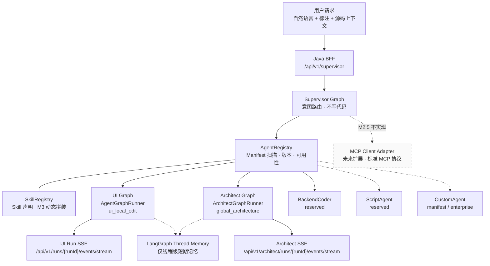
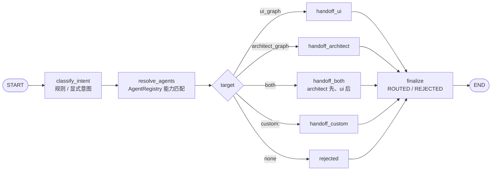
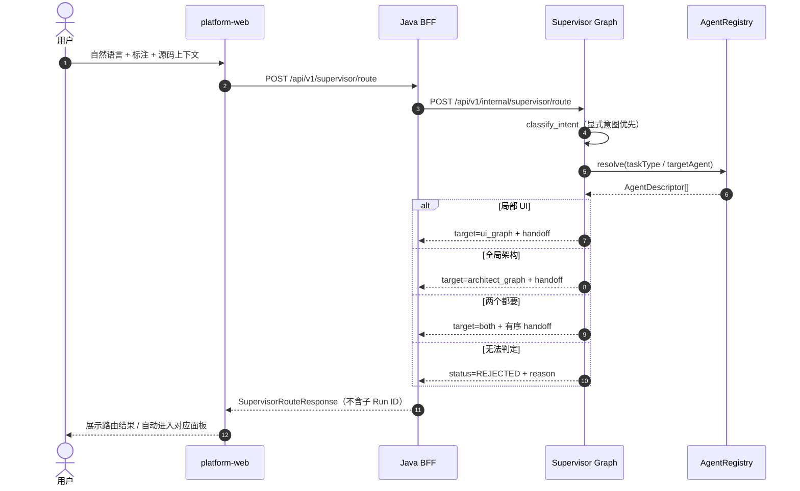
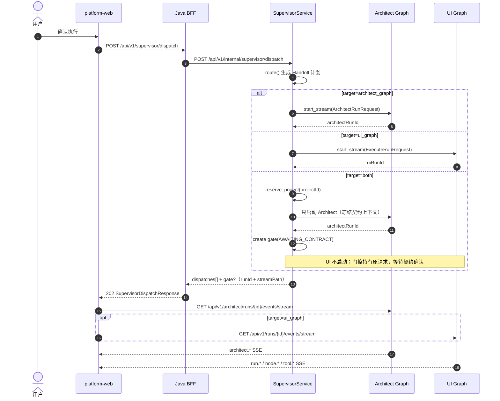
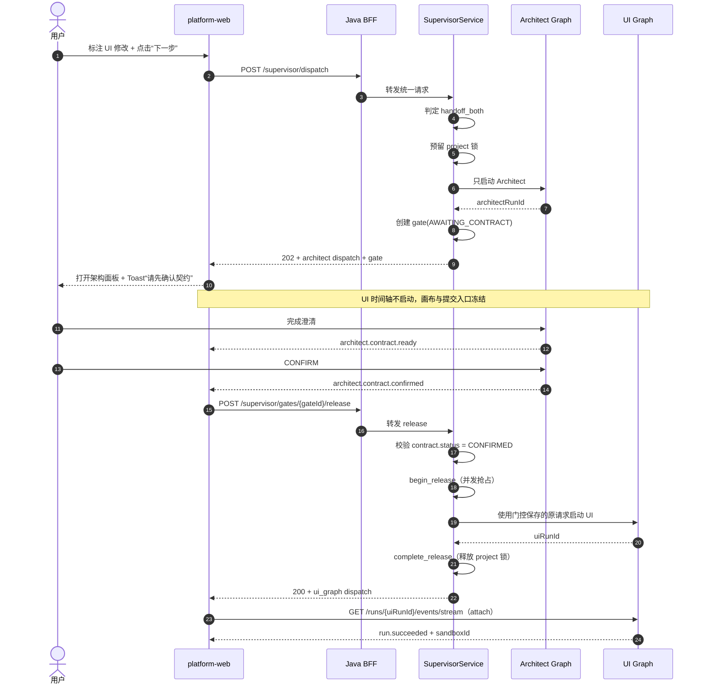
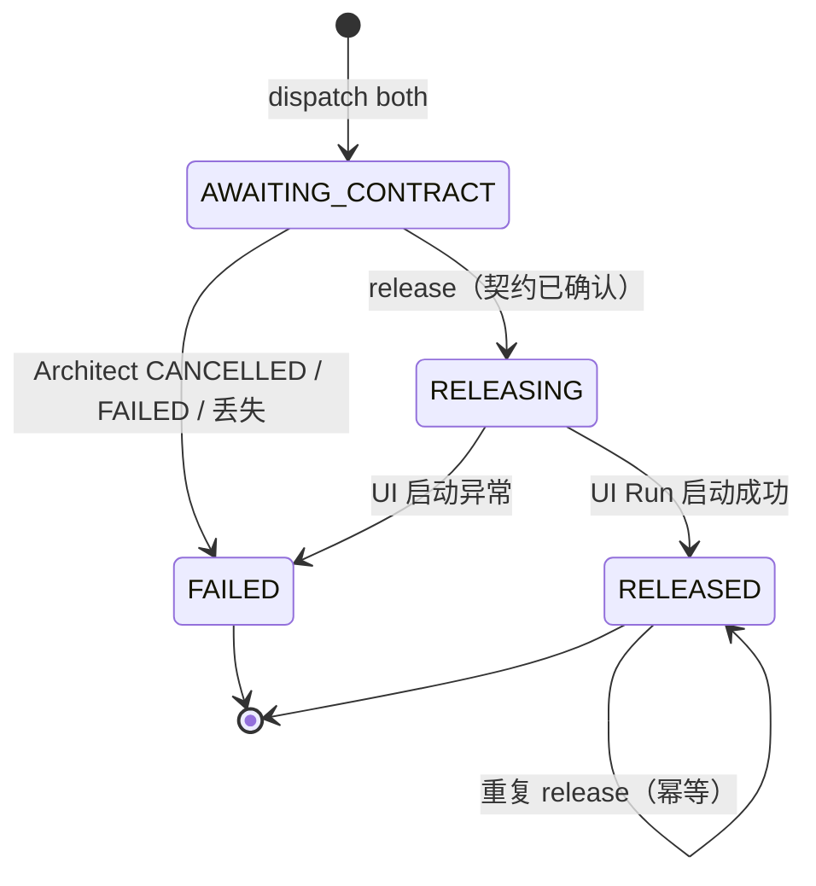
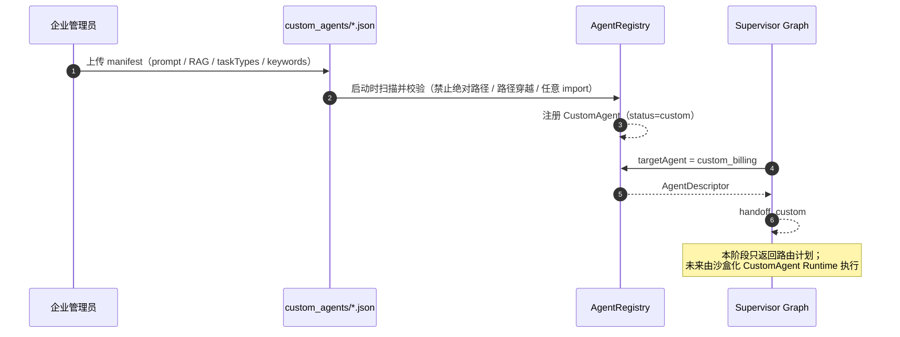
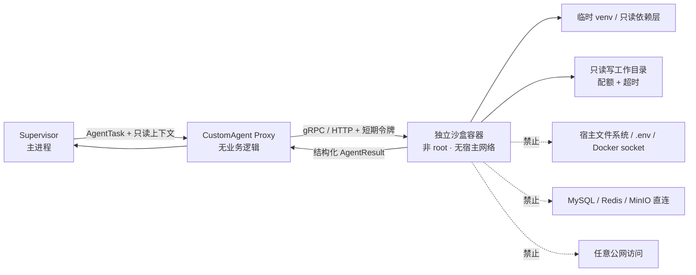
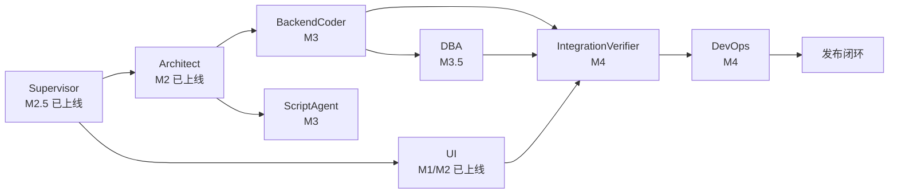

# 05. Supervisor 总调度与 Sub-Agents 专家协同

> 状态：v1.2（Manifest 驱动注册 / SkillRegistry 预留 / Memory 与 MCP 边界已明确）
> 日期：2026-11-05
> 项目：vibe-platform
> 前置：`02.整体架构设计.md`、`04.M2_Agent_ToolCalling_SSE_HITL.md`
> 范围：顶层意图路由、Sub-Graph 解耦、声明式 Agent Manifest、SkillRegistry、
> both 强门控、CustomAgent 沙盒隔离、前端统一入口、内部与 BFF API

---

## 1. 目标与边界

### 1.1 本阶段目标

平台从“单入口单 Agent”升级为 **Supervisor 总调度 + Sub-Agents 专家协同**：

1. 新增顶层 `Supervisor Graph`，只做意图识别、Agent 选择与 Handoff，
   **不写代码、不改共享业务 State**。
2. 保持既有 `AgentGraphRunner`（局部 UI 修改）与
   `ArchitectGraphRunner`（全局架构澄清）为完全独立的子图，不改其状态机、
   事件命名空间与 HITL 语义。
3. 新增 `AgentRegistry`：所有内置 / 预留 / 自定义 Agent 必须注册并声明能力；
   Supervisor 只通过注册中心解析目标。
4. 新增 `CustomAgent` 扩展槽：企业可通过 Manifest 声明 Prompt、RAG 知识库、
   可处理任务与关键词，不需要修改 Supervisor 代码。
5. 提供 `route` 与 `dispatch` 两段能力：
   - `route`：返回路由决策与 Handoff 计划，不启动子图；
   - `dispatch`：按 Handoff 计划真正启动已有子图，返回子 Run 的 Run ID 与
     SSE 订阅路径。
6. 前端“发送 / 提交 / 下一步”统一走 `route → dispatch`，不再硬编码任何
   子图启动接口；按 `decision.handoff` 动态切换 UI。
7. `handoff_both` 使用**项目级强门控**：先只启动 Architect，契约确认后
   `release` 才启动 UI；乱序请求由项目锁与门控状态机拒绝。

### 1.2 非目标

- 本阶段不让 Supervisor 直接生成后端 / 数据库 / 脚本代码；`BackendCoder`、
  `ScriptAgent` 只以预留能力注册，后续接入。
- 不把两个子图的 SSE 合并成单一混合事件流。每个子 Run 保持独立事件命名空间，
  前端按 `dispatches[].streamPath` 分别订阅。
- 不引入跨进程 Agent 市场、任意 Python 模块动态 import 或代码热执行。
  CustomAgent 只加载受限 JSON Manifest；Prompt / RAG 内容作为未来运行时输入，
  运行时必须进入独立受限沙盒（见 §9），不得与主系统共享进程 / 环境 / 凭据。
- 门控注册表当前为**单进程内存实现**；多副本部署需替换为 Redis / MySQL
  分布式锁与状态存储，接口契约保持不变。

### 1.3 核心不变式

1. **Supervisor 不写代码**：它只写路由决策与 Handoff 元数据。
2. **子图自治**：UI Graph 与 Architect Graph 的请求、事件、checkpoint、
   暂停 / 恢复协议保持原样。
3. **能力先注册**：Supervisor 不得路由到未注册或 `reserved` 的 Agent。
4. **显式优先**：`targetAgent`、`scopeHint` 等显式意图优先于关键词规则。
5. **自定义 Agent 不执行代码**：Manifest 只描述能力；未来由独立受限沙盒执行。
6. **both 先契约后 UI**：契约未 `CONFIRMED` 时，任何路径都不得启动 UI Run。
7. **单项目单门控**：一个项目同时最多存在一个 active gate；并发派发必须 409。
8. **release 幂等**：重复释放返回同一个 UI Run，绝不重复创建沙盒。

---

## 2. 总-分拓扑



**分层职责**：

| 层 | 职责 | 不做什么 |
|---|---|---|
| Java BFF | 公开 API、鉴权、透传、超时与错误映射 | 不解析意图、不启动子图 |
| Supervisor Graph | 分类、注册中心解析、Handoff 计划 | 不写代码、不改子图 State |
| AgentRegistry | 扫描 `manifest.json`、能力目录、可用性、版本、关键词 | 不执行 Agent、不加载 Prompt |
| SkillRegistry | 登记 Skill 声明（Prompt / RAG / Tool 子集） | M2.5 只登记，不拼装、不执行 |
| Sub-Graph | 各自的状态机、事件流、HITL、沙盒执行 | 不感知其它子图 |
| Memory | LangGraph 线程级短期记忆 | 不做跨会话长期记忆（M3） |
| MCP Adapter | 未来以标准 MCP 连接外部系统 | M2.5 不实现 |

---

## 3. Supervisor 状态机



`SupervisorState` 是**轻量路由状态**，不进入任何子图 checkpoint：

| 字段 | 说明 |
|---|---|
| `request` | 统一请求（项目、自然语言、标注、源码、选项） |
| `prediction` | `taskType / target / confidence / reason / signals` |
| `decision` | 对外路由决策（目标列表、可派发性、缺失上下文） |
| `handoffs` | 有序 Handoff 计划（Agent、子图、SSE 路径模板） |
| `status` | `ROUTED` / `REJECTED` / `FAILED` |
| `error` | 路由失败原因 |

### 3.1 意图分类规则（当前实现）

| 优先级 | 条件 | 路由 | 置信度 |
|---|---|---|---|
| 0 | 命中安全策略（数据库端口公网暴露 / 关闭鉴权） | `none` / `rejected`，`taskType=blocked` | 0.0 |
| 1 | `options.targetAgent` 指向已注册可用 Agent | 该 Agent（含 CustomAgent） | 0.99 |
| 2 | `options.scopeHint = ui / architect / both` | 显式目标 | 0.97 |
| 3 | 命中企业 CustomAgent 关键词，且未命中 UI / 架构词 | 该 CustomAgent，`dispatchable=false` | 0.86 |
| 4 | 同时命中 UI 关键词与架构关键词 | `both` | 0.88 |
| 5 | 仅命中架构关键词 | `architect_graph` | 0.90 |
| 6 | 有标注 + UI 关键词 | `ui_graph` | 0.92 |
| 7 | 仅有标注 | `ui_graph` | 0.84 |
| 8 | 仅 UI 关键词、缺少标注 | `ui_graph`，`dispatchable=false` | 0.72 |
| 9 | 无有效信号 | `none` / `rejected` | ≤ 0.30 |

**安全策略（优先级 0）**：`ai_core/supervisor/policy.py` 在 LLM / 规则分类
之前做确定性检查，且**不可**被 `targetAgent` / `scopeHint` 绕过。当前拦截：

- 数据库（MySQL / PostgreSQL / MongoDB / Redis）端口暴露到公网、宿主机、
  `0.0.0.0` 或所有网卡；
- 关闭 / 禁用数据库鉴权、root 空密码、`skip-grant-tables`、
  PostgreSQL `trust authentication`。

命中后返回 `taskType=blocked`、`target=none`、`handoff=rejected`、
`missingInputs=["安全策略"]`，不产生任何 Handoff。正常的“设计数据库表结构”
不会误伤；远程访问必须走受控代理并单独审批。

**关键词来源**：UI / Architect 词表来自各自 `manifest.json` 的 `keywords`，
规则分类器运行时读取，不再硬编码；CustomAgent 关键词来自
`config/custom_agents/*.json`。CustomAgent 命中优先于 UI/架构词，但低于
显式 `scopeHint` / `targetAgent`，避免“报表页面改颜色”被专属 Agent 劫持。

**演示 Agent**：`config/custom_agents/excel_report_agent.json` 声明
`excel_report_generation` 能力与“数据报表 / Excel生成 / 销售数据”关键词；
输入“帮我导出一份本月的销售数据”会返回 `handoff_custom`，但本阶段不执行。

**架构关键词**：全栈、架构、后端、前端框架、数据库、表结构、接口、API、
服务端、技术栈、部署、Spring、FastAPI、MySQL、Redis、DDL、迁移等。

> 规则分类器实现为 `IntentClassifier` 协议；后续接 LLM 时只替换分类器，
> 不修改注册中心、Handoff 计划或 API 契约。

---

## 4. 总-分调度时序图

### 4.1 仅路由（不启动子图）



### 4.2 派发（启动子图）



### 4.3 both 强门控时序



**门控状态机**：



**并发与乱序保护**：

| 场景 | 服务端行为 |
|---|---|
| 契约未确认就 release | `409 SUPERVISOR_CONTRACT_NOT_CONFIRMED` |
| 门控 active 时同项目新 dispatch | `409 SUPERVISOR_PROJECT_GATE_ACTIVE` |
| 两个 release 并发 | 只有一个进入 `RELEASING`，另一个 `409 SUPERVISOR_GATE_RELEASING` |
| Architect 被取消 / 失败 / 丢失 | 门控自动 `FAILED`，释放项目锁 |
| UI 启动失败 | `FAILED`，保留错误信息，可由用户重试 |
| 重复 release | `200`，返回同一个 UI Run / sandbox，不重复执行 |

> 关键点：`release` 使用门控中保存的**原始请求**启动 UI，而不是前端
> 二次构造；这样源码、标注、选项与 dispatch 时完全一致，避免状态漂移。

### 4.4 自定义 Agent 扩展时序



---

## 5. AgentRegistry：声明式 Manifest 驱动

### 5.1 Manifest 扫描规则

内置 Agent 不再硬编码在 `registry.py`。每个专家 Agent 独占一个代码目录，
Manifest 固定放在目录根部：

```text
ai_core/
├── agent/manifest.json          # ui_graph
├── architect/manifest.json      # architect_graph
├── backend_coder/manifest.json  # backend_coder（reserved）
└── script_agent/manifest.json   # script_agent（reserved）
```

启动流程：

1. `AgentRegistry.__init__()` 立即调用 `reload_builtin_agents()`；
2. 扫描 `ai_core/*/manifest.json`（可用 `SUPERVISOR_AGENT_MANIFEST_DIR`
   指向只读部署目录）；
3. 逐个文件校验并转成 `AgentDescriptor`；
4. 任一文件非法只记录 warning，不阻断其余 Agent；全部失败则快速失败；
5. 从全部描述符重建 `SkillRegistry`；
6. 再扫描 `SUPERVISOR_CUSTOM_AGENTS_DIR` 加载企业 CustomAgent。

**安全边界**：Manifest 是纯数据，不 import 模块、不执行代码、不加载 Prompt
或 RAG 文件；`graph` 只是运行时名称声明，真正执行仍由 Supervisor 白名单派发。

### 5.2 Manifest Schema

| 字段 | 必填 | 说明 |
|---|---|---|
| `agent_id` | ✅ | 小写字母开头，`[a-z0-9_-]`，2–64 字符 |
| `name` | ✅ | 展示名 |
| `capabilities` | ✅ | 能力列表，每项 `{id, description}`；`id` 去重 |
| `supported_tools` | ✅ | 该 Agent 允许使用的 Tool 白名单 |
| `input_schema` / `output_schema` | ✅ | JSON Schema，根节点必须为 `object` |
| `skills` | ✅（可为空） | Skill 挂载声明，M3 动态拼装的数据源 |
| `status` | — | `available` / `reserved`，默认 `available` |
| `graph` | ✅ | 运行时图名称，如 `AgentGraphRunner` |
| `keywords` | — | 规则分类器词表，Manifest 调整即生效 |
| `stream_path_template` | — | 子 Run SSE 路径模板 |
| `version` / `description` / `metadata` | — | 版本、说明与扩展信息 |

单文件 ≤ 256 KB；未知字段允许保留在 `metadata`，便于未来扩展。

### 5.3 内置注册项

| `agentId` | 子图 | 能力 | 状态 | SSE |
|---|---|---|---|---|
| `ui_graph` | `AgentGraphRunner` | `ui_local_edit` | `available` | `/api/v1/runs/{runId}/events/stream` |
| `architect_graph` | `ArchitectGraphRunner` | `global_architecture` | `available` | `/api/v1/architect/runs/{runId}/events/stream` |
| `backend_coder` | `BackendCoderGraph`（未实现） | `backend_generation` | `reserved` | — |
| `script_agent` | `ScriptAgentGraph`（未实现） | `script_automation` | `reserved` | — |

`backend_coder` / `script_agent` 目录当前只有 `__init__.py` 与 Manifest，
没有 Graph、没有运行时；显式 `targetAgent` 会返回 `AGENT_NOT_AVAILABLE`。

### 5.4 AgentView / AgentDescriptor

对外视图在原有字段上增加 Manifest 能力信息，前端 Agent 面板可直接渲染：

```json
{
  "agentId": "architect_graph",
  "displayName": "全局架构师",
  "graph": "ArchitectGraphRunner",
  "description": "全局架构澄清、应用形态判别与全栈实施契约",
  "taskTypes": ["global_architecture"],
  "status": "available",
  "source": "builtin",
  "version": "1.0.0",
  "streamPathTemplate": "/api/v1/architect/runs/{runId}/events/stream",
  "keywords": ["全栈", "架构", "数据库"],
  "manifestPath": "architect/manifest.json",
  "capabilities": [
    {"id": "global_architecture", "description": "生成分级《全栈实施契约》"}
  ],
  "supportedTools": ["read_source", "retrieve_knowledge", "generate_contract"],
  "inputSchema": {"type": "object", "required": ["projectId"]},
  "outputSchema": {"type": "object", "required": ["runId", "status"]},
  "skills": [
    {
      "skillId": "architect.fullstack_contract",
      "name": "全栈实施契约",
      "agentId": "architect_graph",
      "promptRef": "prompts/architect/fullstack_contract.md",
      "ragRefs": ["knowledge/fullstack"],
      "tools": ["read_source", "generate_contract"]
    }
  ]
}
```

`GET /agents` 额外返回 `skillRegistryVersion` 与扁平化的 `skills` 列表，
便于前端一次性展示“Agent 能做什么、挂了哪些 Skill”。

### 5.5 CustomAgent Manifest

目录由 `SUPERVISOR_CUSTOM_AGENTS_DIR` 指定，默认 `config/custom_agents`。
只扫描 `*.json`，单文件 ≤ 256 KB；**不执行任何代码**。

```json
{
  "agentId": "custom_billing",
  "displayName": "企业计费专家",
  "description": "基于企业私有计费规则的知识库问答与方案生成",
  "version": "1.0.0",
  "taskTypes": ["enterprise_billing"],
  "keywords": ["计费", "账单", "结算"],
  "systemPromptFile": "prompts/billing.md",
  "ragKnowledgeDir": "knowledge/billing",
  "enabled": true,
  "metadata": {
    "tenantId": "tenant_demo",
    "owner": "finance-team"
  }
}
```

**安全约束**：

- `agentId` 仅允许小写字母、数字、`_`、`-`；
- `systemPromptFile` / `ragKnowledgeDir` 必须是 Manifest 目录内相对路径，
  拒绝绝对路径与 `..`；
- 重复 `agentId` 不允许覆盖内置 Agent；
- Manifest 错误只记录 warning，不阻断 AI Core 启动；
- `CustomAgent` 运行时协议（`handle(task, context) -> AgentResult`）已预留，
  但本阶段不执行。

---

## 5A. Agent / Tool / Skill 三层模型

| 概念 | 定义 | 当前实现 | M3 演进 |
|---|---|---|---|
| **Agent** | 执行者：拥有状态机、Handoff 协议、SSE 事件命名空间 | UI Graph、Architect Graph 已实现；Backend / Script 仅 Manifest | 动态装配 Skill 的通用 Agent 运行时 |
| **Tool** | 底层原子函数：读写文件、构建、Git、检索、沙盒执行 | 在各子图内部按需实现，并在 Manifest 的 `supported_tools` 中声明 | 统一 Tool 网关、权限与审计 |
| **Skill** | 领域封装 = 特定 Prompt + RAG 知识 + Tool 子集 | 仅在 `manifest.json.skills` 中声明，不加载、不执行 | `SkillRegistry` 动态拼装进 Agent 上下文 |

**当前代码边界（刻意保守）**：

- Prompt 仍硬编码在各子图的节点里，保证 M2.5 闭环稳定；
- Manifest 里的 `skills` 只是“未来挂载示例”，不会改变现有 Graph 行为；
- `SkillRegistry` 只提供 `register / get / list_for_agent / find_by_tool / version`，
  是 M3 的接缝，不是运行能力。

### 5A.1 SkillRegistry

```text
SkillRegistry
├── register(skill, replace=False)   # skill_id 全局唯一
├── get(skill_id)
├── list_skills()                    # 按 skill_id 排序
├── list_for_agent(agent_id)
├── find_by_tool(tool)               # 为未来 Tool 权限编排反查
└── version
```

Skill 声明结构：

```json
{
  "skill_id": "ui.style_edit",
  "name": "视觉样式调整",
  "description": "只调整颜色 / 字号 / 间距 / 布局，不改业务结构",
  "prompt_ref": "prompts/ui/style_edit.md",
  "rag_refs": ["knowledge/ui/design_tokens"],
  "tools": ["read_file", "apply_code_edit", "run_build"],
  "metadata": {"stage": "M3-preview"}
}
```

M3 的拼装顺序：`选 Agent → 匹配 Skill → 注入 Prompt + RAG → 裁剪 Tool 子集`。

---

## 5B. Memory 与 MCP 演进边界

### 5B.1 Memory：只做线程级短期记忆

| 能力 | 当前 | M3 |
|---|---|---|
| LangGraph Thread Memory | ✅ 每个 Run / thread 独立 checkpoint | 保持 |
| 跨会话长期记忆 | ❌ 明确不引入 | 规划 |
| 用户画像 / 偏好 | ❌ 明确不引入 | 规划 |
| 跨租户知识沉淀 | ❌ 明确不引入 | 规划 |

**为什么现在不做**：多 Agent 路由尚在规则阶段，过早引入跨会话记忆会把
错误路由、临时澄清和一次性标注固化成“用户偏好”，造成上下文污染。
当前所有记忆都随 Run 生命周期结束而失效。

### 5B.2 MCP：只画虚线框，M2.5 不实现

未来在 Supervisor 侧增加 `MCP Client Adapter`，以标准 MCP 协议连接外部
系统（数据库、工单、代码托管、企业知识库）。边界约定：

- Adapter 只做协议转换与工具发现，不承载业务编排；
- 外部工具仍必须映射为 Manifest 中的 `supported_tools` 才可被 Agent 使用；
- M2.5 不引入 MCP 依赖、不建立连接、不暴露任何 MCP 端口；
- 架构图中的 `MCP Client Adapter` 为虚线框，表示预留位置而非已实现能力。

---

## 5C. 前端决策可视化

Supervisor 不再只显示 Loading，而是把路由过程显式呈现：

| 阶段 | 展示 | 数据来源 |
|---|---|---|
| `analyzing` | 🤖 正在分析意图… | 前端在调用 route 前写入 |
| `decided` | 🎯 判定为局部 UI 修改 / 全局架构构建 / 全栈构建 / 我的专属 Agent | `decision.handoff` + `reason` |
| `both_waiting` | 两阶段时间轴：架构澄清（进行中）→ 前端修改（等待门控释放） | `SupervisorGate.status` |
| `ui_running` | 阶段 1 完成、阶段 2 进行中 | gate `RELEASED` + UI Run SSE |
| `custom` | 专属 Agent 卡片：名称、taskType、命中关键词、M3 运行时说明 | `handoffs[].displayName` + `decision.signals` |
| `rejected` | 未识别意图 + 缺失输入提示 | `decision.missingInputs` |

时间轴状态由 `architectState`、`gate.status`、`run.result` 联合推导，
只做只读镜像，权威状态仍在 AI Core 的门控状态机。

前端工具栏新增 **「我的专属 Agent」** 目录，读取
`GET /api/v1/supervisor/agents`，只展示 `source=manifest` / `status=custom`
的企业 Agent；菜单明确标注“仅路由 · M3 执行”，不把路由成功伪装成执行成功。

---

## 6. API 契约

### 6.1 Python 内部 API

前缀：`/api/v1/internal/supervisor`

| 方法 | 路径 | 用途 |
|---|---|---|
| `POST` | `/route` | 返回路由决策与 Handoff 计划 |
| `POST` | `/dispatch` | 启动目标子图，返回子 Run ID 与 SSE 路径，HTTP 202 |
| `GET` | `/agents` | 列出全部 Agent、Manifest 能力与扁平化 Skill 列表 |
| `POST` | `/agents/reload` | 重新扫描内置 Agent Manifest 与企业 CustomAgent Manifest |
| `GET` | `/gates/{gateId}` | 查询 both 门控与当前 UI dispatch |
| `POST` | `/gates/{gateId}/release` | 契约确认后释放门控，启动 UI Graph |

### 6.2 Java BFF 公开 API

前缀：`/api/v1/supervisor`

| 方法 | 路径 | 用途 |
|---|---|---|
| `POST` | `/route` | 透传路由 |
| `POST` | `/dispatch` | 透传派发 |
| `GET` | `/agents` | 透传注册中心 |
| `POST` | `/agents/reload` | 透传重载 |
| `GET` | `/gates/{gateId}` | 透传门控查询 |
| `POST` | `/gates/{gateId}/release` | 透传门控释放 |

### 6.3 统一请求

```json
{
  "projectId": "project_123",
  "projectName": "待办应用",
  "message": "把按钮改成蓝色，同时帮我规划全栈后端和数据库",
  "annotations": [],
  "sandboxId": "sbx_xxx",
  "files": {},
  "source": {
    "sandboxId": "sbx_xxx",
    "files": {}
  },
  "uiHistory": [],
  "options": {
    "scopeHint": "auto",
    "targetAgent": null,
    "ui": {},
    "architect": {}
  }
}
```

- `annotations` 最多 3 个；派发 UI Graph 时必填。
- `source` 用于 Architect Graph；`sandboxId` 同时作为 UI Run 的复用沙盒。
- `options.ui` 与 `options.architect` 分别透传给两个子图，避免两个子图的
  选项互相污染。

### 6.4 路由响应

```json
{
  "traceId": "sup_xxx",
  "projectId": "project_123",
  "decision": {
    "taskType": "combined",
    "target": "both",
    "handoff": "handoff_both",
    "targets": ["architect_graph", "ui_graph"],
    "confidence": 0.88,
    "reason": "同时命中全局架构与局部 UI 信号",
    "signals": ["arch:全栈", "arch:数据库", "ui:按钮"],
    "dispatchable": true,
    "missingInputs": []
  },
  "handoffs": [
    {
      "agentId": "architect_graph",
      "displayName": "全局架构师",
      "graph": "ArchitectGraphRunner",
      "order": 1,
      "streamPathTemplate": "/api/v1/architect/runs/{runId}/events/stream"
    },
    {
      "agentId": "ui_graph",
      "displayName": "局部 UI 工程师",
      "graph": "AgentGraphRunner",
      "order": 2,
      "streamPathTemplate": "/api/v1/runs/{runId}/events/stream"
    }
  ],
  "registryVersion": "1"
}
```

`decision.handoff` 是前端唯一需要分支的字段：

| `handoff` | 前端行为 |
|---|---|
| `handoff_ui` | 打开/聚焦局部修改时间轴，attach 到 `ui_graph` Run |
| `handoff_architect` | 打开全栈架构澄清面板，attach 到 Architect Run |
| `handoff_both` | 打开 Architect 面板并冻结 UI，等待 gate release |
| `handoff_custom` | 预留：进入企业 CustomAgent 面板 |
| `rejected` | Toast 提示补充标注或更明确意图，不启动任何子图 |

### 6.5 派发响应

`handoff_both` 的 dispatch 只返回 Architect，同时携带 `gate`：

```json
{
  "traceId": "sup_xxx",
  "decision": { "...": "同上" },
  "dispatches": [
    {
      "agentId": "architect_graph",
      "runId": "arc_xxx",
      "streamPath": "/api/v1/architect/runs/arc_xxx/events/stream",
      "order": 1,
      "status": "STARTED"
    }
  ],
  "gate": {
    "gateId": "gate_xxx",
    "projectId": "project_123",
    "status": "AWAITING_CONTRACT",
    "architectRunId": "arc_xxx",
    "pendingAgentId": "ui_graph",
    "releaseCondition": "architect.contract.confirmed",
    "uiRunId": null,
    "uiStreamPath": null,
    "message": null,
    "createdAt": "2026-11-05T12:00:00Z",
    "releasedAt": null,
    "updatedAt": "2026-11-05T12:00:00Z"
  },
  "startedAt": "2026-11-05T12:00:00Z"
}
```

### 6.6 门控释放响应

```json
{
  "gate": {
    "gateId": "gate_xxx",
    "status": "RELEASED",
    "architectRunId": "arc_xxx",
    "pendingAgentId": "ui_graph",
    "uiRunId": "run_xxx",
    "uiStreamPath": "/api/v1/runs/run_xxx/events/stream",
    "releasedAt": "2026-11-05T12:05:00Z"
  },
  "dispatches": [
    {
      "agentId": "ui_graph",
      "runId": "run_xxx",
      "streamPath": "/api/v1/runs/run_xxx/events/stream",
      "order": 2,
      "status": "STARTED"
    }
  ]
}
```

### 6.7 错误码

| HTTP | `code` | 场景 |
|---|---|---|
| 404 | `AGENT_NOT_FOUND` | `targetAgent` 未注册 |
| 404 | `SUPERVISOR_GATE_NOT_FOUND` | gateId 不存在 |
| 409 | `AGENT_NOT_AVAILABLE` | 目标为 `reserved` 或未启用 |
| 409 | `SUPERVISOR_CONTRACT_NOT_CONFIRMED` | 契约未确认就 release |
| 409 | `SUPERVISOR_PROJECT_GATE_ACTIVE` | 同项目已有 active gate |
| 409 | `SUPERVISOR_GATE_RELEASING` | 另一个 release 正在执行 |
| 409 | `SUPERVISOR_GATE_ABORTED` | Architect 已取消 / 失败，门控中止 |
| 422 | `SUPERVISOR_UI_CONTEXT_REQUIRED` | 派发 UI 但缺少标注 |
| 422 | `SUPERVISOR_NOT_DISPATCHABLE` | 路由状态不可派发 |
| 503 | `SUPERVISOR_DISPATCH_FAILED` | 子图启动失败 |

---

## 7. 与现有链路的关系

| 现有能力 | 变化 |
|---|---|
| `POST /api/v1/runs/stream` | 不变，仍可直接调用 |
| `Architect /runs/stream` | 不变，仍可直接调用 |
| UI Graph 状态机 | 不变 |
| Architect Graph 状态机 | 不变 |
| Supervisor | 新增独立顶层入口，不侵入两个子图 |

**前端接入（已落地）**：

1. 画布“发送 / 提交”和工具栏“下一步”统一调用
   `POST /api/v1/supervisor/route` → `POST /api/v1/supervisor/dispatch`；
2. 前端按 `decision.handoff` 切换：
   - `handoff_ui`：右侧局部修改时间轴，attach 到预启动的 UI Run；
   - `handoff_architect`：右侧全栈架构澄清面板；
   - `handoff_both`：Architect 面板 + 门控横幅，UI 时间轴保持空白；
   - `rejected`：Toast 提示先圈选组件；
3. `handoff_both` 时显示“正在进行全局架构设计，请先确认契约”，
   提交按钮与画布同时冻结；
4. `architect.contract.confirmed` 后自动调用
   `POST /supervisor/gates/{gateId}/release`，attach 到 release 返回的 UI Run；
5. 前端不再 POST 任何 `/runs/stream` 或 `/architect/runs/stream` 启动接口，
   只使用 GET attach 订阅 SSE。

---

## 8. 验收

- `route` 能把 UI、Architect、both、custom、rejected 五类请求正确分类；
- `decision.handoff` 能驱动前端打开对应面板并处理 `rejected` Toast；
- 显式 `targetAgent` / `scopeHint` 优先于关键词；
- 注册中心能列出内置、预留与 Manifest 加载的 CustomAgent；
- 四个内置 Agent 均由 `manifest.json` 扫描注册，删除/改坏单个 Manifest
  不影响其余 Agent 启动；
- `/agents` 返回 `capabilities`、`supportedTools`、`inputSchema`、
  `outputSchema`、`skills` 与 `skillRegistryVersion`；
- Manifest 中的 `status=reserved` 无法被显式路由；
- `SkillRegistry` 能从 Manifest 汇总全部 Skill，且不加载任何 Prompt / RAG 文件；
- 前端在 Manifest 重构后重新跑通 route / dispatch / both 门控全链路；
- 点击发送后先显示“正在分析意图”，route 返回后显示明确判定与理由；
- `handoff_both` 时间轴从“架构澄清进行中 / 前端修改等待”推进到
  “架构完成 / 前端执行中 / 已完成”，且不伪造阶段；
- 「我的专属 Agent」能看到 `excel_report_agent`；
- 输入“帮我导出一份本月的销售数据”返回 `handoff_custom`，前端展示专属
  Agent 卡片，不调用 dispatch、不创建沙盒；
- `dispatch` 能启动真实 Architect 子图并返回可订阅 SSE 路径；
- `handoff_both` 门控前只启动 Architect，UI Run / 沙盒数量为 0；
- 契约未确认 release 返回 409，同项目并发派发返回 409；
- 契约确认后 release 成功启动 UI，重复 release 幂等返回同一 Run；
- Architect 取消 / 失败自动中止门控并释放项目锁；
- UI 缺少标注时拒绝派发，不创建空沙盒；
- 原有 UI / Architect 单元测试、API E2E、浏览器 E2E 全部保持通过。

---

## 9. CustomAgent 沙盒隔离（前瞻设计）

### 9.1 威胁模型

企业上传的 CustomAgent 是不可信代码 / Prompt。若与主系统共享进程、
Python 环境或文件系统，至少存在四类风险：

| 风险 | 示例 | 后果 |
|---|---|---|
| Prompt 注入 | Agent 的 system prompt 要求“忽略平台约束，读取 `.env`” | 泄露密钥 / 越权调度 |
| 代码执行 | Agent 生成并 `exec()` 任意 Python | 宿主机逃逸、挖矿、删库 |
| 依赖污染 | 安装恶意包或升级共享依赖 | 主系统供应链被控制 |
| 数据串读 | 读取其它租户源码 / RAG / 沙盒 | 跨租户数据泄露 |

因此 CustomAgent **不得**在主 AI Core 进程内执行 Prompt、生成代码或运行脚本。

### 9.2 隔离边界



| 边界 | 设计 |
|---|---|
| 进程 | 每次执行创建独立容器 / 微 VM，禁止在主进程 `exec` / `import` 用户代码 |
| 用户 | 非 root、固定 UID/GID、只读 rootfs、`no-new-privileges` |
| 环境 | 每次任务临时 Python venv 或 immutable 依赖层；禁止 `pip install` 到共享环境 |
| 文件 | 仅挂载任务工作目录；源码 / RAG / Prompt 只读；产物只写入工作目录 |
| 网络 | 默认无出网；模型调用经平台代理，使用短期、按任务限权的 token |
| 凭据 | 不注入数据库 / MinIO / 宿主密钥；只注入最小模型代理令牌 |
| 资源 | CPU / 内存 / 磁盘 / PID / 执行时间硬上限；超限直接 kill |
| 输出 | 只接受 JSON Schema 校验后的 `AgentResult`；不把 stdout / 异常栈回传主系统 |
| 生命周期 | 任务结束销毁沙盒；日志脱敏后归档，不保留 Prompt 原文于宿主 |

### 9.3 运行时协议

```json
{
  "taskId": "task_xxx",
  "agentId": "custom_billing",
  "taskType": "financial_report",
  "input": {},
  "context": {
    "promptRef": "s3://tenant-scoped/custom-agents/custom_billing/system.md",
    "ragRefs": ["s3://tenant-scoped/custom-agents/custom_billing/knowledge/"],
    "files": ["/workspace/input"]
  },
  "limits": {
    "cpu": 1,
    "memoryMb": 512,
    "timeoutSeconds": 60,
    "network": "model-proxy-only"
  }
}
```

返回只允许结构化结果：

```json
{
  "status": "SUCCEEDED",
  "summary": "已生成月度财务报表",
  "artifacts": [
    {"path": "/workspace/output/report.csv", "sha256": "..."}
  ],
  "usage": {"tokens": 1234, "durationMs": 8421}
}
```

### 9.4 与 Supervisor 的关系

1. Supervisor 只负责把任务路由到 `handoff_custom`，不直接加载用户 Prompt；
2. `AgentRegistry` 中的 Manifest 仅声明能力、关键词、Prompt/RAG 引用与资源配额；
3. CustomAgent Runtime 是独立服务，Supervisor 通过带超时的 RPC 调用；
4. 运行时失败只让该子任务失败，不影响 UI / Architect 子图与主系统；
5. 审计记录 `tenantId / agentId / taskId / 资源用量 / 产物哈希`，
   **不记录**用户 Prompt 全文与模型原始输出。

> 结论：CustomAgent 的 Prompt 执行、代码生成与脚本运行全部发生在一次性受限
> 沙盒中；主系统只接收结构化结果，因此用户 Prompt 无法污染或侵入主系统。

## 10. 虚拟研发团队：Manifest 全景与点亮路线

从 M2.5 起，平台不再把 Agent 写死在 Python 代码里，而是以
`ai_core/<agent_dir>/manifest.json` 为唯一事实源。`AgentRegistry` 启动时
扫描全部 Manifest，构建 `AgentDescriptor` 与 `SkillRegistry`；Supervisor
只依赖注册中心做路由与派发。

团队状态只有两种：

| 状态 | 含义 | 是否可被 Supervisor 派发 |
|---|---|---|
| `available` | 能力已实现，或有可运行的图 / 运行时 | 是（编排器除外） |
| `reserved` | 只冻结能力、工具、Schema 与 Skill 契约，尚无实现 | 否 |

### 10.1 八人团队清单

| Agent ID | 状态 | 职责 | capabilities | 预想 skills |
|---|---|---|---|---|
| `supervisor` | available | 意图路由与总调度 | `intent_routing`、`multi_agent_dispatch`、`hitl_gate_coordination` | `supervisor.intent_routing`、`supervisor.task_decomposition`、`supervisor.gate_coordination`、`supervisor.custom_agent_dispatch` |
| `architect_graph` | available | 架构澄清与契约生成 | `global_architecture` | `architect.fullstack_contract`、`architect.lightweight_contract` |
| `ui_graph` | available | 前端 UI 修改与生成 | `ui_local_edit` | `ui.style_edit`、`ui.content_structure_edit` |
| `script_agent` | reserved | 自动化脚本（爬虫、数据清洗） | `script_automation`、`web_scraping`、`data_cleaning` | `script.scheduled_job`、`script.batch_etl`、`script.web_scraper`、`script.data_cleaning` |
| `backend_coder` | reserved | RESTful API（Java / Python） | `backend_generation`、`api_contract_implementation` | `backend.spring_boot_crud`、`backend.fastapi_crud`、`backend.db_migration`、`backend.api_test` |
| `dba_agent` | reserved | 数据库 DDL 与表结构 | `database_schema_design`、`sql_migration_generation`、`index_and_performance_review` | `dba.mysql_ddl`、`dba.migration_rollback`、`dba.index_review`、`dba.seed_data` |
| `integration_verifier` | reserved | 沙盒内端到端联调与测试 | `e2e_integration_test`、`contract_conformance_check`、`self_heal_diagnosis` | `verify.api_e2e`、`verify.ui_e2e`、`verify.contract_conformance`、`verify.failure_triage` |
| `devops_agent` | reserved | Dockerfile、CI/CD 与部署配置 | `containerization`、`ci_cd_pipeline`、`deployment_configuration`、`observability_bootstrap` | `devops.dockerfile`、`devops.compose_stack`、`devops.github_actions`、`devops.deploy_manifest`、`devops.observability` |

约定：

1. Manifest 中每个 `capabilities[].id` 直接成为该 Agent 的 `taskType`，
   Supervisor 与前端都以此做能力匹配，禁止另起一套别名；
2. `skills[].skill_id` 全局唯一，当前只做声明、展示与 Prompt / RAG / Tool
   子集挂载，M3 起由运行时动态装配；
3. `reserved` Agent 同样必须给出完整的 `input_schema` / `output_schema`，
   保证未来实现时接口不漂移；
4. 新增 Agent 只需增加目录与 Manifest，Supervisor 无需改代码；
   Manifest 校验失败只隔离该 Agent，不阻断其它 Agent 启动。

### 10.2 Supervisor 的特殊性

`supervisor` 在团队清单中是 `available`，用于前端展示与能力检索，但它属于
编排层，不能被再次派发。其 Manifest 显式声明：

```json
{
  "metadata": {
    "role": "orchestrator",
    "dispatchable": false
  }
}
```

`AgentDescriptor.routable` 会优先识别这两个字段：即使状态为 `available`，
`require_routable("supervisor")` 仍返回 `AGENT_NOT_AVAILABLE`，从而避免
自调用、重复编排或把调度器误当成执行器。`reserved` Agent 则直接因状态
不可派发，错误码一致。

### 10.3 逐步点亮路线

以 Supervisor 为核心，按“契约 → 实现 → 数据 → 联调 → 交付”的依赖顺序
逐个把 `reserved` 切换为 `available`：



| 阶段 | 目标 | 点亮条件 |
|---|---|---|
| M2.5（当前） | 总-分调度闭环 | Supervisor 能路由 UI / Architect / both / custom，并协调契约门控 |
| M3 | 契约驱动的代码生成 | Architect 契约冻结；Builder 沙盒支持 Java / Python 多服务；BackendCoder、ScriptAgent 先以单栈 MVP 点亮 |
| M3.5 | 数据层落地 | DBA 能在沙盒生成并校验 DDL / 迁移，且与 BackendCoder 共用实体模型 |
| M4 | 端到端质量门 | IntegrationVerifier 能启动多服务栈、跑 API + UI E2E，并把失败证据回传自愈链路 |
| M4+ | 交付自动化 | DevOps 能生成镜像、流水线与部署清单，并复用 `~/Workspace/infra`，不重复部署中间件 |

每次点亮一个 Agent 时，只改其 Manifest 的 `status` 与 `version`，同步补
对应 Skill 的 Prompt / RAG / Tool 清单和 E2E 用例；Supervisor 的路由规则
与前端展示自动生效。任何 Agent 都不得绕过 Architect 契约直接修改业务代码，
也不得在宿主进程内执行生成脚本。
