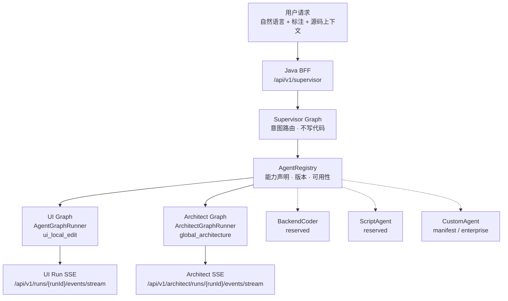
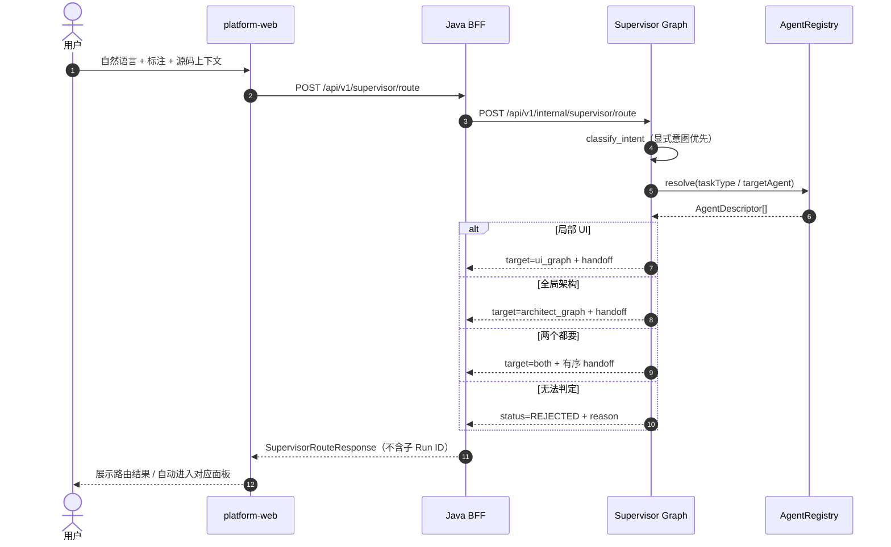
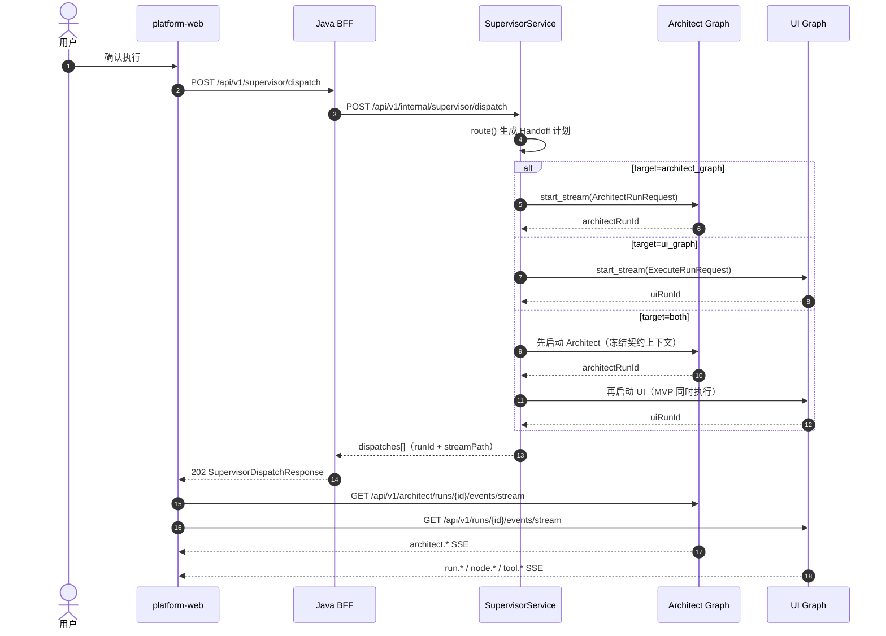
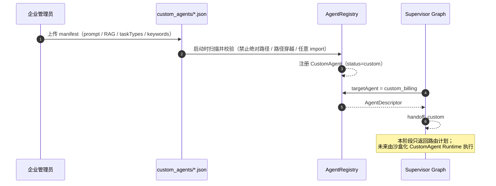

# 05. Supervisor 总调度与 Sub-Agents 专家协同

> 状态：v1.0（M2.5 Supervisor 路由 / 注册中心已实现）
> 日期：2026-11-05
> 项目：vibe-platform
> 前置：`02.整体架构设计.md`、`04.M2_Agent_ToolCalling_SSE_HITL.md`
> 范围：顶层意图路由、Sub-Graph 解耦、AgentRegistry、CustomAgent 扩展槽、内部与 BFF API

---

## 1. 目标与边界

### 1.1 本阶段目标

平台从“单入口单 Agent”升级为 **Supervisor 总调度 + Sub-Agents 专家协同**：

1. 新增顶层 `Supervisor Graph`，只做意图识别、Agent 选择与 Handoff，
   **不写代码、不改共享业务 State**。
2. 保持既有 `AgentGraphRunner`（局部 UI 修改）与
   `ArchitectGraphRunner`（全局架构澄清）为完全独立的子图，不改其状态机、
   事件命名空间与 HITL 语义。
3. 新增 `AgentRegistry`：所有内置 / 预留 / 自定义 Agent 必须注册并声明能力；
   Supervisor 只通过注册中心解析目标。
4. 新增 `CustomAgent` 扩展槽：企业可通过 Manifest 声明 Prompt、RAG 知识库、
   可处理任务与关键词，不需要修改 Supervisor 代码。
5. 提供 `route` 与 `dispatch` 两段能力：
   - `route`：返回路由决策与 Handoff 计划，不启动子图；
   - `dispatch`：按 Handoff 计划真正启动已有子图，返回子 Run 的 Run ID 与
     SSE 订阅路径。

### 1.2 非目标

- 本阶段不让 Supervisor 直接生成后端 / 数据库 / 脚本代码；`BackendCoder`、
  `ScriptAgent` 只以预留能力注册，后续接入。
- 不把两个子图的 SSE 合并成单一混合事件流。每个子 Run 保持独立事件命名空间，
  前端按 `dispatches[].streamPath` 分别订阅。
- 不引入跨进程 Agent 市场、任意 Python 模块动态 import 或代码热执行。
  CustomAgent 只加载受限 JSON Manifest；Prompt / RAG 内容作为未来运行时输入。
- `both` 当前采用“Architect 与 UI 同时启动”的 MVP 语义；契约确认后再放行
  UI 修改的强门控作为后续阶段。

### 1.3 核心不变式

1. **Supervisor 不写代码**：它只写路由决策与 Handoff 元数据。
2. **子图自治**：UI Graph 与 Architect Graph 的请求、事件、checkpoint、
   暂停 / 恢复协议保持原样。
3. **能力先注册**：Supervisor 不得路由到未注册或 `reserved` 的 Agent。
4. **显式优先**：`targetAgent`、`scopeHint` 等显式意图优先于关键词规则。
5. **自定义 Agent 不执行代码**：Manifest 只描述能力；未来由沙盒化运行时执行。

---

## 2. 总-分拓扑



**分层职责**：

| 层 | 职责 | 不做什么 |
|---|---|---|
| Java BFF | 公开 API、鉴权、透传、超时与错误映射 | 不解析意图、不启动子图 |
| Supervisor Graph | 分类、注册中心解析、Handoff 计划 | 不写代码、不改子图 State |
| AgentRegistry | 能力目录、可用性、版本、关键词、Manifest 加载 | 不执行 Agent |
| Sub-Graph | 各自的状态机、事件流、HITL、沙盒执行 | 不感知其它子图 |

---

## 3. Supervisor 状态机


`SupervisorState` 是**轻量路由状态**，不进入任何子图 checkpoint：

| 字段 | 说明 |
|---|---|
| `request` | 统一请求（项目、自然语言、标注、源码、选项） |
| `prediction` | `taskType / target / confidence / reason / signals` |
| `decision` | 对外路由决策（目标列表、可派发性、缺失上下文） |
| `handoffs` | 有序 Handoff 计划（Agent、子图、SSE 路径模板） |
| `status` | `ROUTED` / `REJECTED` / `FAILED` |
| `error` | 路由失败原因 |

### 3.1 意图分类规则（当前实现）

| 优先级 | 条件 | 路由 | 置信度 |
|---|---|---|---|
| 1 | `options.targetAgent` 指向已注册可用 Agent | 该 Agent（含 CustomAgent） | 0.99 |
| 2 | `options.scopeHint = ui / architect / both` | 显式目标 | 0.97 |
| 3 | 同时命中 UI 关键词与架构关键词 | `both` | 0.88 |
| 4 | 仅命中架构关键词 | `architect_graph` | 0.90 |
| 5 | 有标注 + UI 关键词 | `ui_graph` | 0.92 |
| 6 | 仅有标注 | `ui_graph` | 0.84 |
| 7 | 仅 UI 关键词、缺少标注 | `ui_graph`，`dispatchable=false` | 0.72 |
| 8 | 无有效信号 | `none` / `rejected` | ≤ 0.30 |

**UI 关键词**：按钮、样式、颜色、间距、字体、文案、布局、动画、组件、
页面、弹窗、对齐、字号、圈选、改一下、局部等。

**架构关键词**：全栈、架构、后端、前端框架、数据库、表结构、接口、API、
服务端、技术栈、部署、Spring、FastAPI、MySQL、Redis、DDL、迁移等。

> 规则分类器实现为 `IntentClassifier` 协议；后续接 LLM 时只替换分类器，
> 不修改注册中心、Handoff 计划或 API 契约。

---

## 4. 总-分调度时序图

### 4.1 仅路由（不启动子图）



### 4.2 派发（启动子图）



### 4.3 自定义 Agent 扩展时序



---

## 5. AgentRegistry

### 5.1 内置注册项

| `agentId` | 子图 | 能力 | 状态 | SSE |
|---|---|---|---|---|
| `ui_graph` | `AgentGraphRunner` | `ui_local_edit` | `available` | `/api/v1/runs/{runId}/events/stream` |
| `architect_graph` | `ArchitectGraphRunner` | `global_architecture` | `available` | `/api/v1/architect/runs/{runId}/events/stream` |
| `backend_coder` | 未接入 | `backend_generation` | `reserved` | — |
| `script_agent` | 未接入 | `script_automation` | `reserved` | — |

**保留项不可路由**：`reserved` 只用于能力占位和未来 UI 展示，Supervisor
遇到显式 `targetAgent=backend_coder` 会返回 `AGENT_NOT_AVAILABLE`。

### 5.2 AgentDescriptor

```json
{
  "agentId": "architect_graph",
  "displayName": "全局架构师",
  "graph": "ArchitectGraphRunner",
  "description": "全局架构澄清、应用形态判别与全栈实施契约",
  "taskTypes": ["global_architecture"],
  "status": "available",
  "source": "builtin",
  "version": "1.0.0",
  "streamPathTemplate": "/api/v1/architect/runs/{runId}/events/stream",
  "keywords": ["全栈", "架构", "数据库"]
}
```

### 5.3 CustomAgent Manifest

目录由 `SUPERVISOR_CUSTOM_AGENTS_DIR` 指定，默认 `config/custom_agents`。
只扫描 `*.json`，单文件 ≤ 256 KB；**不执行任何代码**。

```json
{
  "agentId": "custom_billing",
  "displayName": "企业计费专家",
  "description": "基于企业私有计费规则的知识库问答与方案生成",
  "version": "1.0.0",
  "taskTypes": ["enterprise_billing"],
  "keywords": ["计费", "账单", "结算"],
  "systemPromptFile": "prompts/billing.md",
  "ragKnowledgeDir": "knowledge/billing",
  "enabled": true,
  "metadata": {
    "tenantId": "tenant_demo",
    "owner": "finance-team"
  }
}
```

**安全约束**：

- `agentId` 仅允许小写字母、数字、`_`、`-`；
- `systemPromptFile` / `ragKnowledgeDir` 必须是 Manifest 目录内相对路径，
  拒绝绝对路径与 `..`；
- 重复 `agentId` 不允许覆盖内置 Agent；
- Manifest 错误只记录 warning，不阻断 AI Core 启动；
- `CustomAgent` 运行时协议（`handle(task, context) -> AgentResult`）已预留，
  但本阶段不执行。

---

## 6. API 契约

### 6.1 Python 内部 API

前缀：`/api/v1/internal/supervisor`

| 方法 | 路径 | 用途 |
|---|---|---|
| `POST` | `/route` | 返回路由决策与 Handoff 计划 |
| `POST` | `/dispatch` | 启动目标子图，返回子 Run ID 与 SSE 路径，HTTP 202 |
| `GET` | `/agents` | 列出注册中心中的全部 Agent |
| `POST` | `/agents/reload` | 重新扫描 CustomAgent Manifest |

### 6.2 Java BFF 公开 API

前缀：`/api/v1/supervisor`

| 方法 | 路径 | 用途 |
|---|---|---|
| `POST` | `/route` | 透传路由 |
| `POST` | `/dispatch` | 透传派发 |
| `GET` | `/agents` | 透传注册中心 |
| `POST` | `/agents/reload` | 透传重载 |

### 6.3 统一请求

```json
{
  "projectId": "project_123",
  "projectName": "待办应用",
  "message": "把按钮改成蓝色，同时帮我规划全栈后端和数据库",
  "annotations": [],
  "sandboxId": "sbx_xxx",
  "files": {},
  "source": {
    "sandboxId": "sbx_xxx",
    "files": {}
  },
  "uiHistory": [],
  "options": {
    "scopeHint": "auto",
    "targetAgent": null,
    "ui": {},
    "architect": {}
  }
}
```

- `annotations` 最多 3 个；派发 UI Graph 时必填。
- `source` 用于 Architect Graph；`sandboxId` 同时作为 UI Run 的复用沙盒。
- `options.ui` 与 `options.architect` 分别透传给两个子图，避免两个子图的
  选项互相污染。

### 6.4 路由响应

```json
{
  "traceId": "sup_xxx",
  "projectId": "project_123",
  "decision": {
    "taskType": "combined",
    "target": "both",
    "targets": ["architect_graph", "ui_graph"],
    "confidence": 0.88,
    "reason": "同时命中全局架构与局部 UI 信号",
    "signals": ["arch:全栈", "arch:数据库", "ui:按钮"],
    "dispatchable": true,
    "missingInputs": []
  },
  "handoffs": [
    {
      "agentId": "architect_graph",
      "displayName": "全局架构师",
      "graph": "ArchitectGraphRunner",
      "order": 1,
      "streamPathTemplate": "/api/v1/architect/runs/{runId}/events/stream"
    },
    {
      "agentId": "ui_graph",
      "displayName": "局部 UI 工程师",
      "graph": "AgentGraphRunner",
      "order": 2,
      "streamPathTemplate": "/api/v1/runs/{runId}/events/stream"
    }
  ],
  "registryVersion": "1"
}
```

### 6.5 派发响应

```json
{
  "traceId": "sup_xxx",
  "decision": { "...": "同上" },
  "dispatches": [
    {
      "agentId": "architect_graph",
      "runId": "arc_xxx",
      "streamPath": "/api/v1/architect/runs/arc_xxx/events/stream",
      "order": 1,
      "status": "STARTED"
    }
  ],
  "startedAt": "2026-11-05T12:00:00Z"
}
```

### 6.6 错误码

| HTTP | `code` | 场景 |
|---|---|---|
| 404 | `AGENT_NOT_FOUND` | `targetAgent` 未注册 |
| 409 | `AGENT_NOT_AVAILABLE` | 目标为 `reserved` 或未启用 |
| 422 | `SUPERVISOR_UI_CONTEXT_REQUIRED` | 派发 UI 但缺少标注 |
| 422 | `SUPERVISOR_NOT_DISPATCHABLE` | 路由状态不可派发 |
| 503 | `SUPERVISOR_DISPATCH_FAILED` | 子图启动失败 |

---

## 7. 与现有链路的关系

| 现有能力 | 变化 |
|---|---|
| `POST /api/v1/runs/stream` | 不变，仍可直接调用 |
| `Architect /runs/stream` | 不变，仍可直接调用 |
| UI Graph 状态机 | 不变 |
| Architect Graph 状态机 | 不变 |
| Supervisor | 新增独立顶层入口，不侵入两个子图 |

**前端迁移路径**：

1. 第一阶段：现有按钮与 Architect 面板保持不变；
2. 第二阶段：工作台输入框先调 `/supervisor/route` 展示路由建议；
3. 第三阶段：用户确认后调 `/supervisor/dispatch`，按 `dispatches[]` 分别
   打开 UI 时间轴或 Architect 面板；
4. 未来：CustomAgent Runtime 接入后，Supervisor 可调度企业专属 Agent。

---

## 8. 验收

- `route` 能把 UI、Architect、both、custom、rejected 五类请求正确分类；
- 显式 `targetAgent` / `scopeHint` 优先于关键词；
- 注册中心能列出内置、预留与 Manifest 加载的 CustomAgent；
- `dispatch` 能启动真实 Architect 子图并返回可订阅 SSE 路径；
- UI 缺少标注时拒绝派发，不创建空沙盒；
- 原有 UI / Architect 单元测试、API E2E、浏览器 E2E 全部保持通过。
