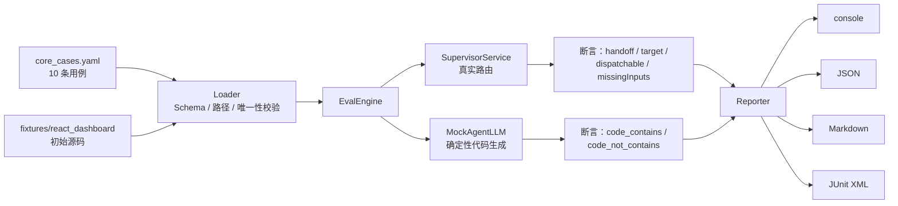

# 07. 自动化评测（Eval Suite）

> 状态：v0.1（CLI 离线跑批已落地）
> 日期：2026-11-05
> 项目：vibe-platform
> 范围：评测集契约、离线执行器、断言与报告、CI 接入

---

## 1. 目标与边界

### 1.1 目标

系统从“人工点击各 Agent”升级为**可重复、可回归、可量化**的自动化评测：

1. 用 YAML 声明评测用例，覆盖 UI 修改、Architect 全栈设计、both 双阶段、
   CustomAgent 路由与负向守卫；
2. 在秒级内完成跑批，不依赖前端、不创建业务沙盒、不需要模型密钥；
3. 每次失败必须定位到“哪条用例、哪个断言、期望值、实际值”；
4. 输出 JSON / Markdown / JUnit，可直接接入 CI 与后续评测看板；
5. 评测集与执行引擎解耦，未来可替换为 HTTP / 真模型 / 沙盒引擎而不改用例。

### 1.2 非目标

- 本阶段不评测真实 Docker 沙盒构建、`npm run build`、Git checkpoint；
  这些继续由既有 E2E 脚本覆盖。
- 本阶段不做模型训练、微调或 LLM-as-Judge；断言全部是确定性的结构化比较。
- 本阶段不接入前端页面；入口只有 CLI。
- 不自动修改 Prompt 或发布；评测只产出结果，决策仍由人工完成。

---

## 2. 总体架构



关键点：

- **路由用真实实现**：`SupervisorService` + `AgentRegistry` + Manifest，
  不是复制一份规则表；Manifest 改动会立即被评测发现。
- **代码生成用 Mock**：`MockAgentLLM(scenario="none")` 把自然语言指令映射为
  确定性代码修改；同一输入永远得到同一输出，适合做回归基线。
- **无副作用**：不启动 FastAPI、不调用 Sandbox、不读写数据库；只读 fixture。

---

## 3. 评测集契约

### 3.1 文件布局

```text
config/eval_suite/
├── core_cases.yaml
├── fixtures/
│   └── react_dashboard/src/App.jsx
└── README.md
```

### 3.2 用例结构

```yaml
- id: "case_001"
  name: "UI 修改：将按钮变红"
  tags: ["ui", "style", "smoke"]
  input:
    target_agent: "auto"
    fixture: "react_dashboard"
    text: "改成红色"
    annotation:
      annotationId: "ann_eval_001"
      type: "note"
      action: "MODIFY"
      target:
        mode: "source"
        selector: "[data-source='primary-action']"
        source:
          file: "src/App.jsx"
          component: "PrimaryButton"
      payload:
        text: "改成红色"
  assertions:
    expected_handoff: "handoff_ui"
    expected_agent: "ui_graph"
    expected_task_type: "ui_local_edit"
    expected_dispatchable: true
    expected_handoffs: ["ui_graph"]
    expected_code_contains: ["background-color:red"]
```

### 3.3 输入字段

| 字段 | 必填 | 语义 |
|---|---|---|
| `input.target_agent` | 否 | `auto` 交给 Supervisor；其他值写入 `options.targetAgent` |
| `input.text` | 否 | 用户自然语言，写入 `SupervisorRequest.message` |
| `input.annotation` | 否 | 单个 `AnnotationEnvelope`，与 `annotations` 互斥 |
| `input.annotations` | 否 | 1–3 个标注；多标注用于批量修改回归 |
| `input.fixture` | 否 | fixture 目录名；有代码断言时必填 |
| `input.project_id` | 否 | 默认 `eval_<case_id>` |

单标注且 `payload.text` 为空时，Loader 自动把 `input.text` 注入，减少重复。

### 3.4 断言字段

| 字段 | 语义 |
|---|---|
| `expected_handoff` | 必填；五类 Handoff 之一 |
| `expected_agent` | `decision.target` 精确匹配 |
| `expected_task_type` | `decision.taskType` 精确匹配 |
| `expected_dispatchable` | 布尔值精确匹配 |
| `expected_handoffs` | `handoffs[].agentId` 列表**完全一致（含顺序）** |
| `expected_missing_inputs` | 实际值必须包含全部期望项；期望为空时要求实际为空 |
| `expected_code_contains` | Mock 生成代码必须包含的片段；每条独立检查 |
| `expected_code_not_contains` | 生成代码不得包含的片段 |
| `max_duration_ms` | 单用例耗时上限，超出即失败 |

Loader 严格拒绝未知字段、重复 ID、绝对路径 / `..` 的 fixture，防止拼写错误
静默通过。

---

## 4. 执行流程

```text
for case in suite:
  1. 读取 fixture → files
  2. 构造 SupervisorRequest（mock 选项、clarificationMode=off）
  3. SupervisorService.route(request)
  4. 断言 decision / handoffs
  5. 若声明代码断言：
       MockAgentLLM.plan → generate → 合并 files
       断言 code_contains / code_not_contains
  6. 记录耗时、检查项、异常
汇总 → 控制台 / JSON / Markdown / JUnit
```

### 4.1 为什么用 `route` 而不是 `dispatch`

`dispatch` 会真正启动子图 / 沙盒，属于端到端测试；本阶段评测关注**路由契约与
生成结果**，`route` 已覆盖全部决策字段且无副作用。未来可增加
`--engine dispatch` 模式复用同一套断言。

### 4.2 Mock 代码生成的可靠边界

MockAgentLLM 支持属性映射：颜色、文案、字号 / 缩放、ADD 组件。评测用例只
使用这些确定性能力，不写“任意布局”类断言；这类需求由 DeepSeek E2E 覆盖。
若 Mock Planner 判定信息不足并要求澄清，评测直接失败并报告 `mock_plan`，
避免把“没生成代码”误判为通过。

---

## 5. CLI 与报告

```bash
./scripts/eval_suite.sh run
./scripts/eval_suite.sh run --filter architect --fail-fast
./scripts/eval_suite.sh run --tag smoke --min-pass-rate 0.95
./scripts/eval_suite.sh list
./scripts/eval_suite.sh validate
```

`scripts/eval_suite.sh` 复用 `vibe-platform/python-ai:dev` 镜像，以一次性容器
执行，不启动 MySQL / Redis / MinIO，也不创建业务沙盒。挂载方式：

- `services/orchestrator` → `/app`（只读）
- `config` → `/config`（只读）
- `reports` → `/reports`（可写）

报告默认写入 `reports/eval/`：

| 文件 | 用途 |
|---|---|
| `eval-report.json` | 机器可读；后续趋势看板 / 回归对比 |
| `eval-report.md` | 人读摘要与失败明细 |
| `eval-junit.xml` | CI 测试报告 |

退出码：`0` 全绿；`1` 断言失败或低于阈值；`2` 配置 / 环境错误。

---

## 6. 核心评测集覆盖

| ID | 场景 | 关键断言 |
|---|---|---|
| `case_001` | UI 按钮改红 | `handoff_ui` + `background-color:red` |
| `case_002` | UI 标题文案替换 | `handoff_ui` + `欢迎回来` |
| `case_003` | UI 卡片放大 | `handoff_ui` + `transform:scale(2)` |
| `case_004` | UI 新增红色按钮 | `handoff_ui` + `backgroundColor: 'red'` + 标签 |
| `case_005` | 双标注批量修改 | 颜色与文案同时出现 |
| `case_006` | Architect 全栈设计 | `handoff_architect` + `architect_graph` |
| `case_007` | both 双阶段 | `handoff_both` + 顺序 `architect → ui` |
| `case_008` | CustomAgent 报表 | `handoff_custom` + `customAgentRuntime` |
| `case_009` | 缺标注守卫 | `handoff_ui` 但 `dispatchable=false` |
| `case_010` | 未知意图兜底 | `rejected` + `none` |

---

## 7. CI 接入

```yaml
# 示例：GitLab CI / GitHub Actions 均可复用
eval-suite:
  script:
    - ./scripts/eval_suite.sh run
  artifacts:
    when: always
    paths:
      - reports/eval/
    reports:
      junit: reports/eval/eval-junit.xml
```

建议门禁：

1. 每个 PR 跑 `run --tag smoke`，必须 100% 通过；
2. 合并到主分支跑全量，通过率不得低于基线；
3. 新增线上缺陷时先补一条用例，修复后全绿再合并。

---

## 8. 演进路线

1. **HTTP 引擎**：`--engine http` 走 BFF / AI Core，验证真实 SSE 与 HITL；
2. **DeepSeek 引擎**：允许非确定性输出，但用结构化断言 + 多次采样统计；
3. **沙盒引擎**：真实构建、预览、Git checkpoint 与回滚；
4. **基线对比**：记录历史耗时 / 通过率，检测回归与性能漂移；
5. **Prompt A/B**：与 M3.3 Prompt Registry 联动，按版本跑同一评测集；
6. **评测看板**：复用 M3.1 Admin Console 的数据聚合与 RBAC。
