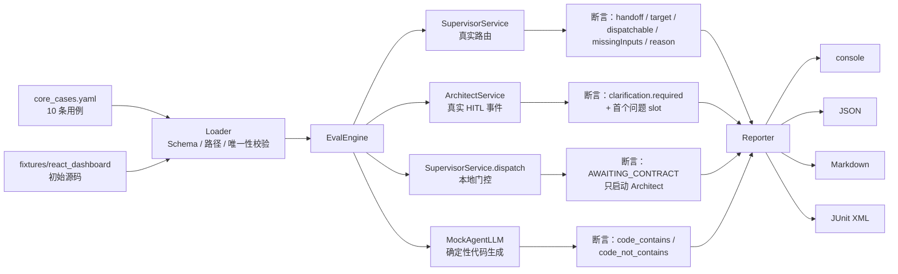
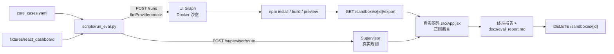

# 07. 自动化评测（Eval Suite）

> 状态：v0.3（离线 + 真实沙盒双引擎；安全策略、HITL、both 门控已纳入回归）
> 日期：2026-11-05
> 项目：vibe-platform
> 范围：评测集契约、离线 / 真实沙盒执行器、断言与报告、CI 接入、
> Eval / Knowledge 解耦、Admin 评测入口预留

---

## 1. 目标与边界

### 1.1 目标

系统从“人工点击各 Agent”升级为**可重复、可回归、可量化**的自动化评测：

1. 用 YAML 声明评测用例，覆盖 UI 修改、Architect HITL、both 门控、
   安全策略拦截、CustomAgent 路由与负向守卫；
2. 提供两种引擎：**离线引擎**秒级验证路由契约与 Mock 生成结果，
   **真实沙盒引擎**验证 Docker 构建、源码落盘与预览链路；
3. 每次失败必须定位到“哪条用例、哪个断言、期望值、实际值”；
4. 输出 JSON / Markdown / JUnit / `docs/eval_report.md`，可直接接入 CI
   与后续评测看板；
5. 评测集与执行引擎解耦，未来可替换为真模型 / 管理中台引擎而不改用例；
6. 评测集与 RAG 知识库解耦：**评测集是“考题”，知识库是“教材”**。

### 1.2 非目标

- 本阶段不评测真实模型质量：真实沙盒引擎仍使用 `llmProvider=mock`，
  只验证“路由 + 沙盒执行 + 代码落盘”链路；DeepSeek 评测后续单独引入。
- 本阶段不做模型训练、微调或 LLM-as-Judge；断言全部是确定性的结构化比较。
- 本阶段不接入前端评测页面；管理中台一键评测与历史得分曲线为契约预留。
- 不自动修改 Prompt 或发布；评测只产出结果，决策仍由人工完成。

### 1.3 与 Knowledge 的边界：考题 vs 教材

| 维度 | Eval Suite（考题） | Knowledge Service（教材） |
|---|---|---|
| 内容 | 问题、输入、期望路由 / 代码片段 | 文档、Chunk、向量、引用 |
| 版本 | `suiteVersion` + Git 提交，评测时 pin 住 | 知识库版本 + 索引版本，检索时 pin 住 |
| 写入 | 人工评审后随代码提交 | 文档摄取流水线写入 |
| 读取 | 评测引擎、CI、管理中台 | Architect / Agent 的 RAG 检索 |
| 可变性 | 低；变更即基线变化，必须评审 | 高；可运营、可重建、可下线 |
| 失败含义 | 系统行为偏离预期 | 检索依据不足或过期 |

**硬约束**：

1. 评测用例、fixture、期望答案**不得**写入知识库，也不得被当作 RAG 语料；
   否则模型会“背答案”，评测失去判别力。
2. 知识库内容变化**不得**改变同一 `suiteVersion` 的通过标准；涉及知识库的
   评测必须在结果中记录 `knowledgeSnapshotId` / 索引版本。
3. 评测报告只保存结果与引用 ID，不复制知识库正文；跨租户评测数据隔离。
4. 管理台展示时，评测得分曲线与知识库运营指标分栏展示，不混为一个“质量分”。

---

## 2. 总体架构



关键点：

- **路由用真实实现**：`SupervisorService` + `AgentRegistry` + Manifest，
  不是复制一份规则表；Manifest 改动会立即被评测发现。
- **代码生成用 Mock**：`MockAgentLLM(scenario="none")` 把自然语言指令映射为
  确定性代码修改；同一输入永远得到同一输出，适合做回归基线。
- **离线引擎无副作用**：不启动 FastAPI、不调用 Sandbox、不读写数据库；只读 fixture。

**真实沙盒引擎（v0.2）**：



- **真实执行**：经过 BFF / AI Core HTTP 契约、UI 子图、Docker 沙盒、
  `npm run build` 与预览启动，覆盖离线引擎无法发现的落盘 / 构建问题。
- **源码读取**：通过沙盒导出接口读取 **真实源文件**，而不是 Vite 转换后的
  模块；导出失败时回退到 Run 响应的 `generatedFiles` / `generatedPatch`，
  并在报告中明确标注来源。
- **线程隔离**：每条用例注入全新 `threadId`，避免固定 `annotationId` 命中
  历史会话快照，导致同一修改在上一轮结果上叠加。
- **资源清理**：`finally` 中删除沙盒；每条用例独立项目 ID，失败不阻断后续。

---

## 3. 评测集契约

### 3.1 文件布局

```text
config/eval_suite/
├── core_cases.yaml
├── fixtures/
│   └── react_dashboard/src/App.jsx
└── README.md
```

### 3.2 用例结构

```yaml
- id: "case_001"
  name: "UI 修改：将按钮变红"
  tags: ["ui", "style", "smoke"]
  input:
    target_agent: "auto"
    fixture: "react_dashboard"
    text: "改成红色"
    annotation:
      annotationId: "ann_eval_001"
      type: "note"
      action: "MODIFY"
      target:
        mode: "source"
        selector: "[data-source='primary-action']"
        source:
          file: "src/App.jsx"
          component: "PrimaryButton"
      payload:
        text: "改成红色"
  assertions:
    expected_handoff: "handoff_ui"
    expected_agent: "ui_graph"
    expected_task_type: "ui_local_edit"
    expected_dispatchable: true
    expected_handoffs: ["ui_graph"]
    expected_code_contains: ["background-color:red"]
```

### 3.3 输入字段

| 字段 | 必填 | 语义 |
|---|---|---|
| `input.target_agent` | 否 | `auto` 交给 Supervisor；其他值写入 `options.targetAgent` |
| `input.text` | 否 | 用户自然语言，写入 `SupervisorRequest.message` |
| `input.annotation` | 否 | 单个 `AnnotationEnvelope`，与 `annotations` 互斥 |
| `input.annotations` | 否 | 1–3 个标注；多标注用于批量修改回归 |
| `input.fixture` | 否 | fixture 目录名；有代码断言时必填 |
| `input.project_id` | 否 | 默认 `eval_<case_id>` |

单标注且 `payload.text` 为空时，Loader 自动把 `input.text` 注入，减少重复。

### 3.4 断言字段

| 字段 | 语义 |
|---|---|
| `expected_handoff` | 必填；五类 Handoff 之一 |
| `expected_agent` | `decision.target` 精确匹配 |
| `expected_task_type` | `decision.taskType` 精确匹配 |
| `expected_dispatchable` | 布尔值精确匹配 |
| `expected_handoffs` | `handoffs[].agentId` 列表**完全一致（含顺序）** |
| `expected_missing_inputs` | 实际值必须包含全部期望项；期望为空时要求实际为空 |
| `expected_code_contains` | Mock 生成代码必须包含的片段；每条独立检查 |
| `expected_code_not_contains` | 生成代码不得包含的片段 |
| `expected_reason_contains` | `decision.reason` 必须包含全部关键词；用于区分“策略拦截”与“未知意图拒绝” |
| `expected_hitl` | 期望的 Architect 暂停事件，如 `architect.clarification.required` |
| `expected_hitl_slot` | 首个澄清问题的 `slot`；必须与 `expected_hitl` 同时声明 |
| `expected_gate_status` | both 派发后门控状态，如 `AWAITING_CONTRACT` |
| `max_duration_ms` | 单用例耗时上限，超出即失败 |

Loader 严格拒绝未知字段、重复 ID、绝对路径 / `..` 的 fixture，防止拼写错误
静默通过。

---

## 4. 执行流程

```text
for case in suite:
  1. 读取 fixture → files
  2. 构造 SupervisorRequest（mock 选项、clarificationMode=off）
  3. SupervisorService.route(request)
  4. 断言 decision / handoffs / reason
  5. 若声明 HITL：
       ArchitectService.start_stream → 轮询事件缓冲
       断言 clarification.required + 首个问题 slot → cancel
  6. 若声明门控：
       本地 GateRegistry + 桩 Dispatcher 执行 dispatch
       断言 AWAITING_CONTRACT 且只启动 architect_graph
  7. 若声明代码断言：
       MockAgentLLM.plan → generate → 合并 files
       断言 code_contains / code_not_contains
  8. 记录耗时、检查项、异常
汇总 → 控制台 / JSON / Markdown / JUnit
```

### 4.1 为什么用 `route` 而不是 `dispatch`

`dispatch` 会真正启动子图 / 沙盒，属于端到端测试；离线引擎关注**路由契约与
Mock 生成结果**，`route` 已覆盖全部决策字段且无副作用。真实沙盒需求由
`scripts/run_eval.py` 独立执行：路由仍走 `route`，代码用例再调用 UI 子图
`/runs`，两套断言共用同一份 YAML。

唯一例外是声明了 `expected_gate_status` 的 both 用例：离线引擎用**本地
GateRegistry + 桩 Dispatcher** 调用真实 `SupervisorService.dispatch`，只验证
门控编排契约（只启动 Architect、UI 被锁住），不创建任何真实子图或沙盒。
HITL 用例则直接使用生产 `ArchitectService` + Mock LLM，观察真实事件缓冲。

### 4.2 Mock 代码生成的可靠边界

MockAgentLLM 支持属性映射：颜色、文案、字号 / 缩放、ADD 组件。评测用例只
使用这些确定性能力，不写“任意布局”类断言；这类需求由 DeepSeek E2E 覆盖。
若 Mock Planner 判定信息不足并要求澄清，评测直接失败并报告 `mock_plan`，
避免把“没生成代码”误判为通过。

### 4.3 真实沙盒引擎的断言语义

```text
for case in suite:
  1. 生成独立 projectId + threadId
  2. POST /supervisor/route       → handoff / target / taskType / handoffs / reason
  3. 若声明 HITL：
       POST /architect/runs/stream（SSE, mock）
       等待 architect.clarification.required，断言首个问题 slot
       finally: POST /architect/runs/{id}/cancel
  4. 若声明门控：
       POST /supervisor/dispatch
       断言 gate.status=AWAITING_CONTRACT 且 dispatches 只有 architect_graph
       finally: cancel gate.architectRunId
  5. 若无代码断言：结束
  6. POST /runs（mock, keepSandbox）
       → 等待 SUCCEEDED，记录 runId / sandboxId / verifyResult
  7. GET /sandboxes/{id}/export   → tar.gz 中读取 src/App.jsx
  8. 正则断言 code_contains / code_not_contains
  9. finally: DELETE /sandboxes/{id}
```

代码断言使用**空白不敏感的字面量正则**：除空白外全部 `re.escape`，
因此 `background-color:red` 与 `background-color: red` 等价，但不会把
期望片段误当成通配表达式。每条用例记录 `runStatus`、`verify.success`、
HITL / 门控证据、代码来源与失败断言，报告同时写入 `docs/eval_report.md`。

---

## 5. CLI 与报告

```bash
./scripts/eval_suite.sh run
./scripts/eval_suite.sh run --filter architect --fail-fast
./scripts/eval_suite.sh run --tag smoke --min-pass-rate 0.95
./scripts/eval_suite.sh list
./scripts/eval_suite.sh validate

# 真实沙盒引擎（宿主机直接运行，需 BFF / AI Core / Docker 已启动）
python scripts/run_eval.py
python scripts/run_eval.py --filter case_001 --verbose
python scripts/run_eval.py --keep-sandboxes          # 排查用，不自动清理
EVAL_BASE_URL=http://127.0.0.1:8100 python scripts/run_eval.py   # 直连 AI Core
```

`scripts/eval_suite.sh` 复用 `vibe-platform/python-ai:dev` 镜像，以一次性容器
执行，不启动 MySQL / Redis / MinIO，也不创建业务沙盒。挂载方式：

- `services/orchestrator` → `/app`（只读）
- `config` → `/config`（只读）
- `reports` → `/reports`（可写）

报告默认写入 `reports/eval/`：

| 文件 | 用途 |
|---|---|
| `eval-report.json` | 机器可读；后续趋势看板 / 回归对比 |
| `eval-report.md` | 人读摘要与失败明细 |
| `eval-junit.xml` | CI 测试报告 |

真实沙盒引擎默认写入 `docs/eval_report.md`，包含总览、逐用例 Handoff /
HITL / 门控 / Run 状态 / 耗时、失败断言明细、代码来源与沙盒清理统计；
终端同时输出成功数、失败数、通过率与总耗时。

退出码：`0` 全绿；`1` 断言失败或低于阈值；`2` 配置 / 环境错误。

---

## 6. 核心评测集覆盖

| ID | 场景 | 关键断言 |
|---|---|---|
| `case_001` | UI 按钮改红 | `handoff_ui` + `background-color:red` |
| `case_002` | UI 标题文案替换 | `handoff_ui` + `欢迎回来` |
| `case_003` | 安全拦截：数据库端口公网暴露 | `rejected` + `taskType=blocked` + reason 含 `安全策略` / `数据库端口` |
| `case_004` | UI 空白区域新增红色按钮 | `handoff_ui` + `backgroundColor: 'red'` + `>提交</button>` |
| `case_005` | 双标注批量修改 | 颜色与文案同时出现 |
| `case_006` | 模糊需求触发 Architect HITL | `handoff_architect` + `architect.clarification.required` + `app.shape` |
| `case_007` | both 双阶段门控 | `handoff_both` + dispatching 仅 Architect + `AWAITING_CONTRACT` |
| `case_008` | CustomAgent 报表 | `handoff_custom` + `customAgentRuntime` |
| `case_009` | 缺标注守卫 | `handoff_ui` 但 `dispatchable=false` |
| `case_010` | 未知意图兜底 | `rejected` + `none` |

---

## 7. CI 接入

```yaml
# 示例：GitLab CI / GitHub Actions 均可复用
eval-suite:
  script:
    - ./scripts/eval_suite.sh run
  artifacts:
    when: always
    paths:
      - reports/eval/
    reports:
      junit: reports/eval/eval-junit.xml
```

建议门禁：

1. 每个 PR 跑 `run --tag smoke`，必须 100% 通过；
2. 合并到主分支跑全量，通过率不得低于基线；
3. 新增线上缺陷时先补一条用例，修复后全绿再合并。

---

## 8. 演进路线

1. ~~**HTTP / 沙盒引擎**：走 BFF / AI Core，验证真实构建、预览与代码落盘~~
   （v0.2 已完成 `scripts/run_eval.py`）；
2. **DeepSeek 引擎**：允许非确定性输出，但用结构化断言 + 多次采样统计；
3. **基线对比**：记录历史耗时 / 通过率，检测回归与性能漂移；
4. **Prompt A/B**：与 M3.3 Prompt Registry 联动，按版本跑同一评测集；
5. **评测看板**：复用 M3.1 Admin Console 的数据聚合与 RBAC；
6. **管理中台一键评测**：`POST /api/v1/admin/eval/run` + 历史得分曲线（见 §9）。

---

## 9. 管理中台联动（契约预留）

评测入口最终收敛到管理中台，不在前端复制一套跑批逻辑：

- `POST /api/v1/admin/eval/run`：管理员选择 `suiteId` / `suiteVersion` /
  `engine` / 过滤条件，异步创建评测任务，返回 `202 + evalRunId`；
- `GET /api/v1/admin/eval/runs/{evalRunId}`：查询进度与逐用例结果；
- `GET /api/v1/admin/eval/trend`：按时间窗返回通过率曲线，支持按
  `suiteVersion`、`promptVersionId`、`engine` 分组，用于在中台展示
  “历史评测得分曲线”；
- 权限复用 `@IsAdmin`：触发与查看归 `platform_admin` / `tenant_admin`，
  `tenant_operator` 只读；所有触发写审计并携带 `reason`；
- 同一 `suiteId + suiteVersion` 同时只允许一个运行，重复触发返回
  `409 EVAL_RUN_ALREADY_RUNNING`，前端按钮置灰并展示当前进度。

完整请求 / 响应契约见 `docs/design/03.API接口设计.md` §14.4.2。当前里程碑
只冻结契约，不注册 BFF 路由；`scripts/run_eval.py` 仍是本地与 CI 的
执行入口。
